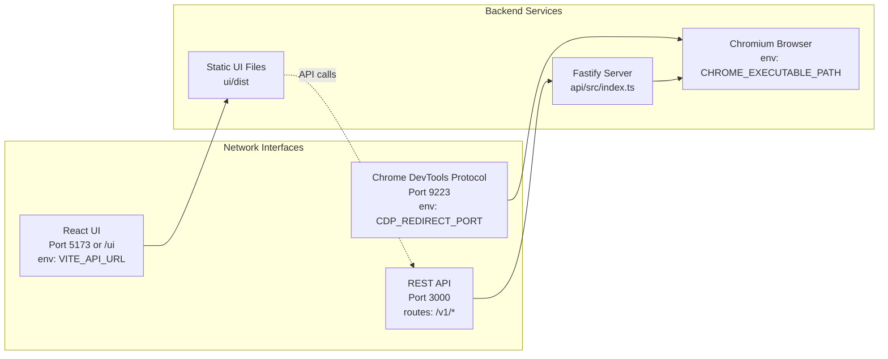
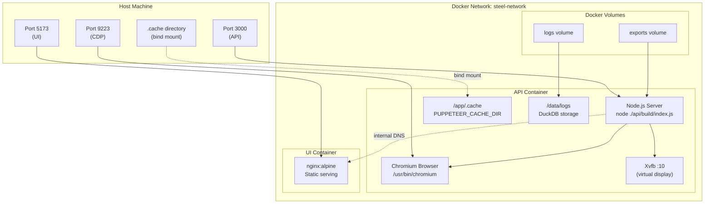
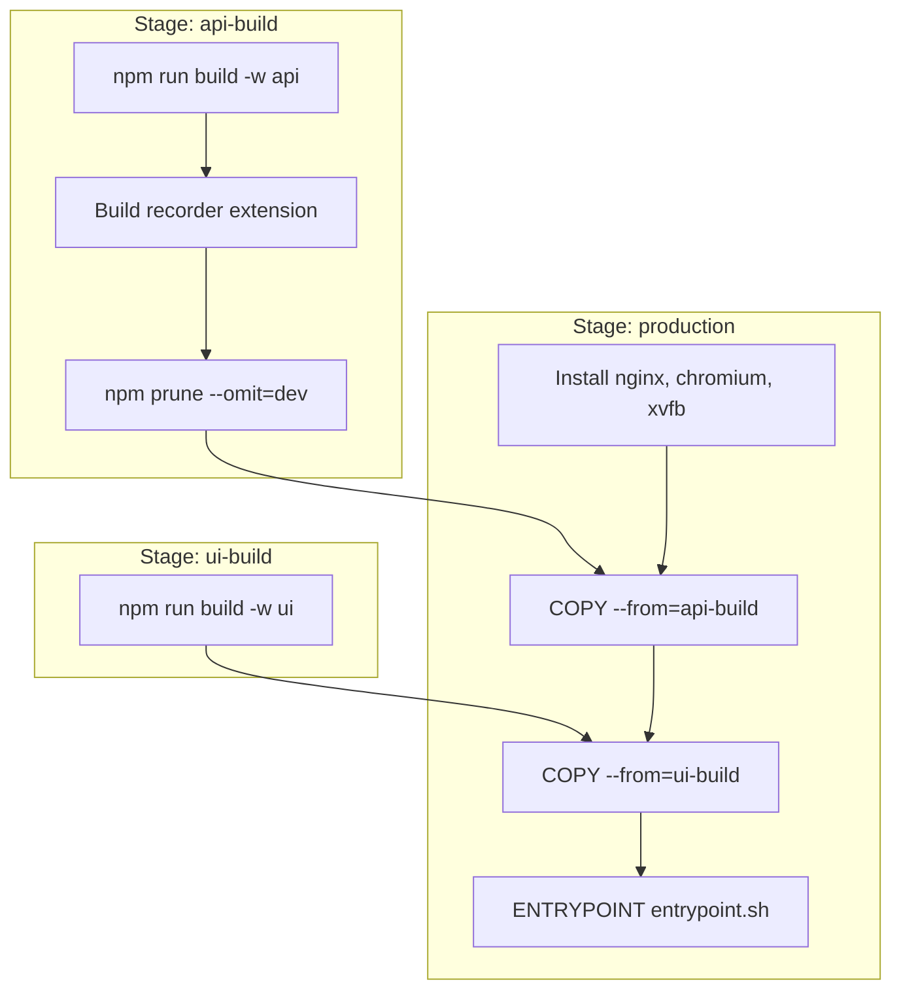

<!-- source: DeepWiki mcp.deepwiki.com · repo steel-dev/steel-browser · page 2 Getting Started · fetched 2026-10-27 -->

# Getting Started

<details>
<summary>Relevant source files</summary>

The following files were used as context for generating this wiki page:

- [Dockerfile](Dockerfile)
- [README.md](README.md)
- [api/Dockerfile](api/Dockerfile)
- [api/entrypoint.sh](api/entrypoint.sh)
- [docker-compose.dev.yml](docker-compose.dev.yml)
- [docker-compose.yml](docker-compose.yml)
- [images/star_img.png](images/star_img.png)
- [render.yaml](render.yaml)
- [ui/Dockerfile](ui/Dockerfile)

</details>


This document guides you through the initial setup and deployment of Steel Browser. It covers the available installation methods, basic configuration, and how to verify your installation is working correctly. 

For detailed environment configuration options, see [Environment Configuration](#2.2). For production deployment details, see [Docker Deployment](#2.3). For advanced deployment and operations topics, see [Deployment & Operations](#13).

## Installation Overview

Steel Browser supports multiple deployment methods depending on your requirements:

| Method | Best For | Complexity | Prerequisites |
|--------|----------|------------|---------------|
| **Pre-built Docker Image** | Quick testing, production | Low | Docker |
| **Docker Compose** | Development, self-hosted | Low | Docker Compose |
| **Local Node.js** | Development, debugging | Medium | Node.js 22+, Chrome/Chromium |
| **Cloud Platforms** | Production hosting | Low | Railway/Render account |
| **Steel Cloud** | Managed service | Very Low | Steel account |

The system exposes three network interfaces once deployed:



**Interface Details:**
- **REST API**: Fastify server with route handlers defined in `api/src/routes.ts`.
- **CDP Port**: Configured via `CDP_REDIRECT_PORT` environment variable, defaulting to 9223 [api/entrypoint.sh:109]().
- **UI Path**: Vite build output served at `/ui` (combined mode) or port 5173 (separate).

Sources: [README.md:70-155](), [api/entrypoint.sh:109](), [Dockerfile:33]()

## Installation Methods

### Pre-built Docker Image

The fastest deployment method uses the pre-built image from GitHub Container Registry:

```bash
docker run -p 3000:3000 -p 9223:9223 ghcr.io/steel-dev/steel-browser
```

This command pulls a combined container that includes the API, the UI, and the browser binaries.

| Component | Location | Description |
|-----------|----------|-------------|
| Fastify API | `node api/build/index.js` | Compiled TypeScript entrypoint [api/entrypoint.sh:124]() |
| Static UI | `/app/ui/dist` | React build artifacts [Dockerfile:115]() |
| Chromium | `/usr/bin/chromium` | Browser binary [Dockerfile:103]() |
| ChromeDriver | `/usr/bin/chromedriver` | Selenium WebDriver binary [Dockerfile:103]() |

**Default Environment:**
- `NODE_ENV=production` [Dockerfile:7]()
- `CDP_REDIRECT_PORT=9223` [api/entrypoint.sh:109]()
- `DISPLAY=:10` [Dockerfile:9]() (Xvfb virtual display)
- `PUPPETEER_CACHE_DIR=/app/.cache` [Dockerfile:8]()

Sources: [README.md:86-94](), [Dockerfile:1-126](), [api/entrypoint.sh:108-124]()

### Docker Compose (Separate Services)

For more control, run API and UI as separate services:

```bash
docker compose up
```

For Mac Silicon users:
```bash
DOCKER_DEFAULT_PLATFORM=linux/arm64 docker compose up
```

This starts the services as defined in `docker-compose.yml`:
- **API service**: Port 3000 [docker-compose.yml:5]()
- **UI service**: Port 5173 [docker-compose.yml:22]()
- **Volumes**: Persistent `logs` for DuckDB and `exports` for file management [docker-compose.yml:35-40]()



Sources: [docker-compose.yml:1-40](), [api/Dockerfile:1-110](), [ui/Dockerfile:1-30]()

### Local Node.js Development

For direct Node.js execution:

```bash
npm install
npm run dev
```

This starts the API server and the UI dev server via the root workspace [README.md:128-130]().

**Chrome Resolution:**
The system searches for Chrome in standard paths (e.g., `/usr/bin/google-chrome` on Linux or `/Applications/Google Chrome.app/...` on macOS) [README.md:136-145](). You can override this by setting `CHROME_EXECUTABLE_PATH` [README.md:151]().

Sources: [README.md:123-154]()

### Cloud Platform Deployment

#### Railway & Render
Steel provides 1-click deployment buttons and configuration files for cloud providers.
- **Railway**: Uses the combined `Dockerfile` [README.md:79]().
- **Render**: Configured via `render.yaml`, which specifies a 1GB persistent disk for caching [render.yaml:14-17]().

Sources: [README.md:76-80](), [render.yaml:1-18]()

## Verifying Installation

### 1. Check API Health
```bash
curl http://localhost:3000/v1/health
```
This endpoint is used by Render for health checks [render.yaml:6]().

### 2. Access OpenAPI Documentation
Navigate to `http://localhost:3000/documentation` to access the interactive Swagger/Scalar UI [README.md:60]().

### 3. Test Session Creation
```bash
curl -X POST http://localhost:3000/v1/sessions \
  -H "Content-Type: application/json" \
  -d '{"blockAds": true}'
```

## Container Build Process

The Docker image uses a multi-stage build [Dockerfile:1-126]() to produce a lean production image.



Sources: [Dockerfile:1-126](), [api/Dockerfile:1-110]()

## Container Initialization

The `entrypoint.sh` script orchestrates the startup of system dependencies before launching the Node.js application.

1. **DBus**: Initialized to support Chrome IPC [api/entrypoint.sh:12-31]().
2. **Chrome Verification**: Checks for `chromium` and `chromedriver` [api/entrypoint.sh:34-63]().
3. **Nginx**: Starts the reverse proxy unless `--no-nginx` is passed [api/entrypoint.sh:66-89]().
4. **Execution**: Replaces the shell with the Node.js process using `exec` to ensure proper signal handling [api/entrypoint.sh:124]().

Sources: [api/entrypoint.sh:1-127]()

## Next Steps

- **Configure Environment**: See [Environment Configuration](#2.2) for variable references.
- **Docker Deployment**: See [Docker Deployment](#2.3) for advanced container orchestration.
- **Usage**: Check the [Steel Cookbook](https://github.com/steel-dev/steel-cookbook) for API examples.

---

