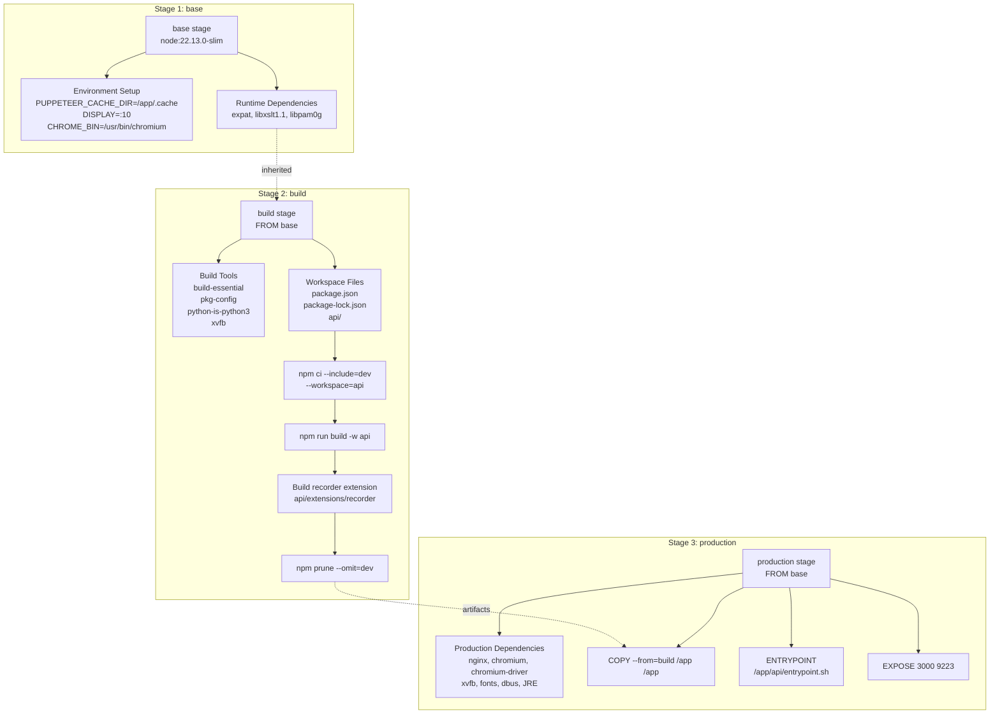
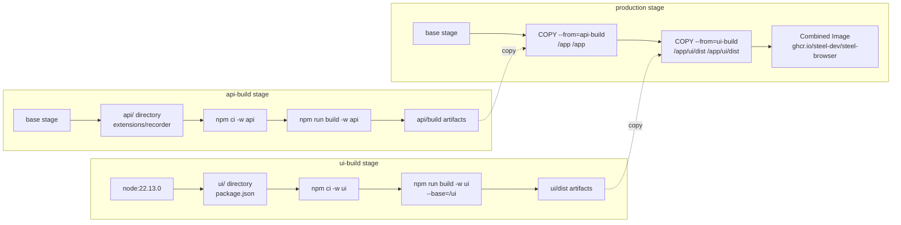
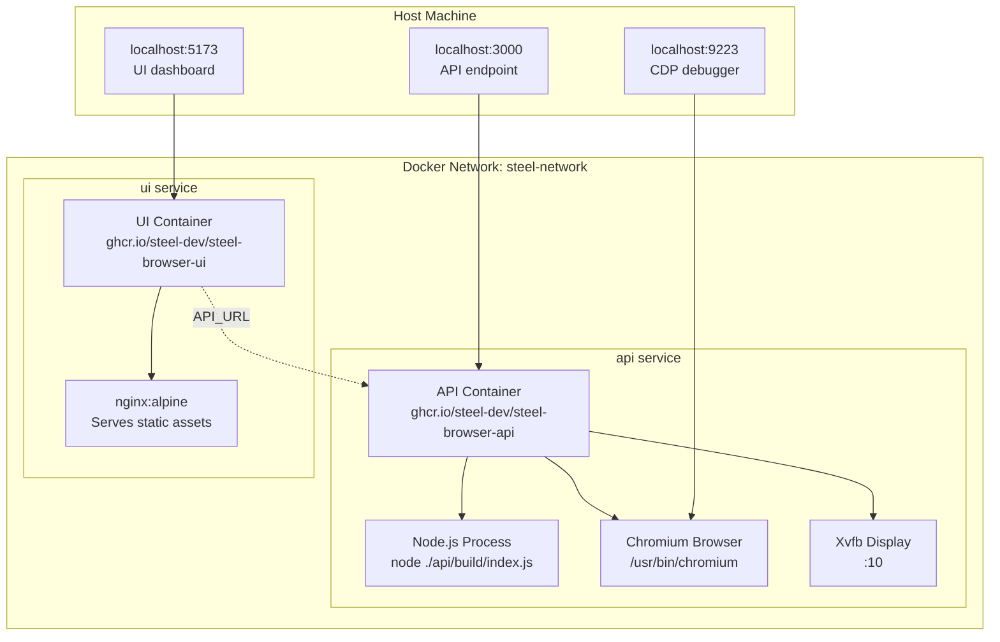
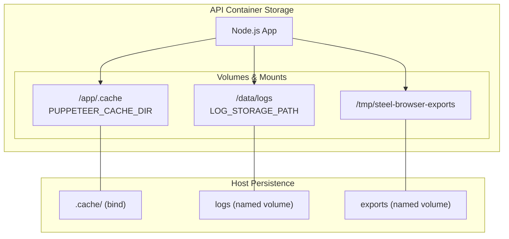
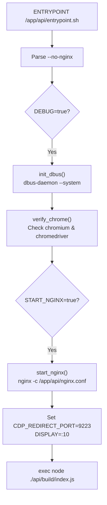

<!-- source: DeepWiki mcp.deepwiki.com · repo steel-dev/steel-browser · page 2.3 Docker Deployment · fetched 2026-10-27 -->

# Docker Deployment

<details>
<summary>Relevant source files</summary>

The following files were used as context for generating this wiki page:

- [.dockerignore](.dockerignore)
- [.github/workflows/check-build.yml](.github/workflows/check-build.yml)
- [Dockerfile](Dockerfile)
- [README.md](README.md)
- [api/.dockerignore](api/.dockerignore)
- [api/Dockerfile](api/Dockerfile)
- [api/entrypoint.sh](api/entrypoint.sh)
- [docker-compose.dev.yml](docker-compose.dev.yml)
- [docker-compose.yml](docker-compose.yml)
- [images/star_img.png](images/star_img.png)
- [render.yaml](render.yaml)
- [ui/Dockerfile](ui/Dockerfile)

</details>


## Purpose and Scope

This document covers the Docker deployment architecture for Steel Browser, including multi-stage build processes, container orchestration, volume strategies, network configuration, and initialization procedures. For general installation instructions, see [Installation](#2.1). For environment variable configuration, see [Environment Configuration](#2.2). For production operations and monitoring, see [Container Architecture](#13.1) and [Storage & Persistence](#13.2).

Steel Browser provides three deployment approaches via Docker:
1. **Combined API + UI image** - Single container with both services.
2. **Separate API and UI images** - Multi-container orchestration via Docker Compose.
3. **Development mode** - Build-from-source with live updates.

## Deployment Options

Steel Browser is distributed as pre-built Docker images via GitHub Container Registry:

| Image | Purpose | Base Image | Entry Point |
|-------|---------|------------|-------------|
| `ghcr.io/steel-dev/steel-browser` | Combined API + UI | `node:22.13.0` | `/app/api/entrypoint.sh` |
| `ghcr.io/steel-dev/steel-browser-api` | API service only | `node:22.13.0-slim` | `/app/api/entrypoint.sh` |
| `ghcr.io/steel-dev/steel-browser-ui` | UI service only | `nginx:alpine` | `/docker-entrypoint.sh` |

**Quick start commands:**

```bash
# Single container deployment (API + UI combined)
docker run -p 3000:3000 -p 9223:9223 ghcr.io/steel-dev/steel-browser

# Multi-container deployment (API + UI separate)
docker compose up

# Development mode (build from source)
docker compose -f docker-compose.dev.yml up --build
```

**Sources:** [README.md:84-106](), [docker-compose.yml:1-40](), [docker-compose.dev.yml:1-35]()

## Multi-Stage Build Architecture

Steel Browser uses Docker multi-stage builds to optimize image size and separate build-time from runtime dependencies.

### API Container Build Stages



The `base` stage establishes the foundation with minimal dependencies [api/Dockerfile:3-26](). The `build` stage inherits from `base` and adds build tools like `build-essential` and `xvfb` [api/Dockerfile:28-43](). It builds the API and the recorder extension [api/Dockerfile:52-56](). The `production` stage copies compiled artifacts and installs runtime tools like `chromium` and `chromium-driver` [api/Dockerfile:62-109]().

**Sources:** [api/Dockerfile:1-110](), [Dockerfile:1-126]()

### Combined Image Build Strategy

The combined API + UI image uses a three-stage build process to integrate both services:



The UI build stage compiles React assets with the `--base=/ui` flag [Dockerfile:33](). The API build stage compiles the core service and the recorder extension [Dockerfile:59-66](). The production stage merges both into a single image [Dockerfile:112-115]().

**Sources:** [Dockerfile:1-126](), [ui/Dockerfile:1-30]()

## Container Services and Orchestration

Docker Compose orchestrates the Steel Browser services using the `steel-network` bridge network [docker-compose.yml:31-33]().

### Service Architecture



**Service definitions in `docker-compose.yml`:**

| Service | Image | Ports | Internal DNS |
|---------|-------|-------|--------------|
| `api` | `steel-browser-api:latest` | 3000, 9223 | `api:3000` |
| `ui` | `steel-browser-ui:latest` | 5173 → 80 | `ui:80` |

The API service is accessible at `http://api:3000` from within the network [docker-compose.yml:24]().

**Sources:** [docker-compose.yml:1-40](), [docker-compose.dev.yml:1-35]()

## Volume Management Strategies

Steel Browser employs distinct storage strategies for cache, logs, and exports.



| Mount Point | Type | Persistence | Reason |
|-------------|------|-------------|---------|
| `/app/.cache` | Bind mount | Host-level | Share Puppeteer binaries [docker-compose.yml:10]() |
| `/data/logs` | Named volume | Docker-managed | Persistent DuckDB logs [docker-compose.yml:15]() |
| `/tmp/steel-browser-exports` | Named volume | Docker-managed | Temporary session archives [docker-compose.yml:9]() |

**Sources:** [docker-compose.yml:7-15](), [api/Dockerfile:8](), [Dockerfile:8]()

## Entrypoint Initialization Process

The `entrypoint.sh` script performs container initialization before launching the Node.js application [api/entrypoint.sh:124]().

### Initialization Sequence



The script uses `exec` to replace the shell process, ensuring proper signal handling for graceful shutdown [api/entrypoint.sh:124](). It verifies that `chromium` and `chromedriver` are correctly installed in the production environment [api/entrypoint.sh:33-63]().

**Sources:** [api/entrypoint.sh:1-127](), [api/Dockerfile:100-107]()

## Network Configuration

Steel Browser uses Docker bridge networking for service discovery.

| Host Port | Container Port | Service | Protocol | Purpose |
|-----------|----------------|---------|----------|---------|
| 3000 | 3000 | api | HTTP/WS | REST API [docker-compose.yml:5]() |
| 9223 | 9223 | api | WS | CDP Debugging [docker-compose.yml:6]() |
| 5173 | 80 | ui | HTTP | React Dashboard [docker-compose.yml:22]() |

**Sources:** [docker-compose.yml:1-40](), [docker-compose.dev.yml:1-35]()

## Development vs Production Compose Files

Steel Browser provides two configurations: `docker-compose.yml` for production and `docker-compose.dev.yml` for local development.

| Feature | docker-compose.yml | docker-compose.dev.yml |
|---------|-------------------|------------------------|
| Images | Pre-built from GHCR [docker-compose.yml:3]() | Built from Dockerfiles [docker-compose.dev.yml:3]() |
| Build Context | N/A | Root directory [docker-compose.dev.yml:4]() |
| Volumes | Full persistence (logs, exports) | Minimal (cache only) [docker-compose.dev.yml:15]() |
| Logging | DuckDB storage enabled [docker-compose.yml:14]() | Disabled by default |

For Mac Silicon users, use `DOCKER_DEFAULT_PLATFORM=linux/arm64` when running compose [README.md:103-106]().

**Sources:** [docker-compose.yml:1-40](), [docker-compose.dev.yml:1-35](), [README.md:97-122]()

## Single Container Deployment

The combined image (`ghcr.io/steel-dev/steel-browser`) runs both API and UI in one container.

- **API Endpoint**: `http://localhost:3000`
- **UI Endpoint**: `http://localhost:3000/ui`
- **CDP Port**: `9223`

This is achieved by copying the UI build artifacts into the API container's `/app/ui/dist` directory [Dockerfile:115]().

**Sources:** [Dockerfile:1-126](), [README.md:86-93]()

## Cloud Platform Deployment

### Render.com
The `render.yaml` configuration defines a web service using the root `Dockerfile` [render.yaml:3-5](). It includes a 1GB persistent disk for the browser cache [render.yaml:14-17]().

### Railway
Railway deployments use the root `Dockerfile` and are triggered via the 1-click deploy button [README.md:79]().

**Sources:** [render.yaml:1-18](), [README.md:73-79]()

---

