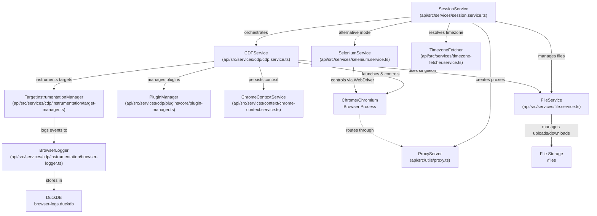
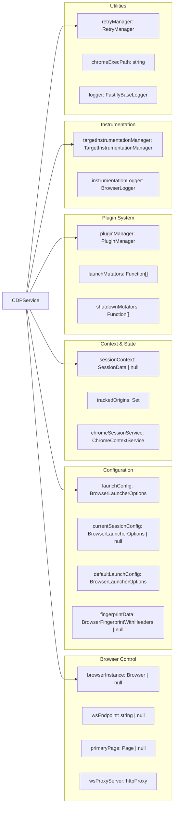
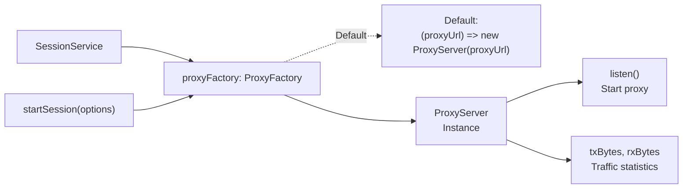
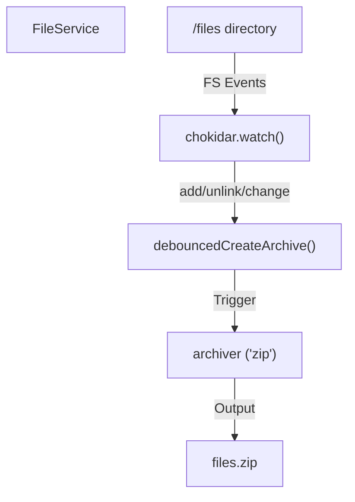

<!-- source: DeepWiki mcp.deepwiki.com · repo steel-dev/steel-browser · page 3 Core Services · fetched 2026-10-27 -->

# Core Services

<details>
<summary>Relevant source files</summary>

The following files were used as context for generating this wiki page:

- [api/src/modules/files/files.controller.ts](api/src/modules/files/files.controller.ts)
- [api/src/modules/files/files.routes.ts](api/src/modules/files/files.routes.ts)
- [api/src/modules/files/files.schema.ts](api/src/modules/files/files.schema.ts)
- [api/src/plugins/file-storage.ts](api/src/plugins/file-storage.ts)
- [api/src/services/cdp/cdp.service.ts](api/src/services/cdp/cdp.service.ts)
- [api/src/services/cdp/plugins/core/base-plugin.ts](api/src/services/cdp/plugins/core/base-plugin.ts)
- [api/src/services/cdp/plugins/core/plugin-manager.ts](api/src/services/cdp/plugins/core/plugin-manager.ts)
- [api/src/services/file.service.ts](api/src/services/file.service.ts)
- [api/src/services/session.service.ts](api/src/services/session.service.ts)

</details>


This page documents the core service layer of the steel-browser system, which consists of three primary services: `CDPService`, `SessionService`, and `FileService`. These services form the backbone of the browser automation infrastructure, handling browser lifecycle management, session orchestration, and file operations.

For detailed information about specific service features:
- For browser control via Chrome DevTools Protocol, see [CDPService](#3.1)
- For session lifecycle and proxy management, see [SessionService](#3.2)  
- For file upload/download operations, see [FileService](#3.3)
- For WebDriver compatibility, see [Selenium Support](#8.2)
- For real-time event streaming, see [Real-time Communication](#10)

## Service Layer Architecture

The core services implement a layered architecture where `SessionService` orchestrates high-level session management while delegating browser control to either `CDPService` (primary) or `SeleniumService` (compatibility mode). `FileService` provides cross-cutting file management capabilities including real-time file watching and archive generation.

### Service Dependency Graph



**Sources:** [api/src/services/session.service.ts:58-91](), [api/src/services/cdp/cdp.service.ts:83-185](), [api/src/services/file.service.ts:16-45]()

## Service Responsibilities

| Service | Primary Role | Key Dependencies | Storage |
|---------|-------------|------------------|---------|
| `SessionService` | Session lifecycle orchestration, proxy management | `CDPService`, `SeleniumService`, `FileService`, `TimezoneFetcher` | Session metadata in memory |
| `CDPService` | Browser process control, CDP protocol handling, fingerprinting | `PluginManager`, `ChromeContextService`, `TargetInstrumentationManager`, `BrowserLogger` | Context in userDataDir, logs in DuckDB |
| `FileService` | File upload/download, archive generation, file watching | `chokidar`, `archiver` | `/files` (prod) or `/tmp/files` (dev) |

**Sources:** [api/src/services/session.service.ts:69-91](), [api/src/services/cdp/cdp.service.ts:121-185](), [api/src/services/file.service.ts:27-38]()

## CDPService

The `CDPService` class is the primary browser automation service, responsible for launching Chrome/Chromium browsers, controlling them via the Chrome DevTools Protocol, and managing all browser-level operations. It integrates a plugin system via `PluginManager` to allow lifecycle hooks.

### Core Components

The `CDPService` constructor initializes multiple subsystems:



**Sources:** [api/src/services/cdp/cdp.service.ts:83-185]()

### Plugin System Hooks

`CDPService` utilizes `PluginManager` to notify registered plugins of browser events. Plugins extend `BasePlugin` and can react to session start, browser launch, page creation, and shutdown.

| Hook | Description |
|------|-------------|
| `onSessionStart` | Called before a session begins |
| `onBrowserLaunch` | Called immediately after the browser process starts |
| `onPageCreated` | Triggered when a new `Page` (tab) is opened |
| `onShutdown` | Triggered during service termination with a `ShutdownReason` |

**Sources:** [api/src/services/cdp/plugins/core/base-plugin.ts:43-55](), [api/src/services/cdp/plugins/core/plugin-manager.ts:54-216]()

## SessionService

The `SessionService` orchestrates browser sessions at a higher level than `CDPService`, managing session lifecycle, proxy configuration, and coordination between CDP and Selenium modes.

### Session Structure

Each session in `SessionService` is represented by the `Session` type, which includes URLs for debugging and the session viewer.

```typescript
type Session = SessionDetails & {
  completion: Promise<void>;
  complete: (value: void) => void;
  proxyServer: IProxyServer | undefined;
};
```

**Sources:** [api/src/services/session.service.ts:25-29](), [api/src/services/session.service.ts:40-51]()

### Proxy Factory Pattern

The `SessionService` uses a factory pattern for proxy creation, allowing customization and bandwidth optimization through `IProxyServer`.



**Sources:** [api/src/services/session.service.ts:53-56](), [api/src/services/session.service.ts:64](), [api/src/services/session.service.ts:208-211]()

## FileService

The `FileService` provides file management capabilities for browser sessions. Unlike the other services, it includes a `chokidar` file watcher that automatically triggers ZIP archive generation whenever files are added or modified in the session storage.

### Archive Generation and Watching

`FileService` maintains a debounced archive process to ensure the `files.zip` is up-to-date for bulk downloads.



**Sources:** [api/src/services/file.service.ts:27-38](), [api/src/services/file.service.ts:62-86]()

### File Operations API

The `FilesController` interfaces with `FileService` to provide RESTful access to session files.

| Operation | Controller Method | Service Method |
|-----------|-------------------|----------------|
| Upload | `handleFileUpload` | `saveFile` |
| Download | `handleFileDownload` | `downloadFile` |
| List | `handleFileList` | `listFiles` |
| Bulk Download | `handleDownloadArchive` | `getPrebuiltArchivePath` |

**Sources:** [api/src/modules/files/files.controller.ts:41-157](), [api/src/modules/files/files.routes.ts:18-146](), [api/src/services/file.service.ts:110-220]()

## Service Integration Points

### SessionService → CDPService Coordination

`SessionService` manages the transition between browser modes. If a session is requested in Selenium mode, it shuts down the `CDPService` instance before handing control to `SeleniumService`.

**Sources:** [api/src/services/session.service.ts:213-242]()

### Error Handling Strategy

The core services implement a tiered error handling approach defined in `launch-errors.ts`, categorizing failures into `NetworkError`, `FingerprintError`, `PluginError`, and others to provide better debugging context.

**Sources:** [api/src/services/cdp/errors/launch-errors.ts:52-71](), [api/src/services/cdp/cdp.service.ts:80]()

---

