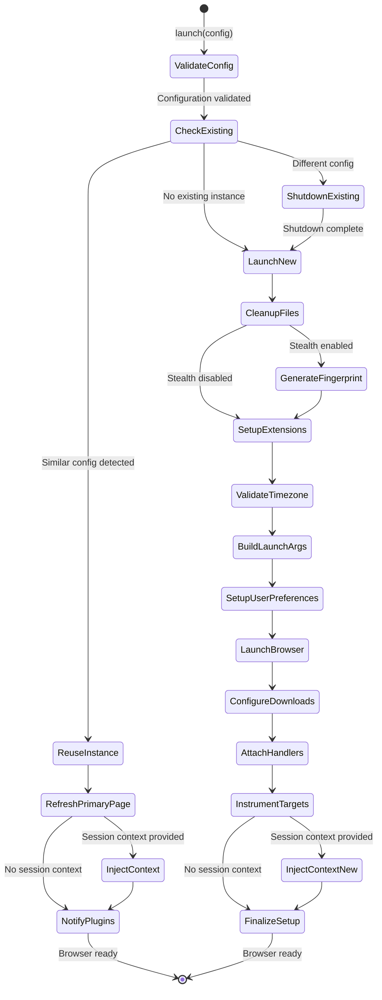
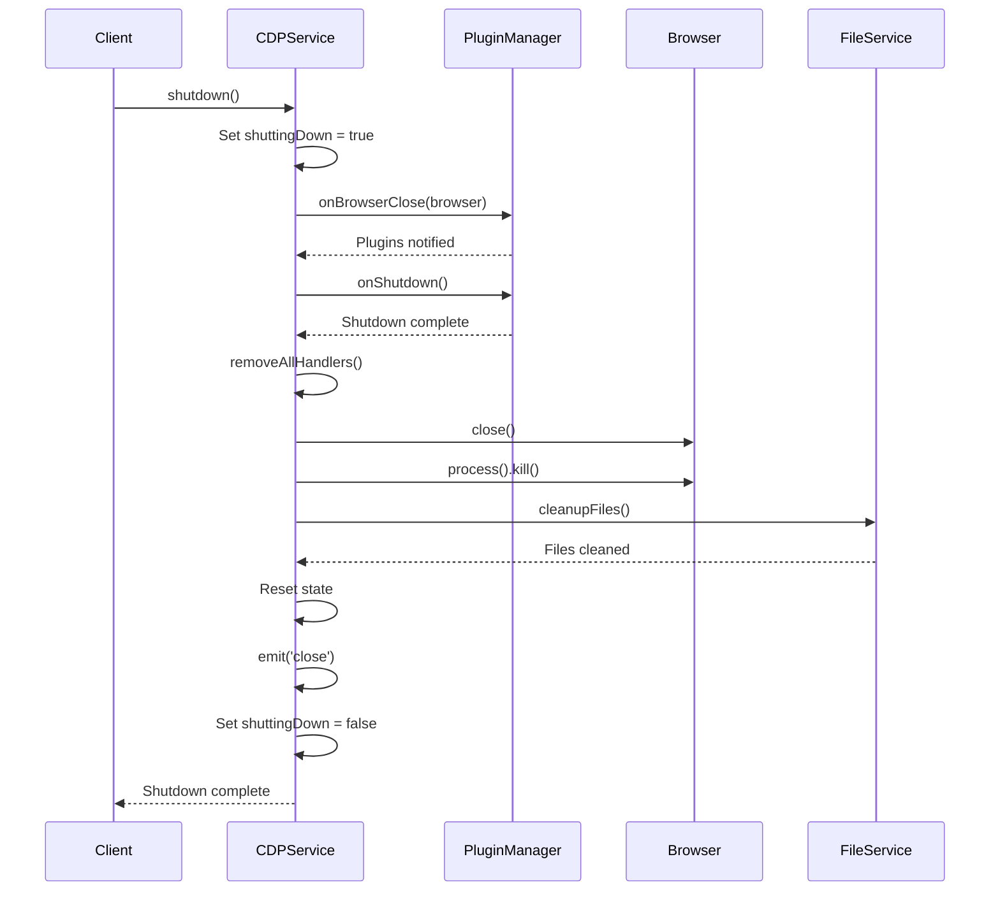
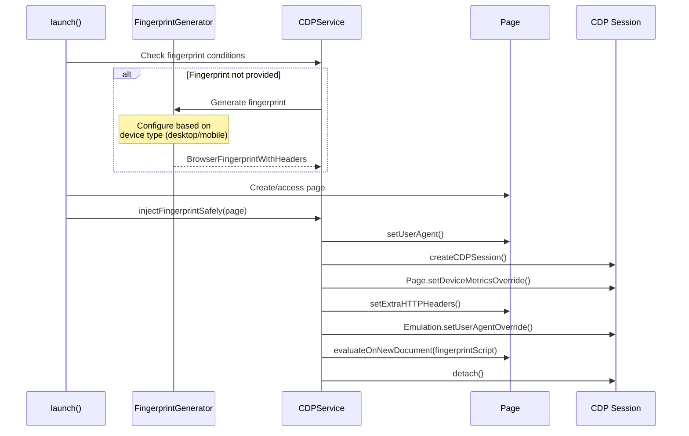
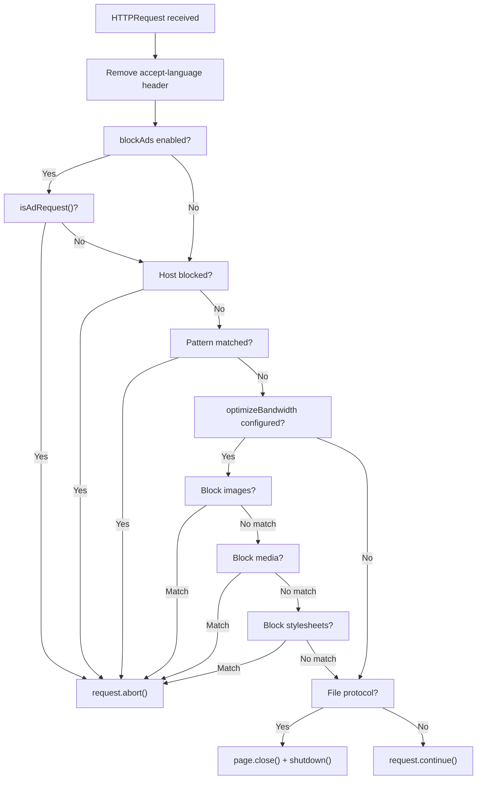

<!-- source: DeepWiki mcp.deepwiki.com · repo steel-dev/steel-browser · page 3.1 CDPService · fetched 2026-10-27 -->

# CDPService

<details>
<summary>Relevant source files</summary>

The following files were used as context for generating this wiki page:

- [api/.prettierrc](api/.prettierrc)
- [api/src/scripts/index.ts](api/src/scripts/index.ts)
- [api/src/services/cdp/cdp.service.ts](api/src/services/cdp/cdp.service.ts)
- [api/src/services/cdp/errors/launch-errors.ts](api/src/services/cdp/errors/launch-errors.ts)
- [api/src/services/cdp/plugins/core/base-plugin.ts](api/src/services/cdp/plugins/core/base-plugin.ts)
- [api/src/services/cdp/plugins/core/plugin-manager.ts](api/src/services/cdp/plugins/core/plugin-manager.ts)
- [api/src/services/cdp/utils/error-handlers.ts](api/src/services/cdp/utils/error-handlers.ts)
- [api/src/services/cdp/utils/validation.ts](api/src/services/cdp/utils/validation.ts)
- [api/src/utils/browser.ts](api/src/utils/browser.ts)
- [repl/package.json](repl/package.json)
- [ui/package.json](ui/package.json)

</details>


## Overview

`CDPService` is the core service responsible for managing Chrome/Chromium browser instances via the Chrome DevTools Protocol (CDP). It handles the complete browser lifecycle including launch, configuration, fingerprinting, request interception, session management, and cleanup. `CDPService` serves as the primary interface between the steel-browser API and the underlying browser automation infrastructure.

For information about orchestrating multiple browser sessions, see [SessionService](3.2). For details on the plugin architecture that extends `CDPService` functionality, see [Plugin System](9).

**Sources:** [api/src/services/cdp/cdp.service.ts:83-185]()

---

## System Architecture

`CDPService` acts as the central coordinator for browser automation, integrating multiple subsystems to provide comprehensive browser control.

### Core Component Architecture

```mermaid
graph TB
    CDPService["CDPService<br/>(EventEmitter)"]
    
    subgraph "Browser Control"
        Browser["Browser<br/>(puppeteer-core)"]
        PrimaryPage["primaryPage<br/>(Page)"]
        WSEndpoint["wsEndpoint<br/>(WebSocket)"]
        BrowserProcess["Browser Process"]
    end
    
    subgraph "Plugin System"
        PluginManager["PluginManager"]
        BasePlugins["BasePlugin[]<br/>(Registered Plugins)"]
    end
    
    subgraph "Instrumentation"
        TargetInstrumentationManager["TargetInstrumentationManager"]
        BrowserLogger["BrowserLogger<br/>(instrumentationLogger)"]
    end
    
    subgraph "Configuration"
        LaunchConfig["launchConfig<br/>(BrowserLauncherOptions)"]
        FingerprintData["fingerprintData<br/>(BrowserFingerprintWithHeaders)"]
        SessionContext["sessionContext<br/>(SessionData)"]
    end
    
    subgraph "Support Services"
        ChromeContextService["ChromeContextService<br/>(chromeSessionService)"]
        RetryManager["RetryManager<br/>(retryManager)"]
        FileService["FileService<br/>(singleton)"]
        TimezoneFetcher["TimezoneFetcher"]
    end
    
    CDPService --> Browser
    CDPService --> PluginManager
    CDPService --> TargetInstrumentationManager
    CDPService --> ChromeContextService
    CDPService --> RetryManager
    CDPService --> FileService
    
    Browser --> PrimaryPage
    Browser --> WSEndpoint
    Browser --> BrowserProcess
    
    PluginManager --> BasePlugins
    TargetInstrumentationManager --> BrowserLogger
    
    CDPService -.->|"stores"| LaunchConfig
    CDPService -.->|"stores"| FingerprintData
    CDPService -.->|"stores"| SessionContext
```



**Sources:** [api/src/services/cdp/cdp.service.ts:83-185](), [api/src/services/cdp/plugins/core/plugin-manager.ts:7-16](), [api/src/services/cdp/instrumentation/target-manager.ts:1-20]()

### Key Class Members

| Member | Type | Purpose |
|--------|------|---------|
| `browserInstance` | `Browser \| null` | Active Puppeteer browser instance [api/src/services/cdp/cdp.service.ts:87]() |
| `wsEndpoint` | `string \| null` | WebSocket endpoint for CDP connections [api/src/services/cdp/cdp.service.ts:88]() |
| `primaryPage` | `Page \| null` | Primary browser page for operations [api/src/services/cdp/cdp.service.ts:93]() |
| `fingerprintData` | `BrowserFingerprintWithHeaders \| null` | Generated browser fingerprint [api/src/services/cdp/cdp.service.ts:89]() |
| `sessionContext` | `SessionData \| null` | Current session state (cookies, storage) [api/src/services/cdp/cdp.service.ts:90]() |
| `launchConfig` | `BrowserLauncherOptions \| undefined` | Current launch configuration [api/src/services/cdp/cdp.service.ts:94]() |
| `pluginManager` | `PluginManager` | Manages plugin lifecycle [api/src/services/cdp/cdp.service.ts:99]() |
| `targetInstrumentationManager` | `TargetInstrumentationManager` | Instruments targets for logging [api/src/services/cdp/cdp.service.ts:103]() |
| `instrumentationLogger` | `BrowserLogger` | Logs browser events to storage [api/src/services/cdp/cdp.service.ts:104]() |
| `chromeSessionService` | `ChromeContextService` | Manages session context persistence [api/src/services/cdp/cdp.service.ts:101]() |
| `retryManager` | `RetryManager` | Handles launch retries [api/src/services/cdp/cdp.service.ts:102]() |

**Sources:** [api/src/services/cdp/cdp.service.ts:83-104]()

---

## Browser Lifecycle Management

`CDPService` manages the complete browser lifecycle from launch to shutdown, including session management and browser reuse optimization.

### Launch Process



**Sources:** [api/src/services/cdp/cdp.service.ts:516-1041](), [api/src/services/cdp/utils/validation.ts:114-189]()

### Browser Launch Method

The `launch()` method is the primary entry point for starting a browser instance. It includes retry logic and comprehensive error handling:

```typescript
public async launch(
  config?: BrowserLauncherOptions,
  retryOptions?: Partial<RetryOptions>,
): Promise<Browser>
```

Key steps in the launch process:

1. **Configuration Validation** - Validates dimensions, proxy URL, and other parameters [api/src/services/cdp/utils/validation.ts:31-62]().
2. **File Cleanup** - Cleans up temporary files before launch [api/src/services/cdp/cdp.service.ts:618-631]().
3. **Launch Mutators** - Executes registered pre-launch hooks [api/src/services/cdp/cdp.service.ts:637-651]().
4. **Fingerprint Generation** - Generates realistic browser fingerprint if stealth enabled [api/src/services/cdp/cdp.service.ts:655-698]().
5. **Extension Resolution** - Resolves extension paths including session extensions [api/src/services/cdp/cdp.service.ts:709-741]().
6. **Timezone Validation** - Validates and resolves timezone configuration [api/src/services/cdp/utils/validation.ts:72-105]().
7. **Chrome Arguments** - Builds comprehensive Chrome launch arguments [api/src/services/cdp/cdp.service.ts:774-854]().
8. **User Preferences** - Sets up Chrome user preferences [api/src/services/cdp/cdp.service.ts:875-882]().
9. **Browser Process Launch** - Launches browser via `puppeteer-core` [api/src/services/cdp/cdp.service.ts:885-896]().
10. **Event Handler Attachment** - Attaches browser event handlers [api/src/services/cdp/cdp.service.ts:912-977]().
11. **Target Instrumentation** - Instruments existing targets for logging [api/src/services/cdp/cdp.service.ts:1004-1016]().
12. **Plugin Notification** - Notifies plugins that browser is ready [api/src/services/cdp/plugins/core/plugin-manager.ts:107-118]().

**Sources:** [api/src/services/cdp/cdp.service.ts:516-1041](), [api/src/services/cdp/utils/error-handlers.ts:18-27]()

### Shutdown Process



**Sources:** [api/src/services/cdp/cdp.service.ts:454-503](), [api/src/services/cdp/plugins/core/plugin-manager.ts:137-146]()

---

## Configuration System

`CDPService` accepts comprehensive configuration through `BrowserLauncherOptions`, which controls all aspects of browser behavior.

### BrowserLauncherOptions Structure

The `BrowserLauncherOptions` type defines the parameters for launching a browser session, including headless mode, proxy settings, user agents, and ad-blocking preferences.

**Sources:** [api/src/types/index.js](), [api/src/services/cdp/cdp.service.ts:94-96]()

### Default Configuration

`CDPService` initializes with a default configuration that can be overridden:

```typescript
this.defaultLaunchConfig = {
  options: {
    headless: env.CHROME_HEADLESS,
    args: [],
    ignoreDefaultArgs: ["--enable-automation"],
  },
  blockAds: true,
  extensions: [],
  userDataDir: env.CHROME_USER_DATA_DIR || path.join(os.tmpdir(), "steel-chrome"),
  timezone: coldStartTimezone,
  userPreferences: {
    plugins: {
      always_open_pdf_externally: true,
      plugins_disabled: ["Chrome PDF Viewer"],
    },
  },
  deviceConfig: { device: "desktop" },
};
```

**Sources:** [api/src/services/cdp/cdp.service.ts:150-167]()

### Configuration Validation

Configuration is validated before browser launch using `validateLaunchConfig()`:

- **Dimensions validation**: Checks positive values and reasonable max size (7680x4320) [api/src/services/cdp/utils/validation.ts:33-48]().
- **Proxy URL validation**: Validates URL format [api/src/services/cdp/utils/validation.ts:51-62]().
- **Timezone validation**: Validates timezone with timeout mechanism [api/src/services/cdp/utils/validation.ts:72-105]().

**Sources:** [api/src/services/cdp/utils/validation.ts:31-105]()

### Configuration Reuse Optimization

`CDPService` implements intelligent configuration comparison to determine if an existing browser instance can be reused via `isSimilarConfig()`. It compares headless state, proxies, user agents, data directories, dimensions, and Chrome arguments.

**Sources:** [api/src/services/cdp/utils/validation.ts:114-189]()

---

## Fingerprinting and Stealth Features

`CDPService` implements comprehensive browser fingerprinting to make automated browsers appear as regular user browsers.

### Fingerprint Generation Process



**Sources:** [api/src/services/cdp/cdp.service.ts:655-698](), [api/src/services/cdp/cdp.service.ts:1335-1428](), [api/src/scripts/index.ts:15-72]()

### Stealth Features

`CDPService` implements multiple stealth features:

| Feature | Implementation | Purpose |
|---------|---------------|---------|
| **Automation flag removal** | `--disable-blink-features=AutomationControlled` | Removes `navigator.webdriver` flag [api/src/services/cdp/cdp.service.ts:827]() |
| **Chrome args filtering** | Removes `--enable-automation` | Prevents detection via default args [api/src/services/cdp/cdp.service.ts:154]() |
| **Accept-language removal** | Deletes header in request handler | Prevents fingerprinting inconsistency [api/src/utils/browser.ts:148-165]() |
| **Fixed constants** | Injects `FIXED_*` values via script | Ensures consistent fingerprint [api/src/scripts/index.ts:51-71]() |

**Sources:** [api/src/services/cdp/cdp.service.ts:150-167](), [api/src/utils/browser.ts:148-165](), [api/src/scripts/index.ts:51-71]()

---

## Request Interception and Filtering

`CDPService` implements comprehensive request interception for ad blocking, bandwidth optimization, and resource filtering.

### Request Interception Flow



**Sources:** [api/src/services/cdp/cdp.service.ts:385-439](), [api/src/utils/requests.ts:32-38]()

---

## Plugin System Integration

`CDPService` integrates with the plugin system via `PluginManager`, enabling extensibility through lifecycle hooks defined in `BasePlugin`.

### Plugin Hook Methods

| Hook | When Called | Purpose |
|------|-------------|---------|
| `onSessionStart` | Before launch/reuse | Initialize session state [api/src/services/cdp/plugins/core/base-plugin.ts:43]() |
| `onBrowserLaunch` | After browser process starts | Initialize browser features [api/src/services/cdp/plugins/core/base-plugin.ts:46]() |
| `onBrowserReady` | After all setup complete | Final browser configuration [api/src/services/cdp/plugins/core/base-plugin.ts:47]() |
| `onPageCreated` | When new page/target created | Initialize page features [api/src/services/cdp/plugins/core/base-plugin.ts:48]() |
| `onShutdown` | During `CDPService` shutdown | Final cleanup based on `ShutdownReason` [api/src/services/cdp/plugins/core/base-plugin.ts:53]() |

**Sources:** [api/src/services/cdp/plugins/core/base-plugin.ts:42-55](), [api/src/services/cdp/plugins/core/plugin-manager.ts:54-216]()

---

## Error Handling and Retry Mechanism

`CDPService` implements sophisticated error handling with categorization and retry logic via `RetryManager`.

### Error Categories

| Error Class | Retryable | Purpose |
|-------------|-----------|---------|
| `BrowserProcessError` | Yes | Browser process launch/management failures [api/src/services/cdp/errors/launch-errors.ts:267]() |
| `NetworkError` | Yes | Network-related failures (proxy, WebSocket) [api/src/services/cdp/errors/launch-errors.ts:188]() |
| `ConfigurationError` | No | Invalid configuration parameters [api/src/services/cdp/errors/launch-errors.ts:124]() |
| `LaunchTimeoutError` | Yes | Launch timeout (default 30s) [api/src/services/cdp/errors/launch-errors.ts:106]() |

**Sources:** [api/src/services/cdp/errors/launch-errors.ts:77-285](), [api/src/services/cdp/utils/error-handlers.ts:18-87]()

### Error Handling Utilities

`CDPService` uses functional wrappers to handle different levels of criticality:

1.  **`executeCritical`**: Operation must succeed or launch fails [api/src/services/cdp/utils/error-handlers.ts:18]().
2.  **`executeOptional`**: Logs a warning but continues execution on failure [api/src/services/cdp/utils/error-handlers.ts:46]().
3.  **`executeBestEffort`**: Silently logs on failure [api/src/services/cdp/utils/error-handlers.ts:70]().

**Sources:** [api/src/services/cdp/utils/error-handlers.ts:1-87]()

---

