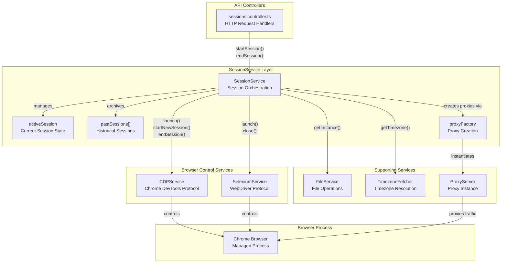
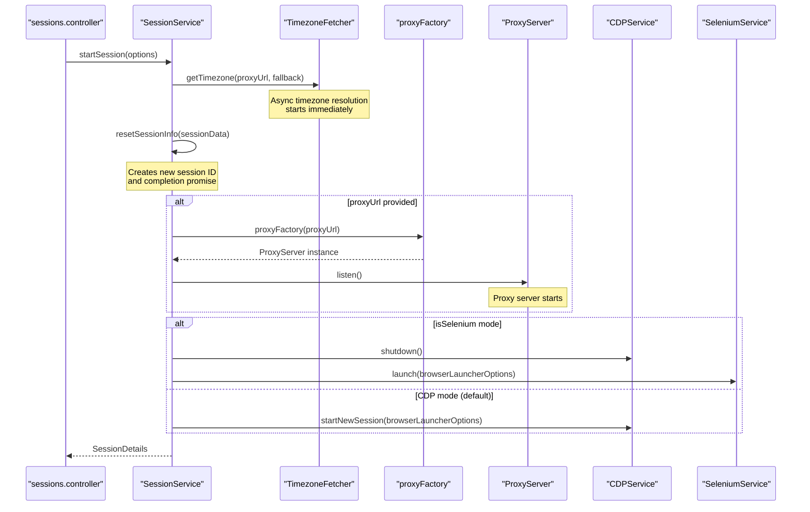
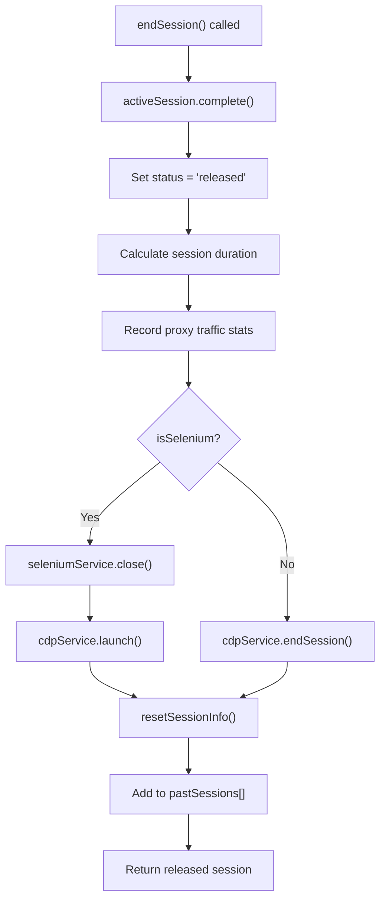
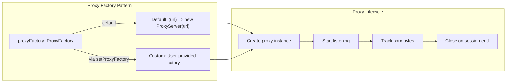
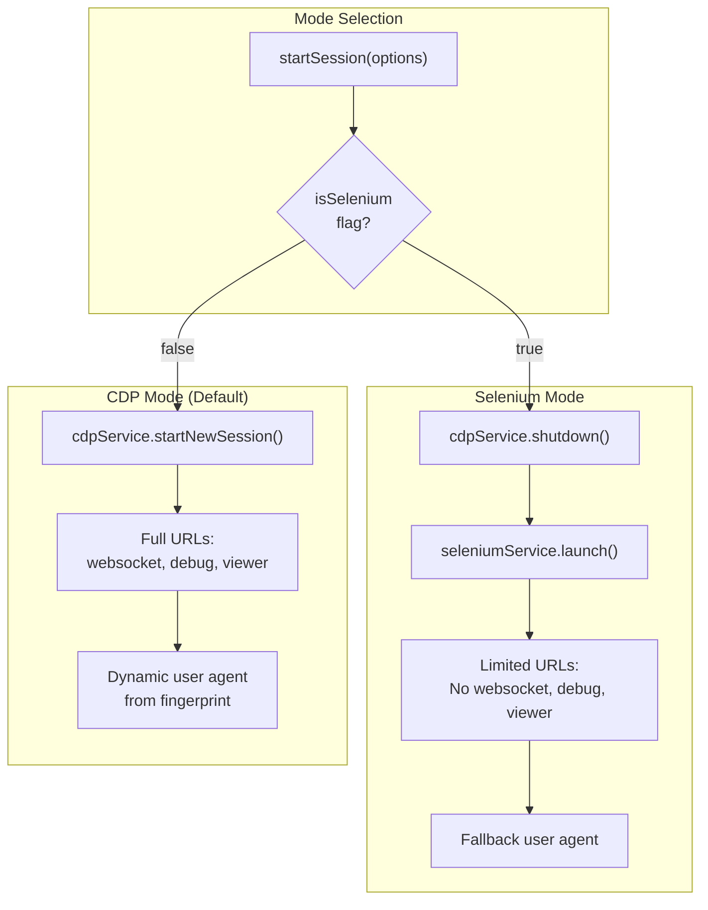
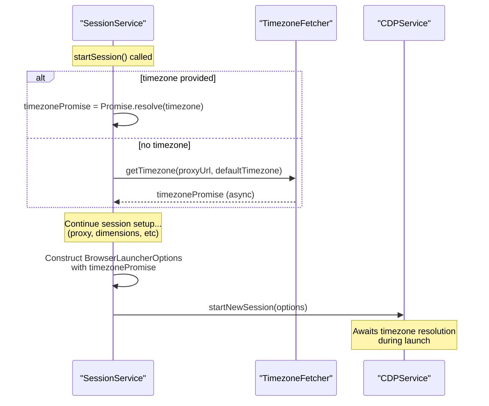

<!-- source: DeepWiki mcp.deepwiki.com · repo steel-dev/steel-browser · page 3.2 SessionService · fetched 2026-10-27 -->

# SessionService

<details>
<summary>Relevant source files</summary>

The following files were used as context for generating this wiki page:

- [api/src/plugins/browser-session.ts](api/src/plugins/browser-session.ts)
- [api/src/services/context/chrome-context.service.ts](api/src/services/context/chrome-context.service.ts)
- [api/src/services/leveldb/sessionstorage.ts](api/src/services/leveldb/sessionstorage.ts)
- [api/src/services/session.service.ts](api/src/services/session.service.ts)
- [api/src/services/timezone-fetcher.service.ts](api/src/services/timezone-fetcher.service.ts)
- [api/src/types/fastify.d.ts](api/src/types/fastify.d.ts)
- [api/src/utils/context.ts](api/src/utils/context.ts)
- [api/src/utils/extensions.ts](api/src/utils/extensions.ts)

</details>


## Purpose and Scope

The **SessionService** is a core orchestration layer that manages the lifecycle of browser sessions in the steel-browser system. It coordinates between the `CDPService` (Chrome DevTools Protocol) and `SeleniumService` (WebDriver compatibility), handles proxy management, tracks session state, and integrates with supporting services for file management and timezone resolution.

For detailed information about browser control via CDP, see [CDPService](3.1). For file management within sessions, see [FileService](3.3). For session configuration options, see [Session Configuration](4.2).

**Sources:** [api/src/services/session.service.ts:1-301]()

---

## System Architecture

The following diagram shows how `SessionService` fits into the overall service architecture and its relationships with other core components:



**Sources:** [api/src/services/session.service.ts:50-300](), [api/src/plugins/browser-session.ts:5-13]()

---

## Core Components

### SessionService Class

The `SessionService` class is defined at [api/src/services/session.service.ts:58-301]() and contains the following key properties:

| Property | Type | Purpose |
|----------|------|---------|
| `cdpService` | `CDPService` | Primary browser control service using Chrome DevTools Protocol |
| `seleniumService` | `SeleniumService` | Alternative browser control for WebDriver compatibility |
| `fileService` | `FileService` | Manages file uploads, downloads, and cleanup |
| `timezoneFetcher` | `TimezoneFetcher` | Resolves timezone based on proxy location |
| `proxyFactory` | `ProxyFactory` | Factory function for creating proxy server instances |
| `activeSession` | `Session` | Current active session with state and completion promise |
| `pastSessions` | `Session[]` | Array of completed sessions for historical tracking |

**Sources:** [api/src/services/session.service.ts:59-67]()

### Session Type

The internal `Session` type extends `SessionDetails` with completion tracking and proxy management:

```typescript
type Session = SessionDetails & {
  completion: Promise<void>;
  complete: (value: void) => void;
  proxyServer: IProxyServer | undefined;
};
```

**Sources:** [api/src/services/session.service.ts:25-29]()

---

## Session Lifecycle Management

### Session Creation Flow

The following diagram illustrates the complete session creation process:



**Sources:** [api/src/services/session.service.ts:93-243]()

### startSession Method

The `startSession` method at [api/src/services/session.service.ts:93-243]() orchestrates the following steps:

1. **Early Timezone Resolution**: Initiates timezone fetching as early as possible to avoid blocking ([lines 143-151]())
2. **Session Initialization**: Creates new session state via `resetSessionInfo` with provided or generated UUID ([lines 166-174]())
3. **User Data Directory Setup**: Creates persistent or temporary user data directory ([lines 176-180]())
4. **Proxy Configuration**: If `proxyUrl` is provided, creates and starts proxy server via `proxyFactory` ([lines 208-211]())
5. **User Preferences Merge**: Combines default and custom user preferences using `deepMerge` ([lines 182-191]())
6. **Bandwidth Optimization**: Normalizes boolean/object configuration via `normalizeOptimizeBandwidth` ([lines 194-206]())
7. **Browser Launch**: Launches either Selenium or CDP-based browser ([lines 212-241]())

**Sources:** [api/src/services/session.service.ts:93-243]()

### Configuration Processing

The method processes configuration in the following order:

| Configuration Stage | Processing | Lines |
|-------------------|-----------|-------|
| Dimensions | Uses provided or falls back to `cdpService.getDimensions()` | [157-164]() |
| Timezone | Async resolution via `TimezoneFetcher` or direct value | [143-151]() |
| User Data Dir | Creates from `userDataDir`, `persist` flag, or default temp dir | [176-180]() |
| User Preferences | Deep merges with PDF viewer defaults | [182-191]() |
| Optimize Bandwidth | Normalizes boolean to full object structure | [194-206]() |
| Browser Launcher Options | Assembles complete `BrowserLauncherOptions` object | [213-233]() |

**Sources:** [api/src/services/session.service.ts:93-243]()

---

## Session State Tracking

### Active Session Management

The `activeSession` property tracks the current session state. It is initialized in the constructor at [api/src/services/session.service.ts:80-90]() with default values:

```typescript
this.activeSession = {
  id: uuidv4(),
  createdAt: new Date().toISOString(),
  ...defaultSession,
  ...sessionStats,
  userAgent: this.cdpService.getUserAgent() ?? "",
  dimensions: this.cdpService.getDimensions(),
  completion: Promise.resolve(),
  complete: () => {},
  proxyServer: undefined,
};
```

The session structure includes:

| Field Group | Fields | Purpose |
|------------|--------|---------|
| Identity | `id`, `createdAt` | Unique identification and timestamp |
| URLs | `websocketUrl`, `debugUrl`, `debuggerUrl`, `sessionViewerUrl` | Access endpoints for session monitoring |
| Browser Config | `userAgent`, `dimensions`, `isSelenium` | Browser configuration state |
| Proxy | `proxy`, `proxyServer`, `proxyTxBytes`, `proxyRxBytes` | Proxy configuration and traffic metrics |
| Stats | `duration`, `eventCount`, `timeout`, `creditsUsed` | Usage and performance metrics |
| Lifecycle | `status`, `completion`, `complete` | Session state and completion handling |

**Sources:** [api/src/services/session.service.ts:40-51](), [api/src/services/session.service.ts:80-90]()

---

## Session Termination

### endSession Method

The `endSession` method at [api/src/services/session.service.ts:245-273]() performs cleanup and state transitions:



**Sources:** [api/src/services/session.service.ts:245-273]()

### Cleanup Operations

The termination process performs the following operations:

1. **Completion Signal**: Resolves the session's completion promise ([line 246]())
2. **Status Update**: Changes status to `"released"` ([line 247]())
3. **Duration Calculation**: Computes total session time ([lines 248-249]())
4. **Proxy Statistics**: Records transmitted and received bytes from `proxyServer` ([lines 251-254]())
5. **Browser Shutdown**: Closes `SeleniumService` or ends `CDPService` session ([lines 256-261]())
6. **Session Reset**: Creates new idle session state via `resetSessionInfo` ([lines 265-268]())
7. **Archival**: Stores completed session in `pastSessions` array ([line 270]())

**Sources:** [api/src/services/session.service.ts:245-273]()

---

## Proxy Management

### ProxyFactory Pattern

`SessionService` uses a factory pattern for proxy creation, allowing custom proxy implementations:



**Sources:** [api/src/services/session.service.ts:53-56](), [api/src/services/session.service.ts:297-299]()

### Proxy Integration

The proxy integration occurs at [api/src/services/session.service.ts:208-211]():

```typescript
if (proxyUrl) {
  this.activeSession.proxyServer = await this.proxyFactory(proxyUrl, normalizedOptimize);
  await this.activeSession.proxyServer.listen();
}
```

The proxy server is passed to the browser launcher at [api/src/services/session.service.ts:216]():

```typescript
proxyUrl: this.activeSession.proxyServer?.url,
```

**Sources:** [api/src/services/session.service.ts:208-211](), [api/src/services/session.service.ts:216]()

---

## Service Orchestration

### CDP vs Selenium Mode

`SessionService` supports two browser control modes with different capabilities:



**Sources:** [api/src/services/session.service.ts:212-241]()

### Mode Switching on Termination

When ending a session, the service switches back to CDP mode if Selenium was active:

```typescript
if (this.activeSession.isSelenium) {
  this.seleniumService.close();
  await this.cdpService.launch();
} else {
  await this.cdpService.endSession();
}
```

This ensures the system returns to its default CDP state at [api/src/services/session.service.ts:256-261]().

**Sources:** [api/src/services/session.service.ts:256-261]()

---

## TimezoneFetcher Integration

`SessionService` uses `TimezoneFetcher` to resolve timezone based on proxy location. The resolution starts early in the session creation process:



The timezone is fetched at [api/src/services/session.service.ts:143-151]() and included in browser options at [api/src/services/session.service.ts:228]().

**Sources:** [api/src/services/session.service.ts:79](), [api/src/services/session.service.ts:143-151](), [api/src/services/timezone-fetcher.service.ts:58-89]()

---

## State Reset Pattern

The `resetSessionInfo` method at [api/src/services/session.service.ts:275-295]() implements a clean state reset:

1. **Complete Previous Session**: Resolves the old completion promise ([line 276]())
2. **Close Proxy**: Cleanly shuts down `proxyServer` if active ([line 278]())
3. **Create New State**: Constructs fresh session with defaults and overrides ([lines 281-290]())
4. **Generate New Promise**: Creates new completion promise with resolvers ([lines 287-288]())

This ensures proper cleanup and fresh state for each session.

**Sources:** [api/src/services/session.service.ts:275-295]()

---

