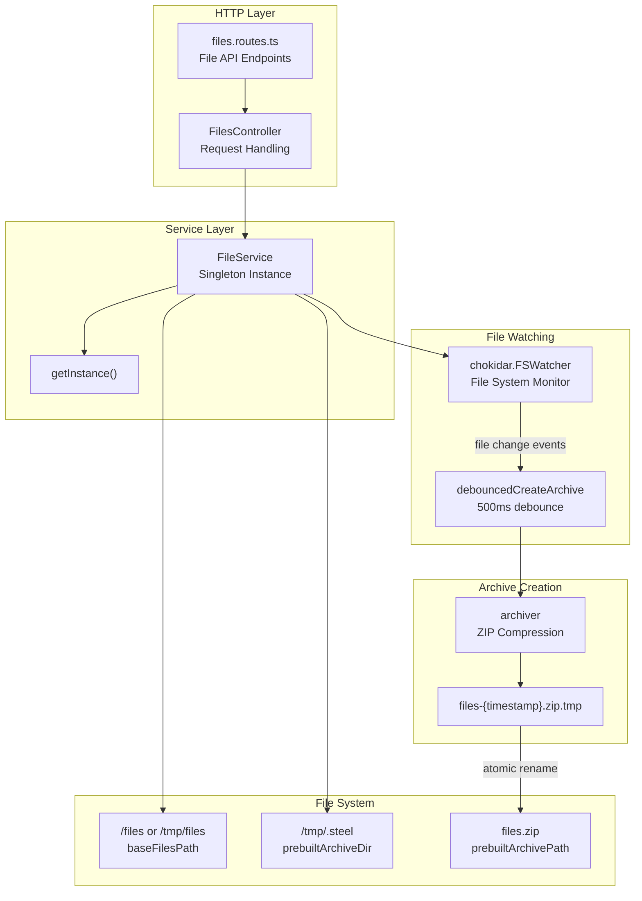
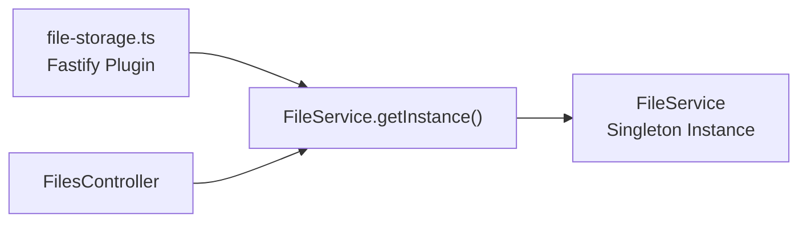
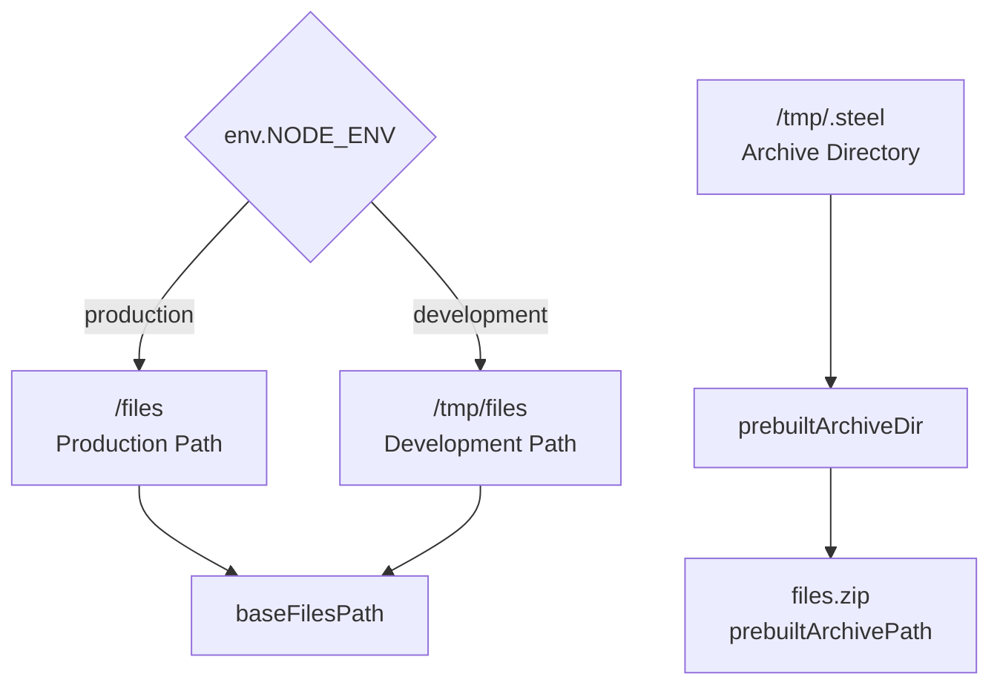
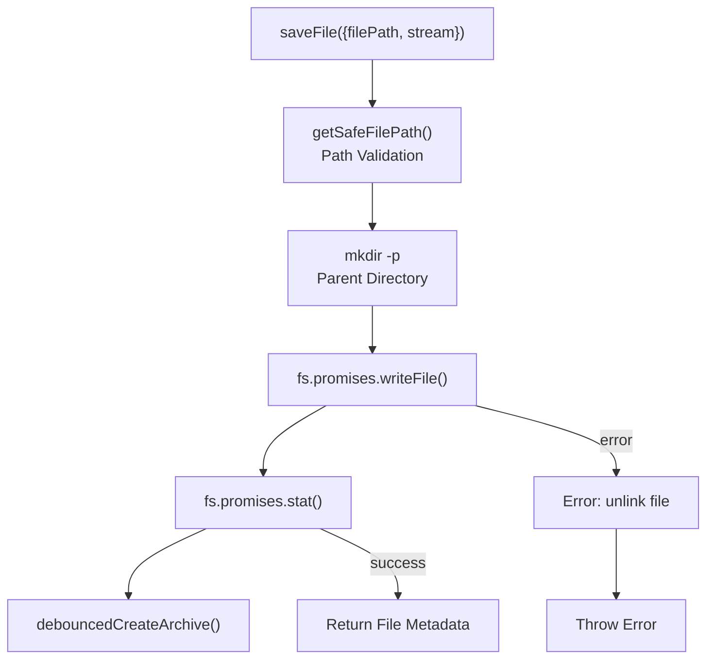
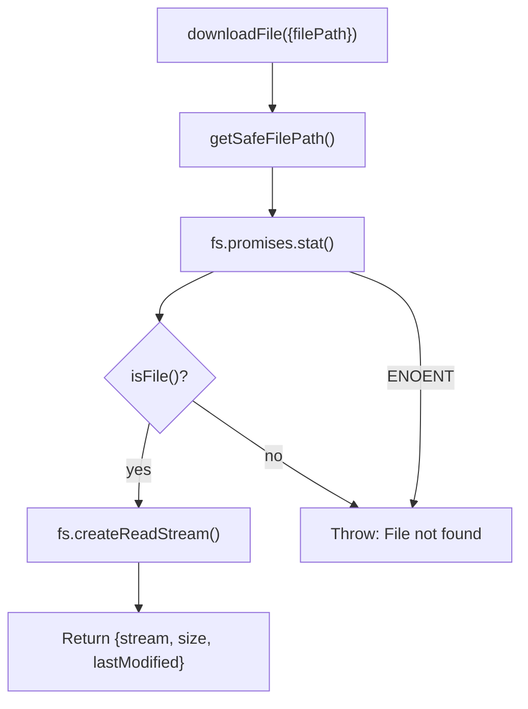
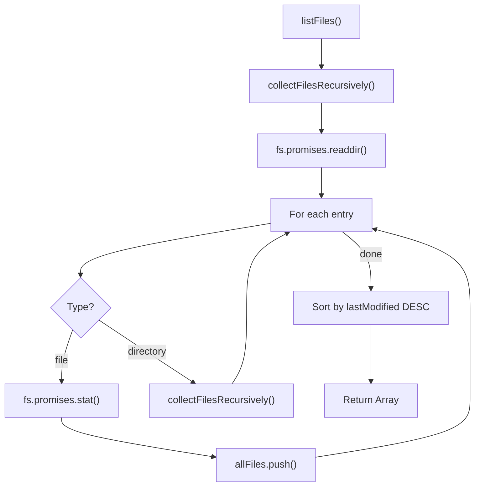
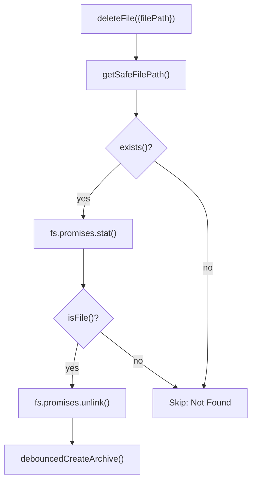
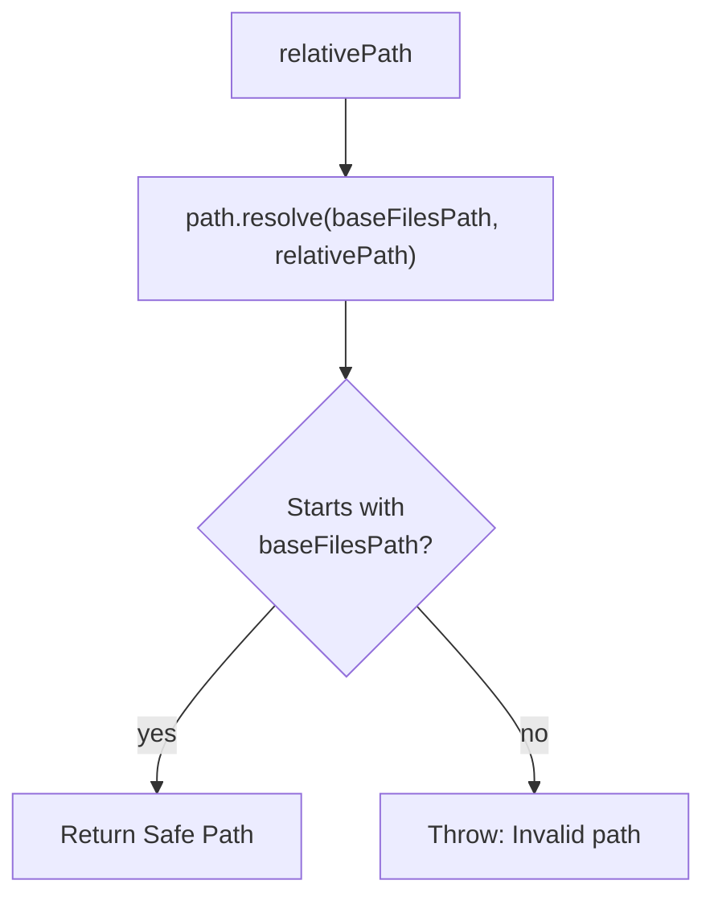
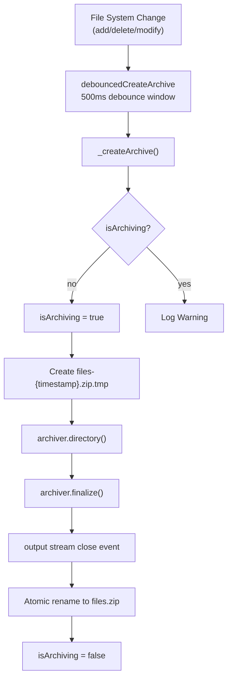
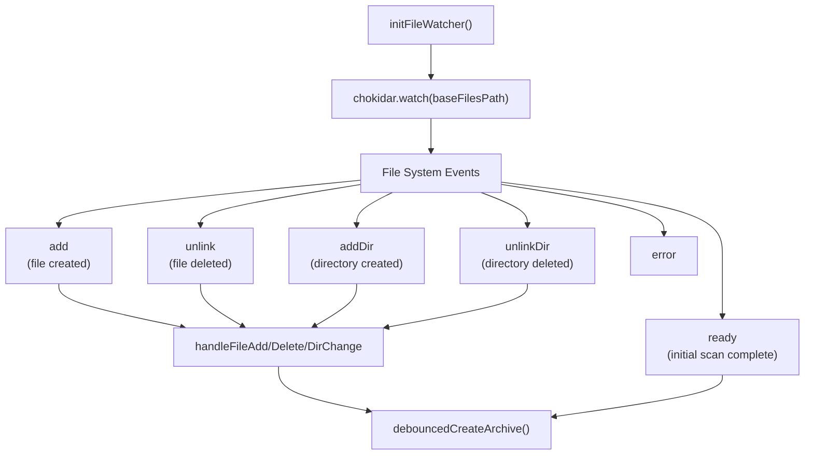

<!-- source: DeepWiki mcp.deepwiki.com · repo steel-dev/steel-browser · page 3.3 FileService · fetched 2026-10-27 -->

# FileService

<details>
<summary>Relevant source files</summary>

The following files were used as context for generating this wiki page:

- [api/src/modules/files/files.controller.ts](api/src/modules/files/files.controller.ts)
- [api/src/modules/files/files.routes.ts](api/src/modules/files/files.routes.ts)
- [api/src/modules/files/files.schema.ts](api/src/modules/files/files.schema.ts)
- [api/src/plugins/file-storage.ts](api/src/plugins/file-storage.ts)
- [api/src/services/file.service.ts](api/src/services/file.service.ts)

</details>


## Purpose and Scope

The `FileService` provides centralized file management capabilities for browser sessions in steel-browser. It handles file upload, download, listing, deletion, and automatic archive generation with real-time file system watching. This service operates as a singleton instance that manages a shared file storage directory and maintains prebuilt ZIP archives of all session files.

For information about the File API endpoints and HTTP routes, see [File API](#7.1). For details on automatic archive generation and bulk download, see [Archive Management](#7.2).

---

## Architecture Overview

The `FileService` is a singleton service that manages all file operations and integrates with the HTTP API layer through the `FilesController`.



**Sources:** [api/src/services/file.service.ts:16-38](), [api/src/modules/files/files.controller.ts:17-18](), [api/src/modules/files/files.routes.ts:8-16]()

---

## Singleton Pattern

The `FileService` implements the singleton pattern to ensure only one instance manages the file storage system across the application lifecycle.



The singleton is initialized lazily on first access and registered as a Fastify decorator:

| Method | Description |
|--------|-------------|
| `FileService.getInstance()` | Returns the singleton instance, creating it if it doesn't exist |
| `constructor()` (private) | Initializes storage paths, creates directories, and starts file watcher |

**Sources:** [api/src/services/file.service.ts:16-45](), [api/src/plugins/file-storage.ts:5-8]()

---

## File Storage Configuration

The `FileService` configures storage paths based on the runtime environment:



| Configuration | Development | Production |
|---------------|-------------|------------|
| `baseFilesPath` | `/tmp/files` | `/files` |
| `prebuiltArchiveDir` | `/tmp/.steel` | `/tmp/.steel` |
| `prebuiltArchivePath` | `/tmp/.steel/files.zip` | `/tmp/.steel/files.zip` |

All directories are created recursively during service initialization using `fs.mkdirSync()`.

**Sources:** [api/src/services/file.service.ts:27-32]()

---

## File Operations

### Save File

The `saveFile()` method stores files to the file system from a readable stream. It handles directory creation and ensures path safety before writing.



The method returns file metadata on success:

```typescript
{
  path: string;          // Absolute file path
  size: number;          // File size in bytes
  lastModified: Date;    // Modification timestamp
}
```

**Sources:** [api/src/services/file.service.ts:110-148]()

### Download File

The `downloadFile()` method retrieves files as readable streams. It verifies that the requested path exists and is a file before opening a read stream.



**Sources:** [api/src/services/file.service.ts:150-179]()

### List Files

The `listFiles()` method recursively scans the base directory and returns all files sorted by modification time (descending).



**Sources:** [api/src/services/file.service.ts:204-250]()

### Delete File

The `deleteFile()` method removes individual files and triggers a background archive update.



**Sources:** [api/src/services/file.service.ts:252-278]()

---

## Path Security

The `FileService` implements path validation through the `getSafeFilePath()` method to prevent directory traversal attacks:



Additionally, the `FilesController` performs validation on user-provided paths:

| Validation Rule | Check |
|----------------|-------|
| Absolute path | `path.isAbsolute()` → reject |
| Parent traversal | Contains `..` → reject |
| Null bytes | Contains `\0` → reject |
| Normalized path | Starts with `..` after normalization → reject |

**Sources:** [api/src/services/file.service.ts:88-97](), [api/src/modules/files/files.controller.ts:20-39]()

---

## Archive Management System

The `FileService` maintains a prebuilt ZIP archive of all files using automatic regeneration triggered by file system changes.

### Archive Creation Flow



### Archive Creation Configuration

| Setting | Value | Purpose |
|---------|-------|---------|
| `archiveDebounceTime` | 500ms | Minimum delay between archive rebuilds |
| Compression level | 9 (maximum) | Optimizes file size |
| Archive format | ZIP | Standard format for cross-platform compatibility |
| Atomic creation | Temp file + rename | Ensures archive is never partially written |

**Sources:** [api/src/services/file.service.ts:339-472]()

---

## File Watching System

The `FileService` uses `chokidar` to monitor the base files directory for changes:



### Chokidar Configuration

```typescript
{
  ignored: /(^|[\/\\])\../,           // Ignore dotfiles
  persistent: true,                    // Keep process running
  ignoreInitial: false,                // Process existing files
  awaitWriteFinish: {
    stabilityThreshold: 500,           // Wait 500ms after last change
    pollInterval: 100                  // Check every 100ms
  },
  depth: undefined                     // Unlimited recursion depth
}
```

The `awaitWriteFinish` configuration ensures files are completely written before triggering archive regeneration, preventing corruption from partial writes.

**Sources:** [api/src/services/file.service.ts:62-86]()

---

## Integration with HTTP API

The `FileService` is consumed by the `FilesController`, which translates HTTP requests into service method calls.

### File Upload Processing

The `FilesController.handleFileUpload()` supports two upload methods:

| Method | Field Name | Processing |
|--------|------------|------------|
| Multipart file upload | `file` (binary) | Stream to disk → `saveFile()` |
| URL download | `file` (string URL) | HTTP GET via `createStreamFromUrl()` → `saveFile()` |

Both methods support an optional `path` field to specify the storage location. If omitted for binary uploads, a random UUID is generated as the filename. For URLs, the filename is extracted from the URL or headers.

**Sources:** [api/src/modules/files/files.controller.ts:41-157](), [api/src/modules/files/files.controller.ts:159-191]()

### Archive Download Behavior

The `handleDownloadArchive()` method serves the prebuilt archive if available. If the prebuilt archive doesn't exist (e.g., immediately after startup), an empty archive is generated on-the-fly.

**Sources:** [api/src/modules/files/files.controller.ts:291-335]()

---

## Configuration and Limits

File upload limits are configured through the Fastify multipart plugin during route registration.

```typescript
{
  limits: {
    fileSize: server.steelBrowserConfig.fileStorage?.maxSizePerSession ?? 100 * MB
  }
}
```

| Configuration | Default Value | Description |
|--------------|---------------|-------------|
| `maxSizePerSession` | 100 MB | Maximum total size for uploaded files per session |

**Sources:** [api/src/modules/files/files.routes.ts:11-16]()

---

## Error Handling

The `FileService` implements comprehensive error handling across all operations:

| Operation | Error Condition | Behavior |
|-----------|----------------|----------|
| `saveFile()` | Write failure | Delete partial file, throw error |
| `downloadFile()` | File not found (ENOENT) | Throw "File not found" |
| `downloadFile()` | Not a file | Throw "Path is not a file" |
| `deleteFile()` | File not found | Log and skip (no error) |
| `listFiles()` | Directory read error | Log error, continue with other directories |
| `_createArchive()` | Stream error | Delete temp archive, reject promise |

**Sources:** [api/src/services/file.service.ts:133-147](), [api/src/services/file.service.ts:172-178](), [api/src/services/file.service.ts:252-278]()

---

