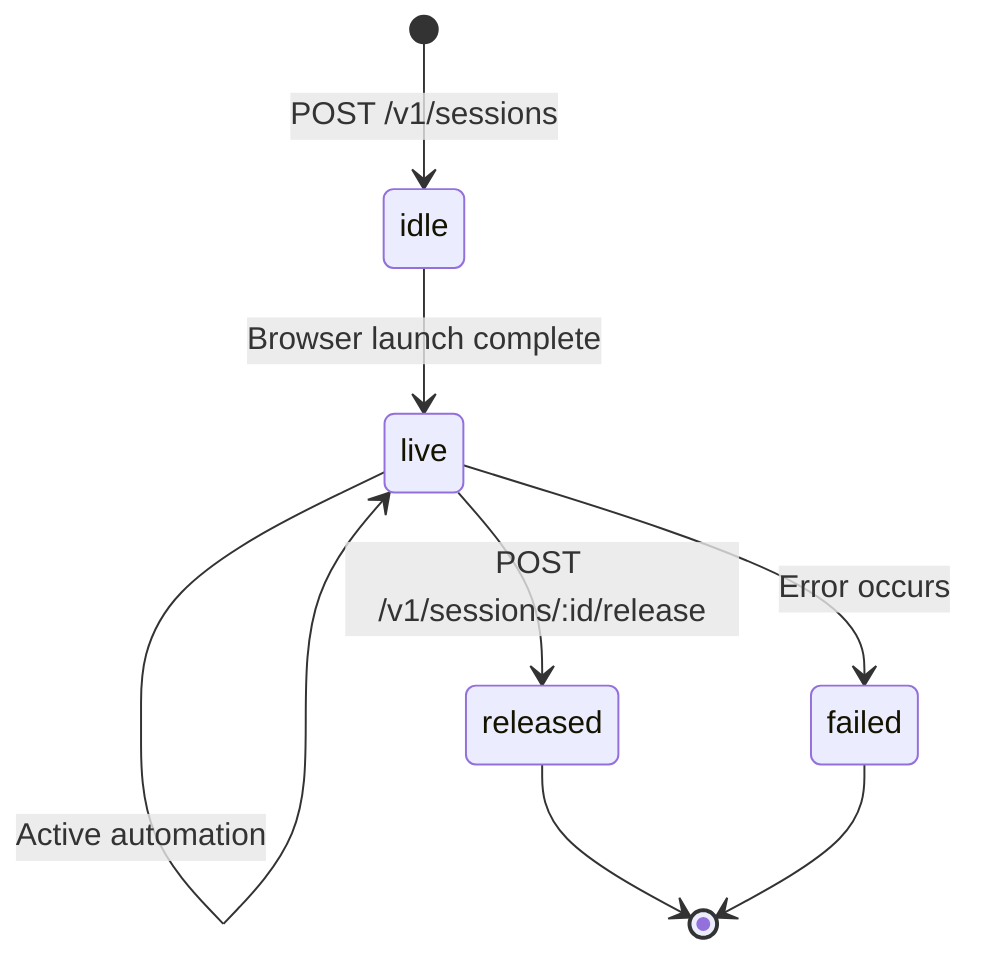
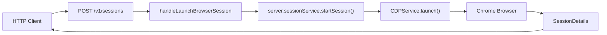
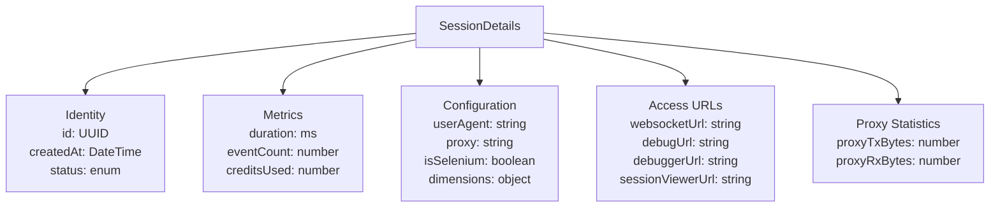
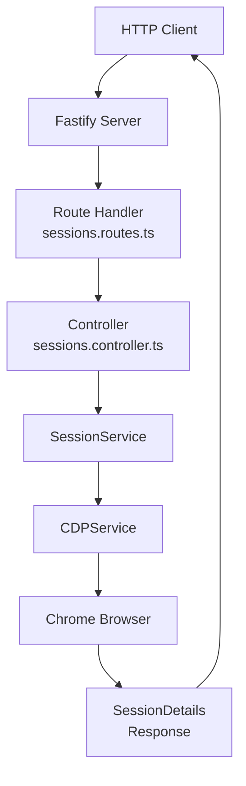

<!-- source: DeepWiki mcp.deepwiki.com · repo steel-dev/steel-browser · page 4.1 Session Management API · fetched 2026-10-27 -->

# Session Management API

<details>
<summary>Relevant source files</summary>

The following files were used as context for generating this wiki page:

- [api/src/modules/sessions/sessions.controller.ts](api/src/modules/sessions/sessions.controller.ts)
- [api/src/modules/sessions/sessions.routes.ts](api/src/modules/sessions/sessions.routes.ts)
- [api/src/modules/sessions/sessions.schema.ts](api/src/modules/sessions/sessions.schema.ts)
- [ui/src/steel-client/services.gen.ts](ui/src/steel-client/services.gen.ts)
- [ui/src/steel-client/types.gen.ts](ui/src/steel-client/types.gen.ts)

</details>


## Purpose and Scope

This document describes the HTTP REST API endpoints for managing browser session lifecycles in steel-browser. It covers creating sessions, querying session state, retrieving session details, and releasing sessions when complete.

For detailed information about session configuration options (e.g., proxy settings, fingerprinting, extensions), see [Session Configuration](#4.2). For information about session context persistence (cookies, localStorage, indexedDB), see [Session Storage & State](#4.3). For real-time session monitoring and WebSocket streaming, see [Live Session Monitoring](#4.4).

## Session Lifecycle Overview

Browser sessions in steel-browser follow a defined lifecycle with four possible states:

| Status | Description |
|--------|-------------|
| `idle` | Session created but not yet in use |
| `live` | Session actively running with browser instance |
| `released` | Session terminated and browser closed |
| `failed` | Session encountered an error and terminated |

**Session Lifecycle Flow**



**Sources:** [api/src/modules/sessions/sessions.schema.ts:93-96]()

## Core Endpoints

### Create Session

Creates a new browser session with specified configuration.

**Endpoint:** `POST /v1/sessions`

**Request Body:** `CreateSession` schema [api/src/modules/sessions/sessions.schema.ts:28-91]()

**Handler:** `handleLaunchBrowserSession` in [api/src/modules/sessions/sessions.controller.ts:8-65]()

**Response:** `SessionDetails` object [api/src/modules/sessions/sessions.schema.ts:93-127]()



**Key Request Parameters:**

| Parameter | Type | Description |
|-----------|------|-------------|
| `sessionId` | string (UUID) | Optional unique identifier for the session |
| `proxyUrl` | string | Proxy URL to route browser traffic through |
| `userAgent` | string | Custom user agent string |
| `sessionContext` | object | Initial cookies, localStorage, sessionStorage |
| `isSelenium` | boolean | Enable Selenium WebDriver compatibility mode |
| `blockAds` | boolean | Enable ad blocking |
| `optimizeBandwidth` | boolean \| object | Enable bandwidth optimizations |
| `skipFingerprintInjection` | boolean | Skip browser fingerprinting |
| `deviceConfig` | object | Device type configuration (desktop/mobile) |
| `extensions` | string[] | Chrome extension paths to load |
| `timezone` | string | IANA timezone string |
| `dimensions` | object | Browser viewport dimensions |
| `userPreferences` | object | Chrome user preferences |
| `headless` | boolean | Run browser in headless mode |

**Sources:** [api/src/modules/sessions/sessions.schema.ts:28-91](), [api/src/modules/sessions/sessions.routes.ts:41-57]()

### List Sessions

Retrieves all sessions (current and past).

**Endpoint:** `GET /v1/sessions`

**Handler:** `handleGetSessions` in [api/src/modules/sessions/sessions.controller.ts:128-140]()

**Response:** `MultipleSessions` object containing array of `SessionDetails` [api/src/modules/sessions/sessions.schema.ts:179-181]()

```typescript
{
  "sessions": [
    {
      "id": "uuid",
      "status": "live",
      "createdAt": "2024-01-01T00:00:00Z",
      "duration": 45000,
      ...
    }
  ]
}
```

The handler returns:
- Current active session (from `server.sessionService.activeSession`)
- Past sessions (from `server.sessionService.pastSessions`)

**Sources:** [api/src/modules/sessions/sessions.controller.ts:128-140](), [api/src/modules/sessions/sessions.routes.ts:59-74]()

### Get Session Details

Retrieves details for a specific session by ID.

**Endpoint:** `GET /v1/sessions/:sessionId`

**Handler:** `handleGetSessionDetails` in [api/src/modules/sessions/sessions.controller.ts:91-126]()

**Response:** `SessionDetails` object [api/src/modules/sessions/sessions.schema.ts:93-127]()

The handler checks if the requested session ID matches the active session. If not, it returns a stub response with `status: "released"`. For active sessions, it returns full details including calculated duration.

**Sources:** [api/src/modules/sessions/sessions.controller.ts:91-126](), [api/src/modules/sessions/sessions.routes.ts:76-91]()

### Get Browser Context

Retrieves current browser state including cookies and storage.

**Endpoint:** `GET /v1/sessions/:sessionId/context`

**Handler:** `handleGetBrowserContext` in [api/src/modules/sessions/sessions.controller.ts:82-89]()

**Response:** `SessionContextSchema` object containing:
- `cookies`: Array of cookie objects
- `localStorage`: Domain-keyed localStorage data
- `sessionStorage`: Domain-keyed sessionStorage data
- `indexedDB`: Domain-keyed indexedDB databases

**Sources:** [api/src/modules/sessions/sessions.controller.ts:82-89](), [api/src/modules/sessions/sessions.routes.ts:93-108]()

### Release Session

Terminates a browser session and releases resources.

**Endpoint:** `POST /v1/sessions/:sessionId/release`

**Alternative Endpoint:** `POST /v1/sessions/release` (releases current session without ID)

**Handler:** `handleExitBrowserSession` in [api/src/modules/sessions/sessions.controller.ts:67-80]()

**Response:** `ReleaseSession` object (extends `SessionDetails` with `success: boolean`) [api/src/modules/sessions/sessions.schema.ts:129-131]()

The handler calls `server.sessionService.endSession()` which closes the browser instance and moves the session to past sessions.

**Sources:** [api/src/modules/sessions/sessions.controller.ts:67-80](), [api/src/modules/sessions/sessions.routes.ts:110-142]()

## Session Details Schema

The `SessionDetails` object is returned by most session endpoints and contains comprehensive session information.

**SessionDetails Type Definition**



**Required Fields:**

| Field | Type | Description |
|-------|------|-------------|
| `id` | string (UUID) | Unique session identifier |
| `createdAt` | string (ISO 8601) | Session creation timestamp |
| `status` | enum | Current session status (idle/live/released/failed) |
| `duration` | integer | Session duration in milliseconds |
| `eventCount` | integer | Number of browser events captured |
| `timeout` | integer | Session timeout in milliseconds |
| `creditsUsed` | integer | Credits consumed by session |
| `websocketUrl` | string | WebSocket endpoint for real-time events |
| `debugUrl` | string | URL for live browser view |
| `debuggerUrl` | string | Chrome DevTools inspector URL |
| `sessionViewerUrl` | string | Session viewer dashboard URL |
| `proxyTxBytes` | integer | Bytes transmitted through proxy |
| `proxyRxBytes` | integer | Bytes received through proxy |

**Sources:** [api/src/modules/sessions/sessions.schema.ts:93-127](), [ui/src/steel-client/types.gen.ts:286-363]()

## Live Session Monitoring

### Get Live Session Details

Retrieves real-time information about the active session including all open pages/tabs.

**Endpoint:** `GET /v1/sessions/:id/live-details`

**Handler:** `handleGetSessionLiveDetails` in [api/src/modules/sessions/sessions.controller.ts:169-243]()

**Response:** `SessionLiveDetailsResponse` object [api/src/modules/sessions/sessions.schema.ts:153-175]()

The handler:
1. Calls `server.cdpService.getAllPages()` to get all browser pages [api/src/modules/sessions/sessions.controller.ts:175]()
2. For each page, extracts URL, title, and favicon [api/src/modules/sessions/sessions.controller.ts:178-212]()
3. Retrieves browser state from `server.cdpService.getBrowserState()` [api/src/modules/sessions/sessions.controller.ts:216]()
4. Returns combined session and page information [api/src/modules/sessions/sessions.controller.ts:229-235]()

**Sources:** [api/src/modules/sessions/sessions.controller.ts:169-243](), [api/src/modules/sessions/sessions.routes.ts:184-201]()

### Get Session Debugger Stream

Returns an HTML page with embedded live browser view.

**Endpoint:** `GET /v1/sessions/debug`

**Handler:** `handleGetSessionStream` in [api/src/modules/sessions/sessions.controller.ts:142-167]()

**Response:** HTML content (`live-session-streamer.ejs`) with embedded WebSocket streaming [api/src/modules/sessions/sessions.controller.ts:159-166]()

**Sources:** [api/src/modules/sessions/sessions.controller.ts:142-167](), [api/src/modules/sessions/sessions.routes.ts:144-161]()

## Event Recording

### Receive Recorded Events

Accepts browser events recorded from client-side instrumentation.

**Endpoint:** `POST /v1/events`

**Request Body:** `RecordedEvents` schema [api/src/modules/sessions/sessions.schema.ts:133-135]()

**Handler Implementation:** [api/src/modules/sessions/sessions.routes.ts:174-181]()

The handler records events to the instrumentation logger via `server.cdpService.getInstrumentationLogger().record()`.

**Sources:** [api/src/modules/sessions/sessions.routes.ts:163-182](), [api/src/modules/sessions/sessions.schema.ts:133-135]()

## Request Flow Architecture

**End-to-End Request Processing**



**Route Registration:** Routes are registered in [api/src/modules/sessions/sessions.routes.ts:23-258]() using Fastify's route definition syntax with schema references via `$ref()`.

**Sources:** [api/src/modules/sessions/sessions.routes.ts:23-258](), [api/src/modules/sessions/sessions.controller.ts]()

## Session Actions Within Sessions

In addition to lifecycle management, sessions support quick actions like scraping and screenshots. These operate on the current active session.

| Endpoint | Purpose | Handler |
|----------|---------|---------|
| `POST /v1/sessions/scrape` | Scrape current page | `handleScrape` |
| `POST /v1/sessions/screenshot` | Capture screenshot | `handleScreenshot` |
| `POST /v1/sessions/pdf` | Generate PDF | `handlePDF` |

**Sources:** [api/src/modules/sessions/sessions.routes.ts:203-255]()

## Generated Client Usage

External clients use a type-safe generated client from the OpenAPI specification.

**Client Function Mapping:**

| API Endpoint | Generated Function | Location |
|--------------|-------------------|----------|
| `POST /v1/sessions` | `launchBrowserSession()` | [ui/src/steel-client/services.gen.ts:168-179]() |
| `GET /v1/sessions` | `getSessions()` | [ui/src/steel-client/services.gen.ts:186-197]() |
| `GET /v1/sessions/:id` | `getSessionDetails()` | [ui/src/steel-client/services.gen.ts:203-214]() |
| `GET /v1/sessions/:id/context` | `getBrowserContext()` | [ui/src/steel-client/services.gen.ts:221-232]() |
| `POST /v1/sessions/:id/release` | `releaseBrowserSession()` | [ui/src/steel-client/services.gen.ts:238-249]() |
| `POST /v1/sessions/release` | `releaseBrowserSessions()` | [ui/src/steel-client/services.gen.ts:256-267]() |

**Sources:** [ui/src/steel-client/services.gen.ts:168-267](), [ui/src/steel-client/types.gen.ts:74-284]()

## Error Handling

All session endpoints implement consistent error handling using `getErrors` utility [api/src/modules/sessions/sessions.controller.ts:62]().

The health check endpoint (`GET /v1/health`) returns 503 status when the browser service is not running:

```typescript
if (!server.cdpService.isRunning()) {
  return reply.status(503).send({ status: "service_unavailable" });
}
```

**Sources:** [api/src/modules/sessions/sessions.controller.ts:60-64](), [api/src/modules/sessions/sessions.routes.ts:35-37]()

---

