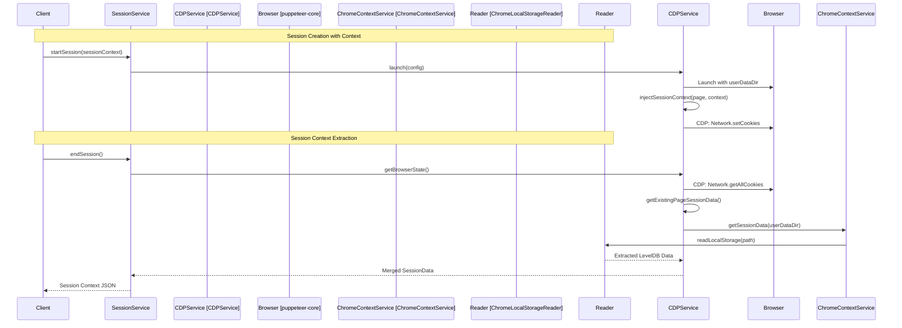
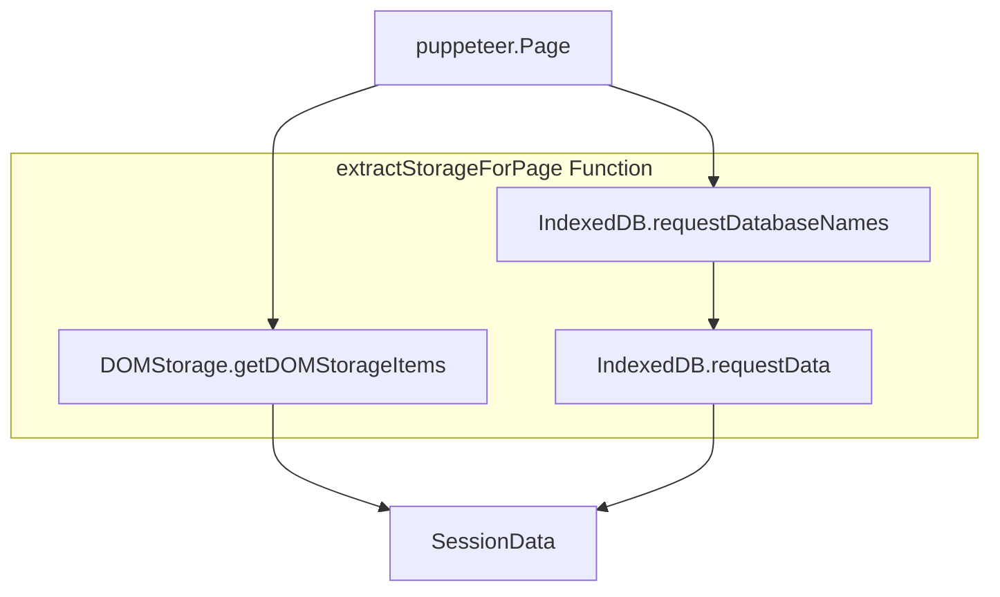
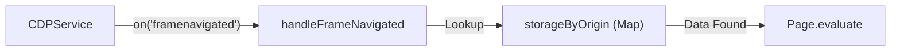

<!-- source: DeepWiki mcp.deepwiki.com · repo steel-dev/steel-browser · page 4.3 Session Storage & State · fetched 2026-10-27 -->

# Session Storage & State

<details>
<summary>Relevant source files</summary>

The following files were used as context for generating this wiki page:

- [api/src/plugins/request-logger.ts](api/src/plugins/request-logger.ts)
- [api/src/services/cdp/cdp.service.ts](api/src/services/cdp/cdp.service.ts)
- [api/src/services/cdp/plugins/core/base-plugin.ts](api/src/services/cdp/plugins/core/base-plugin.ts)
- [api/src/services/cdp/plugins/core/plugin-manager.ts](api/src/services/cdp/plugins/core/plugin-manager.ts)
- [api/src/services/context/chrome-context.service.ts](api/src/services/context/chrome-context.service.ts)
- [api/src/services/context/types.ts](api/src/services/context/types.ts)
- [api/src/services/leveldb/localstorage.ts](api/src/services/leveldb/localstorage.ts)
- [api/src/services/leveldb/sessionstorage.ts](api/src/services/leveldb/sessionstorage.ts)
- [api/src/services/timezone-fetcher.service.ts](api/src/services/timezone-fetcher.service.ts)
- [api/src/utils/context.ts](api/src/utils/context.ts)
- [api/src/utils/extensions.ts](api/src/utils/extensions.ts)

</details>


This page documents how steel-browser captures, persists, and restores browser session state including cookies, localStorage, sessionStorage, and IndexedDB. Session context enables sessions to maintain state across browser restarts and allows state to be transferred between sessions.

---

## Overview

Session context in steel-browser encompasses all client-side state that defines a browser session:

| **Component** | **Description** | **Scope** |
|---------------|----------------|-----------|
| **Cookies** | HTTP cookies with domain, path, and expiration | Per-domain |
| **localStorage** | Persistent key-value storage | Per-origin |
| **sessionStorage** | Temporary key-value storage | Per-origin, per-tab |
| **IndexedDB** | Structured client-side database | Per-origin |

Session context is both **extracted** (when ending a session) and **injected** (when starting a session), enabling state persistence and multi-step automation workflows.

**Sources:** [api/src/services/context/types.ts:3-8](), [api/src/services/context/types.ts:58-63]()

---

## Session Context Data Structure

The `SessionData` type defines the structure for all session state, utilizing Zod for validation.

```typescript
export type SessionData = {
  [StorageProviderName.Cookies]?: CookieData[];
  [StorageProviderName.LocalStorage]?: Record<string, LocalStorageData>;
  [StorageProviderName.SessionStorage]?: Record<string, SessionStorageData>;
  [StorageProviderName.IndexedDB]?: Record<string, Array<IndexedDBDatabase>>;
};
```

### Cookie Data Structure
Cookies map to the `CDPCookieSchema`, aligning with the Chrome DevTools Protocol `Network.Cookie` type. Key fields include `name`, `value`, `domain`, `path`, `expires`, and `partitionKey` for partitioned cookies.

### Storage & IndexedDB Structure
`localStorage` and `sessionStorage` are mapped as `Record<string, Record<string, string>>`, where the first key is the origin/domain. `IndexedDB` is represented by `IndexedDBDatabase` objects containing `IndexedDBObjectStore` and `IndexedDBRecord` arrays.

**Sources:** [api/src/services/context/types.ts:58-63](), [api/src/services/context/types.ts:82-114](), [api/src/services/context/types.ts:17-33]()

---

## Session Context Lifecycle

The following diagram illustrates the interaction between core services during context injection and extraction.

**Diagram: Session Context Lifecycle Flow**



**Sources:** [api/src/services/cdp/cdp.service.ts:126-133](), [api/src/services/context/chrome-context.service.ts:21-56](), [api/src/utils/context.ts:19-27]()

---

## Context Extraction Methods

`CDPService` combines live browser data with on-disk persistence for a complete state snapshot.

### 1. getBrowserState()
This method aggregates data from three distinct sources in parallel:
1.  **CDP Cookies**: Fetched via `Network.getAllCookies`.
2.  **Live Storage**: Extracted from active pages using `getExistingPageSessionData()`.
3.  **On-Disk Persistence**: Extracted from Chrome's LevelDB files via `ChromeContextService`.

**Sources:** [api/src/services/cdp/cdp.service.ts:1129-1175]()

### 2. getExistingPageSessionData() & extractStorageForPage()
The `extractStorageForPage` utility uses CDP to query `DOMStorage` and `IndexedDB` domains directly from the browser's memory for a specific page.



**Sources:** [api/src/utils/context.ts:19-185]()

### 3. ChromeContextService & LevelDB Readers
When a session ends, `ChromeContextService` reads the `userDataDir` to capture state that might not be tied to an open tab. It uses:
*   `ChromeLocalStorageReader`: Parses LevelDB files in the `Local Storage` directory.
*   `ChromeSessionStorageReader`: Parses LevelDB files in the `Session Storage` directory.

These readers handle the complexity of Chrome's binary encoding (UTF-16LE and Latin1) and LevelDB iterator logic.

**Sources:** [api/src/services/context/chrome-context.service.ts:61-97](), [api/src/services/leveldb/localstorage.ts:127-150](), [api/src/services/leveldb/sessionstorage.ts:204-229]()

---

## Context Injection

Injection occurs in two phases to ensure state is available before the page executes its own scripts.

### Phase 1: Immediate Cookie Injection
Cookies are injected via `Network.setCookies` immediately upon session start.

**Sources:** [api/src/services/cdp/cdp.service.ts:1297-1310]()

### Phase 2: Dynamic Storage Injection
`CDPService` registers a `framenavigated` listener. When a frame navigates to an origin that exists in the `SessionData`, the `handleFrameNavigated` utility injects the corresponding `localStorage` and `sessionStorage` items using `page.evaluate`.



**Sources:** [api/src/services/cdp/cdp.service.ts:1330-1371](), [api/src/utils/context.ts:188-212]()

---

## Persistence Strategies

The persistence of state depends on the session configuration:

1.  **Ephemeral (Default)**: If `userDataDir` is not provided, a temporary directory is used and typically cleaned up, making `SessionData` extraction vital for state reuse.
2.  **Persistent**: If `userDataDir` is specified in `BrowserLauncherOptions`, Chrome natively persists state to disk. `ChromeContextService` reads this directory to provide a portable `SessionData` object.
3.  **Context Transfer**: Users can manually fetch context from one session and provide it as `sessionContext` in the launch configuration of another session.

**Sources:** [api/src/services/cdp/cdp.service.ts:158-159](), [api/src/services/context/chrome-context.service.ts:21-30]()

---

## Summary Table: Storage Providers

| Provider | Reader Class | CDP Domain | Path in `userDataDir` |
| :--- | :--- | :--- | :--- |
| **Cookies** | N/A (CDP) | `Network` | `Default/Cookies` |
| **LocalStorage** | `ChromeLocalStorageReader` | `DOMStorage` | `Default/Local Storage/leveldb` |
| **SessionStorage** | `ChromeSessionStorageReader` | `DOMStorage` | `Default/Session Storage` |
| **IndexedDB** | N/A (CDP Only) | `IndexedDB` | `Default/IndexedDB` |

**Sources:** [api/src/services/context/chrome-context.service.ts:64-84](), [api/src/utils/context.ts:53-171]()

---

