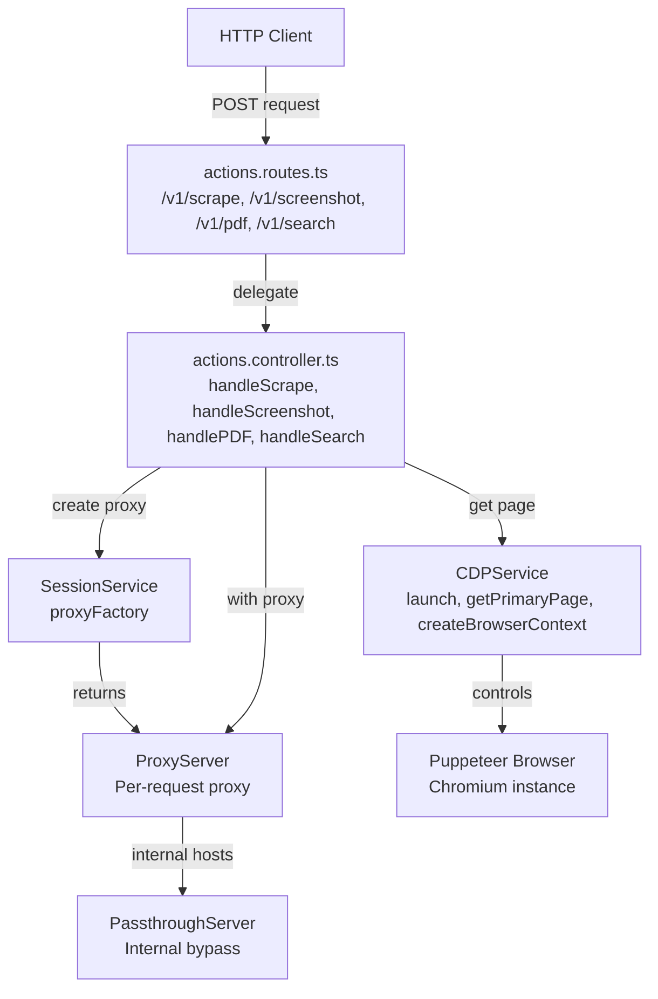
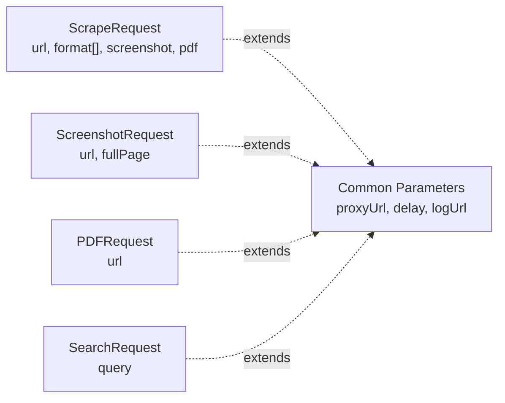
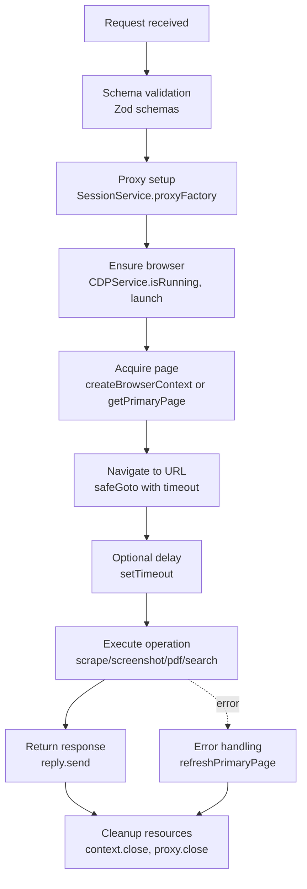
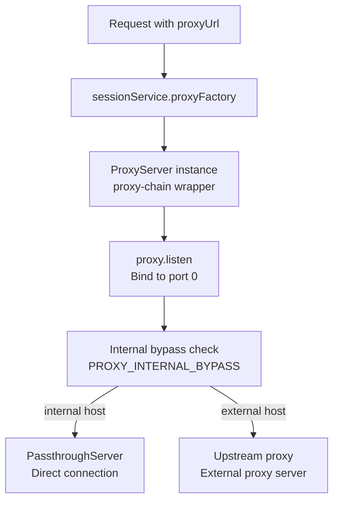
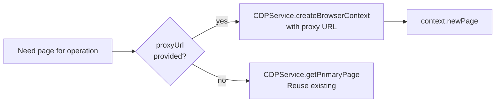

<!-- source: DeepWiki mcp.deepwiki.com · repo steel-dev/steel-browser · page 5 Quick Actions API · fetched 2026-10-27 -->

# Quick Actions API

<details>
<summary>Relevant source files</summary>

The following files were used as context for generating this wiki page:

- [api/src/modules/actions/actions.controller.ts](api/src/modules/actions/actions.controller.ts)
- [api/src/modules/actions/actions.routes.ts](api/src/modules/actions/actions.routes.ts)
- [api/src/modules/actions/actions.schema.ts](api/src/modules/actions/actions.schema.ts)
- [api/src/services/selenium.service.ts](api/src/services/selenium.service.ts)
- [api/src/utils/passthough-proxy.ts](api/src/utils/passthough-proxy.ts)
- [api/src/utils/proxy.ts](api/src/utils/proxy.ts)

</details>


The Quick Actions API provides stateless, single-shot browser operations for common web automation tasks. These endpoints enable simple, read-only operations without requiring session management or maintaining persistent browser state.

For comprehensive session-based browser automation with state persistence, see [Browser Sessions](#4). For detailed documentation on specific operations, see [Web Scraping](#5.1) and [Screenshots & PDF Generation](#5.2).

## Overview

Quick Actions are ephemeral browser operations that execute a single task and automatically clean up resources. Unlike sessions, these endpoints do not maintain browser state between requests and are ideal for simple automation workflows.

### Available Endpoints

| Endpoint | Purpose | Response Format |
|----------|---------|-----------------|
| `POST /v1/scrape` | Extract webpage content in multiple formats | JSON with content, metadata, links |
| `POST /v1/screenshot` | Capture webpage screenshot | Binary image (JPEG) |
| `POST /v1/pdf` | Generate PDF of webpage | Binary PDF document |
| `POST /v1/search` | Execute search engine queries | JSON with titles, URLs, descriptions |

**Architecture Context**



Sources: [api/src/modules/actions/actions.routes.ts:1-81](), [api/src/modules/actions/actions.controller.ts:25-151](), [api/src/utils/proxy.ts:15-69]()

### When to Use Quick Actions vs Sessions

**Use Quick Actions when:**
- Single webpage operation needed.
- No state persistence required.
- Simple read-only data extraction.
- One-off screenshot or PDF generation.
- Minimal configuration needed.

**Use Sessions when:**
- Multiple page navigation required.
- Cookies/storage persistence needed.
- Custom browser extensions required.
- CDP access for automation frameworks (Puppeteer/Playwright/Selenium).
- Complex multi-step workflows.

Sources: [api/src/modules/actions/actions.controller.ts:50-63]()

## Common Request Parameters

All Quick Action endpoints share these common parameters defined in Zod schemas:

| Parameter | Type | Required | Description |
|-----------|------|----------|-------------|
| `url` | string | Optional | Target URL to navigate to. If omitted, operates on current page. |
| `proxyUrl` | string\|null | Optional | Per-request proxy. Set to `null` to disable session proxy. |
| `delay` | number | Optional | Milliseconds to wait after page load before operation. |
| `logUrl` | string | Optional | Webhook URL for performance timing logs. |

**Schema Definition**



Sources: [api/src/modules/actions/actions.schema.ts:5-108]()

## Request Processing Pipeline

All Quick Actions follow a common processing pipeline with distinct phases:

**Pipeline Flow**



Sources: [api/src/modules/actions/actions.controller.ts:31-150]()

### Phase 1: Proxy Setup

When a `proxyUrl` is provided, the system creates a per-request proxy instance via `SessionService.proxyFactory`:



The `ProxyServer` class wraps the `proxy-chain` library and implements intelligent request routing. It checks for internal hostnames (localhost, etc.) to prevent routing loops.

Sources: [api/src/utils/proxy.ts:22-63](), [api/src/utils/passthough-proxy.ts:20-71]()

### Phase 2: Browser Page Acquisition

The system acquires a browser page using one of two strategies:

**Page Acquisition Strategy**



**With Proxy**: Creates an isolated `BrowserContext` with the proxy configuration [api/src/modules/actions/actions.controller.ts:57-58]().

**Without Proxy**: Reuses the primary page from the main browser instance via `getPrimaryPage()` [api/src/modules/actions/actions.controller.ts:61]().

### Phase 3: Navigation and Execution

Navigation is handled by `safeGoto`, which includes PDF detection and specific timeout settings:

```typescript
const safeResponse = normalizedUrl
  ? await safeGoto(page, normalizedUrl, {
      timeout: 30000,
      waitUntil: "domcontentloaded",
    })
  : { response: null, isPdf: false, pdfResponse: null };
```

If the target is a PDF, the system switches to a `node-fetch-with-cookies` strategy to acquire the buffer [api/src/modules/actions/actions.controller.ts:97-118]().

Sources: [api/src/modules/actions/actions.controller.ts:75-84](), [api/src/utils/scrape/safeGoTo.js]()

### Phase 4: Cleanup and Error Handling

All Quick Actions implement consistent cleanup patterns using try-catch-finally blocks:

**Error Recovery**: If an error occurs, the system captures it using the `getErrors` utility [api/src/modules/actions/actions.controller.ts:6](). If a URL was provided, `refreshPrimaryPage()` is called to ensure the browser remains in a clean state [api/src/modules/actions/actions.controller.ts:207]().

**Resource Cleanup**: Browser contexts and proxy servers are closed in the `finally` block to prevent resource leaks [api/src/modules/actions/actions.controller.ts:209-216]().

## Per-Request Proxy Architecture

The proxy system enables per-request proxy configuration without affecting the global browser session.

### Internal Bypass Configuration

The `PROXY_INTERNAL_BYPASS` environment variable configures hostnames that should bypass the upstream proxy. This is critical for preventing routing loops when the browser needs to reach the Steel API or local services [api/src/utils/proxy.ts:29-37]().

### PassthroughServer Implementation

The `PassthroughServer` is a simple HTTP proxy used when a request matches the internal bypass list. It forwards requests directly to the original host, filtering out hop-by-hop headers like `connection` and `proxy-authenticate` [api/src/utils/passthough-proxy.ts:5-14]().

## Browser Lifecycle Management

Quick Actions leverage the shared `CDPService` instance. The browser is launched lazily on the first request if it is not already running [api/src/modules/actions/actions.controller.ts:50-52]().

### Context vs Primary Page

- **BrowserContext**: Used for proxy requests. Isolated environment with separate cookies and storage. Closed immediately after use [api/src/modules/actions/actions.controller.ts:57]().
- **Primary Page**: Shared page used for non-proxy requests. Reused across requests for performance. Refreshed on errors [api/src/modules/actions/actions.controller.ts:61]().

## Performance Timing

All Quick Actions support performance logging via the `logUrl` parameter. Metrics include `proxyTime`, `pageTime`, `pageLoadTime`, and extraction/capture times [api/src/modules/actions/actions.controller.ts:31-62](). Timing data is updated via `updateLog` and sent to the provided webhook [api/src/utils/logging.js]().

## Schema Validation

All Quick Action endpoints use Zod schemas defined in `actions.schema.ts` for request validation and OpenAPI documentation generation [api/src/modules/actions/actions.schema.ts:1-135](). These schemas ensure type safety for parameters like `ScrapeFormat` and request bodies [api/src/modules/actions/actions.schema.ts:3-12]().

## Route Definitions

Routes are registered in `actions.routes.ts`. Each route includes metadata for Swagger/OpenAPI documentation, such as `operationId`, `summary`, and `tags` [api/src/modules/actions/actions.routes.ts:7-77]().

Sources: [api/src/modules/actions/actions.routes.ts:1-81](), [api/src/modules/actions/actions.schema.ts:124-133]()

---

