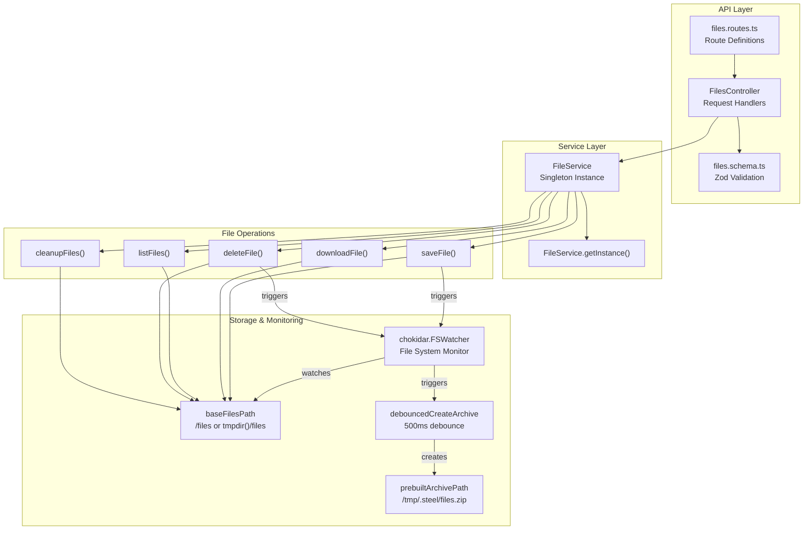
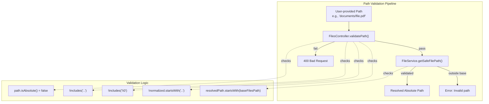
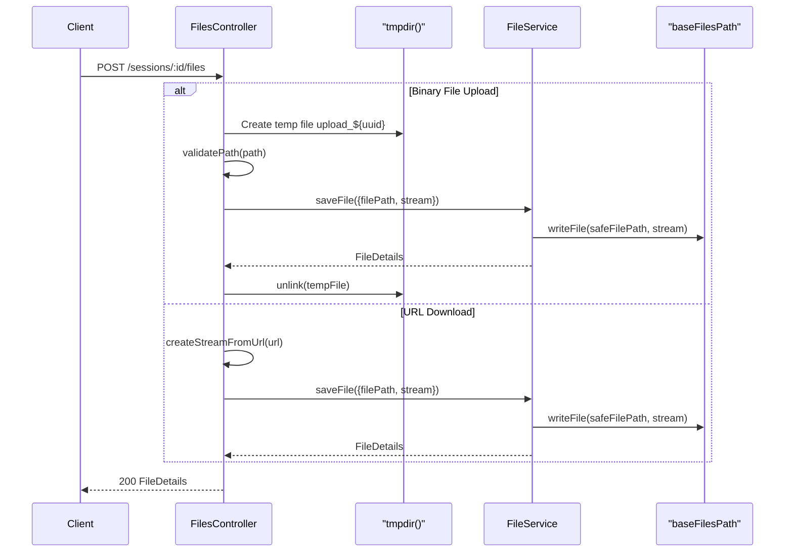

<!-- source: DeepWiki mcp.deepwiki.com · repo steel-dev/steel-browser · page 7 File Management · fetched 2026-10-27 -->

# File Management

Relevant source files

The following files were used as context for generating this wiki page:

- [api/src/modules/files/files.controller.ts](api/src/modules/files/files.controller.ts)
- [api/src/modules/files/files.routes.ts](api/src/modules/files/files.routes.ts)
- [api/src/modules/files/files.schema.ts](api/src/modules/files/files.schema.ts)
- [api/src/plugins/file-storage.ts](api/src/plugins/file-storage.ts)
- [api/src/services/file.service.ts](api/src/services/file.service.ts)

The File Management system provides persistent storage for files associated with browser sessions. This system enables uploading, downloading, listing, and deleting files, along with automatic zip archive creation for bulk downloads. The implementation uses a singleton `FileService` with filesystem watching via `chokidar` to maintain a continuously updated archive.

For detailed information on the REST API endpoints and request validation, see [File API](#7.1). For the automatic archive generation system and debouncing logic, see [Archive Management](#7.2).

## System Overview

The file management system consists of three primary layers: the API layer (`FilesController`), the service layer (`FileService`), and the storage layer (filesystem with `chokidar` monitoring). The `FileService` implements a singleton pattern to ensure consistent state and coordinate file watching across the application.

### File Management Architecture

**Sources:** [api/src/modules/files/files.controller.ts:17-18](), [api/src/services/file.service.ts:16-45](), [api/src/modules/files/files.routes.ts:8-146]()

## FileService Architecture

The `FileService` class uses a singleton pattern to maintain a single instance throughout the application lifecycle. This ensures consistent file watching state and prevents duplicate archive creation operations.

| Component | Type | Purpose |
|-----------|------|---------|
| `baseFilesPath` | `string` | Root directory for file storage (`/files` in production, `tmpdir()/files` in development) [api/src/services/file.service.ts:28-28]() |
| `fileWatcher` | `FSWatcher \| null` | Chokidar instance monitoring the base files directory [api/src/services/file.service.ts:18-18]() |
| `prebuiltArchivePath` | `string` | Path to the continuously maintained zip archive (`/tmp/.steel/files.zip`) [api/src/services/file.service.ts:30-30]() |
| `isArchiving` | `boolean` | Flag preventing concurrent archive creation operations [api/src/services/file.service.ts:22-22]() |
| `debouncedCreateArchive` | `DebouncedFunc` | Debounced function (500ms) that triggers archive rebuilding [api/src/services/file.service.ts:25-35]() |

The singleton is accessed via `FileService.getInstance()`, which is registered as a Fastify decorator through the `fileStoragePlugin` [api/src/plugins/file-storage.ts:5-8]().

**Sources:** [api/src/services/file.service.ts:16-45](), [api/src/plugins/file-storage.ts:1-10]()

## Storage Structure and Path Security

Files are stored in a hierarchical directory structure under `baseFilesPath`. The system implements multiple layers of path validation to prevent directory traversal attacks.

### Path Validation Flow

The `validatePath` method in `FilesController` performs initial string-based validation [api/src/modules/files/files.controller.ts:20-39](), while `getSafeFilePath` in `FileService` performs final path resolution and containment verification [api/src/services/file.service.ts:88-97]().

**Sources:** [api/src/modules/files/files.controller.ts:20-39](), [api/src/services/file.service.ts:88-97]()

## File Upload Flow

File uploads support two input methods: direct binary data via `multipart/form-data` submission, or URLs for remote file download. The system uses temporary staging before moving files to their final location.

The upload handler processes multipart requests, extracting the `file` field (binary or URL) and optional `path` [api/src/modules/files/files.controller.ts:41-157](). For URL-based uploads, `createStreamFromUrl` performs the fetch [api/src/modules/files/files.controller.ts:159-191]().

**Sources:** [api/src/modules/files/files.controller.ts:41-191](), [api/src/services/file.service.ts:110-148]()

## File System Watching

The file watching system uses `chokidar` to monitor all changes within `baseFilesPath` and automatically trigger archive rebuilding. The watcher is initialized during `FileService` construction [api/src/services/file.service.ts:37-37]().

The watcher configuration uses `awaitWriteFinish` to ensure files are completely written before triggering events [api/src/services/file.service.ts:63-72](). All file system events (add, unlink, etc.) invoke the `debouncedCreateArchive` function [api/src/services/file.service.ts:76-85]().

**Sources:** [api/src/services/file.service.ts:62-86](), [api/src/services/file.service.ts:47-60]()

## File Listing and Metadata

The `listFiles` method recursively scans the entire `baseFilesPath` directory tree, collecting file metadata (size, lastModified) for all discovered files [api/src/services/file.service.ts:204-250](). The results are sorted by modification time in descending order.

**Sources:** [api/src/services/file.service.ts:204-250]()

## Archive Download Mechanism

The archive download endpoint serves a pre-built `files.zip` that is continuously maintained. When clients request `/sessions/:sessionId/files.zip`, the system attempts to serve the existing archive from `prebuiltArchivePath` [api/src/modules/files/files.controller.ts:291-335]().

**Sources:** [api/src/modules/files/files.controller.ts:291-335](), [api/src/services/file.service.ts:329-331]()

## File Deletion and Cleanup

Individual files can be deleted via `DELETE /sessions/:sessionId/files/*`, while `DELETE /sessions/:sessionId/files` removes all files using `cleanupFiles()` [api/src/modules/files/files.routes.ts:92-131]().

The `cleanupFiles` method performs a comprehensive teardown:
1. Cancels pending debounced archive operations [api/src/services/file.service.ts:284-284]().
2. Removes the existing `files.zip` [api/src/services/file.service.ts:287-287]().
3. Recursively deletes and recreates the `baseFilesPath` [api/src/services/file.service.ts:297-319]().

**Sources:** [api/src/services/file.service.ts:280-323](), [api/src/modules/files/files.controller.ts:261-289]()

## Configuration

File storage behavior is configured through `steelBrowserConfig.fileStorage`. This includes the `maxSizePerSession` limit which is applied to the `fastify-multipart` plugin [api/src/modules/files/files.routes.ts:11-16]().

**Sources:** [api/src/modules/files/files.routes.ts:11-16](), [api/src/services/file.service.ts:28-30]()

---

