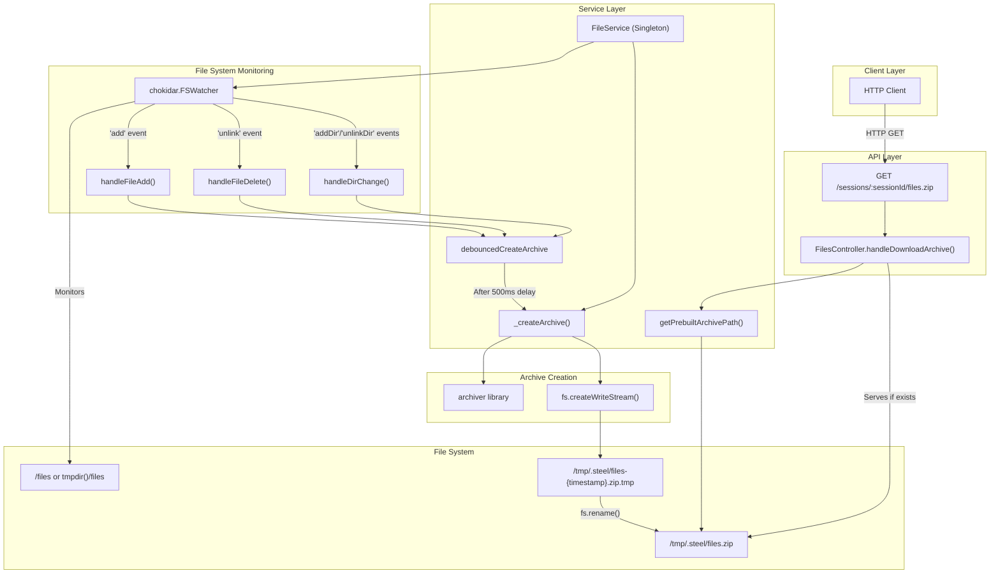
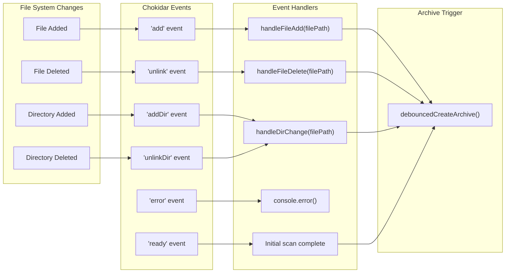
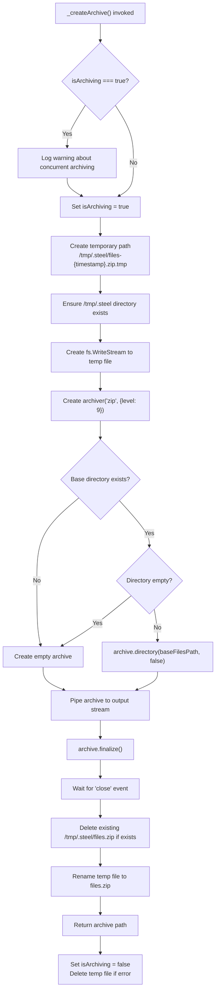
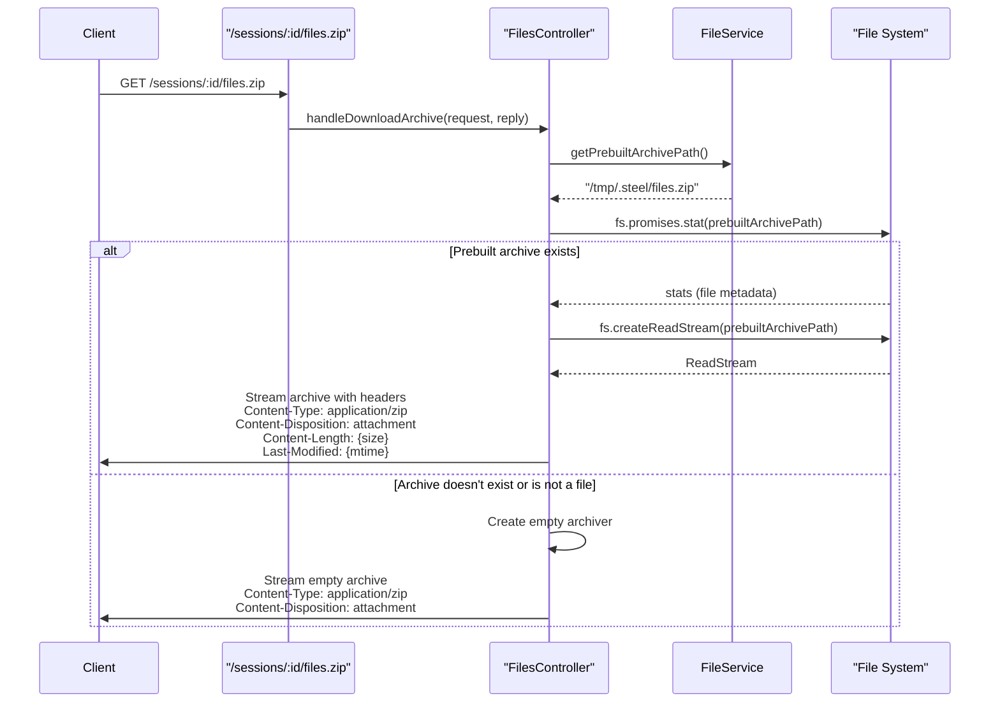

<!-- source: DeepWiki mcp.deepwiki.com · repo steel-dev/steel-browser · page 7.2 Archive Management · fetched 2026-10-27 -->

# Archive Management

<details>
<summary>Relevant source files</summary>

The following files were used as context for generating this wiki page:

- [api/src/modules/files/files.controller.ts](api/src/modules/files/files.controller.ts)
- [api/src/modules/files/files.routes.ts](api/src/modules/files/files.routes.ts)
- [api/src/modules/files/files.schema.ts](api/src/modules/files/files.schema.ts)
- [api/src/plugins/file-storage.ts](api/src/plugins/file-storage.ts)
- [api/src/services/file.service.ts](api/src/services/file.service.ts)

</details>


This page documents the automatic archive generation system in steel-browser, which maintains a continuously updated zip archive of all session files. When files are added, modified, or deleted, the system automatically regenerates a prebuilt archive that can be downloaded instantly via the archive endpoint. For individual file operations (upload, download, delete), see [File API](#7.1).

---

## Overview

The archive management system provides bulk download functionality for all files in a session. Rather than creating archives on-demand (which would be slow for large file sets), the system maintains a prebuilt archive that is automatically regenerated whenever the file system changes.

**Key Components:**

| Component | Purpose |
|-----------|---------|
| `FileService` | Singleton service managing file storage and archive generation |
| `chokidar.FSWatcher` | File system watcher monitoring for changes |
| `archiver` | Library for creating zip archives |
| Debounce mechanism | Prevents excessive archive regeneration during rapid file changes |
| Prebuilt archive | Continuously maintained zip file at `/tmp/.steel/files.zip` |

Sources: [api/src/services/file.service.ts:16-38]()

---

## Architecture

### Archive Management System Architecture



Sources: [api/src/services/file.service.ts:16-37](), [api/src/modules/files/files.controller.ts:291-335]()

---

## File Watching System

The archive management system uses `chokidar` to monitor the file system for changes. The watcher is initialized when the `FileService` singleton is created and runs continuously throughout the application lifecycle.

### Watcher Configuration

The file watcher is configured in `initFileWatcher()` with the following options:

| Option | Value | Purpose |
|--------|-------|---------|
| `ignored` | `/(^|[\/\\])\../` | Ignore hidden files (starting with `.`) |
| `persistent` | `true` | Keep process running while watching |
| `ignoreInitial` | `false` | Trigger events for existing files on startup |
| `awaitWriteFinish.stabilityThreshold` | `500ms` | Wait 500ms for file writes to stabilize |
| `awaitWriteFinish.pollInterval` | `100ms` | Poll every 100ms to check if write is complete |
| `depth` | `undefined` | Watch all subdirectories recursively |

Sources: [api/src/services/file.service.ts:61-72]()

### File System Event Flow



Sources: [api/src/services/file.service.ts:47-85]()

### Event Handlers

Each event handler logs the change and triggers the debounced archive creation:

```typescript
// Implementation of event handlers
private async handleFileAdd(filePath: string) {
  console.log(`[FileService] File added detected: ${filePath}`);
  this.debouncedCreateArchive();
}

private handleFileDelete(filePath: string) {
  console.log(`[FileService] File deleted detected: ${filePath}`);
  this.debouncedCreateArchive();
}

private handleDirChange(filePath: string) {
  console.log(`[FileService] Directory change detected: ${filePath}`);
  this.debouncedCreateArchive();
}
```

Sources: [api/src/services/file.service.ts:47-60]()

---

## Automatic Archive Generation

The archive is automatically regenerated whenever files change, using a debounced approach to handle rapid successive changes efficiently.

### Debouncing Mechanism

The `debouncedCreateArchive` function is created using lodash's `debounce` utility with a 500ms delay:

| Property | Value | Purpose |
|----------|-------|---------|
| `archiveDebounceTime` | `500` | Milliseconds to wait before creating archive |
| `debouncedCreateArchive` | `DebouncedFunc<() => Promise<string \| null>>` | Debounced wrapper around `_createArchive` |

This means:
- If multiple file changes occur within 500ms, only one archive creation is triggered
- The archive creation waits until file operations have stabilized
- Prevents system load from excessive archive regeneration

Sources: [api/src/services/file.service.ts:24-35]()

### Archive Creation Process



Sources: [api/src/services/file.service.ts:339-472]()

### Archive File Paths

The system uses specific file paths for archive management:

| Path Variable | Value | Purpose |
|---------------|-------|---------|
| `prebuiltArchiveDir` | `/tmp/.steel` | Directory for archive storage |
| `prebuiltArchivePath` | `/tmp/.steel/files.zip` | Final archive location |
| `tempArchivePath` | `/tmp/.steel/files-{timestamp}.zip.tmp` | Temporary file during creation |

Sources: [api/src/services/file.service.ts:29-30](), [api/src/services/file.service.ts:350]()

### Concurrency Handling

The `_createArchive()` method includes protection against concurrent archive creation:

```typescript
if (this.isArchiving) {
  console.warn(
    `[_createArchive] Warning: Archiving process initiated while another is already in progress.`
  );
}
this.isArchiving = true;
```

While the warning is logged, the method continues execution. This is acceptable because the debounce mechanism prevents most concurrent calls and the final rename operation is atomic.

Sources: [api/src/services/file.service.ts:341-347]()

### Error Handling

The archive creation process includes comprehensive error handling. Output stream errors trigger cleanup and reject the promise, while archive warnings (e.g., ENOENT for missing files) are logged but don't fail the operation.

Sources: [api/src/services/file.service.ts:368-391](), [api/src/services/file.service.ts:415-439]()

---

## Archive Download API

### Endpoint

**Route:** `GET /sessions/:sessionId/files.zip`

**Operation ID:** `download_archive`

**Summary:** Download all files from the session as a zip archive

Sources: [api/src/modules/files/files.routes.ts:133-145]()

### Request/Response Flow



Sources: [api/src/modules/files/files.controller.ts:291-335]()

### Response Headers

The endpoint sets headers for zip format, filename disposition, size, and modification time.

Sources: [api/src/modules/files/files.controller.ts:304-307]()

### Empty Archive Handling

If the prebuilt archive doesn't exist, the endpoint generates an empty zip archive on-the-fly using `archiver`.

Sources: [api/src/modules/files/files.controller.ts:313-320]()

---

## Integration with File Operations

The archive management system integrates with all file operations through the file watcher and explicit triggers in `FileService` methods.

### Automatic Regeneration Triggers

| File Operation | Method | Archive Trigger |
|----------------|--------|-----------------|
| File Upload | `saveFile()` | Calls `debouncedCreateArchive()` after successful save |
| File Delete | `deleteFile()` | Calls `debouncedCreateArchive()` after successful deletion |
| Cleanup All Files | `cleanupFiles()` | Cancels pending debounced call, then explicitly calls `debouncedCreateArchive()` |
| File System Watch | Event handlers | Each file/directory change triggers `debouncedCreateArchive()` |

Sources: [api/src/services/file.service.ts:131](), [api/src/services/file.service.ts:271](), [api/src/services/file.service.ts:328]()

---

## Performance Considerations

### Compression Level

The archive is created with maximum compression (`zlib: { level: 9 }`) to prioritize smaller file sizes.

Sources: [api/src/services/file.service.ts:365]()

### Atomic File Operations

The archive creation uses atomic file operations (writing to `.tmp` then renaming) to prevent serving partially-written archives.

Sources: [api/src/services/file.service.ts:350-404]()

---

## Code Entity Reference

### FileService Class

**Location:** [api/src/services/file.service.ts:16-473]()

**Key Properties:**

| Property | Type | Description |
|----------|------|-------------|
| `baseFilesPath` | `string` | Base directory for file storage |
| `prebuiltArchivePath` | `string` | Full path to prebuilt archive (`/tmp/.steel/files.zip`) |
| `isArchiving` | `boolean` | Flag indicating archive creation in progress |
| `debouncedCreateArchive` | `DebouncedFunc<...>` | Debounced wrapper for `_createArchive()` |

**Key Methods:**

| Method | Return Type | Description |
|--------|-------------|-------------|
| `getInstance()` | `FileService` | Returns singleton instance |
| `_createArchive()` | `Promise<string \| null>` | Creates zip archive at prebuilt path |
| `getPrebuiltArchivePath()` | `Promise<string>` | Returns path to prebuilt archive |

Sources: [api/src/services/file.service.ts:16-473]()

### FilesController Class

**Location:** [api/src/modules/files/files.controller.ts:17-336]()

Sources: [api/src/modules/files/files.controller.ts:291-335]()

---

