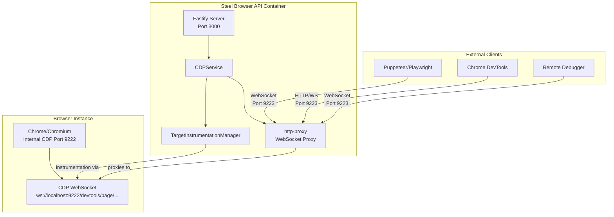
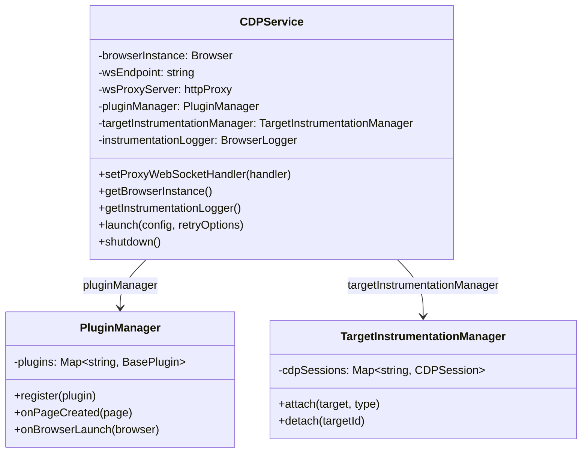
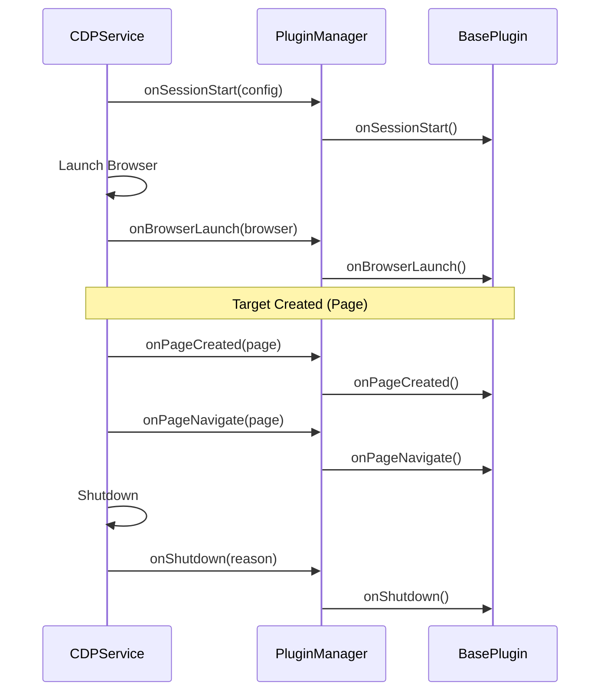

<!-- source: DeepWiki mcp.deepwiki.com · repo steel-dev/steel-browser · page 8.1 CDP Integration · fetched 2026-10-27 -->

# CDP Integration

<details>
<summary>Relevant source files</summary>

The following files were used as context for generating this wiki page:

- [api/src/modules/cdp/cdp.routes.ts](api/src/modules/cdp/cdp.routes.ts)
- [api/src/services/cdp/cdp.service.ts](api/src/services/cdp/cdp.service.ts)
- [api/src/services/cdp/instrumentation/cdp-events.ts](api/src/services/cdp/instrumentation/cdp-events.ts)
- [api/src/services/cdp/instrumentation/page-events.ts](api/src/services/cdp/instrumentation/page-events.ts)
- [api/src/services/cdp/instrumentation/target-manager.ts](api/src/services/cdp/instrumentation/target-manager.ts)
- [api/src/services/cdp/instrumentation/types.ts](api/src/services/cdp/instrumentation/types.ts)
- [api/src/services/cdp/plugins/core/base-plugin.ts](api/src/services/cdp/plugins/core/base-plugin.ts)
- [api/src/services/cdp/plugins/core/plugin-manager.ts](api/src/services/cdp/plugins/core/plugin-manager.ts)
- [api/src/types/enums.ts](api/src/types/enums.ts)

</details>


This document details how Steel Browser integrates with the Chrome DevTools Protocol (CDP), exposing direct browser control to external clients through WebSocket proxying and internal instrumentation for event tracking. CDP is Chrome's native protocol for browser automation, and Steel exposes it to enable integration with tools like Puppeteer, Playwright, and Chrome DevTools itself.

## Overview

Steel Browser runs a Chromium instance with CDP enabled on an internal port (9222) and proxies CDP WebSocket connections through a configurable external port (default 9223). This allows external automation tools and debuggers to connect directly to the browser while Steel manages the browser lifecycle, fingerprinting, and session state.

**CDP Integration Architecture**



The `CDPService` creates an `httpProxy` instance that forwards WebSocket connections from external clients to the browser's internal CDP endpoint. Simultaneously, it uses `TargetInstrumentationManager` to attach internal listeners for logging and event capture.

Sources: [api/src/services/cdp/cdp.service.ts:83-185](), [api/src/services/cdp/instrumentation/target-manager.ts:14-26]()

## CDPService Architecture

The `CDPService` class manages the browser lifecycle and exposes CDP access through WebSocket proxying. It maintains a reference to the browser instance, the WebSocket endpoint, and an HTTP proxy server for routing external connections.

**CDPService Core Components**



The service is initialized with a `PluginManager` for lifecycle hooks and a `TargetInstrumentationManager` for monitoring targets. It also initializes an `instrumentationLogger` that emits logs via the `EmitEvent.Log` event.

Sources: [api/src/services/cdp/cdp.service.ts:83-185](), [api/src/services/cdp/plugins/core/plugin-manager.ts:7-16](), [api/src/services/cdp/instrumentation/target-manager.ts:14-26]()

## Target Instrumentation & Events

Steel uses a multi-layered instrumentation strategy to capture browser activity. When a new target (page, worker, or extension) is created, the `TargetInstrumentationManager` attaches listeners to specific CDP domains.

### Domain Enablement
The system enables different CDP domains based on the `TargetType`:
- **PAGE / BACKGROUND_PAGE**: Enables `Runtime`, `Log`, and `Network`. [api/src/services/cdp/instrumentation/target-manager.ts:147-152]()
- **WORKERS**: Enables `Runtime` and `Log`. [api/src/services/cdp/instrumentation/target-manager.ts:154-161]()
- **EXTENSIONS**: Enables `Network` even for service workers. [api/src/services/cdp/instrumentation/target-manager.ts:158-160]()

### Event Mapping
Events captured from CDP are mapped to internal `BrowserEventType` definitions:

| CDP Event / Source | Internal Event Type | Description |
|-------------------|---------------------|-------------|
| `Network.requestWillBeSent` | `BrowserEventType.Request` | Outgoing HTTP requests |
| `Network.responseReceived` | `BrowserEventType.Response` | Incoming HTTP responses |
| `Network.loadingFinished` | `BrowserEventType.ResponseBody` | Captures response bodies (if enabled) |
| `Runtime.consoleAPICalled` | `BrowserEventType.Console` | Browser console logs |
| `Runtime.exceptionThrown` | `BrowserEventType.PageError` | Uncaught JS exceptions |
| `framenavigated` | `BrowserEventType.Navigation` | Page URL changes |

Sources: [api/src/services/cdp/instrumentation/page-events.ts:24-202](), [api/src/types/enums.ts:10-25](), [api/src/services/cdp/instrumentation/types.ts:4-115]()

## Plugin System Lifecycle

The `CDPService` integrates a plugin system that hooks into various stages of the CDP lifecycle. Plugins extend `BasePlugin` and are notified by the `PluginManager`.

**Plugin Lifecycle Flow**



Plugins can react to events like `onPageCreated` or `onBrowserLaunch` to perform tasks like ad-blocking, custom header injection, or fingerprinting.

Sources: [api/src/services/cdp/plugins/core/base-plugin.ts:27-55](), [api/src/services/cdp/plugins/core/plugin-manager.ts:52-217]()

## CDP Protocol Tracing

For debugging automation flows, Steel can log the raw CDP commands and results. This is handled by `attachCDPEvents`, which wraps the `session.send` method.

**CDP Command Instrumentation**
```typescript
session.send = async function (method: Method, params?: object) {
  // Logs BrowserEventType.CDPCommand before execution
  // Executes original session.send
  // Logs BrowserEventType.CDPCommandResult with duration and success status
}
```
The tracer ignores high-frequency events like `Network.*` (which are handled by specialized listeners) to avoid log bloat.

Sources: [api/src/services/cdp/instrumentation/cdp-events.ts:9-76]()

## WebSocket Proxying

The `CDPService` handles incoming WebSocket connections and forwards them to the browser's CDP endpoint. This enables external tools to connect and control the browser directly.

The proxy server maintains cleanup listeners for browser close events and socket errors. A custom WebSocket handler can be set using `setProxyWebSocketHandler()` for advanced routing, such as directing traffic to specific plugins or instrumentation streams.

Sources: [api/src/services/cdp/cdp.service.ts:195-199](), [api/src/modules/cdp/cdp.routes.ts:7-29]()

## Debugger URL Generation

The `CDPService` provides methods to generate URLs for connecting to the browser's debugger interface. These URLs enable external tools to connect via HTTP or WebSocket.

| Method | Description |
|--------|-------------|
| `getDebuggerUrl()` | Returns HTTP URL for DevTools UI |
| `getDebuggerWsUrl(pageId?)` | Returns WebSocket URL for CDP connection |

The `/devtools/inspector.html` route facilitates this by redirecting clients to the appropriate debugger URL based on the provided `pageId`.

Sources: [api/src/modules/cdp/cdp.routes.ts:7-29]()

---

