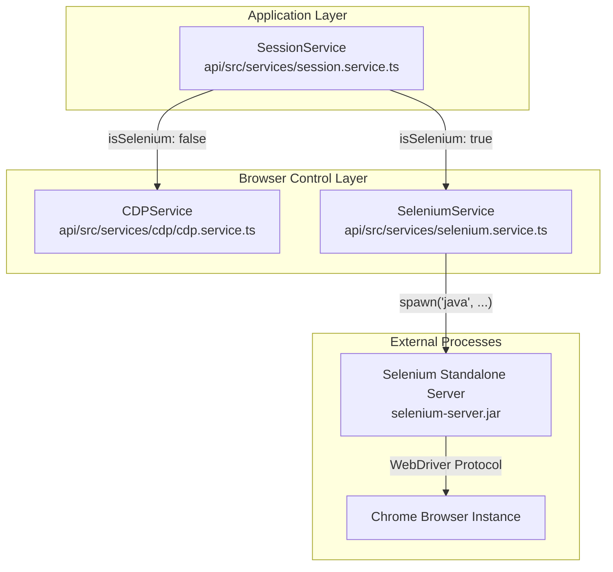
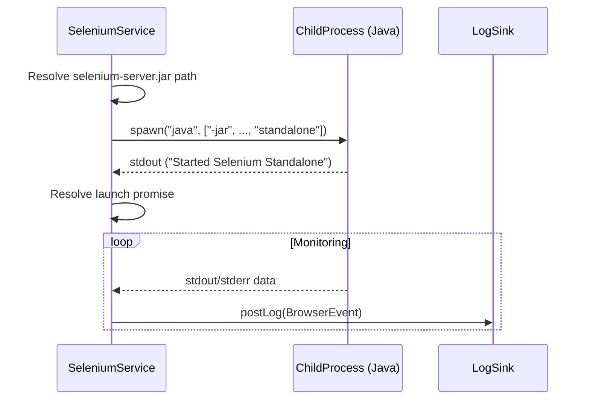
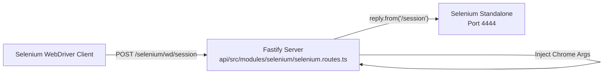
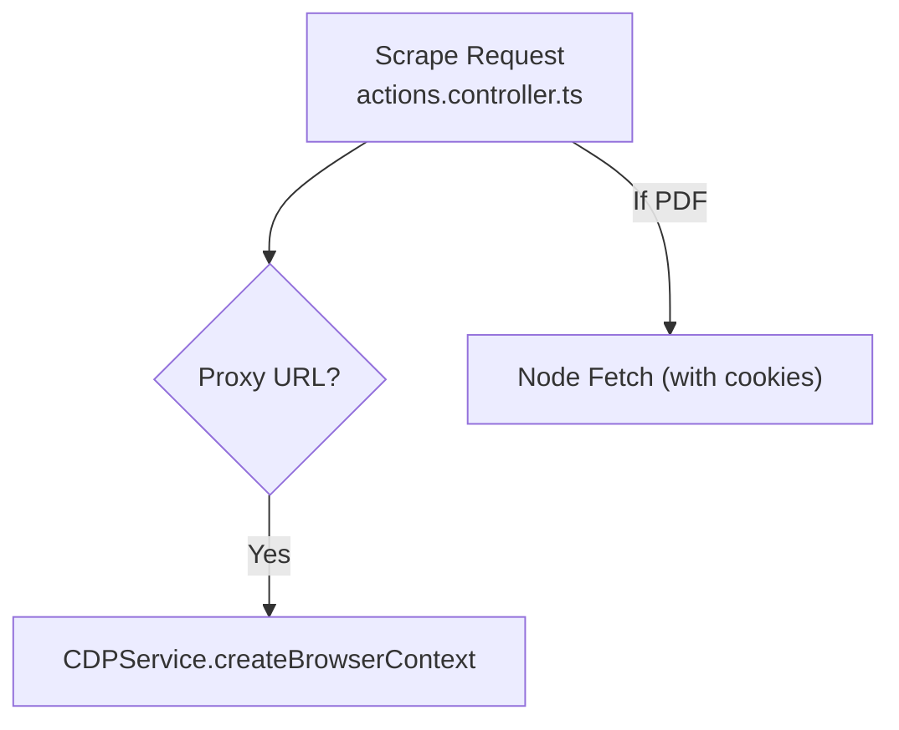

<!-- source: DeepWiki mcp.deepwiki.com · repo steel-dev/steel-browser · page 8.2 Selenium Support · fetched 2026-10-27 -->

# Selenium Support

Relevant source files

The following files were used as context for generating this wiki page:

- [api/src/modules/actions/actions.controller.ts](api/src/modules/actions/actions.controller.ts)
- [api/src/modules/actions/actions.routes.ts](api/src/modules/actions/actions.routes.ts)
- [api/src/modules/actions/actions.schema.ts](api/src/modules/actions/actions.schema.ts)
- [api/src/modules/logs/logs.routes.ts](api/src/modules/logs/logs.routes.ts)
- [api/src/modules/logs/logs.schema.ts](api/src/modules/logs/logs.schema.ts)
- [api/src/modules/selenium/selenium.routes.ts](api/src/modules/selenium/selenium.routes.ts)
- [api/src/modules/selenium/selenium.schema.ts](api/src/modules/selenium/selenium.schema.ts)
- [api/src/services/selenium.service.ts](api/src/services/selenium.service.ts)
- [api/src/utils/passthough-proxy.ts](api/src/utils/passthough-proxy.ts)
- [api/src/utils/proxy.ts](api/src/utils/proxy.ts)

## Purpose and Scope

This document describes steel-browser's Selenium WebDriver compatibility mode, which provides a drop-in replacement for teams with existing Selenium workflows. The Selenium integration allows standard Selenium clients (Java, Python, JavaScript, etc.) to connect to steel-browser sessions using the WebDriver protocol.

For information about the primary Chrome DevTools Protocol (CDP) integration, see [CDP Integration](#8.1). For general session management concepts, see [Session Management API](#4.1).

**Note:** The Selenium integration is a compatibility layer that does not support all features available in CDP-based sessions. It is designed for teams migrating from or maintaining existing Selenium codebases.

---

## Architecture Overview

steel-browser supports two browser control modes through distinct service layers. The `SeleniumService` manages a standalone Selenium server process.

**Sources:** [api/src/services/selenium.service.ts:8-12](), [api/src/services/selenium.service.ts:39-44]()

The `SeleniumService` orchestrates the lifecycle of the `selenium-server.jar` process, which acts as the WebDriver endpoint for external clients.

---

## Selenium Server Lifecycle

### Launching the Service

When a Selenium session is requested, `SeleniumService.launch` is invoked. It spawns a Java process running the Selenium Standalone server.

**Sources:** [api/src/services/selenium.service.ts:32-82](), [api/src/services/selenium.service.ts:95-106]()

### Key Functions and Configuration

| Function | Description |
|----------|-------------|
| `launch(launchOptions)` | Spawns the Selenium server process and waits for the "Started Selenium Standalone" log message. [api/src/services/selenium.service.ts:32-82]() |
| `getChromeArgs()` | Normalizes `BrowserLauncherOptions` into Chrome command-line arguments (e.g., `--proxy-server`, `--user-agent`). [api/src/services/selenium.service.ts:20-30]() |
| `close()` | Sends `SIGINT` to the Selenium process to gracefully shut down. [api/src/services/selenium.service.ts:84-89]() |
| `postLog(browserLog)` | Forwards Selenium process logs to a remote `logSinkUrl` if configured. [api/src/services/selenium.service.ts:95-106]() |

---

## WebDriver Routing and Proxying

The API provides a proxy route that forwards standard WebDriver commands to the internal Selenium server.

**Sources:** [api/src/modules/selenium/selenium.routes.ts:9-13](), [api/src/modules/selenium/selenium.routes.ts:31-43]()

### Command Injection
When a client creates a new session via `POST /selenium/wd/session`, the route handler automatically injects the necessary Chrome capabilities (like proxy settings and user agents) retrieved from `seleniumService.getChromeArgs()`.

**Sources:** [api/src/modules/selenium/selenium.routes.ts:13-29]()

---

## Session Properties

Selenium sessions return different properties compared to CDP sessions. Notably, standard CDP features like live streaming and the session viewer are disabled.

### Property Comparison

| Property | CDP Session Value | Selenium Session Value | Notes |
|----------|------------------|------------------------|-------|
| `websocketUrl` | `ws://host:port/ws` | `""` (empty) | No WebSocket streaming in Selenium mode |
| `debugUrl` | `/v1/sessions/debug` | `""` (empty) | No live debugger in Selenium mode |
| `isSelenium` | `false` | `true` | Identifies session mode |

**Sources:** [api/src/modules/selenium/selenium.schema.ts:3-30]()

---

## Browser Actions Compatibility

While Selenium sessions are intended for external WebDriver control, the Steel **Quick Actions API** (Scrape, Screenshot, PDF) still operates via `CDPService` or independent fetch mechanisms.

### Scrape and PDF Flow
The `handleScrape` function in `actions.controller.ts` uses `CDPService` to create a context even if a proxy is used, but for PDF acquisition, it uses a node-fetch approach with session cookies.

**Sources:** [api/src/modules/actions/actions.controller.ts:33-63](), [api/src/modules/actions/actions.controller.ts:97-118]()

---

## Proxy Handling

For Selenium sessions, proxies are handled via a passthrough mechanism to avoid issues with chunked requests in standard proxy-chain implementations.

| Component | File Path | Role |
|-----------|-----------|------|
| `ProxyServer` | [api/src/utils/proxy.ts:15]() | Extends `proxy-chain` Server to handle upstream proxying. |
| `PassthroughServer` | [api/src/utils/passthough-proxy.ts:20]() | A simple HTTP server that reverse proxies requests to the original host. |
| `makePassthrough` | [api/src/utils/passthough-proxy.ts:79]() | Manually forwards requests and pipes bodies to prevent corruption. |

**Sources:** [api/src/utils/proxy.ts:26-51](), [api/src/utils/passthough-proxy.ts:20-71]()

---

## Summary of Support

| Feature | Supported in Selenium Mode | Implementation Detail |
|---------|---------------------------|-----------------------|
| **WebDriver Protocol** | ✅ Full | Via `selenium-server.jar` standalone. |
| **Chrome Args** | ✅ Full | Injected into session capabilities. |
| **Proxying** | ✅ Full | Via `ProxyServer` and passthrough logic. |
| **Live View** | ❌ No | WebSocket and Debug URLs are empty. |
| **Instrumentation** | ❌ Limited | Only process stdout/stderr logs are captured. |

**Sources:** [api/src/services/selenium.service.ts:20-30](), [api/src/modules/selenium/selenium.routes.ts:10-59](), [api/src/modules/selenium/selenium.schema.ts:32-34]()

---

