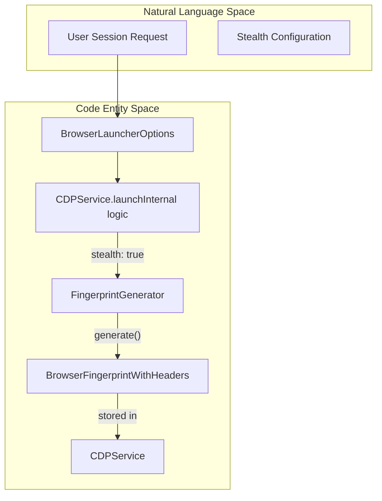
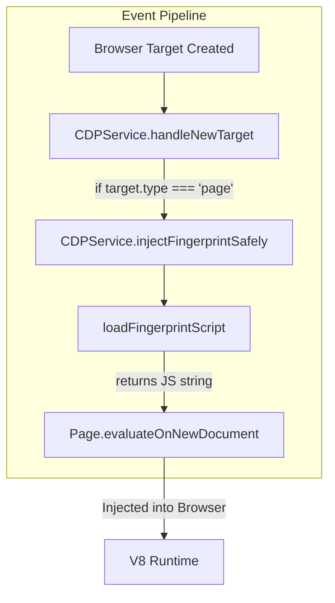
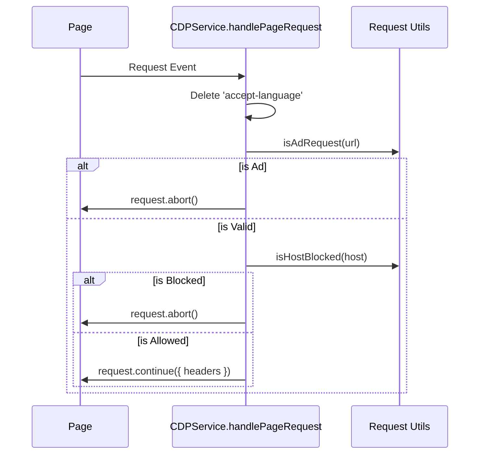

<!-- source: DeepWiki mcp.deepwiki.com · repo steel-dev/steel-browser · page 8.3 Anti-Detection Features · fetched 2026-10-27 -->

# Anti-Detection Features

Relevant source files

The following files were used as context for generating this wiki page:

- [api/src/scripts/fingerprint.js](api/src/scripts/fingerprint.js)
- [api/src/scripts/index.ts](api/src/scripts/index.ts)
- [api/src/services/cdp/cdp.service.ts](api/src/services/cdp/cdp.service.ts)
- [api/src/services/cdp/plugins/core/base-plugin.ts](api/src/services/cdp/plugins/core/base-plugin.ts)
- [api/src/services/cdp/plugins/core/plugin-manager.ts](api/src/services/cdp/plugins/core/plugin-manager.ts)
- [api/src/utils/browser.ts](api/src/utils/browser.ts)

## Purpose and Scope

This document describes the anti-detection features that make automated browsers appear as regular user browsers to detection systems. These features include browser fingerprinting, user agent spoofing, request header manipulation, and Chrome launch configuration to disable automation signals.

For information about request filtering and ad blocking, see [8.4 Request Interception & Filtering](). For proxy configuration to mask IP addresses, see [6. Proxy Support]().

---

## Overview

The `steel-browser` system implements multiple layers of anti-detection mechanisms to evade browser automation detection systems. These mechanisms fall into four categories:

| Category | Techniques | Primary Implementation |
|----------|-----------|----------------------|
| **Browser Fingerprinting** | Hardware, platform, and browser attribute spoofing | `CDPService`, `loadFingerprintScript` |
| **Launch Configuration** | Chrome arguments to disable automation signals | `CDPService.launchInternal` |
| **Request Manipulation** | Header filtering, custom headers, ad blocking | `handlePageRequest`, `filterHeaders` |
| **User Agent Spoofing** | Custom user agent strings | `BrowserLauncherOptions.userAgent` |

---

## Fingerprint Generation

### Fingerprint Generator Library

The system uses the `fingerprint-generator` library to create realistic browser fingerprints based on device type and configuration. Fingerprints are generated during browser launch when stealth mode is enabled.

**Sources:** [api/src/services/cdp/cdp.service.ts:656-693](), [api/src/services/cdp/cdp.service.ts:89-89]()

### Configuration Parameters

The fingerprint generation logic checks several configuration flags within `BrowserLauncherOptions`:

| Field | Type | Default | Purpose |
|-------|------|---------|---------|
| `stealth` | `boolean` | `undefined` | Enables stealth mode features |
| `skipFingerprintInjection` | `boolean` | `false` | Bypasses fingerprint injection |
| `fingerprint` | `BrowserFingerprintWithHeaders` | `null` | Allows pre-generated fingerprints |
| `userAgent` | `string` | `undefined` | Custom user agent string |
| `deviceConfig.device` | `"desktop" \| "mobile"` | `"desktop"` | Device type for fingerprint |
| `dimensions` | `{width, height}` | `{1920, 1080}` | Screen dimensions |

**Sources:** [api/src/services/cdp/cdp.service.ts:656-698]()

---

## Fingerprint Injection

### Injection Mechanism

Fingerprints are injected into every new page using the `injectFingerprintSafely` method. The injection occurs in the `handleNewTarget` event handler when a new page is created.

**Sources:** [api/src/services/cdp/cdp.service.ts:313-383](), [api/src/services/cdp/cdp.service.ts:1145-1193]()

### Fixed Constants and API Overrides

The `loadFingerprintScript` function in `api/src/scripts/index.ts` generates JavaScript code that defines fixed constants and loads the fingerprint override script (`fingerprint.js`).

| Constant | Purpose | Implementation Detail |
|----------|---------|-----------------------|
| `FIXED_VENDOR` | GPU vendor name | Defaults to `"Google Inc."` |
| `FIXED_RENDERER` | GPU renderer | Defaults to `"ANGLE (Intel...)"` |
| `FIXED_HARDWARE_CONCURRENCY` | CPU cores | Spoofed value from generator |
| `FIXED_DEVICE_MEMORY` | RAM in GB | Spoofed value from generator |
| `FIXED_PLATFORM` | Operating system | Defaults to `"Linux x86_64"` |
| `FIXED_BRANDS` | Browser brands | Array of brand/version objects |

The generated script then executes `fingerprint.js`, which uses obfuscated logic to delete automation signals like `window.cdc_adoQpo...` and override `navigator` properties.

**Sources:** [api/src/scripts/index.ts:15-72](), [api/src/scripts/fingerprint.js:37-39]()

---

## Chrome Launch Arguments

### Automation Detection Disablement

The system uses specific Chrome launch arguments to disable automation detection features. These arguments vary between headless and headful modes.

**Critical Anti-Detection Arguments:**
- `--disable-blink-features=AutomationControlled`: Removes the `navigator.webdriver` property (headless only).
- `--disable-features=IsolateOrigins,site-per-process`: Disables site isolation that can be detected by timing attacks.
- `--webrtc-ip-handling-policy=disable_non_proxied_udp`: Prevents WebRTC IP leaks.

**Sources:** [api/src/services/cdp/cdp.service.ts:776-854]()

---

## Request Interception and Header Manipulation

### Header Filtering

The `filterHeaders` function in `api/src/utils/browser.ts` removes fingerprinting headers from outgoing requests that might reveal automation:

| Removed Header | Reason |
|----------------|--------|
| `accept-encoding` | Can reveal automation through encoding preferences |
| `sec-fetch-dest` | Reveals request destination context |
| `sec-fetch-mode` | Reveals fetch mode (navigate, cors, etc.) |
| `sec-fetch-site` | Reveals request origin relationship |
| `upgrade-insecure-requests` | Standard browser-specific header |

**Sources:** [api/src/utils/browser.ts:148-165]()

### Request Interception Pipeline

The `CDPService.handlePageRequest` method intercepts every request to apply anti-detection logic.

**Sources:** [api/src/services/cdp/cdp.service.ts:385-438]()

---

## Plugin System Integration

Anti-detection features can be extended or modified via the Plugin System. The `PluginManager` triggers hooks throughout the browser lifecycle, allowing plugins to perform additional stealth actions.

- `onPageCreated`: Used to set up initial page-level stealth.
- `onBrowserLaunch`: Used to modify browser-wide settings.
- `onPageNavigate`: Used to re-apply stealth settings during navigation.

**Sources:** [api/src/services/cdp/plugins/core/plugin-manager.ts:123-132](), [api/src/services/cdp/plugins/core/base-plugin.ts:46-49]()

---

## Summary of Implementation Entities

| Component | File | Responsibility |
|-----------|------|----------------|
| `CDPService` | [api/src/services/cdp/cdp.service.ts]() | Orchestrates fingerprinting, launch args, and request interception. |
| `FingerprintInjector` | [api/src/services/cdp/cdp.service.ts:9]() | External library used to inject fingerprints into the browser context. |
| `loadFingerprintScript` | [api/src/scripts/index.ts:15]() | Compiles the JS payload for `Page.evaluateOnNewDocument`. |
| `filterHeaders` | [api/src/utils/browser.ts:148]() | Cleans headers to prevent passive fingerprinting. |
| `installMouseHelper` | [api/src/utils/browser.ts:35]() | Injects a visual cursor to simulate human-like interaction in screenshots/videos. |

**Sources:** [api/src/services/cdp/cdp.service.ts](), [api/src/scripts/index.ts](), [api/src/utils/browser.ts]()

---

