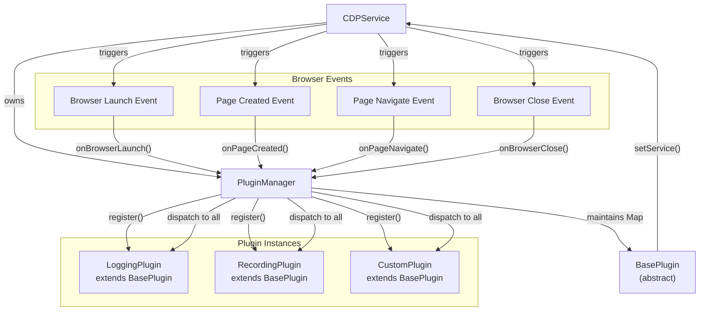
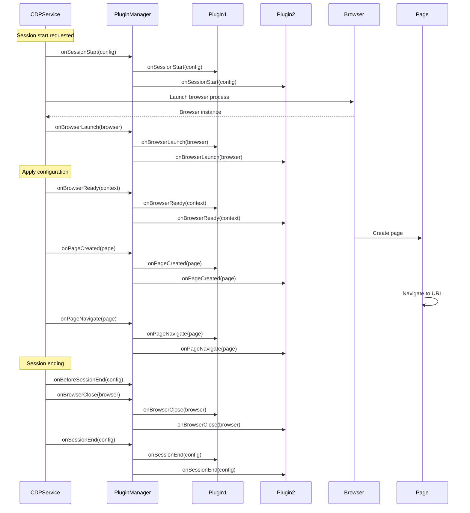
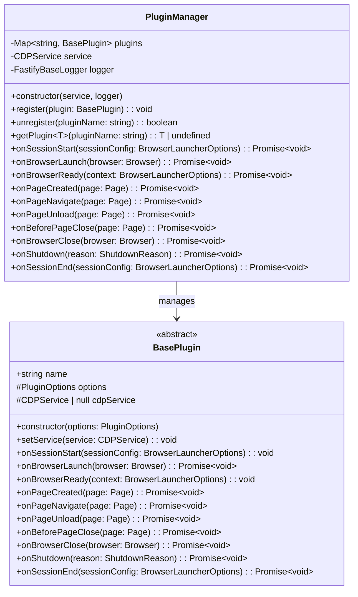
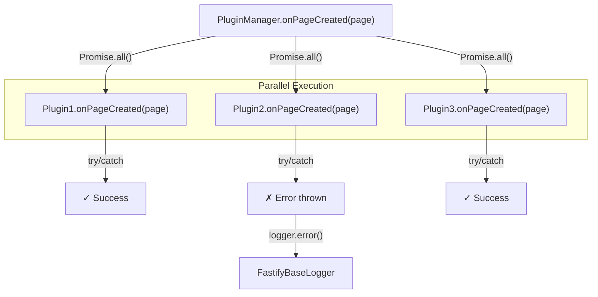

<!-- source: DeepWiki mcp.deepwiki.com · repo steel-dev/steel-browser · page 9 Plugin System · fetched 2026-10-27 -->

# Plugin System

<details>
<summary>Relevant source files</summary>

The following files were used as context for generating this wiki page:

- [api/src/services/cdp/cdp.service.ts](api/src/services/cdp/cdp.service.ts)
- [api/src/services/cdp/plugins/core/base-plugin.ts](api/src/services/cdp/plugins/core/base-plugin.ts)
- [api/src/services/cdp/plugins/core/plugin-manager.ts](api/src/services/cdp/plugins/core/plugin-manager.ts)

</details>


## Purpose and Scope

The Plugin System provides a modular, event-driven architecture for extending browser automation functionality in steel-browser. Plugins intercept key browser lifecycle events (browser launch, page creation, navigation, etc.) to inject custom behavior without modifying core services. The system uses the `BasePlugin` abstract class and `PluginManager` orchestration to provide a clean extension mechanism.

For detailed guidance on creating custom plugins, see [Creating Custom Plugins](#14.4). For documentation of specific built-in plugins, see [Built-in Plugins](#9.2). For information on how plugins integrate with the broader CDP automation system, see [CDPService](#3.1).

---

## Architecture Overview

The plugin system consists of three core components:

| Component | File | Responsibility |
|-----------|------|----------------|
| `BasePlugin` | [api/src/services/cdp/plugins/core/base-plugin.ts]() | Abstract base class defining plugin interface and lifecycle hooks |
| `PluginManager` | [api/src/services/cdp/plugins/core/plugin-manager.ts]() | Orchestrates plugin registration and lifecycle event dispatch |
| `CDPService` | [api/src/services/cdp/cdp.service.ts]() | Owns plugin manager and triggers lifecycle events |

### Plugin Architecture



**Sources:** [api/src/services/cdp/plugins/core/base-plugin.ts:27-40](), [api/src/services/cdp/plugins/core/plugin-manager.ts:7-16](), [api/src/services/cdp/cdp.service.ts:99-169]()

---

## Plugin Lifecycle Hooks

`BasePlugin` defines multiple lifecycle hooks that plugins can override to inject behavior at specific points in the browser automation flow. All hooks receive relevant context objects.

### Lifecycle Hook Reference

| Hook | Signature | Timing | Common Use Cases |
|------|-----------|--------|------------------|
| `onSessionStart` | `onSessionStart(sessionConfig: BrowserLauncherOptions): void \| Promise<void>` | Before session launch or reuse | Initialize session-level resources |
| `onBrowserLaunch` | `async onBrowserLaunch(browser: Browser): Promise<void>` | Immediately after browser process starts | Initialize browser-level state |
| `onBrowserReady` | `onBrowserReady(context: BrowserLauncherOptions): void \| Promise<void>` | After browser launch completes | Access final session configuration |
| `onPageCreated` | `async onPageCreated(page: Page): Promise<void>` | When a new page/tab is created | Inject scripts, set up page event listeners |
| `onPageNavigate` | `async onPageNavigate(page: Page): Promise<void>` | Before page navigation starts | Modify navigation parameters |
| `onPageUnload` | `async onPageUnload(page: Page): Promise<void>` | When page begins to unload | Capture pre-unload state |
| `onBeforePageClose` | `async onBeforePageClose(page: Page): Promise<void>` | Before page closes | Clean up page-specific resources |
| `onBrowserClose` | `async onBrowserClose(browser: Browser): Promise<void>` | Before browser process terminates | Clean up browser-level resources |
| `onShutdown` | `async onShutdown(reason: ShutdownReason): Promise<void>` | When service shuts down | Global cleanup based on `ShutdownReason` |
| `onSessionEnd` | `async onSessionEnd(sessionConfig: BrowserLauncherOptions): Promise<void>` | When session terminates | Post-session cleanup |

**Sources:** [api/src/services/cdp/plugins/core/base-plugin.ts:43-54]()

### Lifecycle Event Flow



**Sources:** [api/src/services/cdp/plugins/core/plugin-manager.ts:54-216]()

---

## Plugin Registration and Management

`PluginManager` maintains a `Map<string, BasePlugin>` of registered plugins, indexed by plugin name. It provides methods for plugin lifecycle management and ensures safe, isolated execution of plugin hooks.

### PluginManager Interface



**Sources:** [api/src/services/cdp/plugins/core/plugin-manager.ts:7-217](), [api/src/services/cdp/plugins/core/base-plugin.ts:27-55]()

### Registration Process

1. **Plugin Instantiation**: Create a plugin instance extending `BasePlugin` with a unique name.
2. **Registration**: Call `pluginManager.register(plugin)`.
3. **Service Injection**: `PluginManager` calls `plugin.setService(service)` to provide access to `CDPService`. [api/src/services/cdp/plugins/core/plugin-manager.ts:26]()
4. **Storage**: Plugin stored in internal `Map<string, BasePlugin>` indexed by `plugin.name`. [api/src/services/cdp/plugins/core/plugin-manager.ts:27]()

### Management Operations

| Method | Parameters | Returns | Behavior |
|--------|------------|---------|----------|
| `register()` | `plugin: BasePlugin` | `void` | Adds plugin to registry. If name exists, overwrites with warning. [api/src/services/cdp/plugins/core/plugin-manager.ts:21-29]() |
| `unregister()` | `pluginName: string` | `boolean` | Removes plugin from registry by name. [api/src/services/cdp/plugins/core/plugin-manager.ts:34-42]() |
| `getPlugin<T>()` | `pluginName: string` | `T \| undefined` | Retrieves plugin by name with type casting. [api/src/services/cdp/plugins/core/plugin-manager.ts:47-49]() |

---

## Event Dispatch Mechanism

When `CDPService` triggers a lifecycle event, `PluginManager` dispatches it to all registered plugins using a parallel, fault-isolated execution model:

### Execution Characteristics

1. **Parallel Dispatch**: All plugins receive events concurrently via `Promise.all()`. [api/src/services/cdp/plugins/core/plugin-manager.ts:62]()
2. **Error Isolation**: Each plugin wrapped in try-catch; failures logged but don't affect other plugins. [api/src/services/cdp/plugins/core/plugin-manager.ts:58-60]()
3. **Async/Sync Flexibility**: Hooks handle both sync and async implementations via `Promise.resolve()`. [api/src/services/cdp/plugins/core/plugin-manager.ts:57]()
4. **Shutdown Context**: `onShutdown` receives a `ShutdownReason` (e.g., `SESSION_END`, `SECURITY_VIOLATION`, `LAUNCH_FAILURE`) to determine cleanup logic. [api/src/services/cdp/plugins/core/base-plugin.ts:9-20]()

### Error Handling Example



**Sources:** [api/src/services/cdp/plugins/core/plugin-manager.ts:123-132]()

---

## Plugin Options and Configuration

Plugins receive configuration through the `PluginOptions` interface passed to their constructor.

### Base Plugin Structure

```typescript
export interface PluginOptions {
  name: string;           // Required: Unique identifier for plugin
  [key: string]: any;     // Optional: Plugin-specific configuration
}

export abstract class BasePlugin {
  public name: string;
  protected options: PluginOptions;
  protected cdpService: CDPService | null;
  
  constructor(options: PluginOptions) {
    this.name = options.name;
    this.options = options;
    this.cdpService = null;
  }
}
```

**Sources:** [api/src/services/cdp/plugins/core/base-plugin.ts:22-36]()

### CDPService Access

After registration, plugins can access the full `CDPService` API through the `cdpService` property. This enables plugins to interact with the broader automation system while maintaining encapsulation. [api/src/services/cdp/plugins/core/base-plugin.ts:38-40]()

---

## Integration Points

The plugin system integrates with `CDPService` at key lifecycle points:

| CDPService Action | Plugin Hook Triggered | Context Passed |
|-------------------|----------------------|----------------|
| Session Start | `onSessionStart()` | `BrowserLauncherOptions` |
| Browser Launch | `onBrowserLaunch()` | `Browser` instance |
| Browser Ready | `onBrowserReady()` | `BrowserLauncherOptions` |
| Page Created | `onPageCreated()` | `Page` instance |
| Navigation | `onPageNavigate()` | `Page` instance |
| Page Unload | `onPageUnload()` | `Page` instance |
| Page Close | `onBeforePageClose()` | `Page` instance |
| Browser Close | `onBrowserClose()` | `Browser` instance |
| Shutdown | `onShutdown()` | `ShutdownReason` |
| Session End | `onSessionEnd()` | `BrowserLauncherOptions` |

**Sources:** [api/src/services/cdp/plugins/core/base-plugin.ts:43-54](), [api/src/services/cdp/plugins/core/plugin-manager.ts:54-216]()

---

