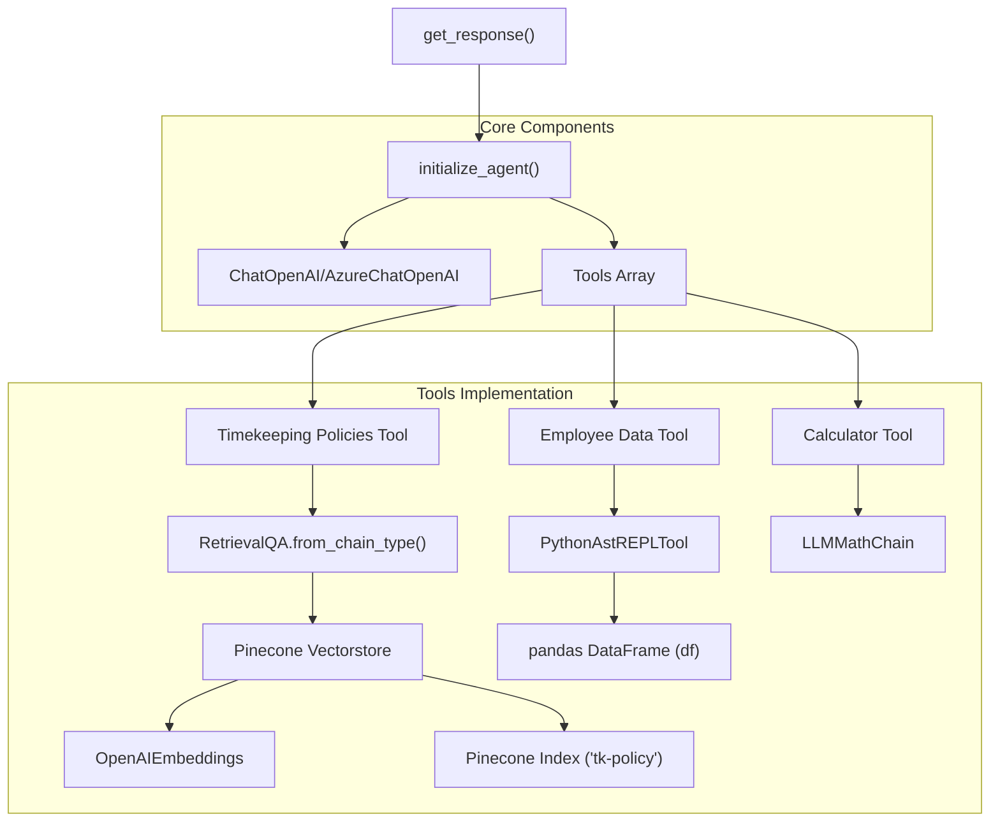
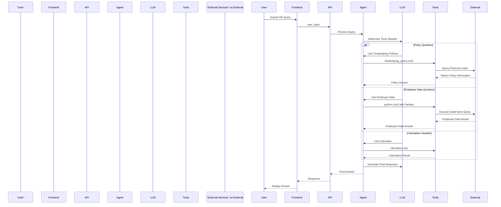

<!-- source: DeepWiki mcp.deepwiki.com · repo stepanogil/autonomous-hr-chatbot · page 2.2 Backend Implementation · fetched 2026-10-27 -->

# Backend Implementation

<details>
<summary>Relevant source files</summary>

The following files were used as context for generating this wiki page:

- [README.md](README.md)
- [hr_agent_backend_azure.py](hr_agent_backend_azure.py)
- [hr_agent_backend_local.py](hr_agent_backend_local.py)

</details>


This document details the core backend architecture and components of the Autonomous HR Chatbot system. It covers the shared implementation patterns between the local and Azure backend variants. For specific details about each implementation, see [Local Backend](#2.2.1) and [Azure Backend](#2.2.2).

## Architecture Overview

The backend system serves as the intelligent engine of the HR chatbot, processing user queries and generating responses by orchestrating various components including language models, vector databases, and specialized HR tools.

### Backend Component Architecture



Sources: [hr_agent_backend_local.py:102-107](), [hr_agent_backend_azure.py:127-132]()

### Query Processing Flow



Sources: [hr_agent_backend_local.py:109-111](), [hr_agent_backend_azure.py:134-136]()

## Core Components

### Language Model (LLM)

Both backend implementations utilize OpenAI's language models with different initialization methods:

```python
# Local Backend - Direct OpenAI API
llm = ChatOpenAI(    
    openai_api_key="<your openai api key>", 
    model_name="gpt-3.5-turbo", 
    temperature=0.0
)

# Azure Backend - Azure OpenAI Service
llm = AzureChatOpenAI(    
    deployment_name="<your deployment name>", 
    model_name="gpt-35-turbo", 
    openai_api_key='<your openai api key>',
    openai_api_version='2023-03-15-preview', 
    openai_api_base='<your api base>',
    openai_api_type='azure'
)
```

The model is set with a temperature of 0.0 to ensure deterministic and factual responses for HR inquiries.

Sources: [hr_agent_backend_local.py:37-41](), [hr_agent_backend_azure.py:42-49]()

### Vector Database

The backend uses Pinecone as the vector database to store and retrieve embeddings of HR policy documents:

```python
# Initialize Pinecone client
pinecone.init(
    api_key="<your pinecone api key>",  
    environment="<your pinecone environment>"  
) 

# Connect to index
index_name = 'tk-policy'
index = pinecone.Index(index_name)

# Initialize text embeddings
embed = OpenAIEmbeddings(
    model='text-embedding-ada-002',
    openai_api_key="<your openai api key>",
)

# Set up vector store
text_field = 'text'  # Field containing document text
vectorstore = Pinecone(
    index, embed.embed_query, text_field
)
```

The vector database enables semantic search capabilities for retrieving relevant HR policy information based on user queries.

Sources: [hr_agent_backend_local.py:17-35](), [hr_agent_backend_azure.py:17-39]()

### Tool Implementation

#### 1. Timekeeping Policies Tool

This tool retrieves HR policy information using semantic search through the vector database:

```python
timekeeping_policy = RetrievalQA.from_chain_type(
    llm=llm,
    chain_type="stuff",
    retriever=vectorstore.as_retriever(),
)
```

Sources: [hr_agent_backend_local.py:44-48](), [hr_agent_backend_azure.py:52-56]()

#### 2. Employee Data Tool

This tool provides access to employee data using Python code execution:

```python
# Initialize DataFrame and Python REPL tool
df = pd.read_csv("employee_data.csv")  # Local implementation
python = PythonAstREPLTool(locals={"df": df})
```

In the Azure implementation, this uses Azure Data Lake Storage to retrieve the employee data CSV file.

Sources: [hr_agent_backend_local.py:50-51](), [hr_agent_backend_azure.py:59-76]()

#### 3. Calculator Tool

This tool performs mathematical calculations when needed for HR calculations:

```python
calculator = LLMMathChain.from_llm(llm=llm, verbose=True)
```

Sources: [hr_agent_backend_local.py:54](), [hr_agent_backend_azure.py:79]()

### Agent Configuration

The backend initializes a LangChain agent with the tools and a custom prompt:

```python
# Create variables for prompt templates
user = 'Alexander Verdad'  # Default user
df_columns = df.columns.to_list()  # DataFrame columns

# Configure tools array with descriptions
tools = [
    Tool(
        name="Timekeeping Policies",
        func=timekeeping_policy.run,
        description="..."  # Tool description
    ),
    Tool(
        name="Employee Data",
        func=python.run,
        description=f"..."  # Tool description with examples
    ),
    Tool(
        name="Calculator",
        func=calculator.run,
        description=f"..."  # Tool description
    )
]

# Custom HR assistant prompt
agent_kwargs = {
    'prefix': f'You are friendly HR assistant. You are tasked to assist the current user: {user} on questions related to HR. You have access to the following tools:'
}

# Initialize the LLM agent
agent = initialize_agent(
    tools, 
    llm, 
    agent=AgentType.ZERO_SHOT_REACT_DESCRIPTION, 
    verbose=True, 
    agent_kwargs=agent_kwargs
)
```

The agent uses ZERO_SHOT_REACT_DESCRIPTION agent type, which enables it to determine the appropriate tool to use for each query without requiring examples.

Sources: [hr_agent_backend_local.py:61-107](), [hr_agent_backend_azure.py:86-132]()

### Response Generation

The backend exposes a simple function to process queries and generate responses:

```python
def get_response(user_input):
    response = agent.run(user_input)
    return response
```

This function serves as the API endpoint for the frontend, taking user input and returning the agent's response.

Sources: [hr_agent_backend_local.py:109-111](), [hr_agent_backend_azure.py:134-136]()

## Implementation Differences

The main differences between the local and Azure backend implementations are:

| Feature | Local Backend | Azure Backend |
|---------|---------------|---------------|
| LLM Provider | Direct OpenAI API | Azure OpenAI Service |
| Employee Data Source | Local CSV file | Azure Data Lake Storage |
| Environment Variables | OpenAI API key | Azure OpenAI API key, deployment details, Azure Storage credentials |
| Infrastructure Requirements | Minimal (local machine) | Azure subscription and services |

For specific implementation details, refer to [Local Backend](#2.2.1) and [Azure Backend](#2.2.2) documentation.

Sources: [hr_agent_backend_local.py](), [hr_agent_backend_azure.py]()

## Tool Descriptions

Both backends configure the agent tools with detailed descriptions to guide their usage:

### Timekeeping Policies Tool

```
Useful for when you need to answer questions about employee timekeeping policies.

<user>: What is the policy on unused vacation leave?
<assistant>: I need to check the timekeeping policies to answer this question.
<assistant>: Action: Timekeeping Policies
<assistant>: Action Input: Vacation Leave Policy - Unused Leave
...
```

### Employee Data Tool

```
Useful for when you need to answer questions about employee data stored in pandas dataframe 'df'. 
Run python pandas operations on 'df' to help you get the right answer.
'df' has the following columns: [name, position, department, ...]

<user>: How many Sick Leave do I have left?
<assistant>: df[df['name'] == 'Alexander Verdad']['sick_leave']
<assistant>: You have n sick leaves left.
```

### Calculator Tool

```
Useful when you need to do math operations or arithmetic.
```

These descriptions contain examples that help guide the agent in properly utilizing each tool when responding to HR queries.

Sources: [hr_agent_backend_local.py:61-95](), [hr_agent_backend_azure.py:86-120]()

---

