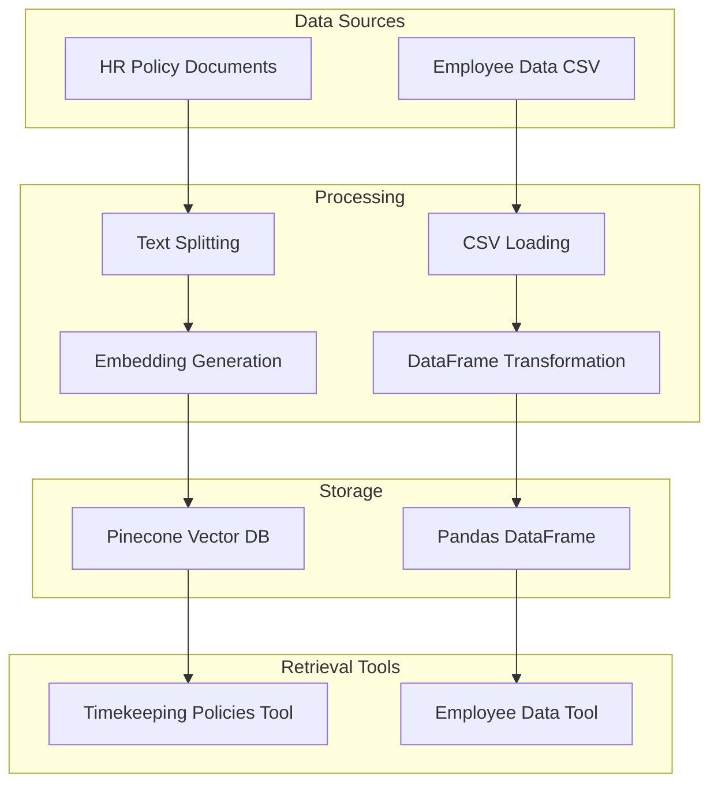
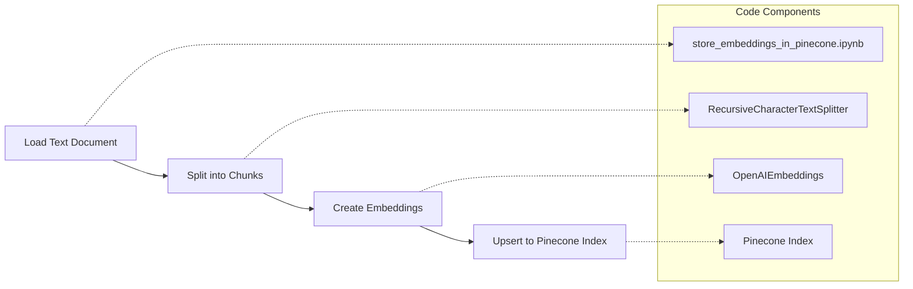
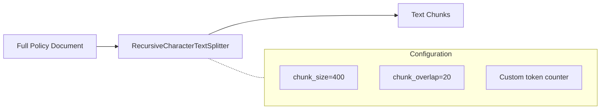
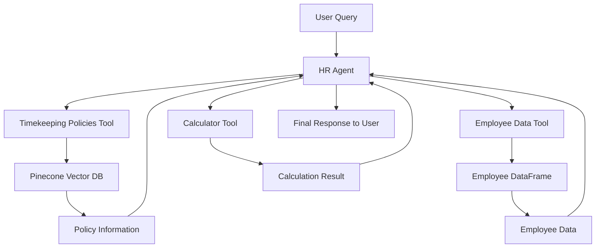

<!-- source: DeepWiki mcp.deepwiki.com · repo stepanogil/autonomous-hr-chatbot · page 4 Data Processing Pipeline · fetched 2026-10-27 -->

# Data Processing Pipeline

<details>
<summary>Relevant source files</summary>

The following files were used as context for generating this wiki page:

- [README.md](README.md)
- [store_embeddings_in_pinecone.ipynb](store_embeddings_in_pinecone.ipynb)

</details>


## Purpose and Scope

This document details how data is processed, embedded, and stored in the Autonomous HR Chatbot system. It covers the two primary data flows in the system: HR policy document processing and employee data processing. For information about creating and storing embeddings specifically, see [Creating and Storing Embeddings](#4.1). For details about employee data structure, see [Employee Data Structure](#4.2).

## Data Processing Overview

The Autonomous HR Chatbot relies on two primary data sources to provide accurate and contextual responses:

1. **HR Policy Documents** - Text-based policy files that are converted into vector embeddings
2. **Employee Data** - Structured data containing employee information

The data processing pipeline transforms these raw data sources into formats that can be efficiently queried by the chatbot's agent tools.



Sources: [README.md:14-17](), [store_embeddings_in_pinecone.ipynb]()

## HR Policy Document Processing

The HR policy document processing pipeline converts text documents into vector embeddings for semantic search capabilities.

### Process Flow



Sources: [store_embeddings_in_pinecone.ipynb:7-251]()

### Loading Text

The pipeline begins by loading the HR policy document from a text file:

```python
doc_path = "hr_policy.txt"
with open(doc_path, 'r') as f:
    contents = f.read()
```

Sources: [store_embeddings_in_pinecone.ipynb:27-32]()

### Text Chunking

The document is then split into smaller chunks using LangChain's `RecursiveCharacterTextSplitter`:



The text splitter is configured to create chunks of approximately 400 tokens with a 20-token overlap between consecutive chunks. A custom tokenizer function using `tiktoken` is used to accurately measure token counts.

Sources: [store_embeddings_in_pinecone.ipynb:52-105]()

### Creating Embeddings

Each text chunk is converted into a vector embedding using OpenAI's `text-embedding-ada-002` model:

```mermaid
flowchart TD
    Chunks["Text Chunks"] --> Embedder["OpenAI Embeddings API"]
    Embedder --> Vectors["Vector Embeddings"]
    
    subgraph "Vector Format"
        direction LR
        ID["UUID"] --- Vector["1536-dim Vector"] --- Metadata["Text Metadata"]
    end
    
    Vectors -.- "Vector Format"
```

The embedding process creates a 1536-dimensional vector representation for each text chunk, along with a unique ID and metadata containing the original text.

Sources: [store_embeddings_in_pinecone.ipynb:122-147](), [store_embeddings_in_pinecone.ipynb:154-164]()

### Storing in Pinecone

The embeddings are stored in a Pinecone vector database for efficient semantic search:

```mermaid
flowchart LR
    Vectors["Vector Embeddings"] --> Index["Pinecone Index"]
    
    subgraph "Index Configuration"
        direction TB
        name["index_name='tk-policy'"]
        dimension["dimension=1536"]
        metric["metric='cosine'"]
    end
    
    Index -.- "Index Configuration"
```

The Pinecone index is configured for cosine similarity searches, which is optimal for finding semantically similar text chunks.

Sources: [store_embeddings_in_pinecone.ipynb:193-208](), [store_embeddings_in_pinecone.ipynb:215-251]()

## Employee Data Processing

Employee data is stored in a CSV file and processed into a pandas DataFrame for querying.

```mermaid
flowchart LR
    CSV["Employee CSV File"] --> Load["Load into Pandas"]
    Load --> DataFrame["Pandas DataFrame"]
    DataFrame --> Query["Python REPL Tool Queries"]
    
    subgraph "Data Fields"
        direction TB
        name["Employee Name"]
        supervisor["Supervisor"]
        leaves["Leave Balance"]
        other["Other Employee Data"]
    end
    
    DataFrame -.- "Data Fields"
```

The employee data includes information such as names, supervisors, leave balances, and other HR-related information. The system accesses this data using LangChain's `PythonAstREPLTool`, which allows the language model to execute Python code to query and manipulate the DataFrame.

Sources: [README.md:16]()

## Integration with Agent Tools

The processed data integrates with the HR agent's tools to provide comprehensive responses to user queries.



The HR agent leverages the processed data through specialized tools:

1. **Timekeeping Policies Tool** - Performs semantic searches on the Pinecone vector database to retrieve relevant HR policy information
2. **Employee Data Tool** - Executes Python code to query the employee DataFrame
3. **Calculator Tool** - Performs calculations when needed, such as computing leave balances or overtime pay

Sources: [README.md:14-17]()

## Deployment Considerations

The data processing pipeline can be deployed in two configurations:

### Local Deployment

In local deployment, the pipeline uses:
- OpenAI API for embeddings
- Local Pinecone connection
- Local CSV files for employee data

### Azure Deployment

In Azure deployment, the pipeline can integrate with:
- Azure OpenAI Service for embeddings
- Pinecone for vector storage
- Azure Data Lake for employee data storage
- Azure Data Factory for ETL processes from source systems like SAP HCM

Sources: [README.md:44-53]()

## Technical Implementation Details

The data processing implementation uses the following key technologies:

| Component | Technology | Purpose |
|-----------|------------|---------|
| Text Splitting | LangChain RecursiveCharacterTextSplitter | Divides documents into semantic chunks |
| Tokenization | tiktoken | Accurately counts tokens for OpenAI models |
| Embeddings | OpenAI text-embedding-ada-002 | Converts text to vector representations |
| Vector Storage | Pinecone | Stores and retrieves embeddings efficiently |
| Structured Data | Pandas DataFrame | Manages employee data for querying |
| Tool Integration | LangChain Agents and Tools | Connects data sources to the HR agent |

Sources: [README.md:44-53](), [store_embeddings_in_pinecone.ipynb]()

---

