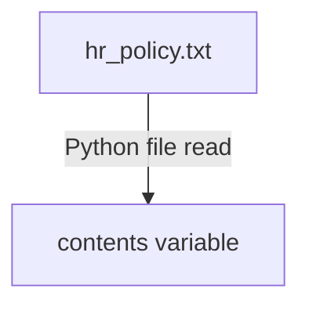
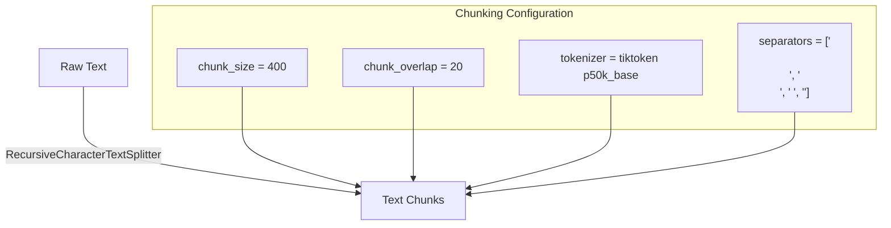
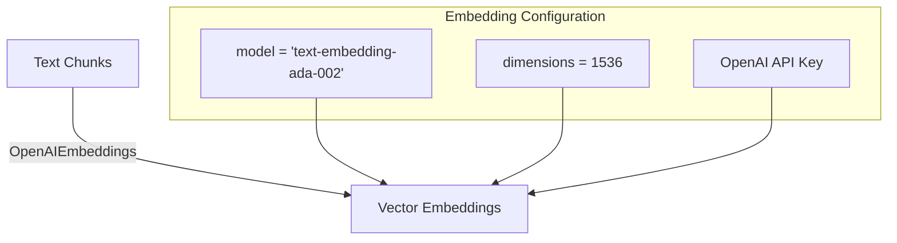
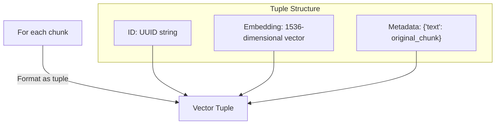
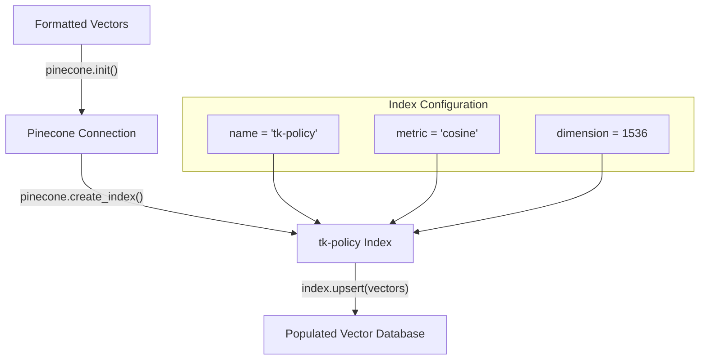

<!-- source: DeepWiki mcp.deepwiki.com · repo stepanogil/autonomous-hr-chatbot · page 4.1 Creating and Storing Embeddings · fetched 2026-10-27 -->

# Creating and Storing Embeddings

Relevant source files

The following files were used as context for generating this wiki page:

- [README.md](README.md)
- [store_embeddings_in_pinecone.ipynb](store_embeddings_in_pinecone.ipynb)

## Purpose and Scope

This document details the process of creating vector embeddings from HR policy documents and storing them in Pinecone, a vector database. These embeddings enable semantic search capabilities for the HR chatbot, allowing it to retrieve and reference relevant policy information when answering user queries.

For information about how employee data is structured and used by the system, see [Employee Data Structure](#4.2). For information about how these stored embeddings are utilized by the agent's tools, see [Agent Tools and Capabilities](#3).

Sources: [README.md:14-17](), [store_embeddings_in_pinecone.ipynb:1-12]()

## Embedding Pipeline Overview

### Embedding Process Workflow

The creation and storage of embeddings involves four main steps:

This process is implemented in the `store_embeddings_in_pinecone.ipynb` notebook, which orchestrates loading HR policy text, converting it to embeddings, and storing those embeddings in a Pinecone vector database.

Sources: [store_embeddings_in_pinecone.ipynb:1-12](), [README.md:37-41]()

## Text Loading and Chunking

### Loading HR Policy Documents

The system begins by loading HR policy text from a file:

The HR policy document is read using standard Python file I/O operations. This document contains the timekeeping policies and other HR rules that the chatbot needs to reference.

Sources: [store_embeddings_in_pinecone.ipynb:22-33]()

### Text Chunking

The loaded text is divided into smaller, manageable chunks to optimize for semantic search:

The system uses LangChain's `RecursiveCharacterTextSplitter` to:
- Break text into chunks of approximately 400 tokens each
- Maintain a 20 token overlap between consecutive chunks
- Split preferentially at paragraph breaks, then newlines, then spaces
- Count tokens using the same tokenizer as OpenAI's models (`tiktoken`)

Sources: [store_embeddings_in_pinecone.ipynb:51-105]()

## Creating Embeddings

After chunking, the system creates vector embeddings for each text chunk:

The embedding process:
1. Initializes the OpenAI embedding client with API credentials
2. For each text chunk, calls the embedding API to generate a 1536-dimensional vector
3. Formats the resulting embeddings with unique IDs and metadata

The generated vectors capture the semantic meaning of each text chunk, enabling meaning-based rather than keyword-based search.

Sources: [store_embeddings_in_pinecone.ipynb:115-147](), [README.md:15]()

## Vector Format and Structure

Before storage, each embedding is formatted into a tuple containing:

This structure provides:
- A unique identifier for each vector (using UUID4)
- The actual embedding vector for similarity search
- Metadata containing the original text, which is returned when the vector is retrieved

Sources: [store_embeddings_in_pinecone.ipynb:142-146]()

## Storing in Pinecone Vector Database

The final step is storing these embeddings in Pinecone for efficient similarity search:

The storage process involves:
1. Connecting to Pinecone using API credentials
2. Creating a new index named `tk-policy` (or resetting an existing one)
3. Configuring the index to use cosine similarity and 1536 dimensions
4. Upserting the vectors with their IDs and metadata

After this process, the embeddings are ready to be queried by the HR chatbot system.

Sources: [store_embeddings_in_pinecone.ipynb:171-251](), [README.md:37-41]()

## Usage in the HR Chatbot System

When the HR chatbot is running, it accesses these stored embeddings to find relevant policy information:

The query process:
1. Converts the user's question into an embedding using the same OpenAI model
2. Searches the Pinecone index for semantically similar vectors
3. Retrieves the original text chunks from the metadata
4. Provides these chunks as context to the language model
5. Generates a response based on the relevant policy information

This retrieval-augmented generation approach enables the HR chatbot to provide accurate, policy-based answers to user questions.

Sources: [README.md:14-17]()

## Technical Implementation Details

The embedding creation and storage process is implemented in `store_embeddings_in_pinecone.ipynb` and requires:

1. **API Keys**:
   - OpenAI API key for creating embeddings
   - Pinecone API key and environment for storing vectors

2. **Libraries**:
   - `langchain.embeddings.openai` for the embedding functionality
   - `langchain.text_splitter` for text chunking
   - `tiktoken` for token counting
   - `pinecone` for vector database operations
   - `uuid` for generating unique IDs

The notebook includes error handling for API connections and verification of the stored vectors through `index.describe_index_stats()`, which returns metadata about the index including the number of vectors stored.

Sources: [store_embeddings_in_pinecone.ipynb:115-251](), [README.md:37-41]()

---

