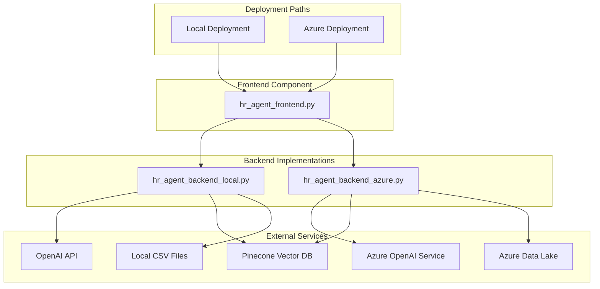
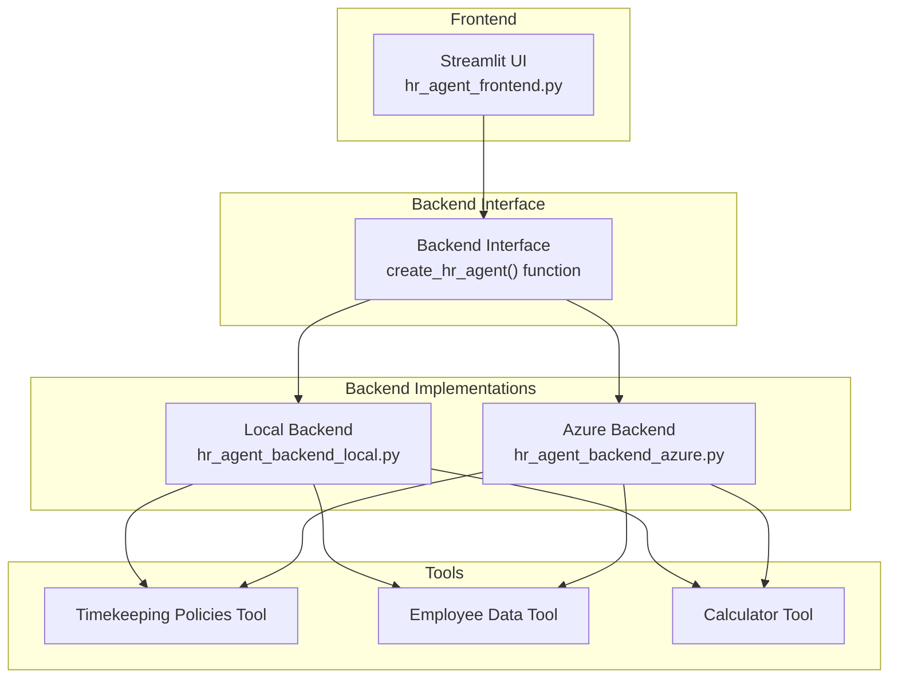
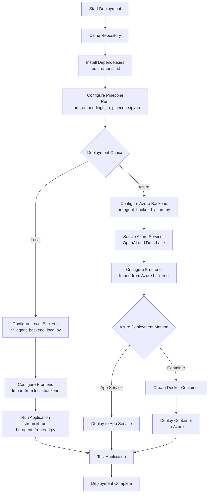

<!-- source: DeepWiki mcp.deepwiki.com · repo stepanogil/autonomous-hr-chatbot · page 5 Deployment Guide · fetched 2026-10-27 -->

# Deployment Guide

<details>
<summary>Relevant source files</summary>

The following files were used as context for generating this wiki page:

- [README.md](README.md)
- [requirements.txt](requirements.txt)

</details>


This guide provides an overview of the deployment options and requirements for the Autonomous HR Chatbot system. It covers both local and Azure deployment paths, configuration requirements, and verification steps. For detailed step-by-step instructions, refer to [Local Deployment](#5.1) and [Azure Deployment](#5.2).

## Deployment Architecture Overview

The Autonomous HR Chatbot system can be deployed in two ways:

1. **Local Deployment**: Using OpenAI API directly with local file storage
2. **Azure Deployment**: Using Azure OpenAI Service and Azure Data Lake

The following diagram shows the relationship between deployment options and codebase components:



Sources: [README.md:29-41]()

## Backend Component Details

The system uses two separate backend implementations that share a common interface for interacting with the frontend:



Sources: [README.md:14-18]()

## Prerequisites

### Required Software
- Python 3.10
- Git (for cloning the repository)
- Python packages specified in `requirements.txt`

### External Services
| Service | Local Deployment | Azure Deployment | Purpose |
|---------|------------------|------------------|---------|
| OpenAI API | Required | Not needed | Access to LLM (local deployment) |
| Azure OpenAI | Not needed | Required | Access to LLM (Azure deployment) |
| Pinecone | Required | Required | Vector database for policy document embeddings |
| Azure Data Lake | Not needed | Required | Storage for employee data |

### API Keys and Credentials
- OpenAI API key (for local deployment)
- Azure OpenAI key, endpoint, deployment name (for Azure deployment)
- Pinecone API key and environment
- Azure storage credentials (for Azure deployment)

Sources: [README.md:29-34](), [requirements.txt:1-103]()

## Configuration Requirements

### Local Deployment Configuration

Configuration for local deployment is managed in the `hr_agent_backend_local.py` file where you need to specify:

1. OpenAI API key
2. Pinecone API key, environment, and index name
3. Path to employee data CSV file

### Azure Deployment Configuration

Configuration for Azure deployment is managed in the `hr_agent_backend_azure.py` file where you need to specify:

1. Azure OpenAI API key, endpoint, and deployment name
2. Pinecone API key, environment, and index name
3. Azure Data Lake connection string, container, and file path

### Frontend Configuration

The frontend (`hr_agent_frontend.py`) needs to be configured to use the appropriate backend:

```
# Use the local backend
from hr_agent_backend_local import create_hr_agent

# Or uncomment to use the Azure backend
# from hr_agent_backend_azure import create_hr_agent
```

Sources: [README.md:34]()

## Deployment Process

The following diagram illustrates the end-to-end deployment workflow:



Sources: [README.md:29-41]()

## Data Setup

### Embedding Creation and Storage

Before deployment, you must create and store embeddings for HR policies in Pinecone:

1. Create a Pinecone account
2. Run the embedding creation notebook:
   ```
   jupyter notebook store_embeddings_in_pinecone.ipynb
   ```
3. Replace Pinecone and OpenAI API keys in the notebook

### Employee Data Preparation

Ensure employee data is in the correct format:
- For local deployment: CSV file in the expected location
- For Azure deployment: CSV file uploaded to Azure Data Lake

Sources: [README.md:37-41]()

## Deployment Options Comparison

| Feature | Local Deployment | Azure Deployment |
|---------|------------------|------------------|
| Setup Complexity | Lower | Higher |
| Scalability | Limited | Highly scalable |
| Data Security | Basic | Enterprise-grade |
| Integration with Enterprise Systems | Limited | Advanced (SAP HCM, etc.) |
| Maintenance Requirements | Manual updates | CI/CD pipeline capable |
| Cost | OpenAI API costs only | Azure services + API costs |
| Suitable for | Development, testing, small deployments | Production, enterprise use |

## Verification Steps

After deployment, verify the system by:

1. Accessing the Streamlit frontend (local: http://localhost:8501)
2. Testing the agent with HR-related questions
3. Verifying each tool works correctly:
   - Policy lookup (tests Pinecone connection)
   - Employee data queries (tests CSV/Data Lake access)
   - Calculations (tests calculator tool)

### Example Verification Questions

| Question Type | Example Question | Tests |
|---------------|------------------|-------|
| Policy | "What is the policy on work from home?" | Pinecone connection, embeddings retrieval |
| Employee Data | "How many leave days does John Smith have?" | Employee data access |
| Calculation | "If I work 45 hours in a week, how much overtime will I get?" | Calculator tool |

For detailed step-by-step deployment instructions, refer to:
- [Local Deployment Guide](#5.1)
- [Azure Deployment Guide](#5.2)

Sources: [README.md:19-25]()

---

