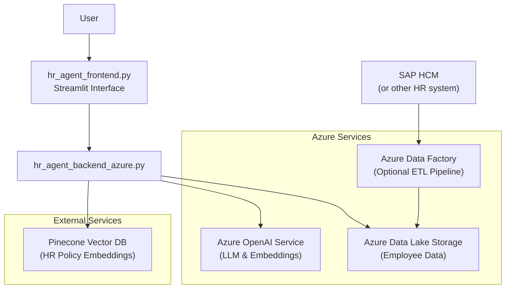
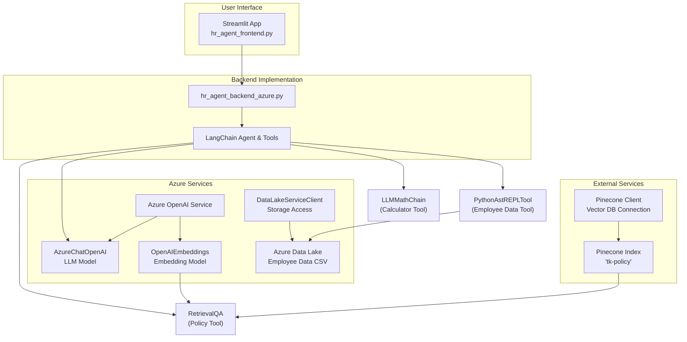
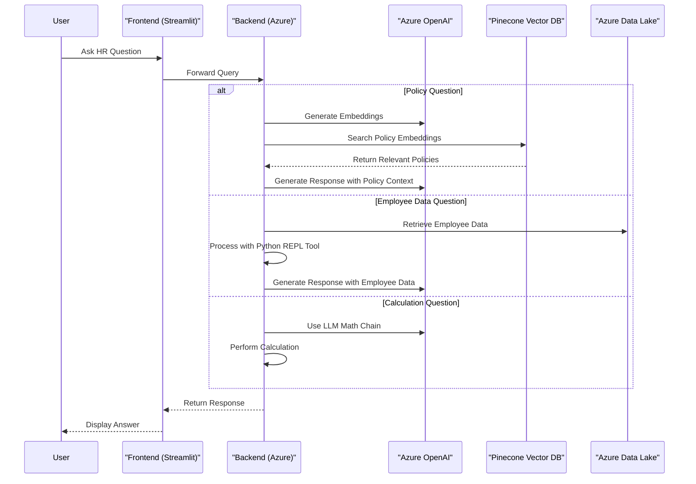

<!-- source: DeepWiki mcp.deepwiki.com · repo stepanogil/autonomous-hr-chatbot · page 5.2 Azure Deployment · fetched 2026-10-27 -->

# Azure Deployment

<details>
<summary>Relevant source files</summary>

The following files were used as context for generating this wiki page:

- [README.md](README.md)
- [hr_agent_backend_azure.py](hr_agent_backend_azure.py)
- [requirements.txt](requirements.txt)

</details>


This document provides detailed instructions for deploying the Autonomous HR Chatbot system on Microsoft Azure. It covers the Azure components used, configuration requirements, and step-by-step deployment instructions. This guide focuses specifically on cloud deployment using Azure services, as opposed to local deployment which is covered in [Local Deployment](#5.1).

## Overview of Azure Deployment

The Autonomous HR Chatbot can be deployed on Azure to leverage cloud capabilities for scalability, security, and enterprise integration. The Azure deployment utilizes several Azure services including Azure OpenAI Service, Azure Data Lake Storage, and optionally Azure Data Factory for ETL processes.



Sources: [hr_agent_backend_azure.py:1-136](), [README.md:46-53]()

## Azure Components and Architecture

The Azure deployment architecture consists of the following components:

1. **Frontend**: Streamlit-based web interface (unchanged from local deployment)
2. **Backend**: Azure-specific implementation (`hr_agent_backend_azure.py`)
3. **Azure OpenAI Service**: Provides LLM capabilities and embeddings
4. **Azure Data Lake Storage**: Stores employee data
5. **Pinecone**: External vector database for storing HR policy embeddings
6. **Azure Data Factory** (optional): For ETL processes from HR systems

### Architecture Details



Sources: [hr_agent_backend_azure.py:1-14](), [hr_agent_backend_azure.py:41-79]()

## Prerequisites

Before deploying the HR Chatbot on Azure, ensure you have:

1. **Azure Subscription**: Active Azure subscription with access to:
   - Azure OpenAI Service
   - Azure Data Lake Storage Gen2
   - Azure Data Factory (optional)

2. **Pinecone Account**: For vector database storage (external to Azure)

3. **Python Environment**: Python 3.10 with required packages

4. **HR Policies**: Documents to be embedded and stored in Pinecone

5. **Employee Data**: CSV file with employee information

## Azure Services Setup

### 1. Azure OpenAI Service

1. Provision an Azure OpenAI Service resource in your Azure subscription
2. Deploy two models:
   - GPT-3.5 Turbo model (for chat completion)
   - text-embedding-ada-002 model (for embeddings)
3. Note down:
   - API key
   - Deployment names
   - API base URL
   - API version (2023-03-15-preview recommended)

### 2. Azure Data Lake Storage

1. Create an Azure Storage account with hierarchical namespace enabled
2. Create a file system (container)
3. Create a directory structure for employee data (e.g., `employee_data/`)
4. Upload the employee data CSV file
5. Note down:
   - Storage account URL
   - Storage account key or SAS token

Table of required Azure configurations:

| Service | Configuration Item | Example Value | Usage |
|---------|-------------------|---------------|-------|
| Azure OpenAI | API Key | "1234567890abcdef..." | Authentication |
| Azure OpenAI | API Base | "https://myopenai.openai.azure.com" | Service endpoint |
| Azure OpenAI | Chat Model Deployment Name | "gpt-35-turbo" | LLM deployment |
| Azure OpenAI | Embedding Model Deployment | "text-embedding-ada-002" | Embedding model |
| Azure OpenAI | API Version | "2023-03-15-preview" | API version |
| Azure Data Lake | Account URL | "https://mystorageacct.dfs.core.windows.net" | Storage endpoint |
| Azure Data Lake | Storage Key | "Ab1Cd2Ef3..." | Storage authentication |
| Azure Data Lake | File System Name | "hr-data" | Container name |
| Azure Data Lake | File Path | "employee_data/employee_data.csv" | Employee data path |

Sources: [hr_agent_backend_azure.py:26-33](), [hr_agent_backend_azure.py:42-49](), [hr_agent_backend_azure.py:59-68]()

## Configuration Steps

### 1. Pinecone Setup

Create and configure a Pinecone index for HR policy embeddings:

1. Create a Pinecone account at [pinecone.io](https://www.pinecone.io/)
2. Create a new index with:
   - Dimension: 1536 (for OpenAI embeddings)
   - Metric: cosine
   - Name: "tk-policy" (or your preferred name)
3. Store your API key and environment

To create and store embeddings in Pinecone:

1. Run the `store_embeddings_in_pinecone.ipynb` notebook
2. Update the notebook with your Azure OpenAI and Pinecone credentials
3. Ensure HR policy documents are embedded and stored in the Pinecone index

Sources: [hr_agent_backend_azure.py:16-24](), [README.md:37-41]()

### 2. Backend Configuration

Modify the `hr_agent_backend_azure.py` file with your credentials and settings:

1. Pinecone configuration (lines 17-20):
   ```python
   pinecone.init(
       api_key="<your pinecone api key>",  
       environment="your pinecone environment"  
   )
   ```

2. Azure OpenAI embeddings configuration (lines 26-33):
   ```python
   embed = OpenAIEmbeddings(
       deployment="<your deployment name>",
       model="text-embedding-ada-002",
       openai_api_key='<your azure openai api key>',
       openai_api_base="<your api base>",
       openai_api_type="azure",
   )
   ```

3. Azure OpenAI LLM configuration (lines 42-49):
   ```python
   llm = AzureChatOpenAI(    
       deployment_name="<your deployment name>", 
       model_name="gpt-35-turbo", 
       openai_api_key='<your openai api key>',
       openai_api_version = '2023-03-15-preview', 
       openai_api_base='<your api base>',
       openai_api_type='azure'
   )
   ```

4. Azure Data Lake configuration (lines 59-68):
   ```python
   client = DataLakeServiceClient(
       account_url="<you azure account storage url>",
       credential="<your azure storage account keys>"
   )
   file = client.get_file_system_client("<your azure storage account name>") \
              .get_file_client("employee_data/employee_data.csv") \
              .download_file() \
              .readall() \
              .decode('utf-8')
   ```

Sources: [hr_agent_backend_azure.py:17-20](), [hr_agent_backend_azure.py:26-33](), [hr_agent_backend_azure.py:42-49](), [hr_agent_backend_azure.py:59-68]()

### 3. Frontend Configuration

Update the `hr_agent_frontend.py` file to use the Azure backend:

1. Ensure the Azure backend is imported and not commented out
2. Comment out the local backend import if needed

## Deployment Instructions

### 1. Install Dependencies

Install all required packages using the requirements file:

```bash
pip install -r requirements.txt
```

Key dependencies for Azure deployment include:
- azure-core
- azure-storage-blob
- azure-storage-file-datalake
- langchain
- openai
- pinecone-client
- streamlit
- streamlit-chat

Sources: [requirements.txt:1-104]()

### 2. Validate Configurations

1. Verify Azure OpenAI Service access:
   - Test API key and endpoints
   - Confirm model deployments are available

2. Verify Azure Data Lake Storage access:
   - Test connection to storage account
   - Ensure employee data CSV is accessible

3. Verify Pinecone index:
   - Test connection and credentials
   - Verify embeddings are stored correctly

### 3. Run the Application

Launch the Streamlit application:

```bash
streamlit run hr_agent_frontend.py
```

The application will use the Azure backend implementation to:
1. Connect to Azure OpenAI Service for LLM capabilities
2. Retrieve employee data from Azure Data Lake Storage
3. Access HR policy embeddings from Pinecone

Sources: [README.md:29-36]()

## Data Flow in Azure Deployment

The following diagram illustrates the data flow during Azure deployment:



Sources: [hr_agent_backend_azure.py:81-119](), [hr_agent_backend_azure.py:134-136]()

## Troubleshooting

### Common Issues and Solutions

1. **Azure OpenAI Authentication Failures**
   - Verify API key is correct
   - Check deployment names match exactly
   - Confirm API version is supported

2. **Data Lake Access Issues**
   - Ensure storage account key or SAS token has appropriate permissions
   - Verify file path format is correct
   - Check if CSV file exists at the specified location

3. **Pinecone Connection Problems**
   - Verify API key and environment values
   - Check index name matches configuration
   - Ensure embeddings dimension matches model output (1536 for text-embedding-ada-002)

4. **Missing Dependencies**
   - Run `pip install -r requirements.txt` to install all required packages
   - Ensure Azure-specific packages are installed (azure-storage-file-datalake)

## Security Considerations

When deploying to Azure, consider these security best practices:

1. Use Azure Key Vault to store sensitive credentials
2. Implement appropriate network security for Azure resources
3. Use managed identities for Azure service authentication when possible
4. Restrict access to Azure OpenAI Service and Data Lake Storage
5. Implement proper user authentication for the Streamlit frontend

Sources: [hr_agent_backend_azure.py:17-20](), [hr_agent_backend_azure.py:26-33](), [hr_agent_backend_azure.py:42-49](), [hr_agent_backend_azure.py:59-68]()

---

