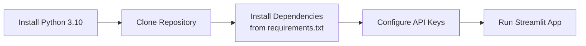
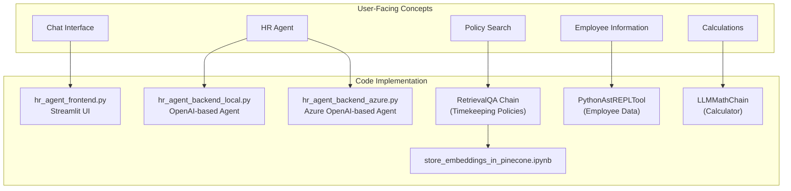
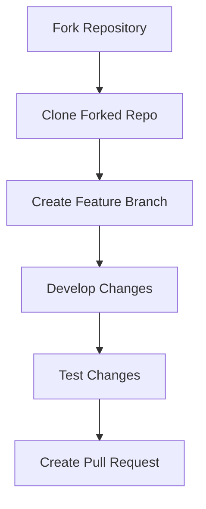
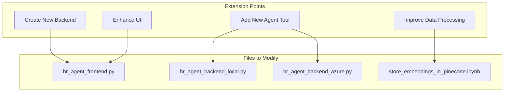
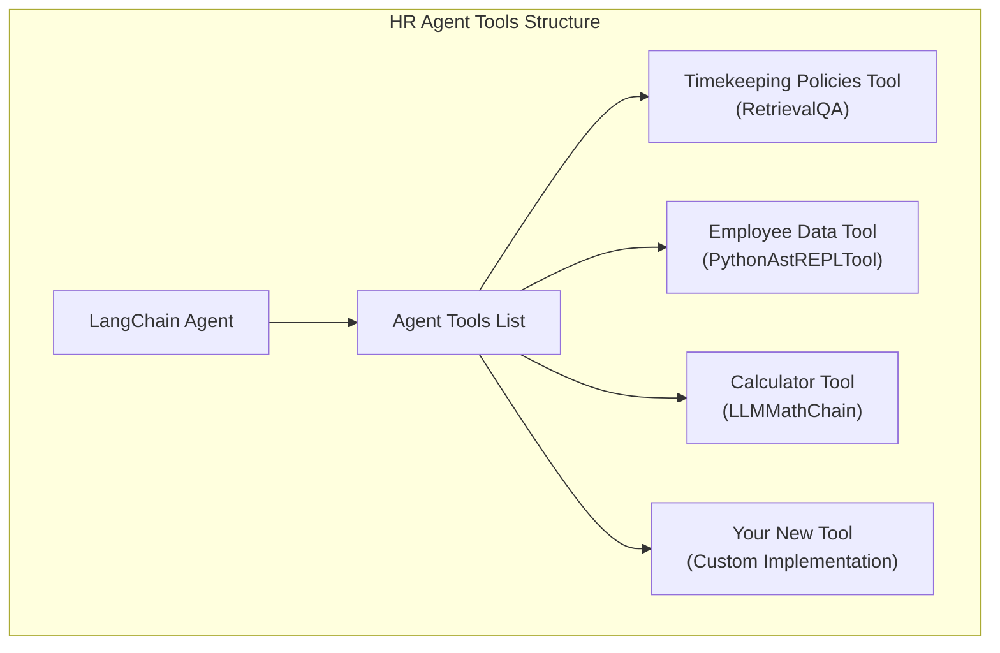

<!-- source: DeepWiki mcp.deepwiki.com · repo stepanogil/autonomous-hr-chatbot · page 6 Development and Contribution Guide · fetched 2026-10-27 -->

# Development and Contribution Guide

<details>
<summary>Relevant source files</summary>

The following files were used as context for generating this wiki page:

- [.gitignore](.gitignore)
- [README.md](README.md)
- [requirements.txt](requirements.txt)

</details>


This guide provides information for developers who want to extend or contribute to the Autonomous HR Chatbot system. It covers development environment setup, codebase structure, contribution workflow, and extension points to help developers effectively work with the system.

For deployment instructions, please refer to the [Deployment Guide](#5). For information about the system architecture, see the [System Architecture](#2) section.

## Development Environment Setup

To set up your development environment for the Autonomous HR Chatbot system:

### Prerequisites

- Python 3.10
- Git for version control
- API keys for:
  - OpenAI (for local backend) or Azure OpenAI (for Azure backend)
  - Pinecone

### Setup Steps



1. Clone the repository:
   ```bash
   git clone https://github.com/stepanogil/autonomous-hr-chatbot.git
   cd autonomous-hr-chatbot
   ```

2. Install dependencies:
   ```bash
   pip install -r requirements.txt
   ```

3. Configure API keys in the appropriate backend file (`hr_agent_backend_local.py` or `hr_agent_backend_azure.py`)

4. Run the application:
   ```bash
   streamlit run hr_agent_frontend.py
   ```

Sources: [README.md:29-36](), [requirements.txt]()

## Codebase Structure

### Code Organization

The Autonomous HR Chatbot codebase is organized into these main components:

```mermaid
graph TD
    subgraph "Frontend"
        Frontend["hr_agent_frontend.py"]
    end
    
    subgraph "Backend Implementations"
        LocalBackend["hr_agent_backend_local.py"]
        AzureBackend["hr_agent_backend_azure.py"]
    end
    
    subgraph "Tools"
        PolicyTool["Timekeeping Policies<br/>Tool"]
        EmployeeTool["Employee Data<br/>Tool"]
        CalculatorTool["Calculator<br/>Tool"]
    end
    
    subgraph "Data Processing"
        EmbeddingScript["store_embeddings_in_pinecone.ipynb"]
    end
    
    Frontend --> LocalBackend
    Frontend --> AzureBackend
    LocalBackend --> PolicyTool
    LocalBackend --> EmployeeTool
    LocalBackend --> CalculatorTool
    AzureBackend --> PolicyTool
    AzureBackend --> EmployeeTool
    AzureBackend --> CalculatorTool
    EmbeddingScript --> PolicyTool
```

### Component to Code Mapping

This diagram maps between user-facing concepts and the actual code implementations:



Sources: [README.md:11-17]()

## Contribution Workflow

### Standard Contribution Process



1. **Fork the repository** on GitHub
2. **Clone your fork** to your local machine
3. **Create a feature branch** for your changes
4. **Make your changes** following the coding standards
5. **Test your changes** thoroughly
6. **Create a pull request** with a clear description of your changes

Sources: [README.md](), [.gitignore]()

## Extension Points

The system is designed to be extendable in several ways. The following diagram shows the main extension points and which files to modify:



Sources: [README.md:14-17]()

### Adding New Tools

The HR Agent uses three main tools, but you can expand its capabilities by adding new tools:



To add a new tool:

1. Create a new tool class or function that follows LangChain's tool interface
2. Add the tool to both backend implementations:
   - `hr_agent_backend_local.py`
   - `hr_agent_backend_azure.py`
3. Update the agent's prompt to inform it about the new tool's capabilities
4. Test the tool with various inputs to ensure it works as expected

Sources: [README.md:14-17]()

### Creating a New Backend

To create a new backend implementation (e.g., for a different LLM provider):

1. Create a new file (e.g., `hr_agent_backend_new.py`)
2. Implement the same interface as the existing backends
3. Update `hr_agent_frontend.py` to include your new backend as an option

Sources: [README.md:33-34]()

### Enhancing the Frontend

The frontend is built with Streamlit and can be enhanced by:

1. Improving the chat interface (using Streamlit's components)
2. Adding new visualizations for data presentation
3. Creating additional UI controls for configuration

Sources: [README.md:5-6]()

### Improving Data Processing

Data processing can be improved by modifying the embedding generation process:

1. Update `store_embeddings_in_pinecone.ipynb` to use different embedding models
2. Implement better text chunking strategies
3. Add support for additional document types

Sources: [README.md:37-41]()

## Coding Standards

When contributing to the project, follow these coding standards:

- **Python Style**: Follow PEP 8 style guidelines
- **Documentation**: Add docstrings to functions and classes
- **Naming Conventions**: Use descriptive names for variables and functions
- **Error Handling**: Implement proper error handling with informative messages
- **Dependencies**: Add any new dependencies to `requirements.txt`

## Testing Guidelines

### Frontend Testing

- Test the UI with different screen sizes
- Verify that chat history displays correctly
- Test various user inputs and edge cases

### Backend Testing

- Test with different types of HR queries
- Verify that the correct tools are selected for each query
- Test error handling and edge cases

### Tool Testing

- Verify that each tool produces the expected output for various inputs
- Test the integration between tools and the agent
- Test boundary conditions for each tool

## Documentation

When adding new features, make sure to:

1. Update the code comments to explain how the new feature works
2. Add usage examples for new functionality
3. Update the README.md file if necessary

This documentation helps other developers understand your contributions and how to use them.

Sources: [README.md]()