# Page: Overview

# Overview

<details>
<summary>Relevant source files</summary>

The following files were used as context for generating this wiki page:

- [README.md](README.md)
- [requirements.txt](requirements.txt)

</details>


This document provides a high-level overview of the Autonomous HR Chatbot system, which is designed to answer HR-related queries by utilizing large language models (LLMs) and specialized tools. The system can interpret natural language questions, retrieve relevant information from HR policies, access employee data, and perform calculations to provide accurate responses without human intervention.

For detailed information about system implementation, see [System Architecture](#2). For deployment instructions, refer to the [Deployment Guide](#5).

## System Architecture

The following diagram illustrates the high-level architecture of the Autonomous HR Chatbot system and how it maps to the actual codebase:

### System Components Diagram

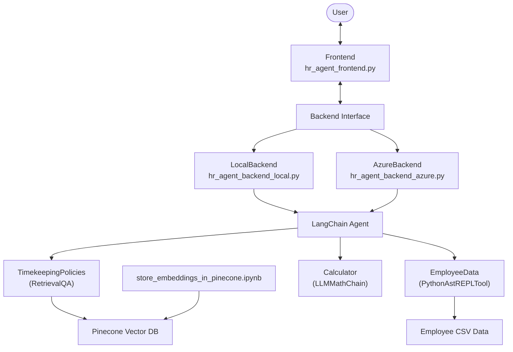

Sources: [README.md:10-17]()

## Key Components

### Frontend

The system uses a Streamlit-based chat interface implemented in `hr_agent_frontend.py` that provides users with a simple way to interact with the HR chatbot. It leverages the `streamlit_chat` component to render conversations in a familiar chat format.

### Backend Implementations

The system supports two deployment options through different backend implementations:

1. **Local Backend** (`hr_agent_backend_local.py`): Connects directly to the OpenAI API for local deployment
2. **Azure Backend** (`hr_agent_backend_azure.py`): Integrates with Azure OpenAI Service for cloud deployment

Both implementations use LangChain's agent framework to orchestrate interactions between the language model and various tools.

### Agent Tools

The HR chatbot comes equipped with three specialized tools:

| Tool | Implementation | Purpose | Data Source |
|------|---------------|---------|------------|
| Timekeeping Policies | `RetrievalQA` | Retrieves HR policy information | Pinecone Vector DB |
| Employee Data | `PythonAstREPLTool` | Accesses employee information | CSV file as Pandas DataFrame |
| Calculator | `LLMMathChain` | Performs mathematical calculations | N/A |

Sources: [README.md:14-17]()

## Data Flow

### Interaction Flow Diagram

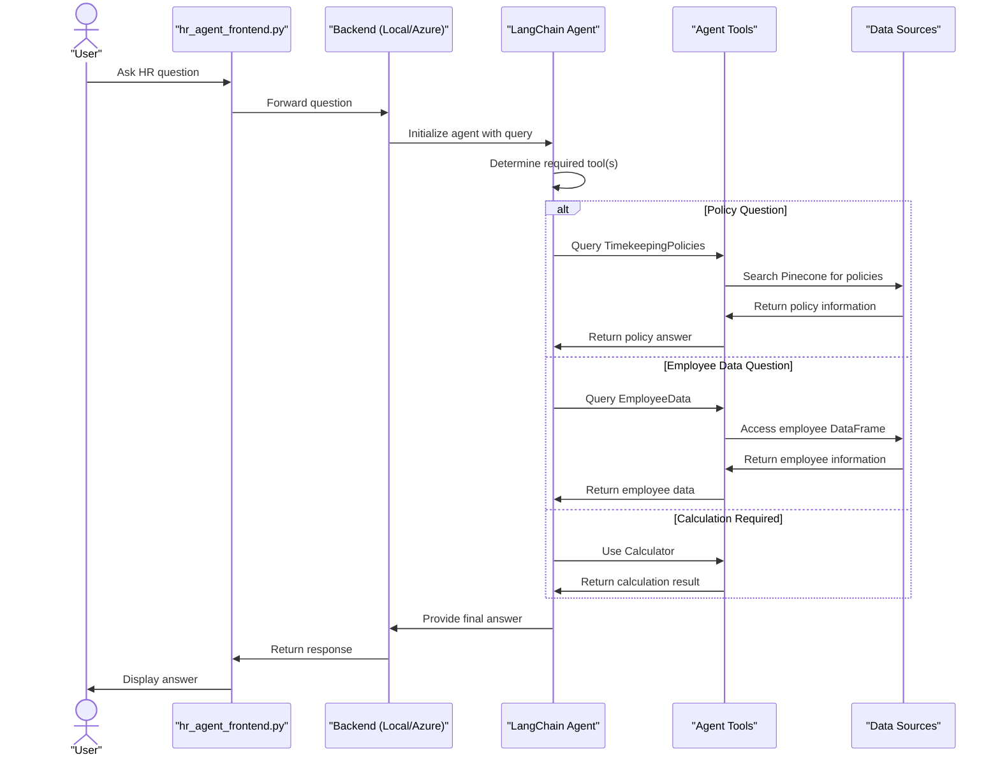

Sources: [README.md:10-17]()

## Data Preparation

### Document Processing Pipeline

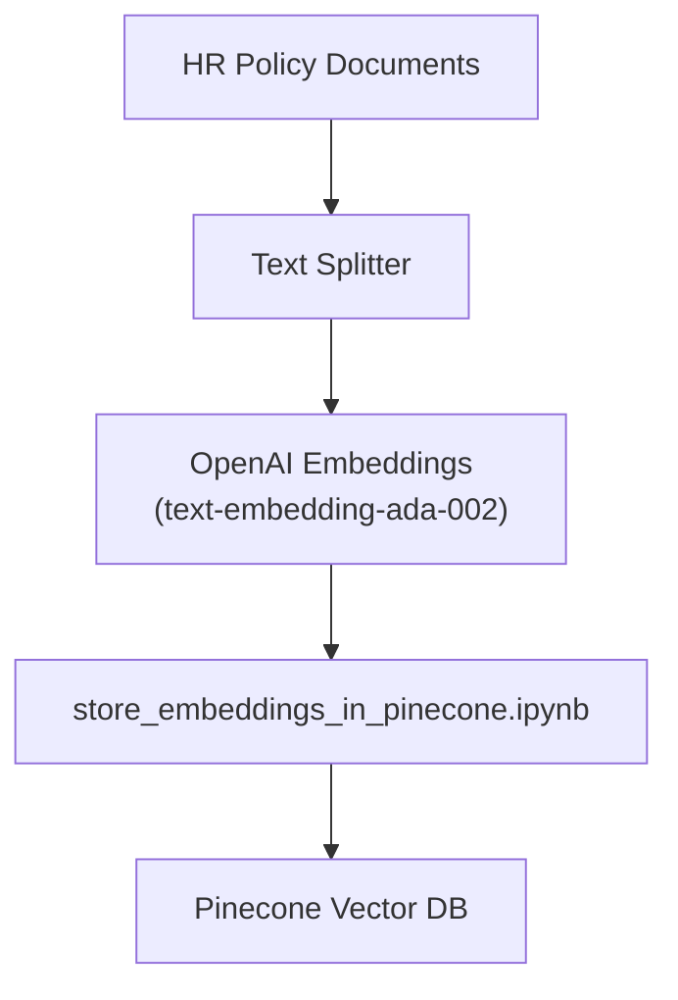

Before using the system, HR policy documents must be processed and stored in the Pinecone vector database. The repository includes a Jupyter notebook (`store_embeddings_in_pinecone.ipynb`) that handles this process by:
1. Splitting documents into smaller chunks
2. Creating embeddings using OpenAI's `text-embedding-ada-002` model
3. Storing these embeddings in Pinecone for semantic search

Employee data is managed through a CSV file containing dummy employee information, which is loaded as a pandas DataFrame at runtime.

Sources: [README.md:37-41]()

## Technical Stack

The Autonomous HR Chatbot is built using the following technologies:

| Component | Technology | Purpose |
|-----------|------------|---------|
| Language Model | `gpt-3.5-turbo` / Azure OpenAI | Natural language processing |
| Framework | `langchain==0.0.220` | LLM application orchestration |
| Vector Database | `pinecone-client==2.2.2` | Storing document embeddings |
| Frontend | `streamlit==1.24.0`, `streamlit-chat==0.1.1` | User interface |
| Data Manipulation | `pandas==2.0.3` | Employee data processing |
| Embeddings | `text-embedding-ada-002` | Text vectorization |
| Cloud Services (Optional) | Azure OpenAI, Azure Data Lake, Azure Data Factory | Cloud deployment components |

Sources: [README.md:43-53](), [requirements.txt:1-103]()

## Use Cases

The HR chatbot can handle various HR-related queries, including:

1. **Policy Questions**: "What is the company policy on remote work?"
2. **Employee Data Queries**: "How many vacation days does John Smith have left?"
3. **Calculations**: "If I take 3 days off in July, how many vacation days will I have remaining?"

The system autonomously determines which tools to use based on the user's question, providing a seamless experience that combines the language understanding capabilities of LLMs with access to structured data and policies.

Sources: [README.md:10-17]()

## Related Documentation

- For detailed system architecture: [System Architecture](#2)
- For information about agent tools: [Agent Tools and Capabilities](#3)
- For data processing details: [Data Processing Pipeline](#4)
- For deployment instructions: [Deployment Guide](#5)
- For development guidelines: [Development and Contribution Guide](#6)

---

# Page: System Architecture

# System Architecture

<details>
<summary>Relevant source files</summary>

The following files were used as context for generating this wiki page:

- [README.md](README.md)

</details>


This document describes the high-level architecture of the Autonomous HR Chatbot system, including its major components, their interactions, and deployment options. This architecture enables the HR chatbot to answer employee questions by leveraging language models, specialized tools, and structured data sources.

For implementation details of specific components, see [Frontend Implementation](#2.1), [Backend Implementation](#2.2), and [Agent Tools and Capabilities](#3).

## System Overview

The Autonomous HR Chatbot is built with a modular architecture that separates the user interface from backend processing logic. The system uses LangChain's agent framework to orchestrate language models and specialized tools that access HR policies, employee data, and perform calculations.

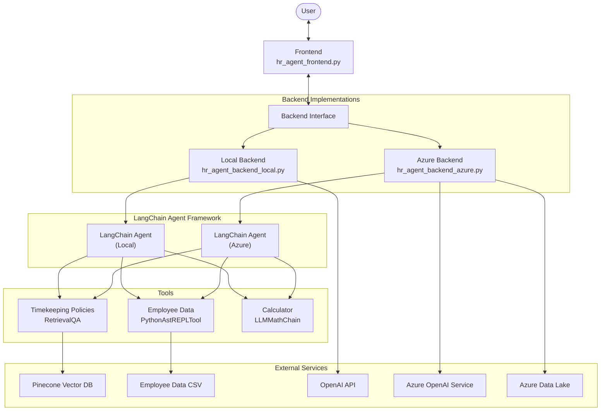

Sources: [README.md:11-18](), [hr_agent_frontend.py](), [hr_agent_backend_local.py](), [hr_agent_backend_azure.py]()

## Core Components

The system consists of the following major components:

| Component | Implementation | Purpose |
|-----------|---------------|---------|
| Frontend | Streamlit-based UI | Provides chat interface for user interaction |
| Backend | Local or Azure implementations | Processes user queries and manages agent interactions |
| Agent Framework | LangChain | Orchestrates tools and language model responses |
| Language Model | OpenAI or Azure OpenAI | Generates responses and reasons about user queries |
| Tools | RetrievalQA, PythonAstREPLTool, LLMMathChain | Provides access to policies, employee data, and calculations |
| Vector Database | Pinecone | Stores and retrieves HR policy embeddings |
| Data Storage | CSV/Azure Data Lake | Stores employee information |

Sources: [README.md:11-18](), [README.md:44-53]()

## Component Interactions

The following diagram illustrates how components interact during a typical user query:

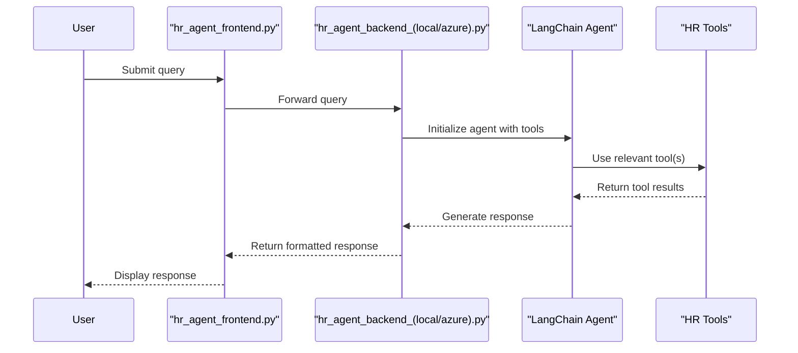

Sources: [hr_agent_frontend.py](), [hr_agent_backend_local.py](), [hr_agent_backend_azure.py]()

## Backend Implementations

The system supports two backend implementations that share the same interface but differ in their external integrations:

### Local Backend Architecture

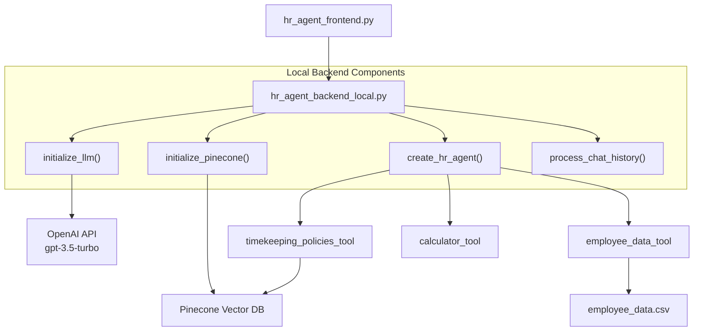

Sources: [hr_agent_backend_local.py](), [README.md:34]()

### Azure Backend Architecture

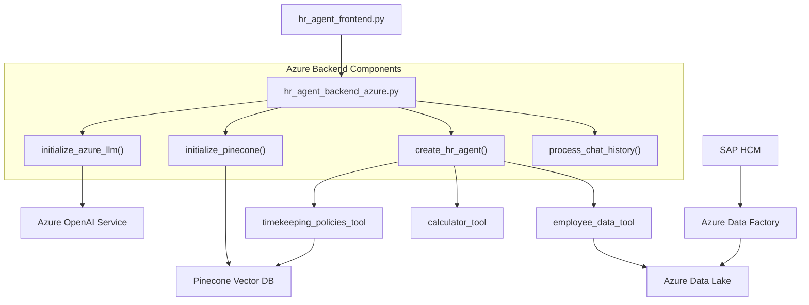

Sources: [hr_agent_backend_azure.py](), [README.md:51-53]()

For detailed information about each backend implementation, see [Local Backend](#2.2.1) and [Azure Backend](#2.2.2).

## Tools Architecture

The HR Agent uses three specialized tools integrated through LangChain's agent framework:

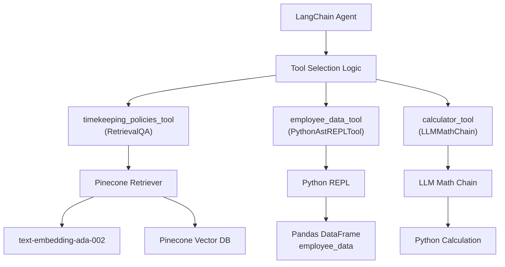

Sources: [README.md:14-17](), [hr_agent_backend_local.py]()

For more information on the tools and their capabilities, see [Agent Tools and Capabilities](#3).

## Data Flow Architecture

The following diagram illustrates how data flows through the system during a typical user interaction:

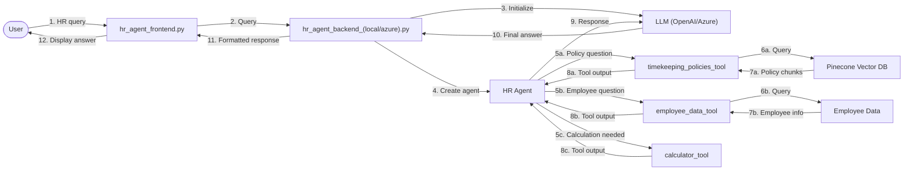

Sources: [hr_agent_frontend.py](), [hr_agent_backend_local.py](), [hr_agent_backend_azure.py]()

## Data Storage Architecture

The system uses different storage solutions for different types of data:

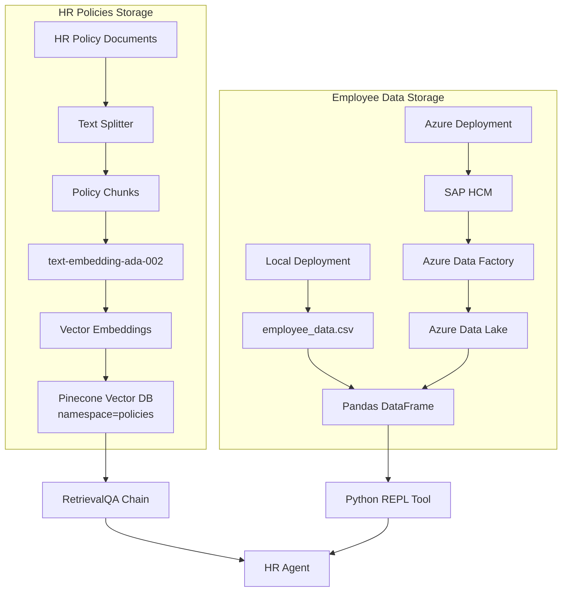

Sources: [README.md:14-17](), [README.md:37-41](), [README.md:51-53]()

For detailed information about data processing and storage, see [Data Processing Pipeline](#4).

## Deployment Options

The system supports two primary deployment scenarios:

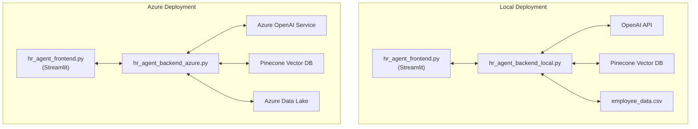

Sources: [README.md:44-53](), [README.md:29-36]()

For detailed deployment instructions, see [Deployment Guide](#5), including [Local Deployment](#5.1) and [Azure Deployment](#5.2).

## Technical Dependencies

The system relies on the following key technologies:

| Technology | Purpose | Used In |
|------------|---------|---------|
| Streamlit | User interface framework | Frontend |
| streamlit_chat | Chat component | Frontend |
| LangChain | Agent framework | Backend |
| OpenAI/Azure OpenAI | Language model provider | Backend |
| Pinecone | Vector database | Backend/Tools |
| Pandas | Data manipulation | Tools/Employee Data |
| Python 3.10+ | Runtime environment | All components |

Sources: [README.md:44-53]()

## Summary

The Autonomous HR Chatbot architecture is designed with modularity and flexibility in mind, allowing for both local and cloud-based deployment options while maintaining consistent functionality. The system integrates language models with specialized tools to provide contextually relevant responses to HR queries by accessing policies, employee data, and performing calculations as needed.

For implementation details about specific components, please refer to the linked wiki pages for each subsystem.

---

# Page: Frontend Implementation

# Frontend Implementation

<details>
<summary>Relevant source files</summary>

The following files were used as context for generating this wiki page:

- [README.md](README.md)
- [hr_agent_frontend.py](hr_agent_frontend.py)

</details>


## Purpose and Scope

This document details the frontend implementation of the Autonomous HR Chatbot system, which provides the user interface for interacting with the HR agent. The frontend is built using Streamlit and the streamlit_chat component to create a simple yet effective chat interface. For information about the backend implementation that processes the user queries, see [Backend Implementation](#2.2).

## Component Overview

The frontend serves as the entry point for user interaction with the HR chatbot system. It handles user input, displays chat messages, and communicates with the backend to process HR-related queries.

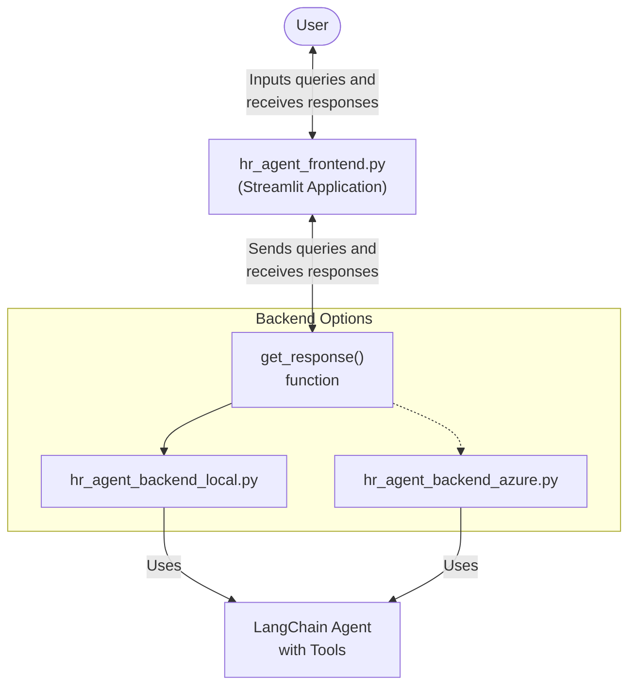

Sources: [hr_agent_frontend.py:1-5]()

## Frontend Implementation Details

The frontend is implemented in a single Python file (`hr_agent_frontend.py`) using Streamlit, a Python library for creating web applications. The implementation focuses on simplicity and user experience.

### Key Components and Libraries

- **Streamlit**: The core framework used to build the web interface
- **streamlit_chat**: A component that provides styled chat message bubbles
- **Backend connector**: Imports the `get_response` function from either the local or Azure backend

```mermaid
classDiagram
    class "StreamlitApp" {
        +session_state
        +process_input(user_input)
        +display_messages()
    }
    
    class "BackendConnector" {
        +get_response(user_input)
    }
    
    class "StreamlitChat" {
        +message(text, is_user, key)
    }
    
    "StreamlitApp" --> "BackendConnector" : uses
    "StreamlitApp" --> "StreamlitChat" : uses for display
```

Sources: [hr_agent_frontend.py:1-5](), [README.md:11-13]()

### User Interface Structure

The frontend presents a simple chat interface with:
- A header and introductory text
- A text input field for users to type their queries
- A "Send" button to submit queries
- A chat container displaying the conversation history with distinct styling for user and bot messages

Sources: [hr_agent_frontend.py:12-14](), [hr_agent_frontend.py:23-25](), [hr_agent_frontend.py:37-41]()

### Session State Management

Streamlit's session state is used to maintain the conversation history across user interactions:

- `st.session_state["past"]`: Stores the history of user messages
- `st.session_state["generated"]`: Stores the history of bot responses
- `st.session_state["input_message_key"]`: Manages the text input field's state

This state management ensures that the conversation persists even when the Streamlit app reruns.

Sources: [hr_agent_frontend.py:15-21](), [hr_agent_frontend.py:30-33]()

## User Interaction Flow

The following diagram illustrates the sequence of events when a user interacts with the frontend:

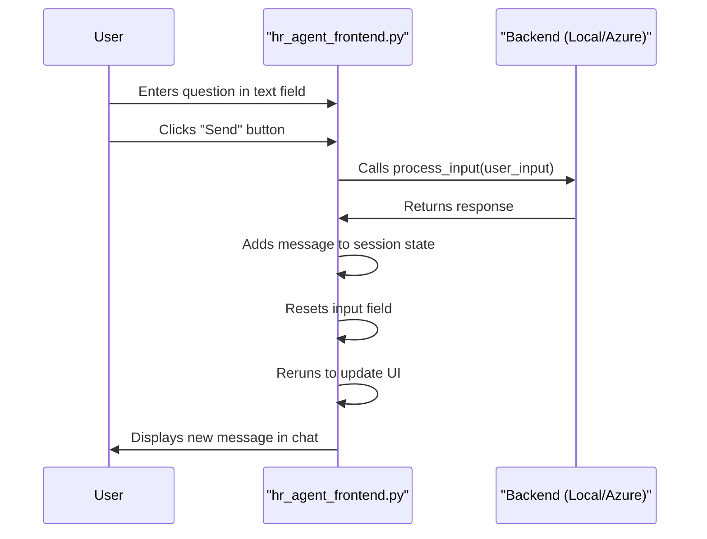

Sources: [hr_agent_frontend.py:27-35]()

## Code Implementation Details

### Input Processing

When a user submits a message, the following process occurs:

1. The `process_input` function is called with the user input
2. This function calls `get_response` from the backend implementation
3. The response is returned to the main application flow

```python
def process_input(user_input):
    response = get_response(user_input)
    return response
```

Sources: [hr_agent_frontend.py:8-10]()

### Message Display

The frontend uses the `streamlit_chat` component's `message` function to display messages with appropriate styling:

1. User messages are displayed with `is_user=True`
2. Bot responses are displayed with default styling
3. Each message is given a unique key to prevent rendering issues

Sources: [hr_agent_frontend.py:37-41]()

## Configuration Options

The frontend allows for switching between different backend implementations by commenting/uncommenting the relevant import statements:

```python
#from hr_agent_backend_azure import get_response
from hr_agent_backend_local import get_response
```

By default, the local backend is used, but developers can switch to the Azure backend by changing which import line is commented out.

Sources: [hr_agent_frontend.py:4-5]()

## Frontend-Backend Integration

The following diagram shows how the frontend's `process_input` function connects to the backend services and tools:

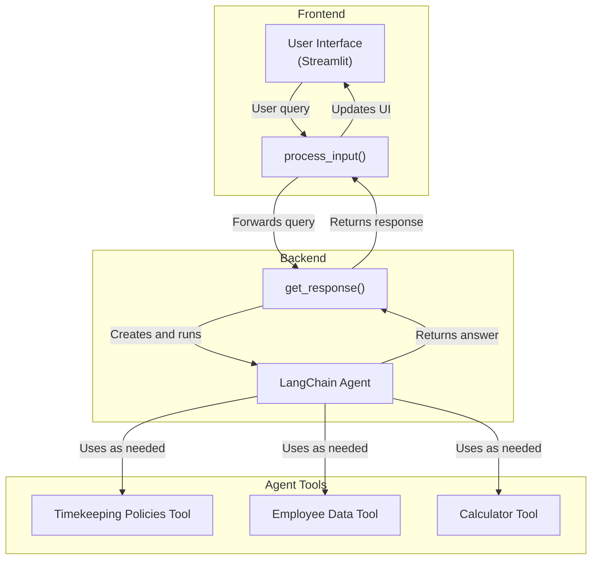

Sources: [hr_agent_frontend.py:8-10](), [README.md:14-17]()

## Sample User Experience

The frontend provides a clean chat interface similar to popular messaging applications. Users can:

1. Type their HR-related questions in the text input field
2. Submit questions by clicking the "Send" button
3. View the conversation history with distinct styling for user and bot messages
4. Ask follow-up questions in the same session

The README provides sample screenshots demonstrating the chat interface and the bot's use of tools to answer questions.

Sources: [README.md:19-25](), [hr_agent_frontend.py:12-14](), [hr_agent_frontend.py:37-41]()

## Deployment

To run the frontend application, users execute the Streamlit command:

```
streamlit run hr_agent_frontend.py
```

This launches a local web server that hosts the application, accessible via a web browser.

Sources: [README.md:35]()

---

# Page: Backend Implementation

# Backend Implementation

<details>
<summary>Relevant source files</summary>

The following files were used as context for generating this wiki page:

- [README.md](README.md)
- [hr_agent_backend_azure.py](hr_agent_backend_azure.py)
- [hr_agent_backend_local.py](hr_agent_backend_local.py)

</details>


This document details the core backend architecture and components of the Autonomous HR Chatbot system. It covers the shared implementation patterns between the local and Azure backend variants. For specific details about each implementation, see [Local Backend](#2.2.1) and [Azure Backend](#2.2.2).

## Architecture Overview

The backend system serves as the intelligent engine of the HR chatbot, processing user queries and generating responses by orchestrating various components including language models, vector databases, and specialized HR tools.

### Backend Component Architecture

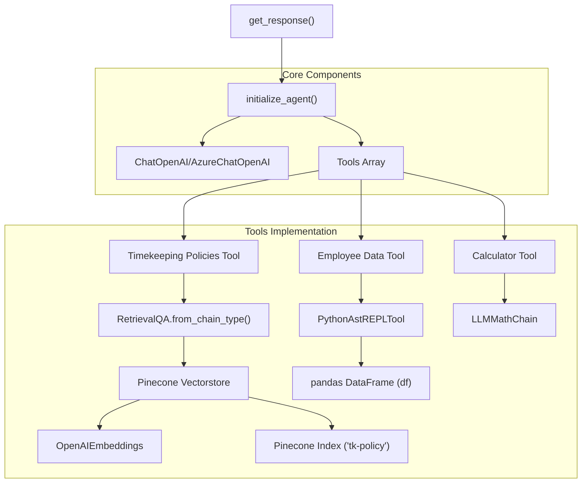

Sources: [hr_agent_backend_local.py:102-107](), [hr_agent_backend_azure.py:127-132]()

### Query Processing Flow

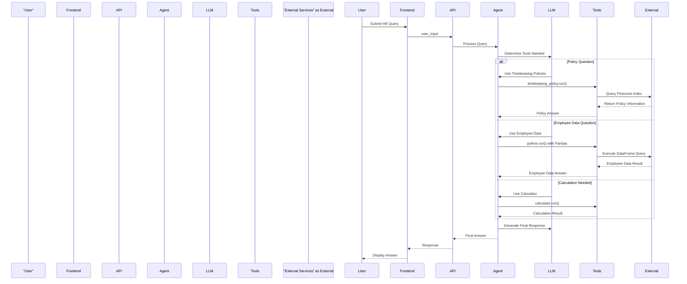

Sources: [hr_agent_backend_local.py:109-111](), [hr_agent_backend_azure.py:134-136]()

## Core Components

### Language Model (LLM)

Both backend implementations utilize OpenAI's language models with different initialization methods:

```python
# Local Backend - Direct OpenAI API
llm = ChatOpenAI(    
    openai_api_key="<your openai api key>", 
    model_name="gpt-3.5-turbo", 
    temperature=0.0
)

# Azure Backend - Azure OpenAI Service
llm = AzureChatOpenAI(    
    deployment_name="<your deployment name>", 
    model_name="gpt-35-turbo", 
    openai_api_key='<your openai api key>',
    openai_api_version='2023-03-15-preview', 
    openai_api_base='<your api base>',
    openai_api_type='azure'
)
```

The model is set with a temperature of 0.0 to ensure deterministic and factual responses for HR inquiries.

Sources: [hr_agent_backend_local.py:37-41](), [hr_agent_backend_azure.py:42-49]()

### Vector Database

The backend uses Pinecone as the vector database to store and retrieve embeddings of HR policy documents:

```python
# Initialize Pinecone client
pinecone.init(
    api_key="<your pinecone api key>",  
    environment="<your pinecone environment>"  
) 

# Connect to index
index_name = 'tk-policy'
index = pinecone.Index(index_name)

# Initialize text embeddings
embed = OpenAIEmbeddings(
    model='text-embedding-ada-002',
    openai_api_key="<your openai api key>",
)

# Set up vector store
text_field = 'text'  # Field containing document text
vectorstore = Pinecone(
    index, embed.embed_query, text_field
)
```

The vector database enables semantic search capabilities for retrieving relevant HR policy information based on user queries.

Sources: [hr_agent_backend_local.py:17-35](), [hr_agent_backend_azure.py:17-39]()

### Tool Implementation

#### 1. Timekeeping Policies Tool

This tool retrieves HR policy information using semantic search through the vector database:

```python
timekeeping_policy = RetrievalQA.from_chain_type(
    llm=llm,
    chain_type="stuff",
    retriever=vectorstore.as_retriever(),
)
```

Sources: [hr_agent_backend_local.py:44-48](), [hr_agent_backend_azure.py:52-56]()

#### 2. Employee Data Tool

This tool provides access to employee data using Python code execution:

```python
# Initialize DataFrame and Python REPL tool
df = pd.read_csv("employee_data.csv")  # Local implementation
python = PythonAstREPLTool(locals={"df": df})
```

In the Azure implementation, this uses Azure Data Lake Storage to retrieve the employee data CSV file.

Sources: [hr_agent_backend_local.py:50-51](), [hr_agent_backend_azure.py:59-76]()

#### 3. Calculator Tool

This tool performs mathematical calculations when needed for HR calculations:

```python
calculator = LLMMathChain.from_llm(llm=llm, verbose=True)
```

Sources: [hr_agent_backend_local.py:54](), [hr_agent_backend_azure.py:79]()

### Agent Configuration

The backend initializes a LangChain agent with the tools and a custom prompt:

```python
# Create variables for prompt templates
user = 'Alexander Verdad'  # Default user
df_columns = df.columns.to_list()  # DataFrame columns

# Configure tools array with descriptions
tools = [
    Tool(
        name="Timekeeping Policies",
        func=timekeeping_policy.run,
        description="..."  # Tool description
    ),
    Tool(
        name="Employee Data",
        func=python.run,
        description=f"..."  # Tool description with examples
    ),
    Tool(
        name="Calculator",
        func=calculator.run,
        description=f"..."  # Tool description
    )
]

# Custom HR assistant prompt
agent_kwargs = {
    'prefix': f'You are friendly HR assistant. You are tasked to assist the current user: {user} on questions related to HR. You have access to the following tools:'
}

# Initialize the LLM agent
agent = initialize_agent(
    tools, 
    llm, 
    agent=AgentType.ZERO_SHOT_REACT_DESCRIPTION, 
    verbose=True, 
    agent_kwargs=agent_kwargs
)
```

The agent uses ZERO_SHOT_REACT_DESCRIPTION agent type, which enables it to determine the appropriate tool to use for each query without requiring examples.

Sources: [hr_agent_backend_local.py:61-107](), [hr_agent_backend_azure.py:86-132]()

### Response Generation

The backend exposes a simple function to process queries and generate responses:

```python
def get_response(user_input):
    response = agent.run(user_input)
    return response
```

This function serves as the API endpoint for the frontend, taking user input and returning the agent's response.

Sources: [hr_agent_backend_local.py:109-111](), [hr_agent_backend_azure.py:134-136]()

## Implementation Differences

The main differences between the local and Azure backend implementations are:

| Feature | Local Backend | Azure Backend |
|---------|---------------|---------------|
| LLM Provider | Direct OpenAI API | Azure OpenAI Service |
| Employee Data Source | Local CSV file | Azure Data Lake Storage |
| Environment Variables | OpenAI API key | Azure OpenAI API key, deployment details, Azure Storage credentials |
| Infrastructure Requirements | Minimal (local machine) | Azure subscription and services |

For specific implementation details, refer to [Local Backend](#2.2.1) and [Azure Backend](#2.2.2) documentation.

Sources: [hr_agent_backend_local.py](), [hr_agent_backend_azure.py]()

## Tool Descriptions

Both backends configure the agent tools with detailed descriptions to guide their usage:

### Timekeeping Policies Tool

```
Useful for when you need to answer questions about employee timekeeping policies.

<user>: What is the policy on unused vacation leave?
<assistant>: I need to check the timekeeping policies to answer this question.
<assistant>: Action: Timekeeping Policies
<assistant>: Action Input: Vacation Leave Policy - Unused Leave
...
```

### Employee Data Tool

```
Useful for when you need to answer questions about employee data stored in pandas dataframe 'df'. 
Run python pandas operations on 'df' to help you get the right answer.
'df' has the following columns: [name, position, department, ...]

<user>: How many Sick Leave do I have left?
<assistant>: df[df['name'] == 'Alexander Verdad']['sick_leave']
<assistant>: You have n sick leaves left.
```

### Calculator Tool

```
Useful when you need to do math operations or arithmetic.
```

These descriptions contain examples that help guide the agent in properly utilizing each tool when responding to HR queries.

Sources: [hr_agent_backend_local.py:61-95](), [hr_agent_backend_azure.py:86-120]()

---

# Page: Local Backend

# Local Backend

<details>
<summary>Relevant source files</summary>

The following files were used as context for generating this wiki page:

- [README.md](README.md)
- [hr_agent_backend_local.py](hr_agent_backend_local.py)

</details>


## Purpose and Scope

This document details the Local Backend implementation of the Autonomous HR Chatbot system. The Local Backend provides a self-contained implementation that can run entirely on a local machine, connecting directly to external APIs like OpenAI and Pinecone without requiring Azure cloud services. This page focuses on the architecture, components, and functionality specific to the local deployment option.

For information about the Azure-based implementation, see [Azure Backend](#2.2.2).

## Architecture Overview

The Local Backend is implemented in `hr_agent_backend_local.py` and serves as one of two possible backend implementations for the HR Chatbot system. It connects the frontend to various tools and services while maintaining all processing logic locally.

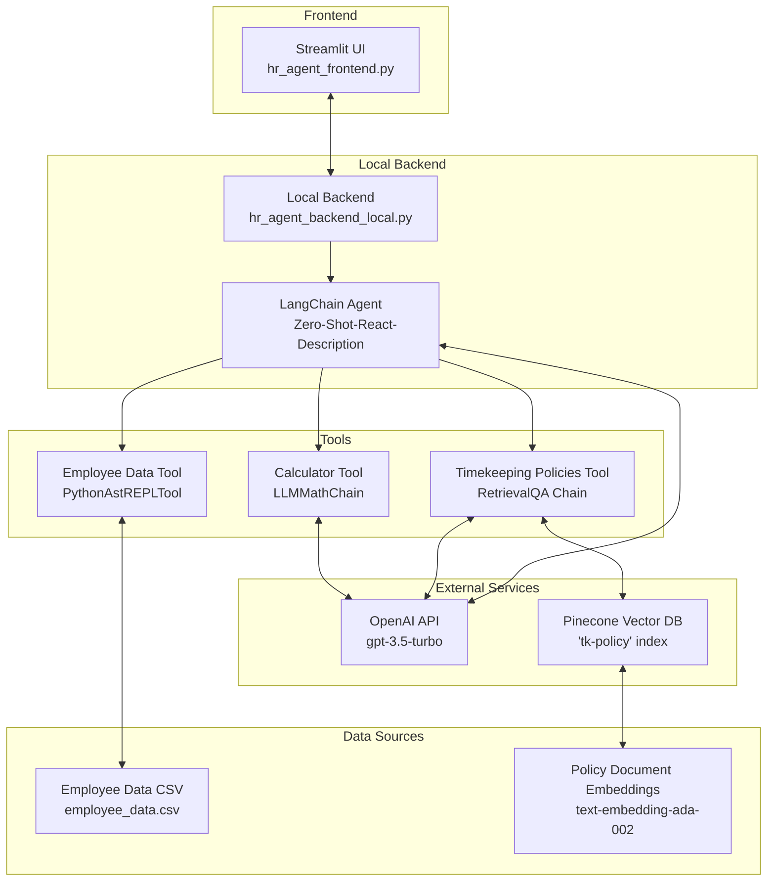

Sources: [hr_agent_backend_local.py:1-107](), [README.md:11-17]()

## Core Components

### Backend Initialization

The Local Backend initializes key components needed for the HR chatbot functionality:

1. **Pinecone Vector Database Client** - Connects to a Pinecone index that stores embeddings of HR policy documents
2. **OpenAI Embeddings** - Creates vector representations of user queries
3. **Language Model (LLM)** - Uses OpenAI's GPT-3.5-turbo model for generating responses
4. **Vector Store** - Bridges between Pinecone and the embedding functionality
5. **Agent** - Zero-shot agent that coordinates tool usage

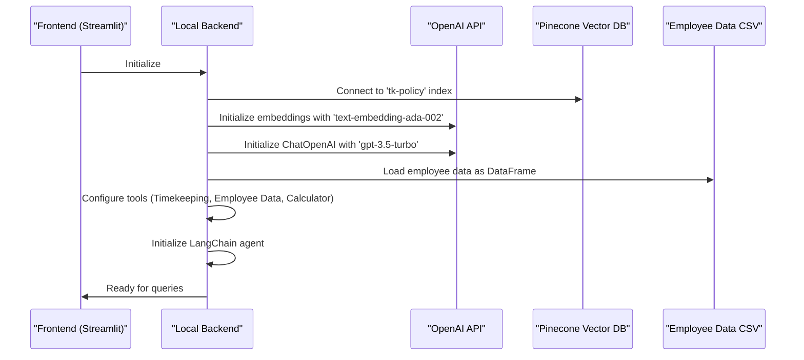

Sources: [hr_agent_backend_local.py:16-41]()

### Configuration and API Keys

The Local Backend requires configuration with several API keys:

| Configuration Item | Description | Code Reference |
|--------------------|-------------|----------------|
| Pinecone API Key | Required to access the vector database | [hr_agent_backend_local.py:18]() |
| Pinecone Environment | Environment setting for Pinecone | [hr_agent_backend_local.py:19]() |
| OpenAI API Key | Required for embeddings and LLM access | [hr_agent_backend_local.py:28](), [hr_agent_backend_local.py:38]() |
| Index Name | Name of the Pinecone index ('tk-policy') | [hr_agent_backend_local.py:22]() |

Sources: [hr_agent_backend_local.py:16-41]()

## Tools Integration

The Local Backend integrates three primary tools that enable the agent to assist with HR queries:

### 1. Timekeeping Policies Tool

This tool allows the agent to retrieve relevant HR policies from the Pinecone vector database using semantic search.

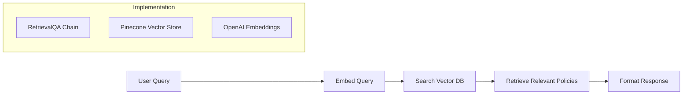

Sources: [hr_agent_backend_local.py:43-48](), [hr_agent_backend_local.py:61-74]()

### 2. Employee Data Tool

This tool enables the agent to query and manipulate employee data stored in a local CSV file.

```mermaid
flowchart LR
    Query["User Query"] --> Parse["Parse Query"]
    Parse --> GenerateCode["Generate Python Code"]
    GenerateCode --> Execute["Execute Code on DataFrame"]
    Execute --> Interpret["Interpret Results"]
    
    subgraph "Implementation"
        PythonTool["PythonAstREPLTool"]
        DataFrame["Pandas DataFrame"]
        CSV["employee_data.csv"]
    end
    
    DataFrame --> CSV
```

Sources: [hr_agent_backend_local.py:50-51](), [hr_agent_backend_local.py:75-87]()

### 3. Calculator Tool

This tool allows the agent to perform mathematical operations when needed.

```mermaid
flowchart LR
    Query["User Math Query"] --> Parse["Parse Query"]
    Parse --> GenerateExpression["Generate Math Expression"]
    GenerateExpression --> Calculate["Calculate Result"]
    Calculate --> Format["Format Response"]
    
    subgraph "Implementation"
        MathChain["LLMMathChain"]
        LLM["ChatOpenAI"]
    end
```

Sources: [hr_agent_backend_local.py:53-54](), [hr_agent_backend_local.py:88-94]()

## Agent Configuration

The Local Backend sets up a LangChain agent with:

1. Zero-shot agent type that can reason about which tool to use without examples
2. Custom prompt prefix that establishes the agent's role as an HR assistant
3. Access to all three tools (Timekeeping Policies, Employee Data, Calculator)
4. Information about the current user to personalize responses

```
agent_kwargs = {'prefix': f'You are friendly HR assistant. You are tasked to assist the current user: {user} on questions related to HR. You have access to the following tools:'}
```

Sources: [hr_agent_backend_local.py:97-107]()

## Data Flow

The following diagram illustrates how the Local Backend processes user queries:

```mermaid
sequenceDiagram
    participant User
    participant Frontend as "Streamlit UI"
    participant Backend as "get_response() function"
    participant Agent as "LangChain Agent"
    participant Tool as "Relevant Tool"
    participant External as "External Service (OpenAI/Pinecone)"
    
    User->>Frontend: Asks HR question
    Frontend->>Backend: Passes user input
    Backend->>Agent: Runs agent with user input
    
    Agent->>Agent: Determines required tool
    
    alt Timekeeping Policy Question
        Agent->>Tool: Calls Timekeeping Policies tool
        Tool->>External: Queries Pinecone vector DB
        External->>Tool: Returns relevant policies
        Tool->>Agent: Returns policy information
    else Employee Data Question
        Agent->>Tool: Calls Employee Data tool
        Tool->>Tool: Executes Python code on DataFrame
        Tool->>Agent: Returns employee data
    else Calculation Needed
        Agent->>Tool: Calls Calculator tool
        Tool->>External: Uses OpenAI for calculation
        External->>Tool: Returns calculation
        Tool->>Agent: Returns result
    end
    
    Agent->>Backend: Returns final response
    Backend->>Frontend: Returns response
    Frontend->>User: Displays response
```

Sources: [hr_agent_backend_local.py:108-111]()

## Local vs Azure Backend Comparison

| Feature | Local Backend | Azure Backend |
|---------|---------------|---------------|
| Implementation File | `hr_agent_backend_local.py` | `hr_agent_backend_azure.py` |
| LLM Provider | Direct OpenAI API | Azure OpenAI Service |
| Employee Data Source | Local CSV file | Azure Data Lake |
| API Keys Required | OpenAI API, Pinecone API | Azure OpenAI API, Azure Data Lake credentials, Pinecone API |
| Deployment | Local machine | Azure cloud services |
| Integration with Enterprise Systems | Limited | Enhanced (e.g., SAP HCM via Azure Data Factory) |

Sources: [README.md:43-53]()

## Usage

The Local Backend exposes a single function for the frontend to use:

```python
def get_response(user_input):
    response = agent.run(user_input)
    return response
```

This function is called by the Streamlit frontend to process user queries and return responses.

Sources: [hr_agent_backend_local.py:108-111]()

## Local Backend Setup Requirements

To set up the Local Backend, you need:

1. An OpenAI API key for both the embedding model and the LLM
2. A Pinecone account with API key and environment
3. A Pinecone index named 'tk-policy' with embeddings of HR policy documents
4. A local employee data CSV file

Follow the setup instructions in the README to initialize all dependencies before running the system.

Sources: [README.md:29-36](), [README.md:37-41]()

---

# Page: Azure Backend

# Azure Backend

<details>
<summary>Relevant source files</summary>

The following files were used as context for generating this wiki page:

- [README.md](README.md)
- [hr_agent_backend_azure.py](hr_agent_backend_azure.py)

</details>


## Purpose and Scope

This document details the Azure Backend implementation of the Autonomous HR Chatbot system. The Azure Backend provides cloud-based deployment capabilities, leveraging Azure services such as Azure OpenAI and Azure Data Lake Storage. This backend alternative is designed for enterprise environments requiring cloud infrastructure, scalability, and integration with existing Azure services.

For information about the local deployment alternative, see [Local Backend](#2.2.1).

Sources: [hr_agent_backend_azure.py:1-136](), [README.md:34-54]()

## Azure Backend Architecture Overview

The Azure Backend follows the same fundamental architecture as the Local Backend but replaces direct API calls with Azure service integrations. It connects to Pinecone for vector storage while utilizing Azure services for LLM capabilities and data storage.

```mermaid
flowchart TD
    subgraph "Azure Backend"
        agent["Agent
        initialize_agent()"]
        tools["Tools
        Timekeeping/Employee/Calculator"]
        qa["RetrievalQA
        timekeeping_policy"]
        llm["AzureChatOpenAI
        gpt-35-turbo"]
        embed["OpenAIEmbeddings
        text-embedding-ada-002"]
    end

    subgraph "Azure Services"
        azopenai["Azure OpenAI Service"]
        azlake["Azure Data Lake Storage"]
    end

    subgraph "External Services"
        pinecone["Pinecone Vector DB
        index_name='tk-policy'"]
    end

    Frontend --> agent
    agent --> tools
    tools --> qa
    tools --> python["PythonAstREPLTool
    (Employee Data)"]
    tools --> calc["LLMMathChain
    (Calculator)"]
    
    qa --> llm
    qa --> pinecone
    llm --> azopenai
    embed --> azopenai
    pinecone --> embed
    python --> df["Pandas DataFrame
    employee_data.csv"]
    df --> azlake
    calc --> llm
```

Sources: [hr_agent_backend_azure.py:1-15](), [hr_agent_backend_azure.py:81-132]()

## Key Components

### 1. Azure Service Integrations

The Azure Backend integrates with two primary Azure services:

| Azure Service | Purpose | Implementation |
|---------------|---------|----------------|
| Azure OpenAI Service | Provides the LLM capabilities for the chatbot | Used for both chat completions and text embeddings |
| Azure Data Lake Storage | Stores and provides employee data | Accessed via DataLakeServiceClient to retrieve CSV files |

Sources: [hr_agent_backend_azure.py:25-33](), [hr_agent_backend_azure.py:42-49](), [hr_agent_backend_azure.py:59-68]()

### 2. Vector Database Connection

The backend connects to Pinecone for storing and retrieving HR policy embeddings:

```mermaid
sequenceDiagram
    participant "Azure Backend" as backend
    participant "OpenAI Embeddings" as embed
    participant "Pinecone" as pinecone
    participant "RetrievalQA" as qa
    
    backend->>pinecone: Initialize connection
    Note over pinecone: pinecone.init(api_key, environment)
    backend->>embed: Configure with Azure credentials
    Note over embed: OpenAIEmbeddings(deployment, model, api_key...)
    backend->>pinecone: Connect to index 'tk-policy'
    backend->>qa: Initialize RetrievalQA chain
    Note over qa: RetrievalQA.from_chain_type(llm, retriever)
```

Sources: [hr_agent_backend_azure.py:16-39](), [hr_agent_backend_azure.py:51-56]()

### 3. Employee Data Access

The Azure implementation retrieves employee data from Azure Data Lake Storage:

```mermaid
flowchart TD
    subgraph "Azure Data Lake"
        storage["Storage Account"]
        fs["File System"]
        file["employee_data.csv"]
    end

    subgraph "Azure Backend"
        client["DataLakeServiceClient"]
        df["Pandas DataFrame"]
        python["PythonAstREPLTool"]
    end

    client --> storage
    storage --> fs
    fs --> file
    file --> df
    df --> python
```

Sources: [hr_agent_backend_azure.py:58-76]()

## Implementation Details

### Authentication and Configuration

The Azure Backend requires several credentials and configuration parameters for each service:

1. **Pinecone Configuration:**
   - API key and environment for connecting to the Pinecone service
   - Index name (`tk-policy`) for the vector database

2. **Azure OpenAI Configuration:**
   - API key
   - API base URL
   - Deployment name
   - Model name (gpt-35-turbo)
   - API version

3. **Azure Data Lake Configuration:**
   - Account URL
   - Storage credential
   - File system and path information

Sources: [hr_agent_backend_azure.py:16-23](), [hr_agent_backend_azure.py:25-33](), [hr_agent_backend_azure.py:42-49](), [hr_agent_backend_azure.py:59-68]()

### Tool Integration

The Azure Backend provides three primary tools to the agent:

```mermaid
graph TD
    subgraph "Agent Tools"
        tk["Timekeeping Policies Tool"]
        emp["Employee Data Tool"]
        calc["Calculator Tool"]
    end
    
    subgraph "Implementation"
        tkqa["RetrievalQA Chain"]
        python["PythonAstREPLTool"]
        mathchain["LLMMathChain"]
    end
    
    subgraph "Data Sources"
        pinecone["Pinecone Vector DB"]
        datalake["Azure Data Lake
        employee_data.csv"]
    end
    
    agent["initialize_agent()"] --> tk
    agent --> emp
    agent --> calc
    
    tk --> tkqa
    tkqa --> pinecone
    emp --> python
    python --> datalake
    calc --> mathchain
```

Sources: [hr_agent_backend_azure.py:86-120]()

### Agent Initialization

The Azure Backend initializes a zero-shot agent with the following configuration:

1. Tools: Timekeeping Policies, Employee Data, and Calculator
2. LLM: Azure OpenAI (gpt-35-turbo)
3. Agent type: ZERO_SHOT_REACT_DESCRIPTION
4. Custom prompt prefix specifying the agent's role as a friendly HR assistant

Sources: [hr_agent_backend_azure.py:122-132]()

## API Interface

The Azure Backend exposes a simple interface for the frontend:

```python
def get_response(user_input):
    response = agent.run(user_input)
    return response
```

This function serves as the primary entry point for processing user queries.

Sources: [hr_agent_backend_azure.py:134-136]()

## Data Flow

This diagram illustrates how a user query flows through the Azure Backend system:

```mermaid
sequenceDiagram
    participant User
    participant Frontend
    participant Agent as "Azure Backend Agent"
    participant Tools as "Agent Tools"
    participant Azure as "Azure Services"
    participant Pinecone
    
    User->>Frontend: Submit query
    Frontend->>Agent: get_response(user_input)
    
    Agent->>Agent: Determine tool to use
    
    alt Timekeeping Policy Question
        Agent->>Tools: Use Timekeeping Policies tool
        Tools->>Pinecone: Query vector store
        Pinecone-->>Tools: Return relevant policies
        Tools-->>Agent: Return policy information
    else Employee Data Question
        Agent->>Tools: Use Employee Data tool
        Tools->>Azure: Access Data Lake Storage
        Azure-->>Tools: Return employee data
        Tools-->>Agent: Return employee information
    else Calculation Needed
        Agent->>Tools: Use Calculator tool
        Tools->>Agent: Return calculation result
    end
    
    Agent->>Frontend: Formulated response
    Frontend->>User: Display response
```

Sources: [hr_agent_backend_azure.py:134-136](), [hr_agent_backend_azure.py:86-120]()

## Differences from Local Backend

The key differences between the Azure and Local backend implementations are:

| Feature | Azure Backend | Local Backend |
|---------|---------------|---------------|
| LLM Service | Azure OpenAI Service | Direct OpenAI API |
| Employee Data Storage | Azure Data Lake Storage | Local CSV file |
| Authentication | Azure-specific credentials | Direct API keys |
| Deployment Environment | Cloud-based | Local machine |
| Integration Capabilities | Enterprise Azure services | Limited to direct API calls |

Sources: [hr_agent_backend_azure.py:1-136](), [README.md:34-54]()

## Configuration Requirements

To use the Azure Backend, you need to:

1. Have an Azure subscription with access to:
   - Azure OpenAI Service
   - Azure Data Lake Storage

2. Configure all necessary API keys and endpoints:
   - Azure OpenAI API key and base URL
   - Azure Storage account credentials
   - Pinecone API key and environment

3. Upload employee data to Azure Data Lake Storage

4. Update the configuration in the `hr_agent_backend_azure.py` file with your credentials

Sources: [hr_agent_backend_azure.py:16-68](), [README.md:34]()

## Integration with Frontend

The Azure Backend is connected to the frontend by uncommenting the appropriate import statement in the frontend file:

```python
# In hr_agent_frontend.py
# from hr_agent_backend_azure import get_response  # Uncomment for Azure Backend
# from hr_agent_backend_local import get_response  # Comment out for Azure Backend
```

Both backend implementations expose the same `get_response` function, allowing the frontend to work seamlessly with either backend.

Sources: [README.md:34]()

---

# Page: Agent Tools and Capabilities

# Agent Tools and Capabilities

<details>
<summary>Relevant source files</summary>

The following files were used as context for generating this wiki page:

- [README.md](README.md)
- [hr-agent-code-jupyter-notebook.ipynb](hr-agent-code-jupyter-notebook.ipynb)
- [hr_agent_backend_azure.py](hr_agent_backend_azure.py)
- [hr_agent_backend_local.py](hr_agent_backend_local.py)

</details>


## Purpose and Scope

This document details the tools available to the Autonomous HR Chatbot agent and explains how these tools work together to provide comprehensive HR assistance. It covers the implementation, functionality, and integration of each tool within the agent framework. For information on the overall system architecture, see [System Architecture](#2).

## Overview of Agent Tools

The Autonomous HR Chatbot is equipped with three specialized tools that allow it to perform a variety of HR-related tasks:

1. **Timekeeping Policies Tool** - Retrieves and provides information from HR policy documents
2. **Employee Data Tool** - Accesses and manipulates employee information
3. **Calculator Tool** - Performs mathematical calculations for payroll and leave-related queries

These tools work together within a LangChain agent framework to enable the HR chatbot to respond intelligently to user queries.

```mermaid
flowchart TD
    User(("User")) -- "HR Query" --> Agent["HR Agent"]
    
    subgraph "Agent Tools"
        TPTool["Timekeeping Policies Tool"]
        EDTool["Employee Data Tool"]
        CalcTool["Calculator Tool"]
    end
    
    Agent --> TPTool
    Agent --> EDTool
    Agent --> CalcTool
    
    TPTool -- "Policy Information" --> Agent
    EDTool -- "Employee Records" --> Agent
    CalcTool -- "Calculation Results" --> Agent
    
    Agent -- "Response" --> User
```

Sources: [hr_agent_backend_local.py:61-95](), [hr_agent_backend_azure.py:86-120](), [README.md:14-17]()

## Tool Implementation and Configuration

Each tool is implemented as a LangChain `Tool` object that wraps around specific functionality. The tools are configured in both local and Azure backend implementations.

```mermaid
classDiagram
    class Tool {
        +name: string
        +func: callable
        +description: string
    }
    
    class "RetrievalQA" {
        +run(query)
    }
    
    class "PythonAstREPLTool" {
        +run(code)
    }
    
    class "LLMMathChain" {
        +run(expression)
    }
    
    Tool "1" *-- "1" "RetrievalQA": Timekeeping Policies
    Tool "1" *-- "1" "PythonAstREPLTool": Employee Data
    Tool "1" *-- "1" "LLMMathChain": Calculator
```

Sources: [hr_agent_backend_local.py:61-95](), [hr_agent_backend_azure.py:86-120]()

### Tools Configuration Code

Tools are initialized with a name, function, and description that helps the agent understand when and how to use each tool. Below are the key components of each tool's initialization:

1. **Timekeeping Policies Tool**:
   - Uses a RetrievalQA chain to access HR policy information
   - Connected to Pinecone vector database for semantic search

2. **Employee Data Tool**:
   - Uses PythonAstREPLTool to run Python code against a pandas DataFrame
   - Provides access to employee records through Python's data manipulation capabilities

3. **Calculator Tool**:
   - Uses LLMMathChain for handling mathematical expressions
   - Supports arithmetic operations for leave calculations, salary computations, etc.

Sources: [hr_agent_backend_local.py:43-54](), [hr_agent_backend_azure.py:52-78]()

## Timekeeping Policies Tool

The Timekeeping Policies Tool enables the agent to retrieve relevant information from HR policy documents using semantic search.

### Implementation Details

The tool is implemented as a RetrievalQA chain that connects to a Pinecone vector database containing embeddings of HR policy documents.

```mermaid
flowchart LR
    Agent["HR Agent"] -- "Policy Question" --> TPTool["timekeeping_policy.run()"]
    
    subgraph "Timekeeping Policies Tool"
        TPTool --> RetrievalQA["RetrievalQA Chain"]
        RetrievalQA --> LLM["Large Language Model"]
        RetrievalQA --> Retriever["vectorstore.as_retriever()"]
        Retriever --> Pinecone["Pinecone Index: 'tk-policy'"]
    end
    
    LLM -- "Processes Results" --> RetrievalQA
    Pinecone -- "Returns Relevant Documents" --> Retriever
    TPTool -- "Policy Answer" --> Agent
```

Sources: [hr_agent_backend_local.py:43-47](), [hr_agent_backend_azure.py:52-56]()

### Function and Usage

When the agent identifies a query about HR policies, it invokes the Timekeeping Policies Tool. The tool:

1. Takes the query string as input
2. Uses the embedded query to search for relevant passages in the Pinecone vector database
3. Retrieves the most relevant policy information
4. Uses the LLM to formulate a comprehensive answer based on the retrieved information
5. Returns the answer to the agent

The tool's description instructs the agent on how to use it with an example:

```
Useful for when you need to answer questions about employee timekeeping policies.

<user>: What is the policy on unused vacation leave?
<assistant>: I need to check the timekeeping policies to answer this question.
<assistant>: Action: Timekeeping Policies
<assistant>: Action Input: Vacation Leave Policy - Unused Leave
...
```

Sources: [hr_agent_backend_local.py:62-73](), [hr_agent_backend_azure.py:86-98]()

## Employee Data Tool

The Employee Data Tool allows the agent to access and manipulate employee information stored in a pandas DataFrame.

### Implementation Details

This tool uses the `PythonAstREPLTool` from LangChain, which enables the execution of Python code to query and manipulate a pandas DataFrame.

```mermaid
flowchart LR
    Agent["HR Agent"] -- "Employee Data Query" --> EDTool["python.run()"]
    
    subgraph "Employee Data Tool"
        EDTool --> PythonREPL["PythonAstREPLTool"]
        PythonREPL --> Locals["locals={'df': DataFrame}"]
        Locals --> DataFrame["Pandas DataFrame\ndf"]
    end
    
    subgraph "Data Source"
        LocalSource["CSV File\n(Local Backend)"]
        AzureSource["Azure Data Lake\n(Azure Backend)"]
    end
    
    LocalSource --> DataFrame
    AzureSource --> DataFrame
    
    EDTool -- "Query Results" --> Agent
```

Sources: [hr_agent_backend_local.py:50-51](), [hr_agent_backend_azure.py:70-76]()

### Data Access Methods

The Employee Data Tool accesses employee information differently depending on the backend:

1. **Local Backend**:
   - Loads employee data directly from a CSV file: `employee_data.csv`
   - Uses `pd.read_csv()` to create the DataFrame

2. **Azure Backend**:
   - Connects to Azure Data Lake Storage
   - Retrieves the CSV file using the DataLakeServiceClient
   - Converts the file content to a DataFrame

The tool description includes the available DataFrame columns and an example of usage:

```
Useful for when you need to answer questions about employee data stored in pandas dataframe 'df'.
Run python pandas operations on 'df' to help you get the right answer.
'df' has the following columns: ['employee_id', 'name', 'position', 'organizational_unit', 'rank', 
'hire_date', 'regularization_date', 'vacation_leave', 'sick_leave', 'basic_pay_in_php', 
'employment_status', 'supervisor']

<user>: How many Sick Leave do I have left?
<assistant>: df[df['name'] == 'Alexander Verdad']['sick_leave']
<assistant>: You have n sick leaves left.
```

Sources: [hr_agent_backend_local.py:50-51](), [hr_agent_backend_local.py:74-86](), [hr_agent_backend_azure.py:59-76](), [hr_agent_backend_azure.py:99-111]()

## Calculator Tool

The Calculator Tool provides mathematical computation capabilities for handling payroll calculations, leave balances, and other numerical HR operations.

### Implementation Details

This tool is implemented using LangChain's `LLMMathChain`, which allows the agent to perform arithmetic operations by leveraging the LLM's ability to generate Python code for calculations.

```mermaid
flowchart LR
    Agent["HR Agent"] -- "Math Expression" --> CalcTool["calculator.run()"]
    
    subgraph "Calculator Tool"
        CalcTool --> LLMMathChain["LLMMathChain"]
        LLMMathChain --> LLM["Large Language Model"]
        LLMMathChain --> Evaluator["Expression Evaluator"]
    end
    
    LLM -- "Generated Math Expression" --> Evaluator
    Evaluator -- "Calculation Result" --> CalcTool
    CalcTool -- "Result" --> Agent
```

Sources: [hr_agent_backend_local.py:54](), [hr_agent_backend_azure.py:79]()

### Function and Usage

The Calculator Tool is used when numerical calculations are needed. It:

1. Takes a mathematical expression as input
2. Uses the LLM to translate the expression into executable Python code
3. Evaluates the expression
4. Returns the result to the agent

The tool's description is simple:

```
Useful when you need to do math operations or arithmetic.
```

This tool is particularly useful for complex HR calculations such as:
- Leave encashment amounts
- Prorated salary calculations
- Overtime pay computation
- Tax and benefit calculations

Sources: [hr_agent_backend_local.py:88-94](), [hr_agent_backend_azure.py:112-119]()

## Tool Integration with Agent Framework

The tools are integrated into the LangChain agent framework using the `initialize_agent` function with the `ZERO_SHOT_REACT_DESCRIPTION` agent type.

```mermaid
flowchart TD
    subgraph "Agent Initialization"
        Tools["tools Array"]
        LLM["llm (ChatOpenAI/AzureChatOpenAI)"]
        AgentType["AgentType.ZERO_SHOT_REACT_DESCRIPTION"]
        AgentKwargs["agent_kwargs (Custom Prompt)"]
        
        Tools --> InitializeAgent["initialize_agent()"]
        LLM --> InitializeAgent
        AgentType --> InitializeAgent
        AgentKwargs --> InitializeAgent
        
        InitializeAgent --> Agent["HR Agent"]
    end
    
    subgraph "Agent Operation"
        UserInput["user_input"] --> AgentRun["agent.run()"]
        AgentRun --> ToolSelection["Tool Selection"]
        ToolSelection --> ToolExecution["Tool Execution"]
        ToolExecution --> ResponseGeneration["Response Generation"]
        ResponseGeneration --> FinalResponse["Final Response"]
    end
```

Sources: [hr_agent_backend_local.py:97-107](), [hr_agent_backend_azure.py:123-132]()

### Agent Decision Process

When the agent receives a user query, it follows this decision process:

1. Analyzes the query to determine which tool(s) are needed
2. Selects the appropriate tool based on the query content
3. Formulates the proper input for the selected tool
4. Executes the tool with the input
5. Interprets the tool's output
6. May use multiple tools in sequence if needed
7. Generates a final response based on all tool outputs

The agent uses a custom prompt template defined in the `agent_kwargs` parameter:

```python
agent_kwargs = {'prefix': f'You are friendly HR assistant. You are tasked to assist the current user: {user} on questions related to HR. You have access to the following tools:'}
```

This custom prompt helps the agent understand its role and the available tools.

Sources: [hr_agent_backend_local.py:97-107](), [hr_agent_backend_azure.py:123-132]()

## Example Tool Usage Scenarios

Here are some common scenarios where each tool is utilized:

| Query Type | Primary Tool | Secondary Tool | Example Query |
|------------|--------------|----------------|--------------|
| Policy Information | Timekeeping Policies | None | "What is the policy on maternity leave?" |
| Employee Data | Employee Data | None | "How many sick leaves do I have left?" |
| Calculation | Calculator | None | "What is 15% of my basic salary?" |
| Leave Encashment | Employee Data | Calculator, Timekeeping Policies | "How much will I get if I encash all my vacation leaves?" |
| Eligibility Check | Timekeeping Policies | Employee Data | "Am I eligible for paternity leave?" |

### Multi-Tool Interaction Example

For complex queries that require multiple tools, the interaction follows this pattern:

1. User asks: "How much will I be paid if I encash my unused VLs?"
2. Agent uses Timekeeping Policies Tool to check the VL encashment policy
3. Agent uses Employee Data Tool to retrieve the user's basic salary and vacation leave balance
4. Agent uses Calculator Tool to calculate the encashment amount (basic salary ÷ 30 × unused VLs)
5. Agent formulates a final response combining all the information

Sources: [hr-agent-code-jupyter-notebook.ipynb:326-376]()

## Tool Performance Optimization

To optimize the performance of the tools, the following strategies are employed:

1. **Precise Tool Descriptions**: Each tool has a detailed description that helps the agent understand when and how to use it
2. **Example-Based Guidance**: Tool descriptions include examples of proper usage
3. **Context-Aware Tools**: The Employee Data Tool is aware of the current user through the variable `user = 'Alexander Verdad'`
4. **Streamlined Data Access**: The DataFrame columns are provided in the tool description to guide the agent

Sources: [hr_agent_backend_local.py:56-59](), [hr_agent_backend_azure.py:81-84]()

## Conclusion

The agent tools and capabilities described in this document form the core functionality of the Autonomous HR Chatbot. By combining these specialized tools with a large language model within the LangChain agent framework, the system can handle a wide variety of HR-related queries with minimal human intervention.

For information on how data is processed and stored in the system, see [Data Processing Pipeline](#4).

---

# Page: Data Processing Pipeline

# Data Processing Pipeline

<details>
<summary>Relevant source files</summary>

The following files were used as context for generating this wiki page:

- [README.md](README.md)
- [store_embeddings_in_pinecone.ipynb](store_embeddings_in_pinecone.ipynb)

</details>


## Purpose and Scope

This document details how data is processed, embedded, and stored in the Autonomous HR Chatbot system. It covers the two primary data flows in the system: HR policy document processing and employee data processing. For information about creating and storing embeddings specifically, see [Creating and Storing Embeddings](#4.1). For details about employee data structure, see [Employee Data Structure](#4.2).

## Data Processing Overview

The Autonomous HR Chatbot relies on two primary data sources to provide accurate and contextual responses:

1. **HR Policy Documents** - Text-based policy files that are converted into vector embeddings
2. **Employee Data** - Structured data containing employee information

The data processing pipeline transforms these raw data sources into formats that can be efficiently queried by the chatbot's agent tools.

```mermaid
flowchart TD
    subgraph "Data Sources"
        HR_Docs["HR Policy Documents"]
        Employee_CSV["Employee Data CSV"]
    end

    subgraph "Processing"
        Text_Split["Text Splitting"]
        Embedding["Embedding Generation"]
        CSV_Load["CSV Loading"]
        DF_Transform["DataFrame Transformation"]
    end

    subgraph "Storage"
        Pinecone["Pinecone Vector DB"]
        DataFrame["Pandas DataFrame"]
    end

    subgraph "Retrieval Tools"
        Policy_Tool["Timekeeping Policies Tool"]
        Employee_Tool["Employee Data Tool"]
    end

    HR_Docs --> Text_Split
    Text_Split --> Embedding
    Embedding --> Pinecone
    Pinecone --> Policy_Tool

    Employee_CSV --> CSV_Load
    CSV_Load --> DF_Transform
    DF_Transform --> DataFrame
    DataFrame --> Employee_Tool
```

Sources: [README.md:14-17](), [store_embeddings_in_pinecone.ipynb]()

## HR Policy Document Processing

The HR policy document processing pipeline converts text documents into vector embeddings for semantic search capabilities.

### Process Flow

```mermaid
flowchart LR
    Load["Load Text Document"] --> Split["Split into Chunks"]
    Split --> Embed["Create Embeddings"]
    Embed --> Upsert["Upsert to Pinecone Index"]

    subgraph "Code Components"
        store["store_embeddings_in_pinecone.ipynb"]
        RecTextSplitter["RecursiveCharacterTextSplitter"]
        OpenAIEmb["OpenAIEmbeddings"]
        PineconeIndex["Pinecone Index"]
    end

    Load -.-> store
    Split -.-> RecTextSplitter
    Embed -.-> OpenAIEmb
    Upsert -.-> PineconeIndex
```

Sources: [store_embeddings_in_pinecone.ipynb:7-251]()

### Loading Text

The pipeline begins by loading the HR policy document from a text file:

```python
doc_path = "hr_policy.txt"
with open(doc_path, 'r') as f:
    contents = f.read()
```

Sources: [store_embeddings_in_pinecone.ipynb:27-32]()

### Text Chunking

The document is then split into smaller chunks using LangChain's `RecursiveCharacterTextSplitter`:

```mermaid
flowchart LR
    Text["Full Policy Document"] --> Splitter["RecursiveCharacterTextSplitter"]
    Splitter --> Chunks["Text Chunks"]

    subgraph "Configuration"
        direction TB
        chunk_size["chunk_size=400"]
        chunk_overlap["chunk_overlap=20"]
        tiktoken_len["Custom token counter"]
    end

    Splitter -.- Configuration
```

The text splitter is configured to create chunks of approximately 400 tokens with a 20-token overlap between consecutive chunks. A custom tokenizer function using `tiktoken` is used to accurately measure token counts.

Sources: [store_embeddings_in_pinecone.ipynb:52-105]()

### Creating Embeddings

Each text chunk is converted into a vector embedding using OpenAI's `text-embedding-ada-002` model:

```mermaid
flowchart TD
    Chunks["Text Chunks"] --> Embedder["OpenAI Embeddings API"]
    Embedder --> Vectors["Vector Embeddings"]
    
    subgraph "Vector Format"
        direction LR
        ID["UUID"] --- Vector["1536-dim Vector"] --- Metadata["Text Metadata"]
    end
    
    Vectors -.- "Vector Format"
```

The embedding process creates a 1536-dimensional vector representation for each text chunk, along with a unique ID and metadata containing the original text.

Sources: [store_embeddings_in_pinecone.ipynb:122-147](), [store_embeddings_in_pinecone.ipynb:154-164]()

### Storing in Pinecone

The embeddings are stored in a Pinecone vector database for efficient semantic search:

```mermaid
flowchart LR
    Vectors["Vector Embeddings"] --> Index["Pinecone Index"]
    
    subgraph "Index Configuration"
        direction TB
        name["index_name='tk-policy'"]
        dimension["dimension=1536"]
        metric["metric='cosine'"]
    end
    
    Index -.- "Index Configuration"
```

The Pinecone index is configured for cosine similarity searches, which is optimal for finding semantically similar text chunks.

Sources: [store_embeddings_in_pinecone.ipynb:193-208](), [store_embeddings_in_pinecone.ipynb:215-251]()

## Employee Data Processing

Employee data is stored in a CSV file and processed into a pandas DataFrame for querying.

```mermaid
flowchart LR
    CSV["Employee CSV File"] --> Load["Load into Pandas"]
    Load --> DataFrame["Pandas DataFrame"]
    DataFrame --> Query["Python REPL Tool Queries"]
    
    subgraph "Data Fields"
        direction TB
        name["Employee Name"]
        supervisor["Supervisor"]
        leaves["Leave Balance"]
        other["Other Employee Data"]
    end
    
    DataFrame -.- "Data Fields"
```

The employee data includes information such as names, supervisors, leave balances, and other HR-related information. The system accesses this data using LangChain's `PythonAstREPLTool`, which allows the language model to execute Python code to query and manipulate the DataFrame.

Sources: [README.md:16]()

## Integration with Agent Tools

The processed data integrates with the HR agent's tools to provide comprehensive responses to user queries.

```mermaid
flowchart TD
    User["User Query"] --> Agent["HR Agent"]
    
    Agent --> Policy_Tool["Timekeeping Policies Tool"]
    Agent --> Employee_Tool["Employee Data Tool"]
    Agent --> Calc_Tool["Calculator Tool"]
    
    Policy_Tool --> Pinecone["Pinecone Vector DB"]
    Employee_Tool --> DataFrame["Employee DataFrame"]
    
    Pinecone --> PolicyResponse["Policy Information"]
    DataFrame --> EmployeeResponse["Employee Data"]
    
    PolicyResponse --> Agent
    EmployeeResponse --> Agent
    Calc_Tool --> CalcResponse["Calculation Result"]
    CalcResponse --> Agent
    
    Agent --> Response["Final Response to User"]
```

The HR agent leverages the processed data through specialized tools:

1. **Timekeeping Policies Tool** - Performs semantic searches on the Pinecone vector database to retrieve relevant HR policy information
2. **Employee Data Tool** - Executes Python code to query the employee DataFrame
3. **Calculator Tool** - Performs calculations when needed, such as computing leave balances or overtime pay

Sources: [README.md:14-17]()

## Deployment Considerations

The data processing pipeline can be deployed in two configurations:

### Local Deployment

In local deployment, the pipeline uses:
- OpenAI API for embeddings
- Local Pinecone connection
- Local CSV files for employee data

### Azure Deployment

In Azure deployment, the pipeline can integrate with:
- Azure OpenAI Service for embeddings
- Pinecone for vector storage
- Azure Data Lake for employee data storage
- Azure Data Factory for ETL processes from source systems like SAP HCM

Sources: [README.md:44-53]()

## Technical Implementation Details

The data processing implementation uses the following key technologies:

| Component | Technology | Purpose |
|-----------|------------|---------|
| Text Splitting | LangChain RecursiveCharacterTextSplitter | Divides documents into semantic chunks |
| Tokenization | tiktoken | Accurately counts tokens for OpenAI models |
| Embeddings | OpenAI text-embedding-ada-002 | Converts text to vector representations |
| Vector Storage | Pinecone | Stores and retrieves embeddings efficiently |
| Structured Data | Pandas DataFrame | Manages employee data for querying |
| Tool Integration | LangChain Agents and Tools | Connects data sources to the HR agent |

Sources: [README.md:44-53](), [store_embeddings_in_pinecone.ipynb]()

---

# Page: Creating and Storing Embeddings

# Creating and Storing Embeddings

<details>
<summary>Relevant source files</summary>

The following files were used as context for generating this wiki page:

- [README.md](README.md)
- [store_embeddings_in_pinecone.ipynb](store_embeddings_in_pinecone.ipynb)

</details>


## Purpose and Scope

This document details the process of creating vector embeddings from HR policy documents and storing them in Pinecone, a vector database. These embeddings enable semantic search capabilities for the HR chatbot, allowing it to retrieve and reference relevant policy information when answering user queries.

For information about how employee data is structured and used by the system, see [Employee Data Structure](#4.2). For information about how these stored embeddings are utilized by the agent's tools, see [Agent Tools and Capabilities](#3).

Sources: [README.md:14-17](), [store_embeddings_in_pinecone.ipynb:1-12]()

## Embedding Pipeline Overview

### Embedding Process Workflow

The creation and storage of embeddings involves four main steps:

```mermaid
flowchart LR
    A["HR Policy Text"] -->|"Load Text"| B["Raw Text Content"]
    B -->|"Chunk Text"| C["Text Chunks"]
    C -->|"Create Embeddings"| D["Vector Embeddings"]
    D -->|"Store in Pinecone"| E["Vector Database"]
```

This process is implemented in the `store_embeddings_in_pinecone.ipynb` notebook, which orchestrates loading HR policy text, converting it to embeddings, and storing those embeddings in a Pinecone vector database.

Sources: [store_embeddings_in_pinecone.ipynb:1-12](), [README.md:37-41]()

## Text Loading and Chunking

### Loading HR Policy Documents

The system begins by loading HR policy text from a file:

```mermaid
flowchart TD
    A["hr_policy.txt"] -->|"Python file read"| B["contents variable"]
```

The HR policy document is read using standard Python file I/O operations. This document contains the timekeeping policies and other HR rules that the chatbot needs to reference.

Sources: [store_embeddings_in_pinecone.ipynb:22-33]()

### Text Chunking

The loaded text is divided into smaller, manageable chunks to optimize for semantic search:

```mermaid
flowchart TD
    A["Raw Text"] -->|"RecursiveCharacterTextSplitter"| B["Text Chunks"]
    
    subgraph "Chunking Configuration"
        C["chunk_size = 400"]
        D["chunk_overlap = 20"]
        E["tokenizer = tiktoken p50k_base"]
        F["separators = ['\n\n', '\n', ' ', '']"]
    end
    
    C --> B
    D --> B
    E --> B
    F --> B
```

The system uses LangChain's `RecursiveCharacterTextSplitter` to:
- Break text into chunks of approximately 400 tokens each
- Maintain a 20 token overlap between consecutive chunks
- Split preferentially at paragraph breaks, then newlines, then spaces
- Count tokens using the same tokenizer as OpenAI's models (`tiktoken`)

Sources: [store_embeddings_in_pinecone.ipynb:51-105]()

## Creating Embeddings

After chunking, the system creates vector embeddings for each text chunk:

```mermaid
flowchart TD
    A["Text Chunks"] -->|"OpenAIEmbeddings"| B["Vector Embeddings"]
    
    subgraph "Embedding Configuration"
        C["model = 'text-embedding-ada-002'"]
        D["dimensions = 1536"]
        E["OpenAI API Key"]
    end
    
    C --> B
    D --> B
    E --> B
```

The embedding process:
1. Initializes the OpenAI embedding client with API credentials
2. For each text chunk, calls the embedding API to generate a 1536-dimensional vector
3. Formats the resulting embeddings with unique IDs and metadata

The generated vectors capture the semantic meaning of each text chunk, enabling meaning-based rather than keyword-based search.

Sources: [store_embeddings_in_pinecone.ipynb:115-147](), [README.md:15]()

## Vector Format and Structure

Before storage, each embedding is formatted into a tuple containing:

```mermaid
flowchart TD
    A["For each chunk"] -->|"Format as tuple"| B["Vector Tuple"]
    
    subgraph "Tuple Structure"
        C["ID: UUID string"]
        D["Embedding: 1536-dimensional vector"]
        E["Metadata: {'text': original_chunk}"]
    end
    
    C --> B
    D --> B
    E --> B
```

This structure provides:
- A unique identifier for each vector (using UUID4)
- The actual embedding vector for similarity search
- Metadata containing the original text, which is returned when the vector is retrieved

Sources: [store_embeddings_in_pinecone.ipynb:142-146]()

## Storing in Pinecone Vector Database

The final step is storing these embeddings in Pinecone for efficient similarity search:

```mermaid
flowchart TD
    A["Formatted Vectors"] -->|"pinecone.init()"| B["Pinecone Connection"]
    B -->|"pinecone.create_index()"| C["tk-policy Index"]
    C -->|"index.upsert(vectors)"| D["Populated Vector Database"]
    
    subgraph "Index Configuration"
        E["name = 'tk-policy'"]
        F["metric = 'cosine'"]
        G["dimension = 1536"]
    end
    
    E --> C
    F --> C
    G --> C
```

The storage process involves:
1. Connecting to Pinecone using API credentials
2. Creating a new index named `tk-policy` (or resetting an existing one)
3. Configuring the index to use cosine similarity and 1536 dimensions
4. Upserting the vectors with their IDs and metadata

After this process, the embeddings are ready to be queried by the HR chatbot system.

Sources: [store_embeddings_in_pinecone.ipynb:171-251](), [README.md:37-41]()

## Usage in the HR Chatbot System

When the HR chatbot is running, it accesses these stored embeddings to find relevant policy information:

```mermaid
flowchart LR
    A["User Query"] -->|"Create Query Embedding"| B["Query Vector"]
    B -->|"Search Pinecone Index"| C["tk-policy Index"]
    C -->|"Return Similar Chunks"| D["Relevant Policy Text"]
    D -->|"Include in Context"| E["HR Agent LLM"]
    E -->|"Generate Response"| F["Answer to User"]
```

The query process:
1. Converts the user's question into an embedding using the same OpenAI model
2. Searches the Pinecone index for semantically similar vectors
3. Retrieves the original text chunks from the metadata
4. Provides these chunks as context to the language model
5. Generates a response based on the relevant policy information

This retrieval-augmented generation approach enables the HR chatbot to provide accurate, policy-based answers to user questions.

Sources: [README.md:14-17]()

## Technical Implementation Details

The embedding creation and storage process is implemented in `store_embeddings_in_pinecone.ipynb` and requires:

1. **API Keys**:
   - OpenAI API key for creating embeddings
   - Pinecone API key and environment for storing vectors

2. **Libraries**:
   - `langchain.embeddings.openai` for the embedding functionality
   - `langchain.text_splitter` for text chunking
   - `tiktoken` for token counting
   - `pinecone` for vector database operations
   - `uuid` for generating unique IDs

The notebook includes error handling for API connections and verification of the stored vectors through `index.describe_index_stats()`, which returns metadata about the index including the number of vectors stored.

Sources: [store_embeddings_in_pinecone.ipynb:115-251](), [README.md:37-41]()

---

# Page: Employee Data Structure

# Employee Data Structure

<details>
<summary>Relevant source files</summary>

The following files were used as context for generating this wiki page:

- [employee_data.csv](employee_data.csv)
- [hr_agent_backend_azure.py](hr_agent_backend_azure.py)
- [hr_agent_backend_local.py](hr_agent_backend_local.py)
- [hr_policy.txt](hr_policy.txt)

</details>


## Purpose and Scope

This document details the structure, storage, and usage of employee data within the Autonomous HR Chatbot system. It describes how employee information is organized, how it's loaded in different deployment environments, and how the HR agent interacts with this data to answer employee-related queries.

For information about how this data is processed as part of the larger system pipeline, see [Data Processing Pipeline](#4).

## Employee Data Schema

The employee data schema defines the structure of the employee information used by the HR chatbot. The data is stored in a tabular format with the following fields:

| Field Name | Data Type | Description |
|------------|-----------|-------------|
| employee_id | Integer | Unique identifier for each employee |
| name | String | Full name of the employee |
| position | String | Job title/role of the employee |
| organizational_unit | String | Department or division the employee belongs to |
| rank | String | Employee rank (e.g., Rank and File, Supervisor, Manager) |
| hire_date | Date | Date when the employee was hired |
| regularization_date | Date | Date when the employee was regularized (may be empty) |
| vacation_leave | Float | Current vacation leave balance |
| sick_leave | Float | Current sick leave balance |
| basic_pay_in_php | Float | Basic monthly salary in Philippine Pesos |
| employment_status | String | Current status (e.g., Permanent, Probation) |
| supervisor | String | Name of the employee's immediate supervisor |

### Data Schema Diagram

```mermaid
classDiagram
    class "EmployeeData" {
        +Integer employee_id
        +String name
        +String position
        +String organizational_unit
        +String rank
        +Date hire_date
        +Date regularization_date
        +Float vacation_leave
        +Float sick_leave
        +Float basic_pay_in_php
        +String employment_status
        +String supervisor
    }
```

Sources: [employee_data.csv:1-7]()

## Data Storage and Loading

The employee data is stored and loaded differently depending on the deployment environment of the HR chatbot.

### Storage Mechanisms Diagram

```mermaid
flowchart LR
    subgraph "Data Sources"
        LocalCSV["Employee Data CSV File"]
        AzureDL["Azure Data Lake Storage"]
    end

    subgraph "Backend Loading"
        LocalBackend["Local Backend"]
        AzureBackend["Azure Backend"]
    end

    subgraph "Runtime Storage"
        PandasDF["Pandas DataFrame (df)"]
    end

    LocalCSV --> LocalBackend
    AzureDL --> AzureBackend
    LocalBackend --> PandasDF
    AzureBackend --> PandasDF
```

Sources: [hr_agent_backend_local.py:50-51](), [hr_agent_backend_azure.py:58-71]()

### Local Deployment

In a local deployment, the employee data is stored in a CSV file (`employee_data.csv`) in the project root directory. When the application starts, the HR agent backend loads this data into a pandas DataFrame:

```python
df = pd.read_csv("employee_data.csv")
```

Sources: [hr_agent_backend_local.py:50]()

### Azure Deployment

In an Azure deployment, the employee data is stored in Azure Data Lake Storage. The HR agent backend retrieves the data using the Azure Data Lake Storage client:

```python
file = client.get_file_system_client("<your azure storage account name>") \
             .get_file_client("employee_data/employee_data.csv") \
             .download_file() \
             .readall() \
             .decode('utf-8')
csv_file = StringIO(file)
df = pd.read_csv(csv_file)
```

Sources: [hr_agent_backend_azure.py:58-75]()

## Integration with HR Agent Tools

The employee data is made available to the HR agent through a Python REPL tool that has access to the DataFrame. This allows the agent to execute pandas operations to query and manipulate the employee data.

### Tool Integration Diagram

```mermaid
flowchart TB
    User["User"] --> UserQuery["User Query"]
    UserQuery --> Agent["HR Agent"]
    
    subgraph "Agent Tools"
        TimekeepingTool["Timekeeping Policies Tool"]
        EmployeeDataTool["Employee Data Tool"]
        CalculatorTool["Calculator Tool"]
    end
    
    Agent --> EmployeeDataTool
    EmployeeDataTool --> PythonREPL["PythonAstREPLTool"]
    PythonREPL --> DataFrame["Pandas DataFrame (df)"]
    DataFrame --> Result["Query Result"]
    Result --> Response["Agent Response"]
    Response --> User
```

Sources: [hr_agent_backend_local.py:76-86](), [hr_agent_backend_azure.py:100-112]()

## Employee Data Tool Configuration

The Employee Data tool is configured with a description that guides the agent on how to use it. The tool has access to the pandas DataFrame (`df`) and can perform any valid pandas operation on it.

```python
Tool(
    name = "Employee Data",
    func=python.run,
    description = f"""
    Useful for when you need to answer questions about employee data stored in pandas dataframe 'df'. 
    Run python pandas operations on 'df' to help you get the right answer.
    'df' has the following columns: {df_columns}
    
    <user>: How many Sick Leave do I have left?
    <assistant>: df[df['name'] == '{user}']['sick_leave']
    <assistant>: You have n sick leaves left.              
    """
)
```

Sources: [hr_agent_backend_local.py:76-86](), [hr_agent_backend_azure.py:100-112]()

## Common Query Patterns

The HR agent uses the Employee Data tool to answer various employee-related queries. Here are some common query patterns:

### Personal Information Queries

```python
# Get a specific employee's information
df[df['name'] == 'Alexander Verdad']

# Get an employee's position
df[df['name'] == 'Alexander Verdad']['position']

# Get an employee's organizational unit
df[df['name'] == 'Alexander Verdad']['organizational_unit']
```

### Leave Balance Queries

```python
# Get an employee's vacation leave balance
df[df['name'] == 'Alexander Verdad']['vacation_leave']

# Get an employee's sick leave balance
df[df['name'] == 'Alexander Verdad']['sick_leave']
```

### Organizational Queries

```python
# Get all employees in a specific department
df[df['organizational_unit'] == 'HR Department']

# Get all employees with a specific rank
df[df['rank'] == 'Supervisor']

# Get all employees under a specific supervisor
df[df['supervisor'] == 'Joseph Santos']
```

Sources: [hr_agent_backend_local.py:76-86](), [hr_agent_backend_azure.py:100-112](), [employee_data.csv:1-7]()

## Sample Data

The employee data CSV includes sample records that demonstrate the data structure. Here's an example of the data contained in the CSV file:

| employee_id | name | position | organizational_unit | rank | hire_date | regularization_date | vacation_leave | sick_leave | basic_pay_in_php | employment_status | supervisor |
|-------------|------|----------|---------------------|------|-----------|---------------------|----------------|------------|------------------|-------------------|------------|
| 1005674 | Joseph Peña | Accounts Receivable Supervisor | Finance Department | Supervisor | 2/16/2013 | 7/16/2013 | 30 | 15 | 20000 | Permanent | Richard Santos |
| 1005675 | Mark Delos Santos | HR Assistant | HR Department | Rank and File | 1/1/2023 | | 20 | 2 | 15000 | Probation | Jinky Francisco |
| 1005676 | Alexander Verdad | Account Receivable Assistant | Finance Department | Rank and File | 11/1/2017 | 5/1/2018 | 45 | 8 | 15000 | Permanent | Joseph Santos |

Sources: [employee_data.csv:1-7]()

## Data Flow in the System

The following diagram illustrates how employee data flows through the system, from storage to user query response:

```mermaid
sequenceDiagram
    participant User
    participant Frontend as "HR Agent Frontend"
    participant Backend as "HR Agent Backend"
    participant EmployeeTool as "Employee Data Tool"
    participant REPL as "Python REPL Tool"
    participant DataFrame as "Pandas DataFrame"
    
    User->>Frontend: Ask question about employee data
    Frontend->>Backend: Forward question
    Backend->>EmployeeTool: Select appropriate tool
    EmployeeTool->>REPL: Construct pandas query
    REPL->>DataFrame: Execute query
    DataFrame->>REPL: Return query results
    REPL->>EmployeeTool: Process results
    EmployeeTool->>Backend: Return formatted answer
    Backend->>Frontend: Send response
    Frontend->>User: Display answer
```

Sources: [hr_agent_backend_local.py:76-86](), [hr_agent_backend_azure.py:100-112]()

## Limitations and Considerations

- The employee data is stored in a static CSV file, which means it needs to be manually updated when employee information changes.
- The system currently supports only read operations on the employee data; it cannot modify the data.
- In the local implementation, the CSV file must be present in the project root directory.
- In the Azure implementation, the appropriate authentication credentials must be configured to access the Azure Data Lake Storage.

Sources: [hr_agent_backend_local.py:50](), [hr_agent_backend_azure.py:58-71]()

---

# Page: Deployment Guide

# Deployment Guide

<details>
<summary>Relevant source files</summary>

The following files were used as context for generating this wiki page:

- [README.md](README.md)
- [requirements.txt](requirements.txt)

</details>


This guide provides an overview of the deployment options and requirements for the Autonomous HR Chatbot system. It covers both local and Azure deployment paths, configuration requirements, and verification steps. For detailed step-by-step instructions, refer to [Local Deployment](#5.1) and [Azure Deployment](#5.2).

## Deployment Architecture Overview

The Autonomous HR Chatbot system can be deployed in two ways:

1. **Local Deployment**: Using OpenAI API directly with local file storage
2. **Azure Deployment**: Using Azure OpenAI Service and Azure Data Lake

The following diagram shows the relationship between deployment options and codebase components:

```mermaid
graph TD
    subgraph "Deployment Paths"
        LocalDeploy["Local Deployment"]
        AzureDeploy["Azure Deployment"]
    end
    
    subgraph "Frontend Component"
        Frontend["hr_agent_frontend.py"]
    end
    
    subgraph "Backend Implementations"
        LocalBackend["hr_agent_backend_local.py"]
        AzureBackend["hr_agent_backend_azure.py"]
    end
    
    subgraph "External Services"
        OpenAIAPI["OpenAI API"]
        AzureOpenAI["Azure OpenAI Service"]
        Pinecone["Pinecone Vector DB"]
        LocalCSV["Local CSV Files"]
        DataLake["Azure Data Lake"]
    end
    
    LocalDeploy --> Frontend
    AzureDeploy --> Frontend
    
    Frontend --> LocalBackend
    Frontend --> AzureBackend
    
    LocalBackend --> OpenAIAPI
    LocalBackend --> Pinecone
    LocalBackend --> LocalCSV
    
    AzureBackend --> AzureOpenAI
    AzureBackend --> Pinecone
    AzureBackend --> DataLake
```

Sources: [README.md:29-41]()

## Backend Component Details

The system uses two separate backend implementations that share a common interface for interacting with the frontend:

```mermaid
graph TD
    subgraph "Frontend"
        UI["Streamlit UI<br/>hr_agent_frontend.py"]
    end
    
    subgraph "Backend Interface"
        BackendInterface["Backend Interface<br/>create_hr_agent() function"]
    end
    
    subgraph "Backend Implementations"
        LocalImpl["Local Backend<br/>hr_agent_backend_local.py"]
        AzureImpl["Azure Backend<br/>hr_agent_backend_azure.py"]
    end
    
    subgraph "Tools"
        TimekeepingTool["Timekeeping Policies Tool"]
        EmployeeDataTool["Employee Data Tool"]
        CalculatorTool["Calculator Tool"]
    end
    
    UI --> BackendInterface
    BackendInterface --> LocalImpl
    BackendInterface --> AzureImpl
    
    LocalImpl --> TimekeepingTool
    LocalImpl --> EmployeeDataTool
    LocalImpl --> CalculatorTool
    
    AzureImpl --> TimekeepingTool
    AzureImpl --> EmployeeDataTool
    AzureImpl --> CalculatorTool
```

Sources: [README.md:14-18]()

## Prerequisites

### Required Software
- Python 3.10
- Git (for cloning the repository)
- Python packages specified in `requirements.txt`

### External Services
| Service | Local Deployment | Azure Deployment | Purpose |
|---------|------------------|------------------|---------|
| OpenAI API | Required | Not needed | Access to LLM (local deployment) |
| Azure OpenAI | Not needed | Required | Access to LLM (Azure deployment) |
| Pinecone | Required | Required | Vector database for policy document embeddings |
| Azure Data Lake | Not needed | Required | Storage for employee data |

### API Keys and Credentials
- OpenAI API key (for local deployment)
- Azure OpenAI key, endpoint, deployment name (for Azure deployment)
- Pinecone API key and environment
- Azure storage credentials (for Azure deployment)

Sources: [README.md:29-34](), [requirements.txt:1-103]()

## Configuration Requirements

### Local Deployment Configuration

Configuration for local deployment is managed in the `hr_agent_backend_local.py` file where you need to specify:

1. OpenAI API key
2. Pinecone API key, environment, and index name
3. Path to employee data CSV file

### Azure Deployment Configuration

Configuration for Azure deployment is managed in the `hr_agent_backend_azure.py` file where you need to specify:

1. Azure OpenAI API key, endpoint, and deployment name
2. Pinecone API key, environment, and index name
3. Azure Data Lake connection string, container, and file path

### Frontend Configuration

The frontend (`hr_agent_frontend.py`) needs to be configured to use the appropriate backend:

```
# Use the local backend
from hr_agent_backend_local import create_hr_agent

# Or uncomment to use the Azure backend
# from hr_agent_backend_azure import create_hr_agent
```

Sources: [README.md:34]()

## Deployment Process

The following diagram illustrates the end-to-end deployment workflow:

```mermaid
flowchart TD
    Start["Start Deployment"] --> Clone["Clone Repository"]
    Clone --> InstallDeps["Install Dependencies<br/>requirements.txt"]
    InstallDeps --> ConfigPinecone["Configure Pinecone<br/>Run store_embeddings_in_pinecone.ipynb"]
    
    ConfigPinecone --> DeployChoice{"Deployment Choice"}
    
    DeployChoice -- "Local" --> ConfigLocal["Configure Local Backend<br/>hr_agent_backend_local.py"]
    DeployChoice -- "Azure" --> ConfigAzure["Configure Azure Backend<br/>hr_agent_backend_azure.py"]
    
    ConfigLocal --> ConfigFrontendLocal["Configure Frontend<br/>Import from local backend"]
    ConfigAzure --> AzureServices["Set Up Azure Services<br/>OpenAI and Data Lake"]
    AzureServices --> ConfigFrontendAzure["Configure Frontend<br/>Import from Azure backend"]
    
    ConfigFrontendLocal --> RunLocal["Run Application<br/>streamlit run hr_agent_frontend.py"]
    ConfigFrontendAzure --> DeployMethod{"Azure Deployment Method"}
    
    DeployMethod -- "App Service" --> DeployAppService["Deploy to App Service"]
    DeployMethod -- "Container" --> CreateContainer["Create Docker Container"]
    CreateContainer --> DeployContainer["Deploy Container<br/>to Azure"]
    
    RunLocal --> TestApp["Test Application"]
    DeployAppService --> TestApp
    DeployContainer --> TestApp
    
    TestApp --> End["Deployment Complete"]
```

Sources: [README.md:29-41]()

## Data Setup

### Embedding Creation and Storage

Before deployment, you must create and store embeddings for HR policies in Pinecone:

1. Create a Pinecone account
2. Run the embedding creation notebook:
   ```
   jupyter notebook store_embeddings_in_pinecone.ipynb
   ```
3. Replace Pinecone and OpenAI API keys in the notebook

### Employee Data Preparation

Ensure employee data is in the correct format:
- For local deployment: CSV file in the expected location
- For Azure deployment: CSV file uploaded to Azure Data Lake

Sources: [README.md:37-41]()

## Deployment Options Comparison

| Feature | Local Deployment | Azure Deployment |
|---------|------------------|------------------|
| Setup Complexity | Lower | Higher |
| Scalability | Limited | Highly scalable |
| Data Security | Basic | Enterprise-grade |
| Integration with Enterprise Systems | Limited | Advanced (SAP HCM, etc.) |
| Maintenance Requirements | Manual updates | CI/CD pipeline capable |
| Cost | OpenAI API costs only | Azure services + API costs |
| Suitable for | Development, testing, small deployments | Production, enterprise use |

## Verification Steps

After deployment, verify the system by:

1. Accessing the Streamlit frontend (local: http://localhost:8501)
2. Testing the agent with HR-related questions
3. Verifying each tool works correctly:
   - Policy lookup (tests Pinecone connection)
   - Employee data queries (tests CSV/Data Lake access)
   - Calculations (tests calculator tool)

### Example Verification Questions

| Question Type | Example Question | Tests |
|---------------|------------------|-------|
| Policy | "What is the policy on work from home?" | Pinecone connection, embeddings retrieval |
| Employee Data | "How many leave days does John Smith have?" | Employee data access |
| Calculation | "If I work 45 hours in a week, how much overtime will I get?" | Calculator tool |

For detailed step-by-step deployment instructions, refer to:
- [Local Deployment Guide](#5.1)
- [Azure Deployment Guide](#5.2)

Sources: [README.md:19-25]()

---

# Page: Local Deployment

# Local Deployment

<details>
<summary>Relevant source files</summary>

The following files were used as context for generating this wiki page:

- [README.md](README.md)
- [hr_agent_backend_local.py](hr_agent_backend_local.py)
- [requirements.txt](requirements.txt)

</details>


This document provides detailed instructions for deploying the Autonomous HR Chatbot system on a local environment. For deploying on Azure cloud infrastructure, see [Azure Deployment](#5.2).

## Overview

Local deployment uses the direct OpenAI API instead of Azure OpenAI Service, stores employee data in a local CSV file, and still leverages Pinecone as the vector database for storing HR policy embeddings. This approach is simpler to set up and suitable for development, testing, and small-scale deployments.

```mermaid
flowchart TD
    User(["User"]) <--> |"Chat Interface"| Frontend["hr_agent_frontend.py"]
    Frontend <--> LocalBackend["hr_agent_backend_local.py"]
    
    subgraph "External Services"
        LocalBackend <--> |"API Calls"| OpenAI["OpenAI API"]
        LocalBackend <--> |"Vector Queries"| Pinecone["Pinecone Vector DB"]
    end
    
    subgraph "Local Data"
        LocalBackend <--> |"Read"| EmployeeCSV["employee_data.csv"]
    end
    
    subgraph "Agent Tools"
        TKPolicy["Timekeeping Policies Tool"]
        EmpData["Employee Data Tool"]
        Calculator["Calculator Tool"]
        
        LocalBackend --> TKPolicy
        LocalBackend --> EmpData
        LocalBackend --> Calculator
        
        TKPolicy <--> Pinecone
        EmpData <--> EmployeeCSV
    end
```

Sources: [README.md:29-41](), [hr_agent_backend_local.py:1-15]()

## Prerequisites

Before beginning local deployment, ensure you have the following:

### Required Software
- Python 3.10
- Git (for cloning the repository)

### Required API Keys
- OpenAI API key (from platform.openai.com)
- Pinecone API key and environment (free tier available)

### Required Files
- HR policy documents for embedding into Pinecone
- Employee data CSV file

Sources: [README.md:31-33](), [hr_agent_backend_local.py:16-29]()

## Step-by-Step Setup

### 1. Environment Setup

1. Install Python 3.10
   ```bash
   # Installation commands vary by operating system
   # See links in README for platform-specific instructions
   ```

2. Clone the repository
   ```bash
   git clone https://github.com/stepanogil/autonomous-hr-chatbot
   cd autonomous-hr-chatbot
   ```

3. Install dependencies
   ```bash
   pip install -r requirements.txt
   ```

Sources: [README.md:31-33](), [requirements.txt:1-104]()

### 2. Configure API Keys

Open `hr_agent_backend_local.py` and replace the placeholder API keys with your own:

```python
# Pinecone configuration
pinecone.init(
    api_key="<your pinecone api key>",  
    environment="<your pinecone environment>"  
) 

# OpenAI configuration
embed = OpenAIEmbeddings(
    model = 'text-embedding-ada-002',
    openai_api_key="<your openai api key from from platform.openai.com>",
)

# ChatGPT configuration
llm = ChatOpenAI(    
    openai_api_key="<your openai api key from from platform.openai.com>", 
    model_name="gpt-3.5-turbo", 
    temperature=0.0
)
```

Sources: [hr_agent_backend_local.py:16-41]()

### 3. Prepare Pinecone Vector Database

Before running the application, you need to store HR policy embeddings in Pinecone:

1. Create a Pinecone account at [pinecone.io](https://pinecone.io/) (free tier available)
2. Create a new index named `tk-policy` with dimensions set to 1536 (for OpenAI's text-embedding-ada-002 model)
3. Open and run the `store_embeddings_in_pinecone.ipynb` notebook:
   - Replace Pinecone and OpenAI API keys with your own
   - This notebook processes your HR policy documents, creates embeddings, and stores them in the Pinecone index

```mermaid
flowchart LR
    HRDocs["HR Policy Documents"] --> Notebook["store_embeddings_in_pinecone.ipynb"]
    Notebook --> |"Text Splitting"| Chunks["Text Chunks"]
    Chunks --> |"Create Embeddings"| OpenAIEmbed["OpenAI Embedding API"]
    OpenAIEmbed --> |"Store Vectors"| Pinecone["Pinecone Index (tk-policy)"]
```

Sources: [README.md:37-41](), [hr_agent_backend_local.py:16-35]()

### 4. Prepare Employee Data

Ensure you have the `employee_data.csv` file in the root directory of the project. This file should contain employee information with columns matching those referenced in the backend code:

The Employee Data CSV needs to contain at minimum these columns:
- `name`: Employee's full name
- `sick_leave`: Available sick leave
- Other columns as referenced in your code

You can modify the user being served by the chatbot by editing line 57 in `hr_agent_backend_local.py`:

```python
user = 'Alexander Verdad' # set user
```

Sources: [hr_agent_backend_local.py:50-58]()

### 5. Run the Application

Once everything is configured, run the Streamlit frontend:

```bash
streamlit run hr_agent_frontend.py
```

The application should now be accessible at `http://localhost:8501` in your web browser.

Sources: [README.md:35]()

## Configuration Options

### Agent Configuration

The HR agent is configured in `hr_agent_backend_local.py` with several customizable parameters:

| Parameter | Description | Default Value | File Location |
|-----------|-------------|---------------|--------------|
| `llm.model_name` | The OpenAI model to use | "gpt-3.5-turbo" | hr_agent_backend_local.py:39 |
| `llm.temperature` | Controls randomness (0-1) | 0.0 | hr_agent_backend_local.py:40 |
| `user` | The current user being served | "Alexander Verdad" | hr_agent_backend_local.py:57 |
| `index_name` | Pinecone index name | "tk-policy" | hr_agent_backend_local.py:22 |

### Tools Configuration

The agent has access to three tools, which can be customized in the `tools` list:

1. **Timekeeping Policies**: Retrieves information from the Pinecone vector database
2. **Employee Data**: Accesses and manipulates the employee data CSV using pandas
3. **Calculator**: Performs mathematical calculations when needed

You can modify the tool descriptions to adjust how the agent uses them by editing the description strings in the `tools` list.

Sources: [hr_agent_backend_local.py:60-95]()

## System Architecture Details

```mermaid
graph TD
    subgraph "Frontend"
        StreamlitUI["streamlit_chat Component<br/>hr_agent_frontend.py"]
    end
    
    subgraph "Backend (hr_agent_backend_local.py)"
        Backend["get_response() Function"]
        Agent["LangChain ZERO_SHOT_REACT Agent"]
        
        subgraph "Tools"
            TKTool["Timekeeping Policies<br/>RetrievalQA Chain"]
            EDTool["Employee Data<br/>PythonAstREPLTool"]
            CalcTool["Calculator<br/>LLMMathChain"]
        end
        
        Backend --> Agent
        Agent --> TKTool
        Agent --> EDTool
        Agent --> CalcTool
    end
    
    subgraph "External Services"
        OpenAI["OpenAI API<br/>gpt-3.5-turbo"]
        Embeddings["OpenAI Embeddings API<br/>text-embedding-ada-002"]
        PineconeDB["Pinecone Vector DB<br/>tk-policy Index"]
    end
    
    subgraph "Local Data"
        CSV["employee_data.csv<br/>Pandas DataFrame"]
    end
    
    StreamlitUI <--> Backend
    Agent <--> OpenAI
    TKTool <--> PineconeDB
    PineconeDB <--> Embeddings
    EDTool <--> CSV
```

Sources: [hr_agent_backend_local.py:1-111]()

## Data Flow

```mermaid
sequenceDiagram
    actor User
    participant Frontend as hr_agent_frontend.py
    participant Backend as hr_agent_backend_local.py
    participant LLM as OpenAI API
    participant Pinecone as Pinecone Vector DB
    participant CSV as employee_data.csv
    
    User->>Frontend: Ask HR question
    Frontend->>Backend: Send query to get_response()
    Backend->>LLM: Initialize agent with query
    
    alt Policy question
        LLM->>Pinecone: Search relevant policies
        Pinecone-->>LLM: Return policy information
    else Employee data question
        LLM->>CSV: Query employee data
        CSV-->>LLM: Return employee information
    else Calculation needed
        LLM->>LLM: Perform calculation
    end
    
    LLM-->>Backend: Generate final response
    Backend-->>Frontend: Return response
    Frontend-->>User: Display response
```

Sources: [hr_agent_backend_local.py:108-111](), [README.md:19-25]()

## Troubleshooting

### Common Issues and Solutions

| Issue | Possible Cause | Solution |
|-------|---------------|----------|
| "Missing API key" error | API keys not set | Update API keys in hr_agent_backend_local.py |
| "Index not found" error | Pinecone index not created | Create "tk-policy" index in Pinecone console |
| Employee data not found | Missing CSV file | Ensure employee_data.csv is in the root directory |
| Embedding creation fails | OpenAI API issues | Check API key validity and billing status |
| Agent not responding correctly | Incorrect tool configuration | Review tool descriptions in hr_agent_backend_local.py |

### Debugging Tips

1. Enable verbose mode in the agent initialization to see detailed agent reasoning:
   ```python
   agent = initialize_agent(tools, llm, agent=AgentType.ZERO_SHOT_REACT_DESCRIPTION, verbose=True, agent_kwargs=agent_kwargs)
   ```

2. Test each component individually before running the full system:
   - Test Pinecone connection and query separately
   - Verify CSV data loading works correctly
   - Test OpenAI API connection

Sources: [hr_agent_backend_local.py:102-107]()

---

# Page: Azure Deployment

# Azure Deployment

<details>
<summary>Relevant source files</summary>

The following files were used as context for generating this wiki page:

- [README.md](README.md)
- [hr_agent_backend_azure.py](hr_agent_backend_azure.py)
- [requirements.txt](requirements.txt)

</details>


This document provides detailed instructions for deploying the Autonomous HR Chatbot system on Microsoft Azure. It covers the Azure components used, configuration requirements, and step-by-step deployment instructions. This guide focuses specifically on cloud deployment using Azure services, as opposed to local deployment which is covered in [Local Deployment](#5.1).

## Overview of Azure Deployment

The Autonomous HR Chatbot can be deployed on Azure to leverage cloud capabilities for scalability, security, and enterprise integration. The Azure deployment utilizes several Azure services including Azure OpenAI Service, Azure Data Lake Storage, and optionally Azure Data Factory for ETL processes.

```mermaid
flowchart TB
    User["User"] --> Frontend["hr_agent_frontend.py\nStreamlit Interface"]
    Frontend --> AzureBackend["hr_agent_backend_azure.py"]
    
    subgraph "Azure Services"
        AzureOpenAI["Azure OpenAI Service\n(LLM & Embeddings)"]
        DataLake["Azure Data Lake Storage\n(Employee Data)"]
        ADF["Azure Data Factory\n(Optional ETL Pipeline)"]
    end
    
    subgraph "External Services"
        Pinecone["Pinecone Vector DB\n(HR Policy Embeddings)"]
    end
    
    AzureBackend --> AzureOpenAI
    AzureBackend --> DataLake
    AzureBackend --> Pinecone
    
    SAP["SAP HCM\n(or other HR system)"] --> ADF
    ADF --> DataLake
```

Sources: [hr_agent_backend_azure.py:1-136](), [README.md:46-53]()

## Azure Components and Architecture

The Azure deployment architecture consists of the following components:

1. **Frontend**: Streamlit-based web interface (unchanged from local deployment)
2. **Backend**: Azure-specific implementation (`hr_agent_backend_azure.py`)
3. **Azure OpenAI Service**: Provides LLM capabilities and embeddings
4. **Azure Data Lake Storage**: Stores employee data
5. **Pinecone**: External vector database for storing HR policy embeddings
6. **Azure Data Factory** (optional): For ETL processes from HR systems

### Architecture Details

```mermaid
flowchart TD
    subgraph "User Interface"
        Streamlit["Streamlit App\nhr_agent_frontend.py"]
    end
    
    subgraph "Backend Implementation"
        AzureBackend["hr_agent_backend_azure.py"]
        AgentTools["LangChain Agent & Tools"]
    end
    
    subgraph "Azure Services"
        AzureOpenAI["Azure OpenAI Service"]
        AzureOpenAIChat["AzureChatOpenAI\nLLM Model"]
        AzureOpenAIEmbeddings["OpenAIEmbeddings\nEmbedding Model"]
        DataLakeService["DataLakeServiceClient\nStorage Access"]
        DataLake["Azure Data Lake\nEmployee Data CSV"]
    end
    
    subgraph "External Services"
        PineconeClient["Pinecone Client\nVector DB Connection"]
        PineconeIndex["Pinecone Index\n'tk-policy'"]
    end
    
    Streamlit --> AzureBackend
    AzureBackend --> AgentTools
    
    AgentTools --> AzureOpenAIChat
    AgentTools --> PythonREPL["PythonAstREPLTool\n(Employee Data Tool)"]
    AgentTools --> RetrievalQA["RetrievalQA\n(Policy Tool)"]
    AgentTools --> Calculator["LLMMathChain\n(Calculator Tool)"]
    
    AzureOpenAI --> AzureOpenAIChat
    AzureOpenAI --> AzureOpenAIEmbeddings
    
    DataLakeService --> DataLake
    PythonREPL --> DataLake
    
    PineconeClient --> PineconeIndex
    AzureOpenAIEmbeddings --> RetrievalQA
    PineconeIndex --> RetrievalQA
```

Sources: [hr_agent_backend_azure.py:1-14](), [hr_agent_backend_azure.py:41-79]()

## Prerequisites

Before deploying the HR Chatbot on Azure, ensure you have:

1. **Azure Subscription**: Active Azure subscription with access to:
   - Azure OpenAI Service
   - Azure Data Lake Storage Gen2
   - Azure Data Factory (optional)

2. **Pinecone Account**: For vector database storage (external to Azure)

3. **Python Environment**: Python 3.10 with required packages

4. **HR Policies**: Documents to be embedded and stored in Pinecone

5. **Employee Data**: CSV file with employee information

## Azure Services Setup

### 1. Azure OpenAI Service

1. Provision an Azure OpenAI Service resource in your Azure subscription
2. Deploy two models:
   - GPT-3.5 Turbo model (for chat completion)
   - text-embedding-ada-002 model (for embeddings)
3. Note down:
   - API key
   - Deployment names
   - API base URL
   - API version (2023-03-15-preview recommended)

### 2. Azure Data Lake Storage

1. Create an Azure Storage account with hierarchical namespace enabled
2. Create a file system (container)
3. Create a directory structure for employee data (e.g., `employee_data/`)
4. Upload the employee data CSV file
5. Note down:
   - Storage account URL
   - Storage account key or SAS token

Table of required Azure configurations:

| Service | Configuration Item | Example Value | Usage |
|---------|-------------------|---------------|-------|
| Azure OpenAI | API Key | "1234567890abcdef..." | Authentication |
| Azure OpenAI | API Base | "https://myopenai.openai.azure.com" | Service endpoint |
| Azure OpenAI | Chat Model Deployment Name | "gpt-35-turbo" | LLM deployment |
| Azure OpenAI | Embedding Model Deployment | "text-embedding-ada-002" | Embedding model |
| Azure OpenAI | API Version | "2023-03-15-preview" | API version |
| Azure Data Lake | Account URL | "https://mystorageacct.dfs.core.windows.net" | Storage endpoint |
| Azure Data Lake | Storage Key | "Ab1Cd2Ef3..." | Storage authentication |
| Azure Data Lake | File System Name | "hr-data" | Container name |
| Azure Data Lake | File Path | "employee_data/employee_data.csv" | Employee data path |

Sources: [hr_agent_backend_azure.py:26-33](), [hr_agent_backend_azure.py:42-49](), [hr_agent_backend_azure.py:59-68]()

## Configuration Steps

### 1. Pinecone Setup

Create and configure a Pinecone index for HR policy embeddings:

1. Create a Pinecone account at [pinecone.io](https://www.pinecone.io/)
2. Create a new index with:
   - Dimension: 1536 (for OpenAI embeddings)
   - Metric: cosine
   - Name: "tk-policy" (or your preferred name)
3. Store your API key and environment

To create and store embeddings in Pinecone:

1. Run the `store_embeddings_in_pinecone.ipynb` notebook
2. Update the notebook with your Azure OpenAI and Pinecone credentials
3. Ensure HR policy documents are embedded and stored in the Pinecone index

Sources: [hr_agent_backend_azure.py:16-24](), [README.md:37-41]()

### 2. Backend Configuration

Modify the `hr_agent_backend_azure.py` file with your credentials and settings:

1. Pinecone configuration (lines 17-20):
   ```python
   pinecone.init(
       api_key="<your pinecone api key>",  
       environment="your pinecone environment"  
   )
   ```

2. Azure OpenAI embeddings configuration (lines 26-33):
   ```python
   embed = OpenAIEmbeddings(
       deployment="<your deployment name>",
       model="text-embedding-ada-002",
       openai_api_key='<your azure openai api key>',
       openai_api_base="<your api base>",
       openai_api_type="azure",
   )
   ```

3. Azure OpenAI LLM configuration (lines 42-49):
   ```python
   llm = AzureChatOpenAI(    
       deployment_name="<your deployment name>", 
       model_name="gpt-35-turbo", 
       openai_api_key='<your openai api key>',
       openai_api_version = '2023-03-15-preview', 
       openai_api_base='<your api base>',
       openai_api_type='azure'
   )
   ```

4. Azure Data Lake configuration (lines 59-68):
   ```python
   client = DataLakeServiceClient(
       account_url="<you azure account storage url>",
       credential="<your azure storage account keys>"
   )
   file = client.get_file_system_client("<your azure storage account name>") \
              .get_file_client("employee_data/employee_data.csv") \
              .download_file() \
              .readall() \
              .decode('utf-8')
   ```

Sources: [hr_agent_backend_azure.py:17-20](), [hr_agent_backend_azure.py:26-33](), [hr_agent_backend_azure.py:42-49](), [hr_agent_backend_azure.py:59-68]()

### 3. Frontend Configuration

Update the `hr_agent_frontend.py` file to use the Azure backend:

1. Ensure the Azure backend is imported and not commented out
2. Comment out the local backend import if needed

## Deployment Instructions

### 1. Install Dependencies

Install all required packages using the requirements file:

```bash
pip install -r requirements.txt
```

Key dependencies for Azure deployment include:
- azure-core
- azure-storage-blob
- azure-storage-file-datalake
- langchain
- openai
- pinecone-client
- streamlit
- streamlit-chat

Sources: [requirements.txt:1-104]()

### 2. Validate Configurations

1. Verify Azure OpenAI Service access:
   - Test API key and endpoints
   - Confirm model deployments are available

2. Verify Azure Data Lake Storage access:
   - Test connection to storage account
   - Ensure employee data CSV is accessible

3. Verify Pinecone index:
   - Test connection and credentials
   - Verify embeddings are stored correctly

### 3. Run the Application

Launch the Streamlit application:

```bash
streamlit run hr_agent_frontend.py
```

The application will use the Azure backend implementation to:
1. Connect to Azure OpenAI Service for LLM capabilities
2. Retrieve employee data from Azure Data Lake Storage
3. Access HR policy embeddings from Pinecone

Sources: [README.md:29-36]()

## Data Flow in Azure Deployment

The following diagram illustrates the data flow during Azure deployment:

```mermaid
sequenceDiagram
    participant User
    participant Frontend as "Frontend (Streamlit)"
    participant Backend as "Backend (Azure)"
    participant AOAI as "Azure OpenAI"
    participant Pinecone as "Pinecone Vector DB"
    participant ADLS as "Azure Data Lake"
    
    User->>Frontend: Ask HR Question
    Frontend->>Backend: Forward Query
    
    alt Policy Question
        Backend->>AOAI: Generate Embeddings
        Backend->>Pinecone: Search Policy Embeddings
        Pinecone-->>Backend: Return Relevant Policies
        Backend->>AOAI: Generate Response with Policy Context
    else Employee Data Question
        Backend->>ADLS: Retrieve Employee Data
        Backend->>Backend: Process with Python REPL Tool
        Backend->>AOAI: Generate Response with Employee Data
    else Calculation Question
        Backend->>AOAI: Use LLM Math Chain
        Backend->>Backend: Perform Calculation
    end
    
    Backend-->>Frontend: Return Response
    Frontend-->>User: Display Answer
```

Sources: [hr_agent_backend_azure.py:81-119](), [hr_agent_backend_azure.py:134-136]()

## Troubleshooting

### Common Issues and Solutions

1. **Azure OpenAI Authentication Failures**
   - Verify API key is correct
   - Check deployment names match exactly
   - Confirm API version is supported

2. **Data Lake Access Issues**
   - Ensure storage account key or SAS token has appropriate permissions
   - Verify file path format is correct
   - Check if CSV file exists at the specified location

3. **Pinecone Connection Problems**
   - Verify API key and environment values
   - Check index name matches configuration
   - Ensure embeddings dimension matches model output (1536 for text-embedding-ada-002)

4. **Missing Dependencies**
   - Run `pip install -r requirements.txt` to install all required packages
   - Ensure Azure-specific packages are installed (azure-storage-file-datalake)

## Security Considerations

When deploying to Azure, consider these security best practices:

1. Use Azure Key Vault to store sensitive credentials
2. Implement appropriate network security for Azure resources
3. Use managed identities for Azure service authentication when possible
4. Restrict access to Azure OpenAI Service and Data Lake Storage
5. Implement proper user authentication for the Streamlit frontend

Sources: [hr_agent_backend_azure.py:17-20](), [hr_agent_backend_azure.py:26-33](), [hr_agent_backend_azure.py:42-49](), [hr_agent_backend_azure.py:59-68]()

---

# Page: Development and Contribution Guide

# Development and Contribution Guide

<details>
<summary>Relevant source files</summary>

The following files were used as context for generating this wiki page:

- [.gitignore](.gitignore)
- [README.md](README.md)
- [requirements.txt](requirements.txt)

</details>


This guide provides information for developers who want to extend or contribute to the Autonomous HR Chatbot system. It covers development environment setup, codebase structure, contribution workflow, and extension points to help developers effectively work with the system.

For deployment instructions, please refer to the [Deployment Guide](#5). For information about the system architecture, see the [System Architecture](#2) section.

## Development Environment Setup

To set up your development environment for the Autonomous HR Chatbot system:

### Prerequisites

- Python 3.10
- Git for version control
- API keys for:
  - OpenAI (for local backend) or Azure OpenAI (for Azure backend)
  - Pinecone

### Setup Steps

```mermaid
flowchart LR
    Install["Install Python 3.10"] --> Clone["Clone Repository"]
    Clone --> Dependencies["Install Dependencies<br/>from requirements.txt"]
    Dependencies --> APIKeys["Configure API Keys"]
    APIKeys --> Run["Run Streamlit App"]
```

1. Clone the repository:
   ```bash
   git clone https://github.com/stepanogil/autonomous-hr-chatbot.git
   cd autonomous-hr-chatbot
   ```

2. Install dependencies:
   ```bash
   pip install -r requirements.txt
   ```

3. Configure API keys in the appropriate backend file (`hr_agent_backend_local.py` or `hr_agent_backend_azure.py`)

4. Run the application:
   ```bash
   streamlit run hr_agent_frontend.py
   ```

Sources: [README.md:29-36](), [requirements.txt]()

## Codebase Structure

### Code Organization

The Autonomous HR Chatbot codebase is organized into these main components:

```mermaid
graph TD
    subgraph "Frontend"
        Frontend["hr_agent_frontend.py"]
    end
    
    subgraph "Backend Implementations"
        LocalBackend["hr_agent_backend_local.py"]
        AzureBackend["hr_agent_backend_azure.py"]
    end
    
    subgraph "Tools"
        PolicyTool["Timekeeping Policies<br/>Tool"]
        EmployeeTool["Employee Data<br/>Tool"]
        CalculatorTool["Calculator<br/>Tool"]
    end
    
    subgraph "Data Processing"
        EmbeddingScript["store_embeddings_in_pinecone.ipynb"]
    end
    
    Frontend --> LocalBackend
    Frontend --> AzureBackend
    LocalBackend --> PolicyTool
    LocalBackend --> EmployeeTool
    LocalBackend --> CalculatorTool
    AzureBackend --> PolicyTool
    AzureBackend --> EmployeeTool
    AzureBackend --> CalculatorTool
    EmbeddingScript --> PolicyTool
```

### Component to Code Mapping

This diagram maps between user-facing concepts and the actual code implementations:

```mermaid
graph TD
    subgraph "User-Facing Concepts"
        Chat["Chat Interface"]
        HRAgent["HR Agent"]
        PolicySearch["Policy Search"]
        EmployeeInfo["Employee Information"]
        Calculations["Calculations"]
    end
    
    subgraph "Code Implementation"
        Frontend["hr_agent_frontend.py<br/>Streamlit UI"]
        BackendLocal["hr_agent_backend_local.py<br/>OpenAI-based Agent"]
        BackendAzure["hr_agent_backend_azure.py<br/>Azure OpenAI-based Agent"]
        RetrievalQA["RetrievalQA Chain<br/>(Timekeeping Policies)"]
        PythonREPL["PythonAstREPLTool<br/>(Employee Data)"]
        MathChain["LLMMathChain<br/>(Calculator)"]
        Embeddings["store_embeddings_in_pinecone.ipynb"]
    end
    
    Chat --> Frontend
    HRAgent --> BackendLocal
    HRAgent --> BackendAzure
    PolicySearch --> RetrievalQA
    EmployeeInfo --> PythonREPL
    Calculations --> MathChain
    RetrievalQA --> Embeddings
```

Sources: [README.md:11-17]()

## Contribution Workflow

### Standard Contribution Process

```mermaid
flowchart TD
    Fork["Fork Repository"] --> Clone["Clone Forked Repo"]
    Clone --> Branch["Create Feature Branch"]
    Branch --> Develop["Develop Changes"]
    Develop --> Test["Test Changes"]
    Test --> PR["Create Pull Request"]
```

1. **Fork the repository** on GitHub
2. **Clone your fork** to your local machine
3. **Create a feature branch** for your changes
4. **Make your changes** following the coding standards
5. **Test your changes** thoroughly
6. **Create a pull request** with a clear description of your changes

Sources: [README.md](), [.gitignore]()

## Extension Points

The system is designed to be extendable in several ways. The following diagram shows the main extension points and which files to modify:

```mermaid
graph TD
    subgraph "Extension Points"
        NewTool["Add New Agent Tool"]
        NewBackend["Create New Backend"]
        UIEnhance["Enhance UI"]
        DataProc["Improve Data Processing"]
    end
    
    subgraph "Files to Modify"
        Frontend["hr_agent_frontend.py"]
        LocalBackend["hr_agent_backend_local.py"]
        AzureBackend["hr_agent_backend_azure.py"]
        Embeddings["store_embeddings_in_pinecone.ipynb"]
    end
    
    NewTool --> LocalBackend
    NewTool --> AzureBackend
    NewBackend --> Frontend
    UIEnhance --> Frontend
    DataProc --> Embeddings
```

Sources: [README.md:14-17]()

### Adding New Tools

The HR Agent uses three main tools, but you can expand its capabilities by adding new tools:

```mermaid
graph TD
    subgraph "HR Agent Tools Structure"
        Agent["LangChain Agent"]
        
        Tools["Agent Tools List"]
        
        Tool1["Timekeeping Policies Tool<br/>(RetrievalQA)"]
        Tool2["Employee Data Tool<br/>(PythonAstREPLTool)"]
        Tool3["Calculator Tool<br/>(LLMMathChain)"]
        Tool4["Your New Tool<br/>(Custom Implementation)"]
        
        Agent --> Tools
        Tools --> Tool1
        Tools --> Tool2
        Tools --> Tool3
        Tools --> Tool4
    end
```

To add a new tool:

1. Create a new tool class or function that follows LangChain's tool interface
2. Add the tool to both backend implementations:
   - `hr_agent_backend_local.py`
   - `hr_agent_backend_azure.py`
3. Update the agent's prompt to inform it about the new tool's capabilities
4. Test the tool with various inputs to ensure it works as expected

Sources: [README.md:14-17]()

### Creating a New Backend

To create a new backend implementation (e.g., for a different LLM provider):

1. Create a new file (e.g., `hr_agent_backend_new.py`)
2. Implement the same interface as the existing backends
3. Update `hr_agent_frontend.py` to include your new backend as an option

Sources: [README.md:33-34]()

### Enhancing the Frontend

The frontend is built with Streamlit and can be enhanced by:

1. Improving the chat interface (using Streamlit's components)
2. Adding new visualizations for data presentation
3. Creating additional UI controls for configuration

Sources: [README.md:5-6]()

### Improving Data Processing

Data processing can be improved by modifying the embedding generation process:

1. Update `store_embeddings_in_pinecone.ipynb` to use different embedding models
2. Implement better text chunking strategies
3. Add support for additional document types

Sources: [README.md:37-41]()

## Coding Standards

When contributing to the project, follow these coding standards:

- **Python Style**: Follow PEP 8 style guidelines
- **Documentation**: Add docstrings to functions and classes
- **Naming Conventions**: Use descriptive names for variables and functions
- **Error Handling**: Implement proper error handling with informative messages
- **Dependencies**: Add any new dependencies to `requirements.txt`

## Testing Guidelines

### Frontend Testing

- Test the UI with different screen sizes
- Verify that chat history displays correctly
- Test various user inputs and edge cases

### Backend Testing

- Test with different types of HR queries
- Verify that the correct tools are selected for each query
- Test error handling and edge cases

### Tool Testing

- Verify that each tool produces the expected output for various inputs
- Test the integration between tools and the agent
- Test boundary conditions for each tool

## Documentation

When adding new features, make sure to:

1. Update the code comments to explain how the new feature works
2. Add usage examples for new functionality
3. Update the README.md file if necessary

This documentation helps other developers understand your contributions and how to use them.

Sources: [README.md]()