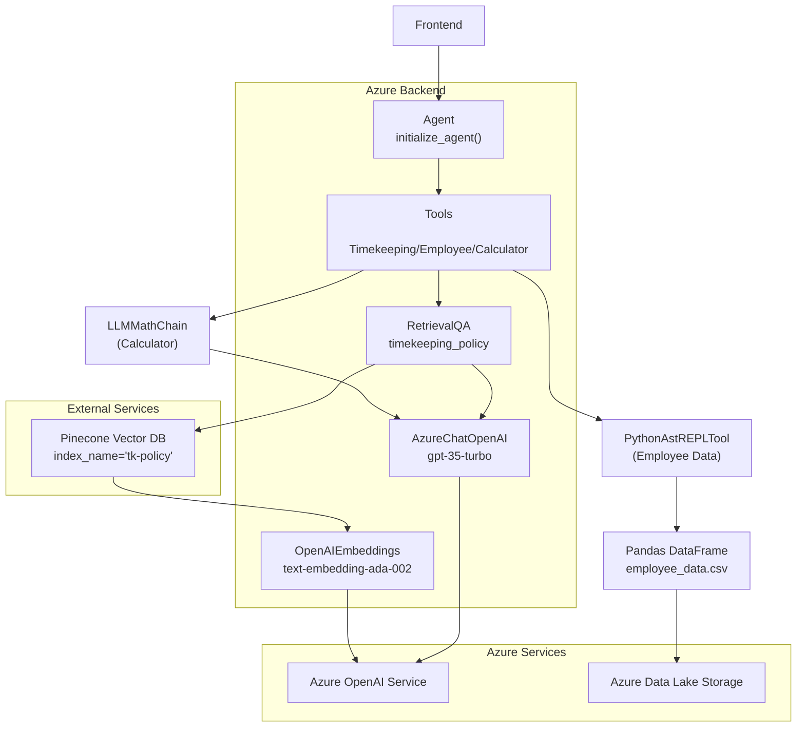
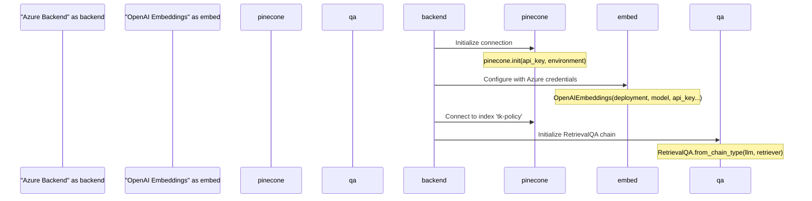
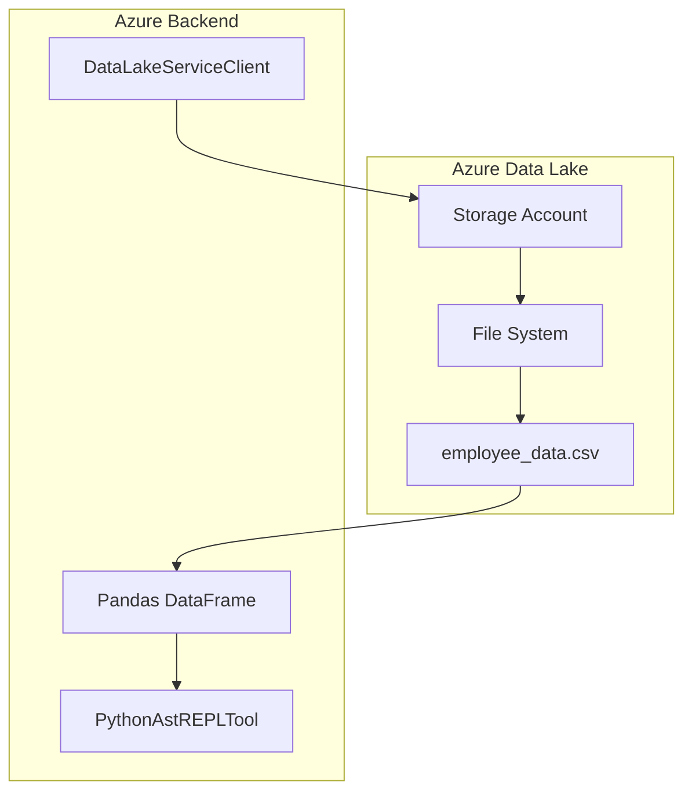
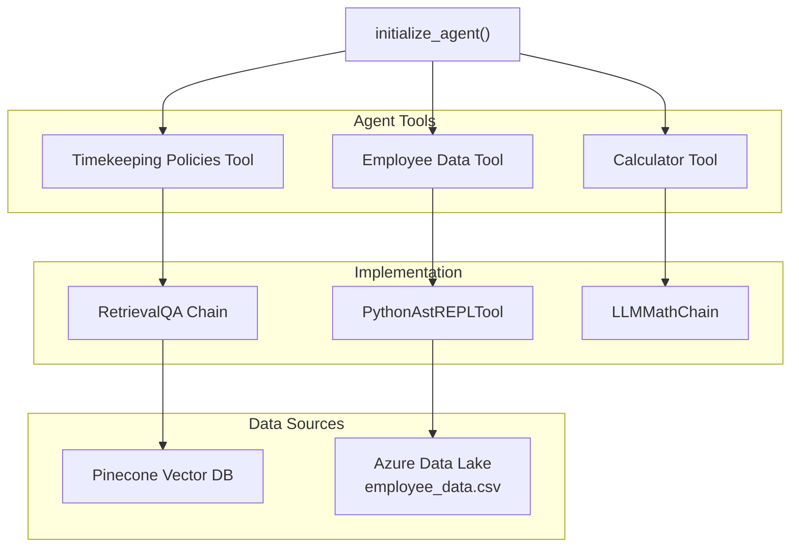
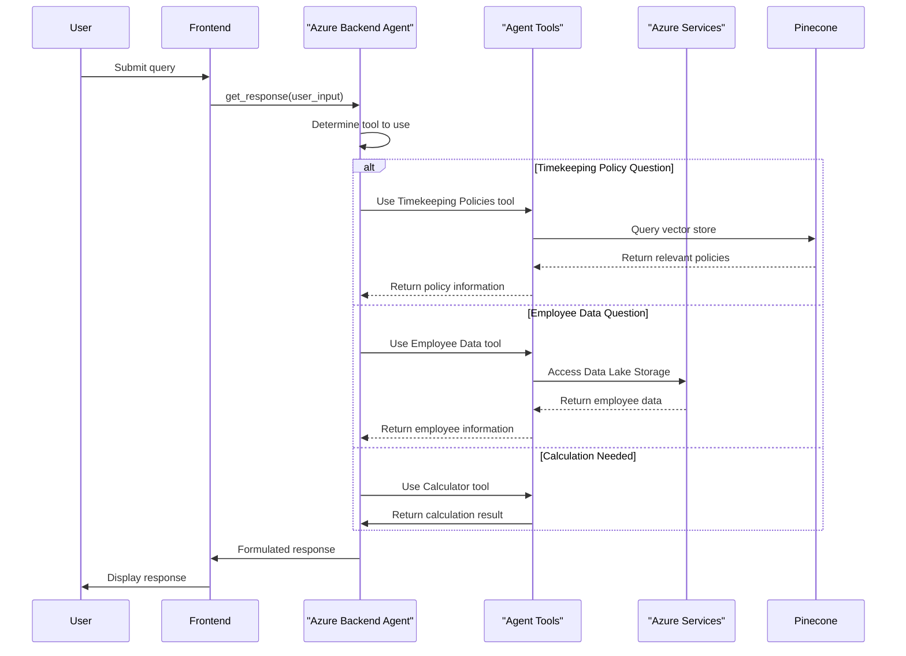

<!-- source: DeepWiki mcp.deepwiki.com · repo stepanogil/autonomous-hr-chatbot · extra page Azure Backend · fetched 2026-10-27 -->

# Azure Backend

<details>
<summary>Relevant source files</summary>

The following files were used as context for generating this wiki page:

- [README.md](README.md)
- [hr_agent_backend_azure.py](hr_agent_backend_azure.py)

</details>


## Purpose and Scope

This document details the Azure Backend implementation of the Autonomous HR Chatbot system. The Azure Backend provides cloud-based deployment capabilities, leveraging Azure services such as Azure OpenAI and Azure Data Lake Storage. This backend alternative is designed for enterprise environments requiring cloud infrastructure, scalability, and integration with existing Azure services.

For information about the local deployment alternative, see [Local Backend](#2.2.1).

Sources: [hr_agent_backend_azure.py:1-136](), [README.md:34-54]()

## Azure Backend Architecture Overview

The Azure Backend follows the same fundamental architecture as the Local Backend but replaces direct API calls with Azure service integrations. It connects to Pinecone for vector storage while utilizing Azure services for LLM capabilities and data storage.



Sources: [hr_agent_backend_azure.py:1-15](), [hr_agent_backend_azure.py:81-132]()

## Key Components

### 1. Azure Service Integrations

The Azure Backend integrates with two primary Azure services:

| Azure Service | Purpose | Implementation |
|---------------|---------|----------------|
| Azure OpenAI Service | Provides the LLM capabilities for the chatbot | Used for both chat completions and text embeddings |
| Azure Data Lake Storage | Stores and provides employee data | Accessed via DataLakeServiceClient to retrieve CSV files |

Sources: [hr_agent_backend_azure.py:25-33](), [hr_agent_backend_azure.py:42-49](), [hr_agent_backend_azure.py:59-68]()

### 2. Vector Database Connection

The backend connects to Pinecone for storing and retrieving HR policy embeddings:



Sources: [hr_agent_backend_azure.py:16-39](), [hr_agent_backend_azure.py:51-56]()

### 3. Employee Data Access

The Azure implementation retrieves employee data from Azure Data Lake Storage:



Sources: [hr_agent_backend_azure.py:58-76]()

## Implementation Details

### Authentication and Configuration

The Azure Backend requires several credentials and configuration parameters for each service:

1. **Pinecone Configuration:**
   - API key and environment for connecting to the Pinecone service
   - Index name (`tk-policy`) for the vector database

2. **Azure OpenAI Configuration:**
   - API key
   - API base URL
   - Deployment name
   - Model name (gpt-35-turbo)
   - API version

3. **Azure Data Lake Configuration:**
   - Account URL
   - Storage credential
   - File system and path information

Sources: [hr_agent_backend_azure.py:16-23](), [hr_agent_backend_azure.py:25-33](), [hr_agent_backend_azure.py:42-49](), [hr_agent_backend_azure.py:59-68]()

### Tool Integration

The Azure Backend provides three primary tools to the agent:



Sources: [hr_agent_backend_azure.py:86-120]()

### Agent Initialization

The Azure Backend initializes a zero-shot agent with the following configuration:

1. Tools: Timekeeping Policies, Employee Data, and Calculator
2. LLM: Azure OpenAI (gpt-35-turbo)
3. Agent type: ZERO_SHOT_REACT_DESCRIPTION
4. Custom prompt prefix specifying the agent's role as a friendly HR assistant

Sources: [hr_agent_backend_azure.py:122-132]()

## API Interface

The Azure Backend exposes a simple interface for the frontend:

```python
def get_response(user_input):
    response = agent.run(user_input)
    return response
```

This function serves as the primary entry point for processing user queries.

Sources: [hr_agent_backend_azure.py:134-136]()

## Data Flow

This diagram illustrates how a user query flows through the Azure Backend system:



Sources: [hr_agent_backend_azure.py:134-136](), [hr_agent_backend_azure.py:86-120]()

## Differences from Local Backend

The key differences between the Azure and Local backend implementations are:

| Feature | Azure Backend | Local Backend |
|---------|---------------|---------------|
| LLM Service | Azure OpenAI Service | Direct OpenAI API |
| Employee Data Storage | Azure Data Lake Storage | Local CSV file |
| Authentication | Azure-specific credentials | Direct API keys |
| Deployment Environment | Cloud-based | Local machine |
| Integration Capabilities | Enterprise Azure services | Limited to direct API calls |

Sources: [hr_agent_backend_azure.py:1-136](), [README.md:34-54]()

## Configuration Requirements

To use the Azure Backend, you need to:

1. Have an Azure subscription with access to:
   - Azure OpenAI Service
   - Azure Data Lake Storage

2. Configure all necessary API keys and endpoints:
   - Azure OpenAI API key and base URL
   - Azure Storage account credentials
   - Pinecone API key and environment

3. Upload employee data to Azure Data Lake Storage

4. Update the configuration in the `hr_agent_backend_azure.py` file with your credentials

Sources: [hr_agent_backend_azure.py:16-68](), [README.md:34]()

## Integration with Frontend

The Azure Backend is connected to the frontend by uncommenting the appropriate import statement in the frontend file:

```python
# In hr_agent_frontend.py
# from hr_agent_backend_azure import get_response  # Uncomment for Azure Backend
# from hr_agent_backend_local import get_response  # Comment out for Azure Backend
```

Both backend implementations expose the same `get_response` function, allowing the frontend to work seamlessly with either backend.

Sources: [README.md:34]()

---

