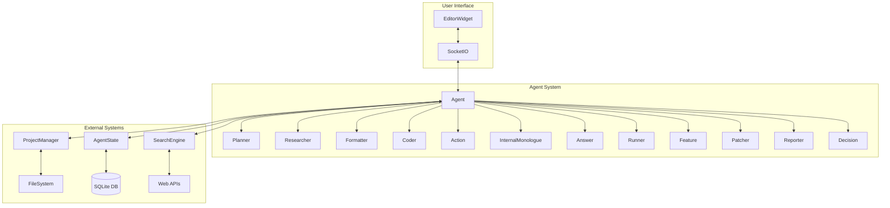
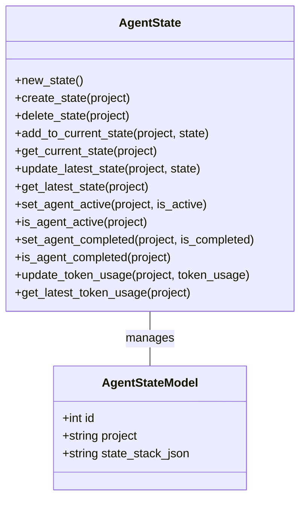
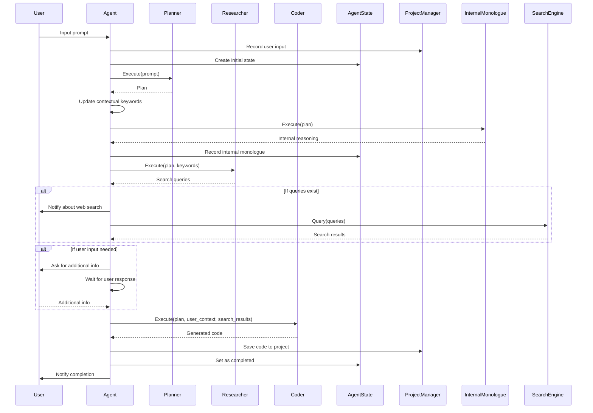
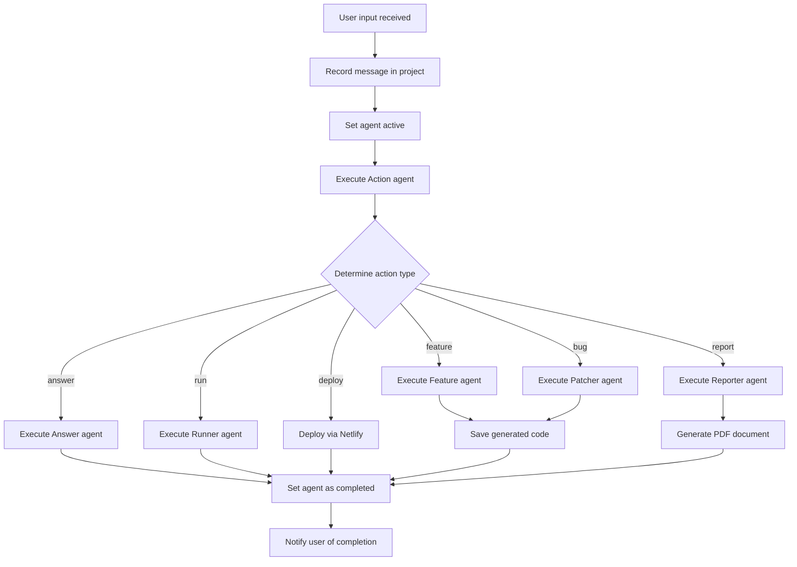
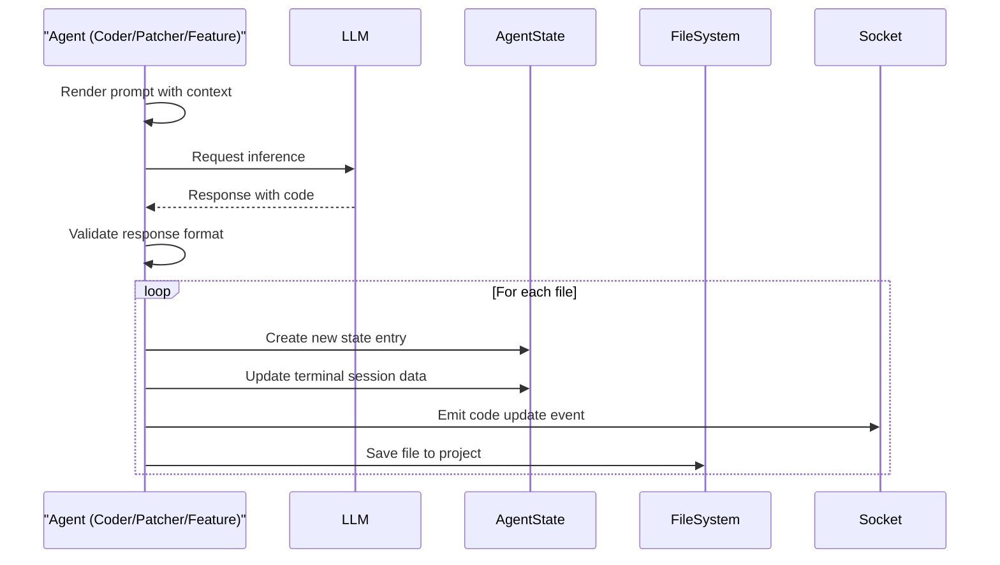
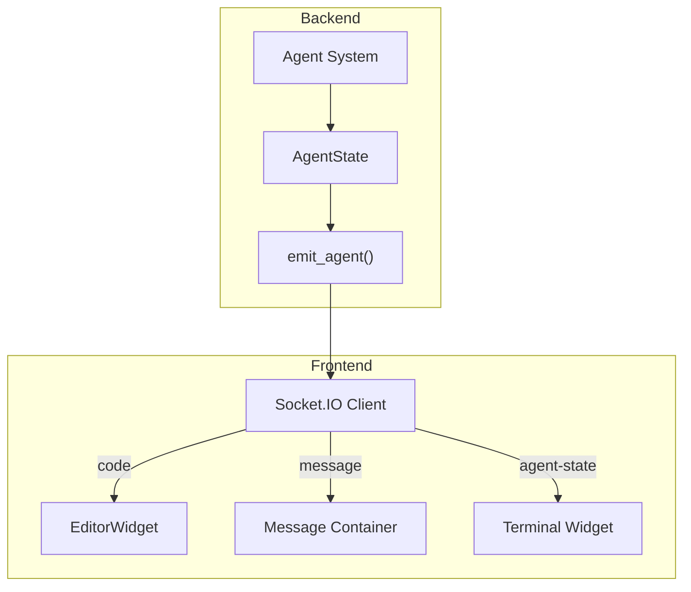
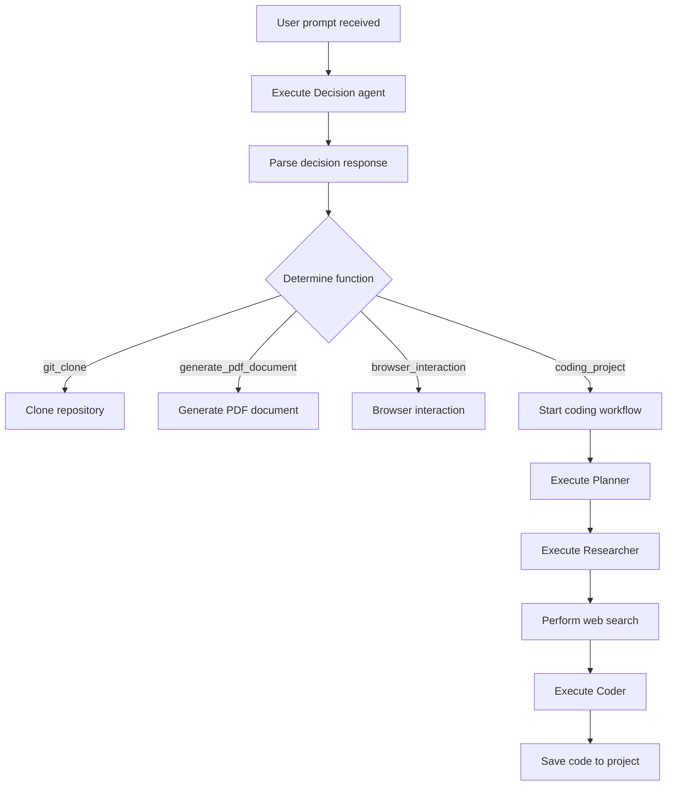

<!-- source: DeepWiki mcp.deepwiki.com · repo stitionai/devika · page 2.2 Agent System Architecture · fetched 2026-10-27 -->

# Agent System Architecture

<details>
<summary>Relevant source files</summary>

The following files were used as context for generating this wiki page:

- [src/agents/agent.py](src/agents/agent.py)
- [src/agents/coder/coder.py](src/agents/coder/coder.py)
- [src/agents/feature/feature.py](src/agents/feature/feature.py)
- [src/agents/patcher/patcher.py](src/agents/patcher/patcher.py)
- [src/state.py](src/state.py)
- [ui/src/lib/components/EditorWidget.svelte](ui/src/lib/components/EditorWidget.svelte)

</details>


## Purpose and Scope

This document describes the agent system architecture of Devika, detailing how different agents collaborate to accomplish software engineering tasks. It covers the agent orchestration, specialized agent types, execution flows, state management, and inter-agent communication patterns. For implementation details of individual agents, see [Agent System](#5.1). For detailed information about code generation capabilities, see [Code Generation](#5.2).

## Agent System Overview

The agent system is the core of Devika's functionality, employing multiple specialized agents that work together to understand, research, plan, and implement software solutions. Each agent has a specific role in the overall workflow, orchestrated by a central coordinator.



Sources: [src/agents/agent.py:36-66]()

## Agent Types and Responsibilities

The agent system includes several specialized agents with distinct responsibilities:

| Agent Type | Primary Responsibility |
|------------|------------------------|
| Planner | Creates step-by-step plans for implementing user requests |
| Researcher | Identifies information needs and formulates search queries |
| Formatter | Processes and structures raw information from web searches |
| Coder | Generates code based on plans and research |
| Action | Determines appropriate actions based on user input |
| InternalMonologue | Provides reasoning and thought process visibility |
| Feature | Implements new features to existing codebases |
| Patcher | Fixes bugs and issues in existing code |
| Runner | Executes code and provides runtime feedback |
| Answer | Provides direct responses to user inquiries |
| Reporter | Generates documentation and reports |
| Decision | Makes high-level decisions about task execution approach |

Sources: [src/agents/agent.py:46-62]()

## Agent State Management

Each agent operation is tracked in a state management system that persists information about the agent's activities, thought processes, and outputs.



The state includes:
- Internal monologue representing agent thoughts
- Browser session data (URL, screenshots)
- Terminal session data (commands, outputs)
- Execution step tracking
- Completion status
- Token usage metrics
- Timestamps

Sources: [src/state.py:10-45](), [src/state.py:102-176]()

## Agent Execution Flows

### Primary Execution Flow

The main execution flow begins with user input and progresses through planning, research, and code generation:



Sources: [src/agents/agent.py:270-365]()

### Subsequent Execution Flow

For follow-up interactions, a different flow is used:



Sources: [src/agents/agent.py:179-267]()

## Agent Integration with Code Generation

The Coder, Patcher, and Feature agents follow similar patterns for code generation and integration with the file system:

1. Render a prompt template with context
2. Call LLM for code generation
3. Validate and parse the response
4. Emulate code writing in the UI
5. Save code to the project directory



Sources: [src/agents/coder/coder.py:88-112](), [src/agents/patcher/patcher.py:88-110](), [src/agents/feature/feature.py:88-108]()

## Agent-UI Communication

The agent system communicates with the UI through Socket.IO events, enabling real-time updates of agent activities:



When code is modified by agents:
1. The agent emits a 'code' event with file data
2. The EditorWidget receives the event via Socket.IO
3. The editor updates to display the new code

Sources: [src/agents/coder/coder.py:109-112](), [ui/src/lib/components/EditorWidget.svelte:55-60]()

## Decision-Making Process

The agent can make high-level decisions about how to approach a task using the Decision agent:



Sources: [src/agents/agent.py:128-177]()

## Implementation Details

### Agent Initialization

All agents are initialized with a base language model and stored as properties of the main Agent class:

```python
def __init__(self, base_model: str, search_engine: str, browser: Browser = None):
    # Initialize agents
    self.planner = Planner(base_model=base_model)
    self.researcher = Researcher(base_model=base_model)
    self.formatter = Formatter(base_model=base_model)
    self.coder = Coder(base_model=base_model)
    # ... and other agents
```

Sources: [src/agents/agent.py:36-66]()

### Web Search Capability

The Agent implements search functionality that:
1. Takes a list of queries
2. Selects an appropriate search engine
3. Retrieves and visits search results
4. Captures screenshots for UI feedback
5. Formats the results for agent consumption

Sources: [src/agents/agent.py:79-116]()

### Context Management

The agent system maintains contextual awareness through:
1. Tracking keywords from previous interactions
2. Maintaining conversation history
3. Preserving code state across interactions
4. Sharing context between agents via the state system

Sources: [src/agents/agent.py:118-126]()

---

