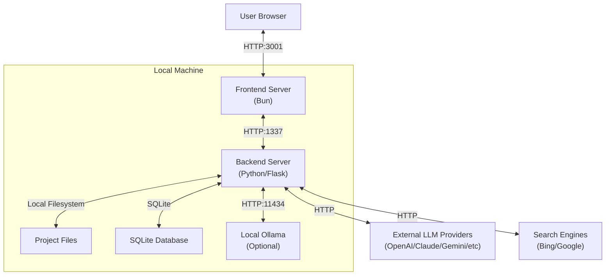
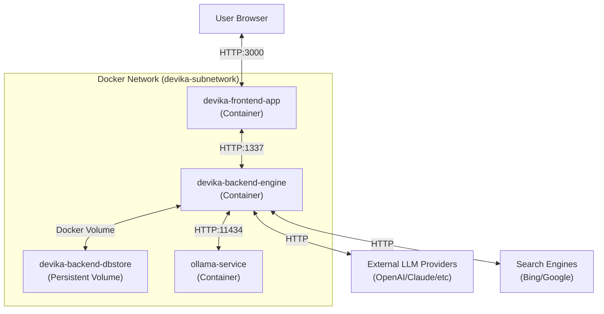
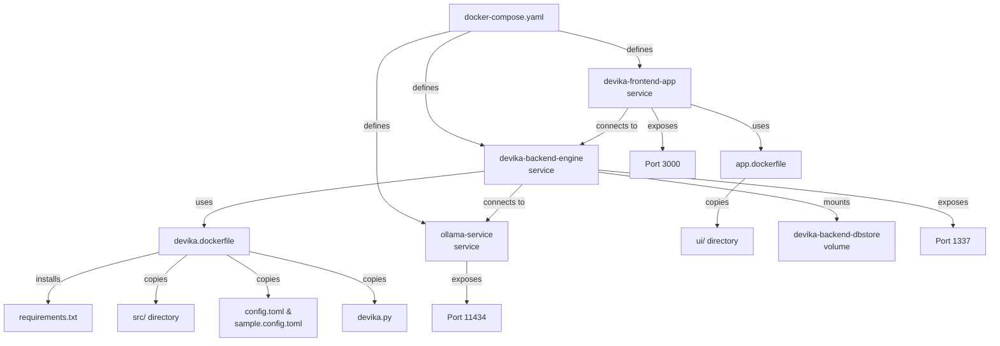

<!-- source: DeepWiki mcp.deepwiki.com · repo stitionai/devika · page 3 Installation and Deployment · fetched 2026-10-27 -->

# Installation and Deployment

<details>
<summary>Relevant source files</summary>

The following files were used as context for generating this wiki page:

- [.gitignore](.gitignore)
- [Makefile](Makefile)
- [README.md](README.md)
- [app.dockerfile](app.dockerfile)
- [devika.dockerfile](devika.dockerfile)
- [docker-compose.yaml](docker-compose.yaml)
- [requirements.txt](requirements.txt)
- [ui/src/routes/logs/+page.svelte](ui/src/routes/logs/+page.svelte)

</details>


This document provides comprehensive instructions for installing and deploying Devika, an agentic AI software engineer. You'll find both manual installation steps for development environments and Docker-based deployment options for production or containerized setups. For information about configuring Devika after installation, see [Configuration](#4).

## System Requirements

Before installing Devika, ensure your system meets the following requirements:

| Component | Requirement |
|-----------|-------------|
| Python    | >= 3.10 and < 3.12 |
| Node.js   | >= 18 |
| JavaScript Runtime | bun |
| Package Managers | uv (Python), npm/bun (JavaScript) |
| Storage   | At least 2GB free space (more if using local LLMs) |

### Required Software

- **uv**: Python package manager - [GitHub Repository](https://github.com/astral-sh/uv)
- **bun**: JavaScript runtime - [Installation Guide](https://bun.sh/docs/installation)
- **Ollama** (Optional): For local LLM support

Sources: [README.md:59-68]()

## Manual Installation

The manual installation process involves setting up both the backend (Python) and frontend (JavaScript) components separately.

### Backend Setup

1. Clone the Devika repository:
   ```bash
   git clone https://github.com/stitionai/devika.git
   ```

2. Navigate to the project directory:
   ```bash
   cd devika
   ```

3. Create a virtual environment and install the required dependencies:
   ```bash
   uv venv
   
   # On macOS and Linux
   source .venv/bin/activate
   
   # On Windows
   .venv\Scripts\activate
   
   uv pip install -r requirements.txt
   ```

4. Install Playwright for browsing capabilities:
   ```bash
   playwright install --with-deps
   ```

5. Start the Devika server:
   ```bash
   python devika.py
   ```

   If everything is working correctly, you should see:
   ```
   root: INFO   : Devika is up and running!
   ```

Sources: [README.md:74-107]()

### Frontend Setup

1. Open a new terminal and navigate to the UI directory:
   ```bash
   cd ui/
   ```

2. Install the frontend dependencies:
   ```bash
   bun install
   ```

3. Start the frontend development server:
   ```bash
   bun run start
   ```

4. Access the Devika web interface by opening a browser and navigating to `http://127.0.0.1:3001`

Sources: [README.md:108-114]()

## Manual Installation Architecture



Sources: [README.md:40-49](), [requirements.txt:1-34]()

## Docker-based Deployment

Docker-based deployment is recommended for production environments or when you want a more isolated and consistent setup.

### Prerequisites

- Docker and docker-compose installed on your system

### Using docker-compose

The Devika repository includes a `docker-compose.yaml` file that defines three services:
- `ollama-service`: Local LLM service
- `devika-backend-engine`: Devika's Python backend
- `devika-frontend-app`: Devika's web frontend

To deploy Devika using docker-compose:

1. Clone the repository:
   ```bash
   git clone https://github.com/stitionai/devika.git
   cd devika
   ```

2. Start the services:
   ```bash
   docker-compose up --build
   ```

3. Access Devika through your browser at `http://localhost:3000`

Sources: [docker-compose.yaml:1-61]()

### Using Makefile Commands

The repository includes a Makefile that simplifies Docker operations:

```bash
# Check if Docker and docker-compose are installed
make deps

# Set up the environment
make setup

# Start the Docker services
make compose-up

# Stop the Docker services
make compose-down

# Remove Docker images and volumes (complete cleanup)
make compose-destroy
```

Sources: [Makefile:1-33]()

## Docker Deployment Architecture



Sources: [docker-compose.yaml:1-61]()

## Docker Components and File Relationships



Sources: [docker-compose.yaml:1-61](), [devika.dockerfile:1-39](), [app.dockerfile:1-29]()

## Configuration for Deployment

### Environment Variables

The Docker deployment uses these environment variables:

- `OLLAMA_HOST`: URL for the Ollama service (default: `http://ollama-service:11434`)
- `VITE_API_BASE_URL`: URL for the backend API (default: `http://127.0.0.1:1337`)

Sources: [docker-compose.yaml:29-31](), [docker-compose.yaml:46-47]()

### Volume Management

The deployment uses a Docker volume (`devika-backend-dbstore`) to persist:
- Project files
- Agent state information
- Database files

Sources: [docker-compose.yaml:37-38](), [docker-compose.yaml:60-61]()

### Network Configuration

By default, the Docker deployment exposes these ports:
- `3000`: Frontend web interface
- `1337`: Backend API
- `11434`: Ollama service

Sources: [docker-compose.yaml:6-9](), [docker-compose.yaml:25-28](), [docker-compose.yaml:50-53]()

## Dockerfile Details

### Backend Dockerfile (`devika.dockerfile`)

The backend Dockerfile:
1. Uses Debian 12 as the base image
2. Sets up a non-root user for security
3. Installs Python and the `uv` package manager
4. Installs Python dependencies from `requirements.txt`
5. Installs Playwright for web browsing capabilities
6. Copies the Devika source code, configuration files, and main script
7. Sets up a volume mount point for persistent storage
8. Starts the Devika server when the container runs

Sources: [devika.dockerfile:1-39]()

### Frontend Dockerfile (`app.dockerfile`)

The frontend Dockerfile:
1. Uses Debian 12 as the base image
2. Sets up a non-root user for security
3. Installs Node.js and the Bun JavaScript runtime
4. Copies the UI code and configuration files
5. Installs frontend dependencies
6. Starts the frontend server when the container runs

Sources: [app.dockerfile:1-29]()

## Verification and Troubleshooting

### Verifying Installation

After installing and starting Devika, verify the installation by:

1. Checking that the backend service is running at http://localhost:1337/
2. Accessing the web interface at:
   - Docker installation: http://localhost:3000
   - Manual installation: http://localhost:3001
3. Viewing logs:
   - Manual installation: Check the terminal output
   - Docker installation: `docker-compose logs`
   - Web interface: Navigate to http://localhost:3000/logs or http://localhost:3001/logs

Sources: [ui/src/routes/logs/+page.svelte:1-64]()

### Common Issues

**Backend fails to start**:
- Check Python version compatibility (must be 3.10 or 3.11)
- Verify all dependencies are installed correctly
- Ensure API keys are properly configured (if needed)

**Frontend fails to load**:
- Verify Node.js version (must be 18+)
- Check that bun is installed correctly
- Ensure the backend is running and accessible

**Docker deployment issues**:
- Verify Docker and docker-compose are installed
- Check port availability (no conflicts on ports 3000, 1337, or 11434)
- Ensure sufficient system resources

## Post-Installation Setup

After successfully installing Devika, you'll need to:

1. Configure API keys for LLM providers (OpenAI, Anthropic, etc.)
2. Configure search engine access (Bing, Google)
3. Create or select a project to work on

For detailed configuration instructions, see [Configuration](#4).

---

