<!-- source: DeepWiki mcp.deepwiki.com · repo stitionai/devika · page 5 Core Components · fetched 2026-10-27 -->

# Core Components

Relevant source files

The following files were used as context for generating this wiki page:

- [.gitignore](.gitignore)
- [README.md](README.md)
- [devika.py](devika.py)
- [src/state.py](src/state.py)

This document provides a technical overview of the core components that make up the Devika system, including their purpose, structure, and interactions. It focuses on the fundamental building blocks that enable Devika to function as an agentic AI software engineer.

For detailed information on specific subsystems, see the following related wiki pages:
- For detailed agent system information, see [Agent System](#5.1)
- For code generation specifics, see [Code Generation](#5.2)
- For LLM integration details, see [LLM Interface](#5.3)
- For search capabilities, see [Search and Research](#5.4)

## Core Components Overview

Devika is built on a modular architecture with several key components working together to provide an AI software engineering assistant.

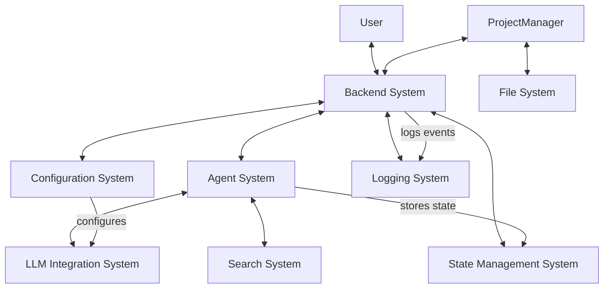

Sources: [devika.py:11-26](), [README.md:51-53]()

## Backend System

The backend system serves as the central nervous system of Devika, handling communication with the frontend, managing API endpoints, and orchestrating the other components.

### Flask Application

The backend is built on Flask, providing HTTP endpoints and Socket.IO for real-time communication.

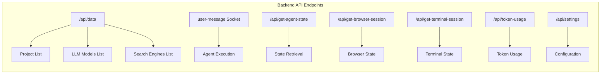

Sources: [devika.py:59-205]()

The backend initializes several core components during startup:

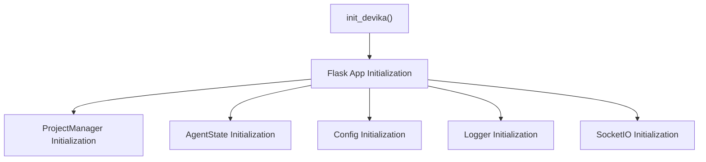

Sources: [devika.py:7-8](), [devika.py:28-49]()

## Agent System

The Agent System is responsible for processing user requests, breaking them down into tasks, and executing those tasks through specialized agents.

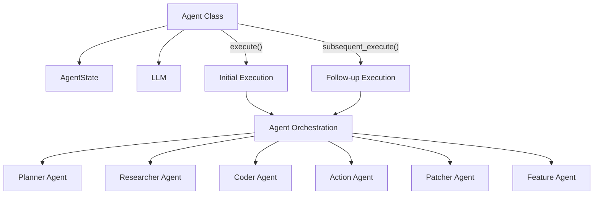

Sources: [devika.py:85-103]()

## State Management System

The State Management System tracks and persists the state of agents and their interactions with the system.

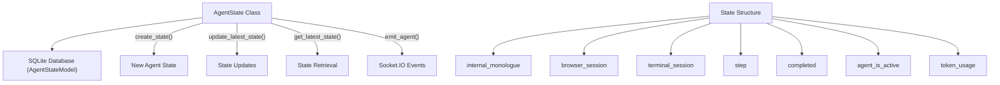

Sources: [src/state.py:1-177]()

### State Persistence

Agent state is persisted in a SQLite database using SQLModel:

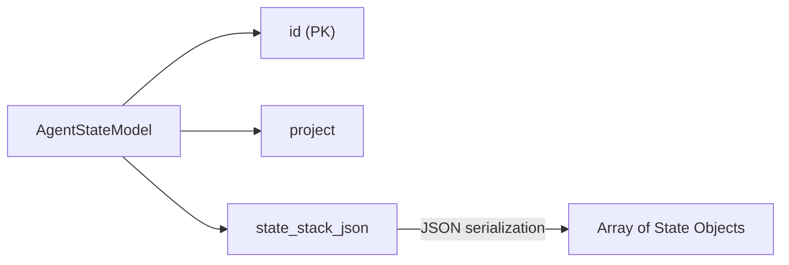

Sources: [src/state.py:10-16](), [src/state.py:25-45]()

## Configuration System

The Configuration System manages application settings, including API keys, endpoints, and other configuration parameters.

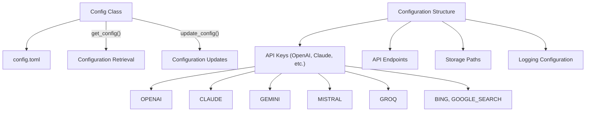

Sources: [devika.py:190-198](), [README.md:130-151]()

## LLM Integration System

The LLM Integration System provides a unified interface to various language models, allowing Devika to leverage different AI capabilities.

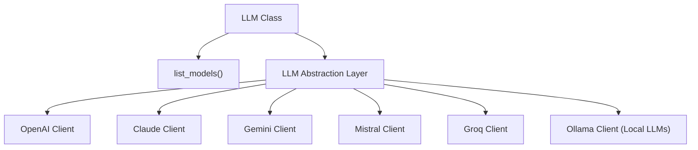

Sources: [devika.py:63-64](), [README.md:41]()

## Project Management

The Project Management system handles the organization and management of user projects.

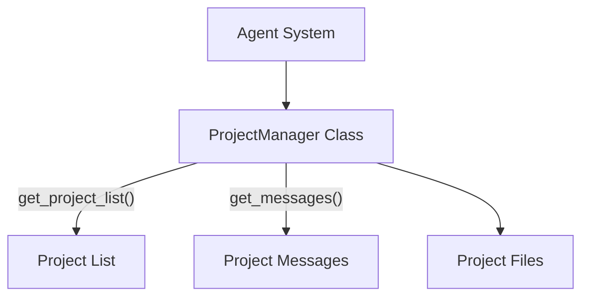

Sources: [devika.py:46](), [devika.py:59-73]()

## Logging System

The Logging System captures events and diagnostics throughout the application.

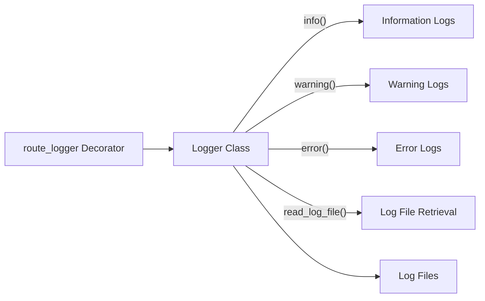

Sources: [devika.py:49](), [devika.py:181-184]()

## Communication Between Components

Components in Devika communicate through several mechanisms:

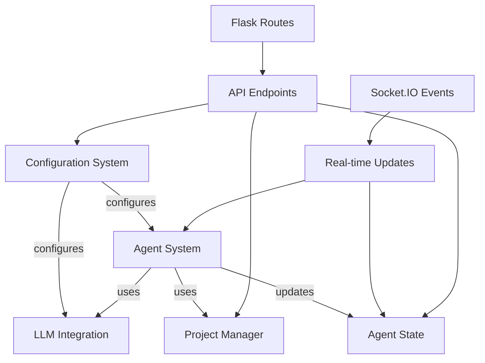

Sources: [devika.py:53-56](), [devika.py:77-103]()

## System Initialization Flow

When Devika starts, the following initialization sequence occurs:

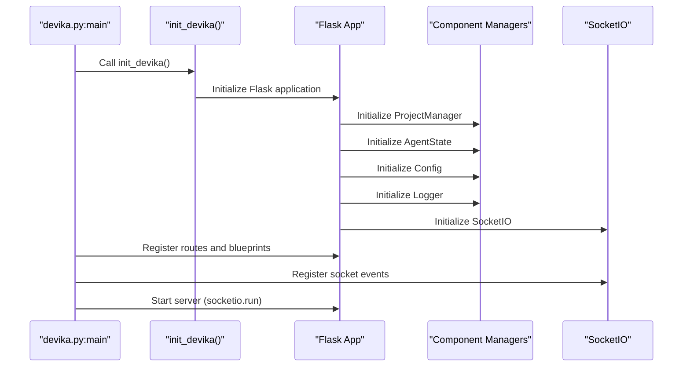

Sources: [devika.py:7-8](), [devika.py:207-209]()

The core components of Devika work together to provide a comprehensive AI software engineering assistant capable of understanding user requirements, researching solutions, and generating code to meet those requirements.

---

