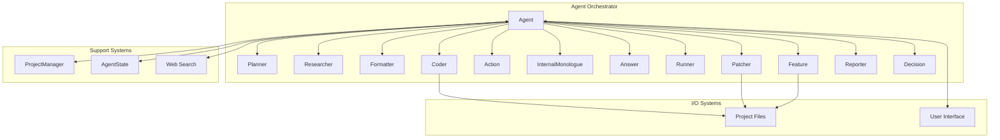
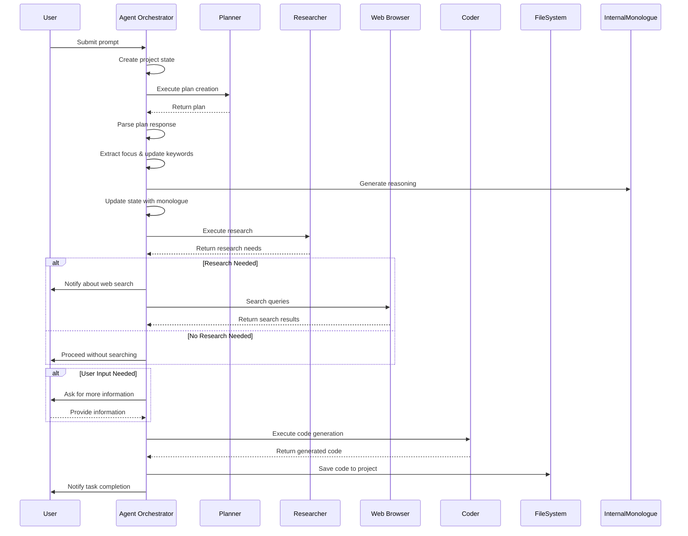
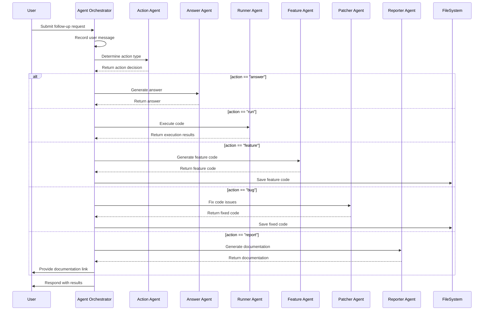
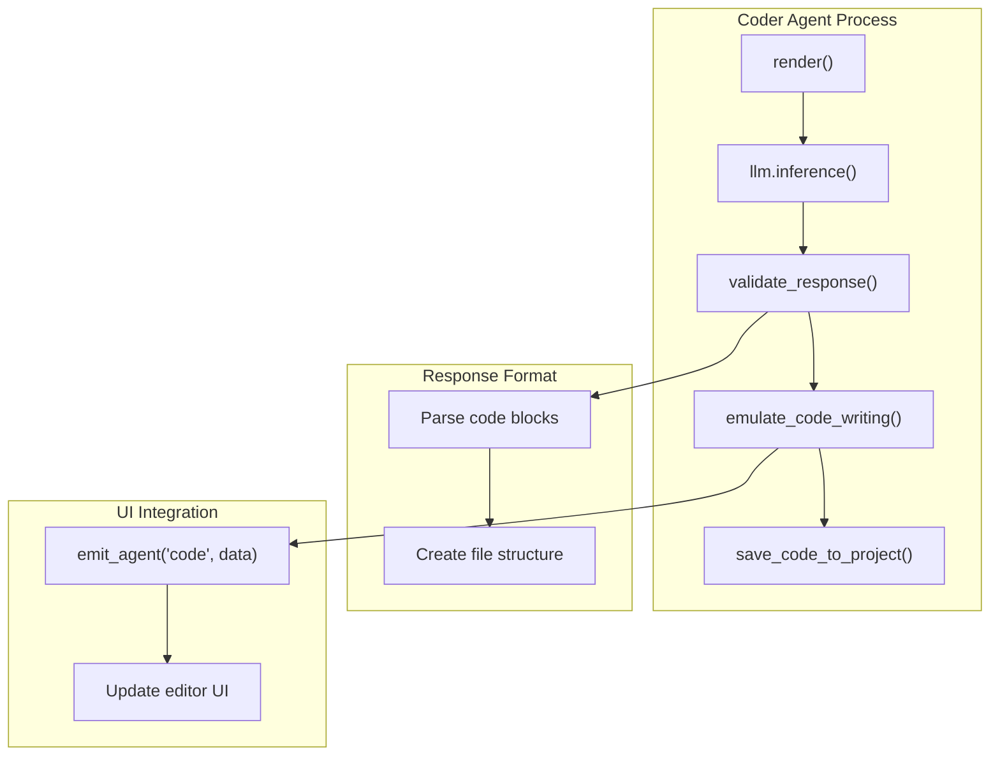
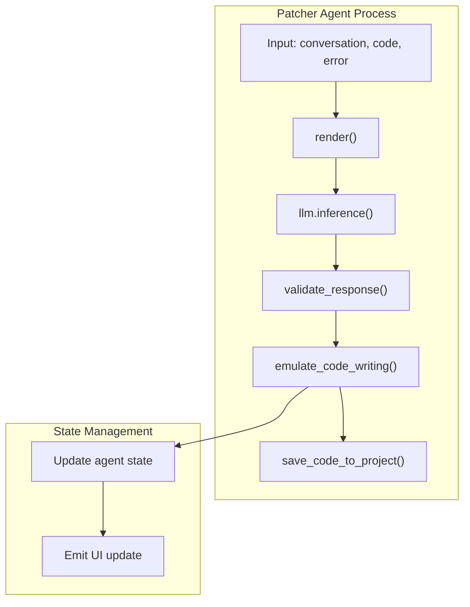
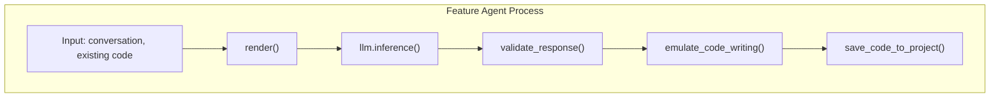
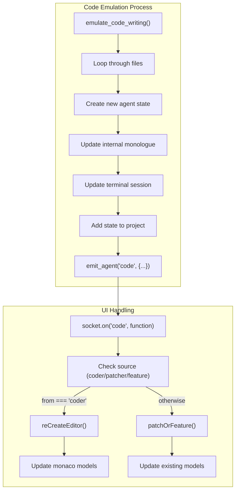
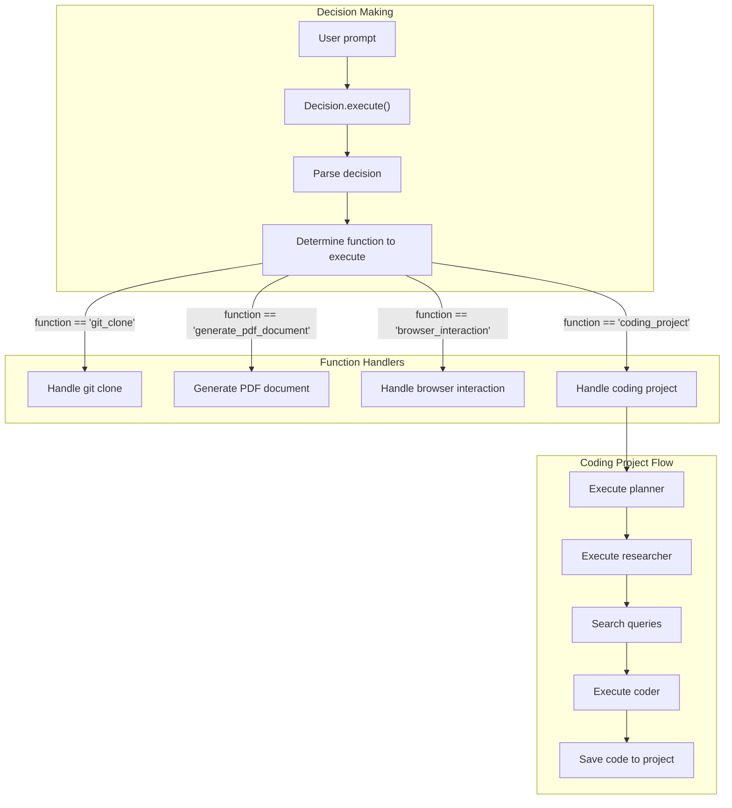
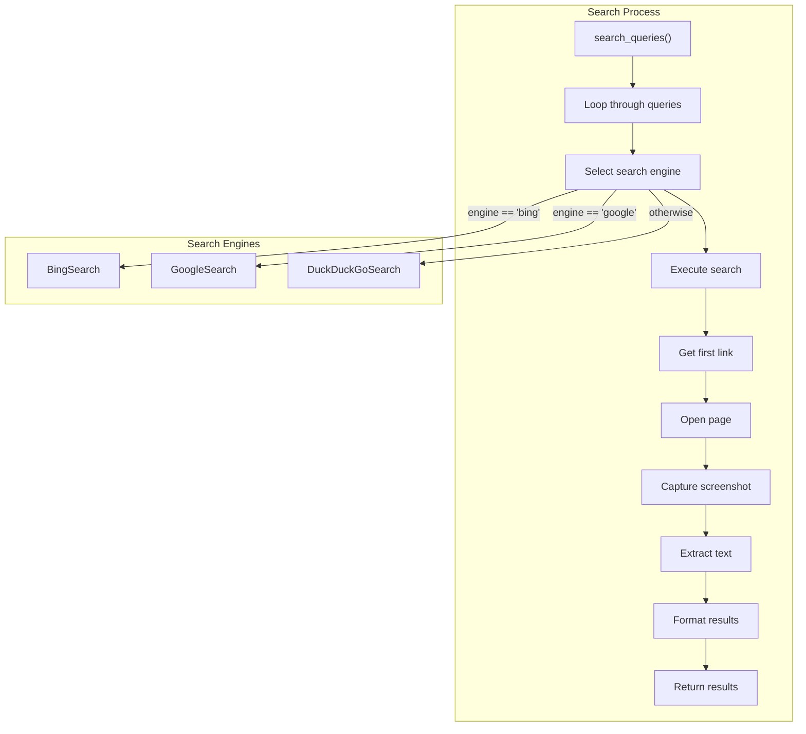
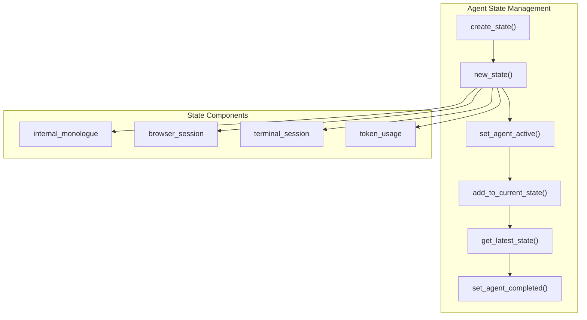

<!-- source: DeepWiki mcp.deepwiki.com · repo stitionai/devika · page 5.1 Agent System · fetched 2026-10-27 -->

# Agent System

<details>
<summary>Relevant source files</summary>

The following files were used as context for generating this wiki page:

- [src/agents/agent.py](src/agents/agent.py)
- [src/agents/coder/coder.py](src/agents/coder/coder.py)
- [src/agents/feature/feature.py](src/agents/feature/feature.py)
- [src/agents/patcher/patcher.py](src/agents/patcher/patcher.py)
- [ui/src/lib/components/EditorWidget.svelte](ui/src/lib/components/EditorWidget.svelte)

</details>


## Purpose and Scope

The Agent System is the core orchestration layer of Devika that coordinates multiple specialized AI agents to understand user requirements, research necessary information, generate code, fix bugs, and add features to projects. This document explains the architecture, components, and workflow of the Agent System.

For details on how code is specifically generated, patched, or enhanced, see [Code Generation](#5.2).

## Agent System Architecture

The Agent System follows a hierarchical architecture where an orchestrator manages multiple specialized agents to execute complex software engineering tasks.



Sources: [src/agents/agent.py:36-67]()

## Agent Initialization

The Agent System is initialized with a base language model and a search engine configuration. During initialization, it creates instances of all specialized agents.

```python
def __init__(self, base_model: str, search_engine: str, browser: Browser = None):
    # Initialize all specialized agents with the same base model
    self.planner = Planner(base_model=base_model)
    self.researcher = Researcher(base_model=base_model)
    self.formatter = Formatter(base_model=base_model)
    self.coder = Coder(base_model=base_model)
    self.action = Action(base_model=base_model)
    self.internal_monologue = InternalMonologue(base_model=base_model)
    self.answer = Answer(base_model=base_model)
    self.runner = Runner(base_model=base_model)
    self.feature = Feature(base_model=base_model)
    self.patcher = Patcher(base_model=base_model)
    self.reporter = Reporter(base_model=base_model)
    self.decision = Decision(base_model=base_model)
    
    # Initialize support systems
    self.project_manager = ProjectManager()
    self.agent_state = AgentState()
    self.engine = search_engine
    self.tokenizer = tiktoken.get_encoding("cl100k_base")
```

Sources: [src/agents/agent.py:36-67]()

## Specialized Agents

The Agent System comprises several specialized agents, each with a specific role in the software development process:

| Agent | Purpose |
|-------|---------|
| Planner | Breaks down user requests into actionable steps |
| Researcher | Generates search queries and gathers information |
| Formatter | Formats and structures gathered information |
| Coder | Generates code based on research and requirements |
| Action | Determines what action to take for a given request |
| InternalMonologue | Provides reasoning about approach and decisions |
| Answer | Generates textual responses to user queries |
| Runner | Executes code and returns results |
| Feature | Adds new features to existing code |
| Patcher | Fixes bugs and issues in code |
| Reporter | Generates documentation and reports |
| Decision | Makes high-level decisions about approach |

Sources: [src/agents/agent.py:46-62]()

## Primary Workflow

The main execution flow in the Agent System follows a sequential process from planning to implementation:



Sources: [src/agents/agent.py:269-365]()

## Secondary Workflow (Subsequent Interactions)

After the initial code generation, the Agent System handles follow-up requests through a different workflow:



Sources: [src/agents/agent.py:179-267]()

## Code Generation Agents

### Coder Agent

The Coder Agent is responsible for generating code based on a detailed plan, user context, and search results.



Sources: [src/agents/coder/coder.py:16-134]()

### Patcher Agent

The Patcher Agent specializes in fixing bugs and issues in existing code:



Sources: [src/agents/patcher/patcher.py:15-138]()

### Feature Agent

The Feature Agent adds new functionality to existing code:



Sources: [src/agents/feature/feature.py:16-128]()

## Code Emulation and UI Integration

When code is generated, patched, or enhanced, the system emulates the code writing process and updates the UI:



Sources: [src/agents/coder/coder.py:90-112](), [src/agents/patcher/patcher.py:90-110](), [src/agents/feature/feature.py:88-108](), [ui/src/lib/components/EditorWidget.svelte:54-67]()

## Decision Making Process

The Agent Orchestrator makes decisions about how to handle user requests using the Decision agent:



Sources: [src/agents/agent.py:128-177]()

## Web Search Integration

The Agent System can perform web searches to gather information for research:



Sources: [src/agents/agent.py:79-116]()

## Agent State Management

The Agent System maintains state for each project, tracking the agent's progress, internal monologue, browser sessions, and terminal sessions:



Sources: [src/agents/agent.py:277-300](), [src/agents/coder/coder.py:96-107]()

## Conclusion

The Agent System in Devika provides a comprehensive framework for orchestrating multiple specialized AI agents to perform software engineering tasks. Through careful coordination of planning, research, code generation, and other specialized functions, the system can understand user requirements and turn them into working code.

The system's modular design allows for easy extension and modification of agent behaviors, while the state management and UI integration provide a seamless experience for users interacting with the generated code.

---

