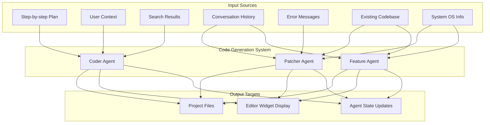
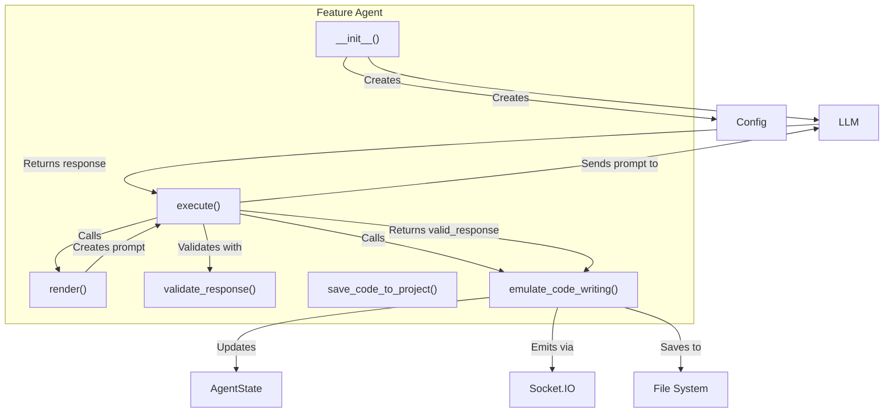
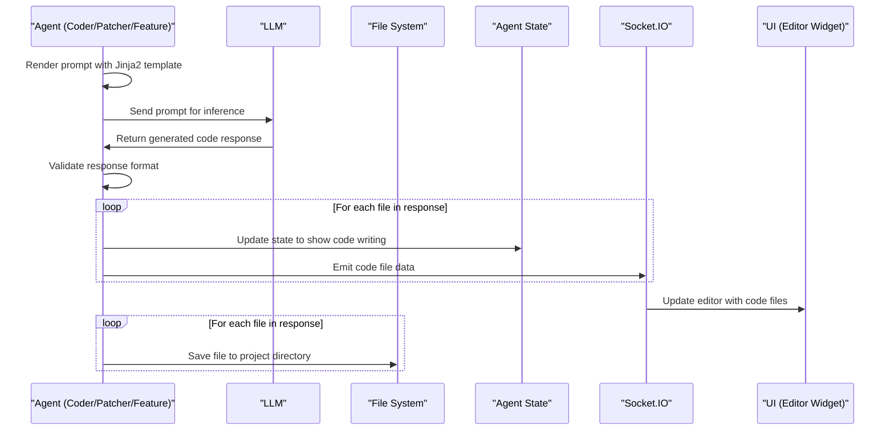
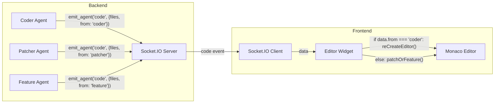
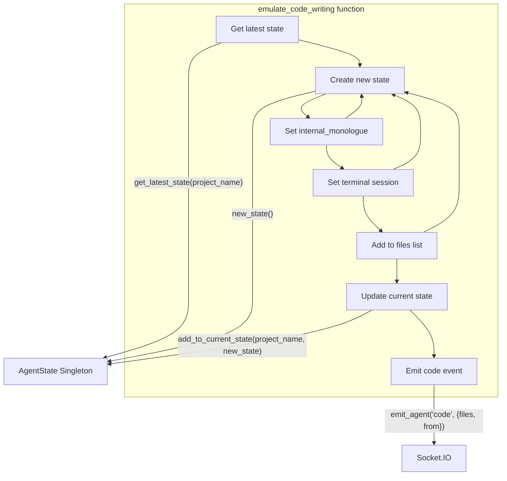
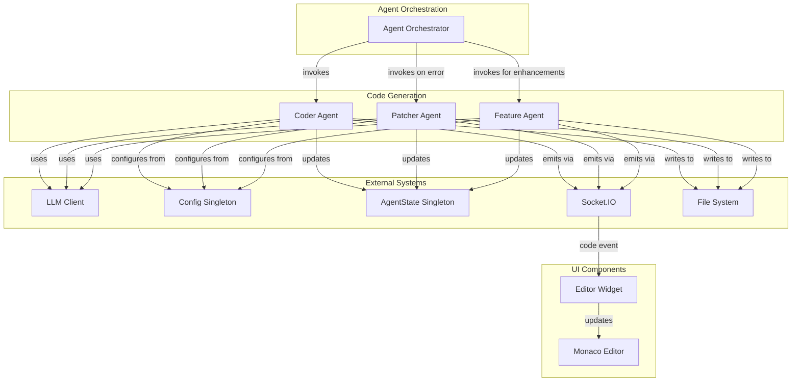

<!-- source: DeepWiki mcp.deepwiki.com · repo stitionai/devika · page 5.2 Code Generation · fetched 2026-10-27 -->

# Code Generation

<details>
<summary>Relevant source files</summary>

The following files were used as context for generating this wiki page:

- [src/agents/coder/coder.py](src/agents/coder/coder.py)
- [src/agents/feature/feature.py](src/agents/feature/feature.py)
- [src/agents/patcher/patcher.py](src/agents/patcher/patcher.py)
- [ui/src/lib/components/EditorWidget.svelte](ui/src/lib/components/EditorWidget.svelte)

</details>


This document details Devika's code generation system, which is responsible for creating, patching, and enhancing code based on user requests and system feedback. The code generation system consists of three specialized agents that work together to produce high-quality code: the Coder, Patcher, and Feature agents.

For information about the broader Agent System architecture, see [Agent System Architecture](#2.2) and [Agent System](#5.1).

## Overview

The code generation system is a core component of Devika that translates high-level plans and user requirements into executable code. It handles several distinct scenarios:

1. **Initial code generation** - Creating new code files from scratch based on plans
2. **Error fixing** - Patching existing code to fix runtime errors or bugs
3. **Feature addition** - Extending existing codebases with new functionality

Each scenario is handled by a specialized agent with prompt templates tailored to the specific task.



Sources: [src/agents/coder/coder.py:1-135](), [src/agents/patcher/patcher.py:1-139](), [src/agents/feature/feature.py:1-129]()

## Agent Components

### Coder Agent

The Coder agent is responsible for generating code from scratch based on the detailed plan created by the Planner agent. It takes the following inputs:

- **Step-by-step plan**: The plan developed by the Planner agent
- **User context**: The original request and additional context
- **Search results**: Information gathered by the Researcher agent


Sources: [src/agents/coder/coder.py:16-134]()

### Patcher Agent

The Patcher agent is responsible for fixing errors in existing code. It's invoked when code execution results in errors or when the user reports issues. It takes the following inputs:

- **Conversation**: The conversation history with the user
- **Code markdown**: The existing codebase in markdown format
- **Commands**: The commands that were executed
- **Error**: The error message that was generated
- **System OS**: Information about the operating system


Sources: [src/agents/patcher/patcher.py:15-138]()

### Feature Agent

The Feature agent is responsible for adding new features to existing code. It's invoked when the user requests enhancements to the current codebase. It takes the following inputs:

- **Conversation**: The conversation history with the user
- **Code markdown**: The existing codebase in markdown format
- **System OS**: Information about the operating system



Sources: [src/agents/feature/feature.py:16-128]()

## Code Generation Process

The code generation process follows a common pattern across all three agent types:



Sources: [src/agents/coder/coder.py:114-134](), [src/agents/patcher/patcher.py:112-138](), [src/agents/feature/feature.py:110-128]()

### Code Response Format

All three agent types expect and validate a similar response format from the LLM. The response is expected to have code blocks for each file following a specific structure:

```
~~~
File: `path/to/file1`
```
code for file1
```

File: `path/to/file2`
```
code for file2
```
~~~
```

The code generation system processes this format by:
1. Extracting the content between the `~~~` delimiters
2. Parsing the content to identify file paths and their associated code
3. Converting this into a list of dictionaries with `file` and `code` keys
4. Using this structured data for display and file system operations

Sources: [src/agents/coder/coder.py:34-66](), [src/agents/patcher/patcher.py:40-67](), [src/agents/feature/feature.py:37-64]()

## UI Integration

The code generation system communicates with the UI through Socket.IO events. When code is generated, the agents emit a `code` event with the file data and a `from` field indicating which agent generated the code.



The Editor Widget handles the code differently based on its source:
- Code from the Coder agent replaces all existing files with new ones
- Code from the Patcher or Feature agents updates existing files or adds new ones

Sources: [src/agents/coder/coder.py:90-112](), [src/agents/patcher/patcher.py:90-110](), [src/agents/feature/feature.py:88-108](), [ui/src/lib/components/EditorWidget.svelte:54-67]()

## Agent State Management

Each code generation agent updates the Agent State during code generation to provide visual feedback to the user. This creates the illusion of the agent writing code in real-time.



Sources: [src/agents/coder/coder.py:90-112](), [src/agents/patcher/patcher.py:90-110](), [src/agents/feature/feature.py:88-108]()

## Interaction Between Components

The following diagram shows how the different components of the code generation system interact with each other and external systems:



Sources: [src/agents/coder/coder.py:1-135](), [src/agents/patcher/patcher.py:1-139](), [src/agents/feature/feature.py:1-129](), [ui/src/lib/components/EditorWidget.svelte:1-99]()

## Key Methods

The following table summarizes the key methods shared by all three agent types:

| Method | Purpose | Input | Output |
|--------|---------|-------|--------|
| `__init__` | Initialize the agent with configuration and LLM | `base_model` (string) | Agent instance |
| `render` | Create a prompt using a Jinja2 template | Various context data | Formatted prompt (string) |
| `validate_response` | Parse and validate the LLM response | `response` (string) | List of file dictionaries or False |
| `save_code_to_project` | Save generated code to project files | `response` (list), `project_name` (string) | Directory path (string) |
| `emulate_code_writing` | Update agent state and emit code events | `code_set` (list), `project_name` (string) | None |
| `execute` | Main method to run the code generation process | Various context data, `project_name` (string) | Valid response or False |

Sources: [src/agents/coder/coder.py:16-134](), [src/agents/patcher/patcher.py:15-138](), [src/agents/feature/feature.py:16-128]()

## Summary

The Code Generation system in Devika consists of three specialized agents (Coder, Patcher, and Feature) that work together to create, fix, and enhance code. Each agent follows a similar pattern of:
1. Preparing a prompt with relevant context
2. Sending the prompt to an LLM for inference
3. Validating and processing the LLM's response
4. Emulating code writing through agent state updates
5. Emitting events to update the UI
6. Saving the generated code to the project directory

This modular approach allows Devika to handle different code generation scenarios with specialized prompts while maintaining a consistent workflow and response format.

---

