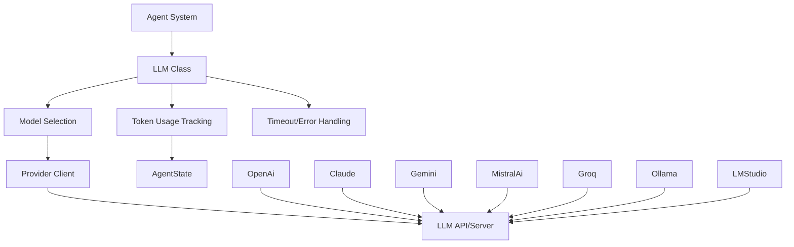
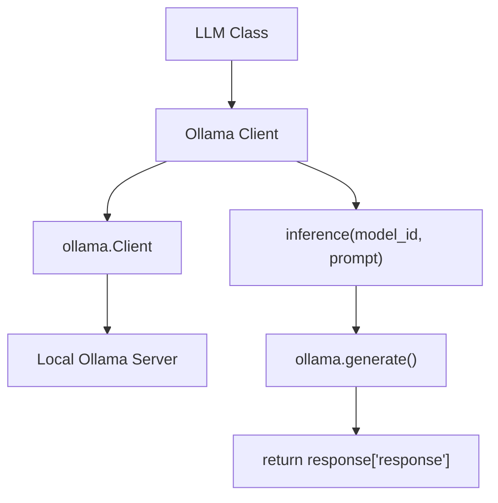
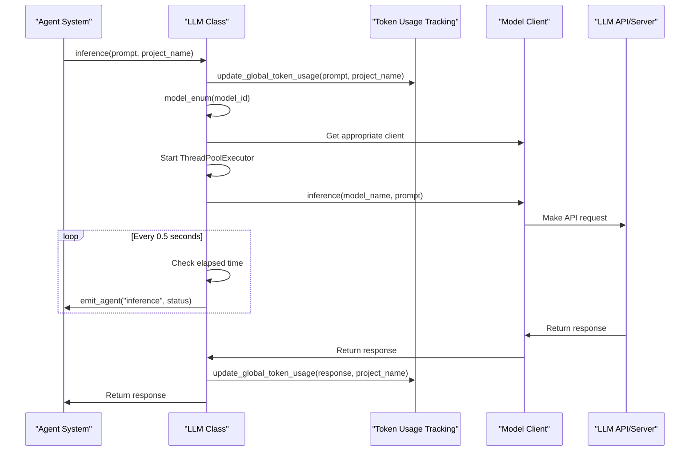
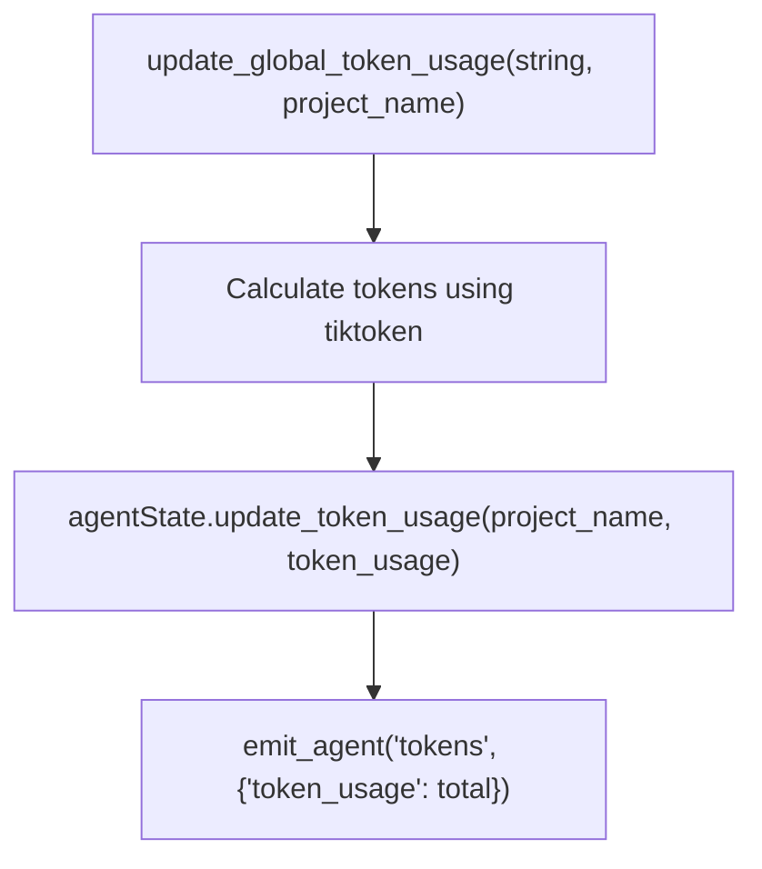
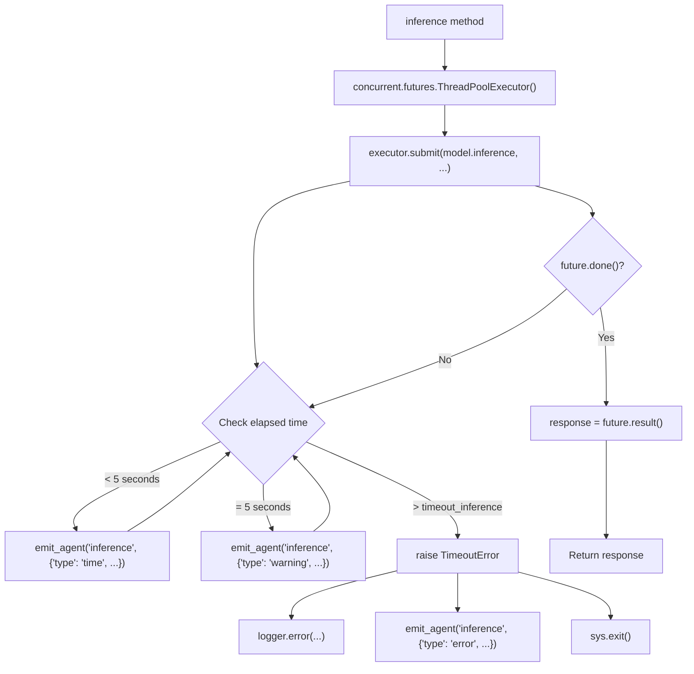
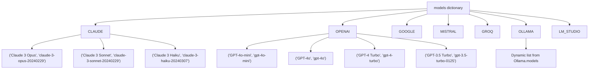
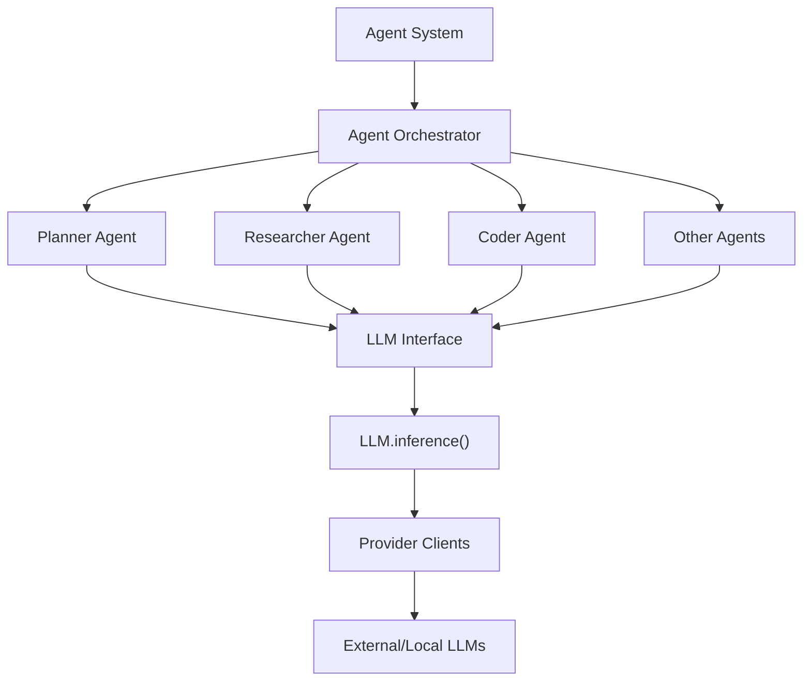

<!-- source: DeepWiki mcp.deepwiki.com · repo stitionai/devika · page 5.3 LLM Interface · fetched 2026-10-27 -->

# LLM Interface

<details>
<summary>Relevant source files</summary>

The following files were used as context for generating this wiki page:

- [src/init.py](src/init.py)
- [src/llm/llm.py](src/llm/llm.py)
- [src/llm/ollama_client.py](src/llm/ollama_client.py)

</details>


The LLM Interface provides a unified abstraction layer that allows Devika to interact with various language model providers through a consistent API. This component serves as the bridge between the Agent System and different Large Language Model (LLM) services, enabling agents to leverage AI capabilities without dealing with provider-specific implementation details.

For information about the Agent System that uses this interface, see [Agent System](#5.1). For details on how code generation utilizes LLMs, see [Code Generation](#5.2).

## 1. Architecture Overview

The LLM Interface implements a provider-agnostic abstraction layer that supports multiple LLM services:



Sources: [src/llm/llm.py]()

## 2. Core Components

The LLM Interface consists of the following key components:

1. **Central LLM Class**: The main `LLM` class that provides the abstraction layer
2. **Provider Clients**: Specialized clients for each LLM provider
3. **Model Registry**: A dictionary of supported models and their mappings
4. **Token Tracking**: Mechanism for tracking token usage
5. **Timeout Handling**: System to prevent inference operations from hanging

Sources: [src/llm/llm.py:28-156]()

## 3. Supported Models and Providers

Devika supports multiple LLM providers through dedicated client implementations:

| Provider | Models | Client Class |
|----------|--------|-------------|
| OpenAI | GPT-4o-mini, GPT-4o, GPT-4 Turbo, GPT-3.5 Turbo | `OpenAi` |
| Claude (Anthropic) | Claude 3 Opus, Claude 3 Sonnet, Claude 3 Haiku | `Claude` |
| Google | Gemini 1.0 Pro, Gemini 1.5 Flash, Gemini 1.5 Pro | `Gemini` |
| Mistral AI | Mistral 7b, 8x7b, Medium, Small, Large | `MistralAi` |
| Groq | LLAMA3 8B, LLAMA3 70B, LLAMA2 70B, Mixtral, GEMMA 7B | `Groq` |
| Ollama | Any model available in local Ollama installation | `Ollama` |
| LM Studio | Local models | `LMStudio` |

The complete list of supported models is defined in the `models` dictionary in the `LLM` class.

Sources: [src/llm/llm.py:33-71]()

## 4. LLM Class Implementation

The core of the LLM Interface is the `LLM` class:

```mermaid
classDiagram
    class LLM {
        +String model_id
        +Boolean log_prompts
        +Integer timeout_inference
        +Dictionary models
        +__init__(model_id: String)
        +list_models() Dictionary
        +model_enum(model_name: String) Tuple
        +update_global_token_usage(string: String, project_name: String) void
        +inference(prompt: String, project_name: String) String
    }
    
    LLM --> "OpenAi" : uses
    LLM --> "Claude" : uses
    LLM --> "Gemini" : uses
    LLM --> "MistralAi" : uses
    LLM --> "Groq" : uses
    LLM --> "Ollama" : uses
    LLM --> "LMStudio" : uses
```

The key methods in the `LLM` class include:

- `__init__(model_id)`: Initializes the class with a specific model ID 
- `list_models()`: Returns the dictionary of available models
- `model_enum(model_name)`: Maps a model name to its provider and ID
- `update_global_token_usage(string, project_name)`: Tracks token usage
- `inference(prompt, project_name)`: Performs the inference operation

Sources: [src/llm/llm.py:28-156]()

## 5. Provider Client Interface

Each LLM provider has a dedicated client that implements a common interface pattern. All clients must implement an `inference(model_id, prompt)` method that returns the model's response as a string.

Here's an example of the Ollama client implementation:



The Ollama client connects to a local Ollama server and provides access to the models available on that server.

Sources: [src/llm/ollama_client.py:8-25]()

## 6. Inference Process Flow

The inference process is the core functionality of the LLM Interface, handled by the `inference` method:



The inference process includes:
1. Tracking token usage for the prompt
2. Identifying the appropriate model provider
3. Selecting the correct client implementation
4. Running the inference in a separate thread with timeout monitoring
5. Tracking token usage for the response
6. Returning the model's response

Sources: [src/llm/llm.py:92-156]()

## 7. Token Usage Tracking

Token usage tracking is implemented in the `update_global_token_usage` method:



The method:
1. Calculates the number of tokens in the string using the tiktoken library
2. Updates the token usage in the global agent state
3. Emits an event with the total token usage

Sources: [src/llm/llm.py:84-90]()

## 8. Error Handling and Timeout Mechanism

To ensure system responsiveness, the `inference` method includes a sophisticated timeout and error handling mechanism:



The implementation:
1. Uses Python's `concurrent.futures` to run the inference in a separate thread
2. Monitors the elapsed time and emits progress events
3. Raises a timeout error if the inference takes too long
4. Catches and handles exceptions, including TimeoutError

Sources: [src/llm/llm.py:111-145]()

## 9. Model Registry and Selection

Models are organized by provider in a dictionary structure that maps display names to provider-specific identifiers:



The model selection is handled by the `model_enum` method, which maps a display name to its provider and internal identifier. Ollama models are dynamically loaded from the local Ollama server during initialization.

Sources: [src/llm/llm.py:33-71](), [src/llm/llm.py:76-82]()

## 10. Provider-Specific Implementation Details

### Ollama Client Example

The Ollama client demonstrates how provider-specific implementations work:

1. Initialization checks for Ollama availability by attempting to connect to the configured endpoint
2. If Ollama is available, it fetches the list of available models
3. The `inference` method simply calls Ollama's generate API with the specified model and prompt

```python
def inference(self, model_id: str, prompt: str) -> str:
    response = self.client.generate(
        model=model_id,
        prompt=prompt.strip(),
        options={"temperature": 0}
    )
    return response['response']
```

Sources: [src/llm/ollama_client.py:8-25]()

## 11. Integration with Agent System

The LLM Interface is used by various components of the Agent System:



Each agent uses the LLM Interface to generate content, answer questions, or perform other AI-driven tasks. The interface provides a consistent way to interact with different language models regardless of the underlying provider.

Sources: System Architecture diagrams

## 12. Configuration

The LLM Interface uses the central Config system to obtain:

- API endpoints for different providers
- Timeout settings for inference operations
- Logging preferences
- Other provider-specific configuration

For example, the Ollama client uses the Config system to get the Ollama API endpoint:

```python
self.client = ollama.Client(Config().get_ollama_api_endpoint())
```

Sources: [src/llm/llm.py:31-32](), [src/llm/ollama_client.py:11]()

## Conclusion

The LLM Interface provides a crucial abstraction layer that enables Devika to leverage multiple language model providers through a consistent API. Key features include:

- Support for multiple LLM providers (OpenAI, Claude, Google, Mistral, Groq, Ollama, LM Studio)
- A unified interface for model selection and inference
- Token usage tracking for monitoring and billing
- Robust timeout and error handling
- Real-time progress reporting during inference

This design allows the Agent System to utilize different language models based on availability, performance requirements, and user preferences, without modifying its implementation.

---

