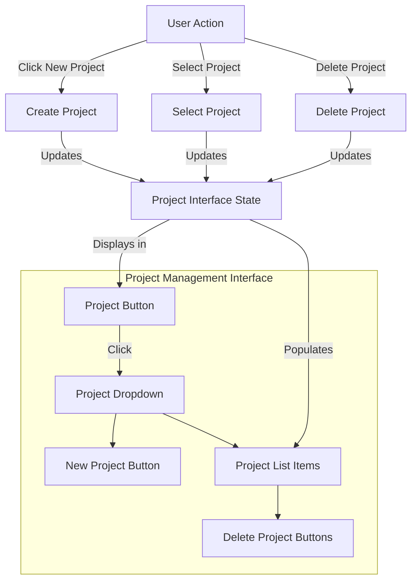
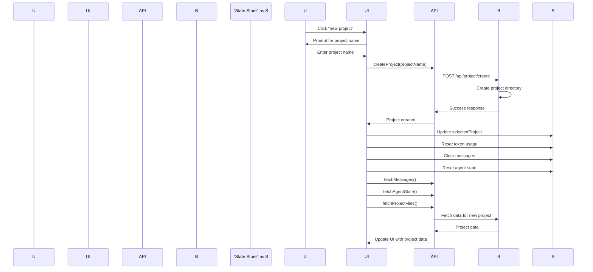
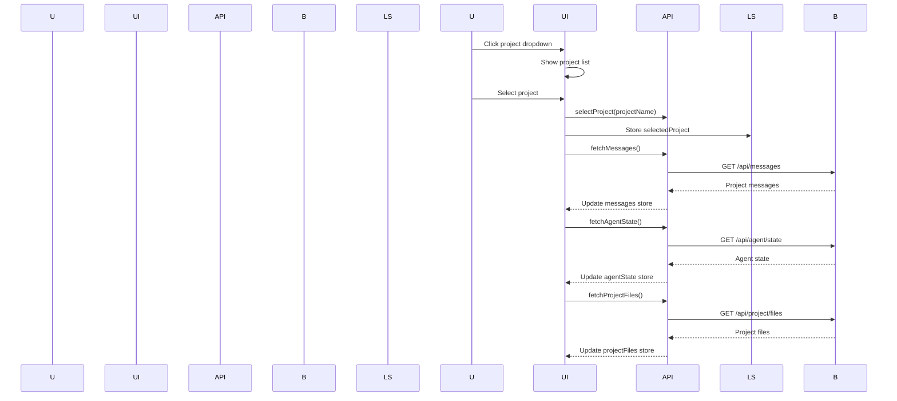
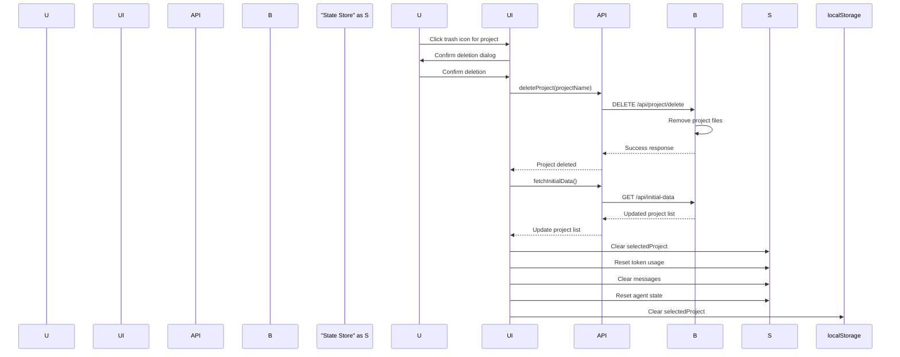
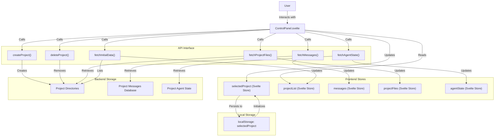
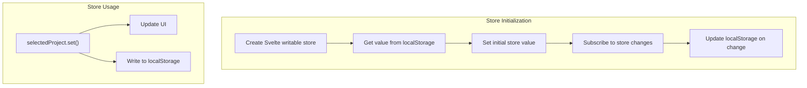

<!-- source: DeepWiki mcp.deepwiki.com · repo stitionai/devika · page 6.1 Project Management · fetched 2026-10-27 -->

# Project Management

Relevant source files

The following files were used as context for generating this wiki page:

- [ui/src/lib/components/ControlPanel.svelte](ui/src/lib/components/ControlPanel.svelte)
- [ui/src/lib/store.js](ui/src/lib/store.js)

This document explains how users can create, select, and manage projects within the Devika system. Project management is a fundamental aspect of Devika that allows users to organize their work into distinct projects, each with its own state, messages, and files.

For information about interacting with projects through the chat interface, see [Chat Interface](#6.2). For details on viewing and editing project files, see [Editor and Terminal](#6.3).

## Project Management Interface

Devika provides a straightforward interface for managing projects through the Control Panel at the top of the UI. The project management interface consists primarily of a dropdown menu that displays the currently selected project and allows users to select, create, or delete projects.

Sources: [ui/src/lib/components/ControlPanel.svelte:90-139]()

## Project Operations

### Creating a Project

To create a new project in Devika:

1. Click on the project dropdown button in the Control Panel
2. Select "new project" from the dropdown menu
3. Enter a name for your project when prompted
4. The system will create the project and automatically select it

When a new project is created, Devika resets the token usage counter, clears any messages, and initializes a fresh agent state.

Sources: [ui/src/lib/components/ControlPanel.svelte:23-34](), [ui/src/lib/store.js:30-36]()

### Selecting a Project

To select an existing project:

1. Click on the project dropdown button in the Control Panel
2. Choose a project from the list of available projects

When a project is selected, Devika loads the messages, agent state, and project files associated with that project. The selected project name is stored in the browser's localStorage, allowing Devika to automatically restore your last selected project when you return.

Sources: [ui/src/lib/components/ControlPanel.svelte:7-13](), [ui/src/lib/store.js:34]()

### Deleting a Project

To delete a project:

1. Click on the project dropdown button in the Control Panel
2. Find the project you want to delete in the list
3. Click the trash can icon next to the project name
4. Confirm the deletion when prompted

When a project is deleted, Devika removes all associated files and data. This action cannot be undone.

Sources: [ui/src/lib/components/ControlPanel.svelte:35-46](), [ui/src/lib/store.js:3-11]()

## Project Data Architecture

Devika manages project data through a combination of frontend stores and backend storage. The following diagram illustrates the architecture of project data management:

Sources: [ui/src/lib/components/ControlPanel.svelte:3-4](), [ui/src/lib/store.js:30-40]()

## Project State Persistence

Devika uses a combination of browser localStorage and backend storage to ensure project state persistence:

### Frontend State Persistence

The currently selected project is stored in the browser's localStorage, allowing Devika to restore your project selection when you return to the application. This is implemented in the store.js file:

Sources: [ui/src/lib/store.js:3-19](), [ui/src/lib/store.js:30-36]()

### Backend State Persistence

When a project is selected, Devika loads the following data from the backend:

1. **Messages**: Previous conversation history with the agent
2. **Agent State**: The current state of the agent, including its internal monologue and context
3. **Project Files**: Source code and other files in the project

This data is stored on the backend and loaded when a project is selected.

## Management Table

The following table summarizes the key project management operations and their corresponding code implementations:

| Operation | User Interface | Function | Implementation Location |
|-----------|---------------|----------|-------------------------|
| Create Project | New Project button in dropdown | `createNewProject()` | [ui/src/lib/components/ControlPanel.svelte:23-34]() |
| Select Project | Project list in dropdown | `selectProject(project)` | [ui/src/lib/components/ControlPanel.svelte:7-13]() |
| Delete Project | Trash icon next to project name | `deleteproject(project)` | [ui/src/lib/components/ControlPanel.svelte:35-46]() |
| Store Selected Project | Automatic on selection | `subscribeAndStore()` | [ui/src/lib/store.js:14-19]() |

Sources: [ui/src/lib/components/ControlPanel.svelte:7-46](), [ui/src/lib/store.js:14-19]()

## Integration with Other Components

Project management is central to Devika's functionality and integrates with several other components:

1. **Chat Interface**: The conversation history is project-specific and loaded when a project is selected
2. **Editor Interface**: The files shown in the editor are specific to the selected project
3. **Agent System**: The agent's state and context are tied to the selected project
4. **Token Usage**: Token usage is tracked per project

When switching between projects, Devika ensures that all components are updated with the appropriate project-specific data.

Sources: [ui/src/lib/components/ControlPanel.svelte:3-4](), [ui/src/lib/components/ControlPanel.svelte:8-11]()

---

