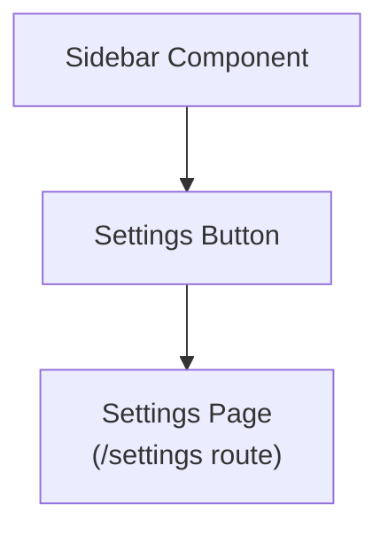
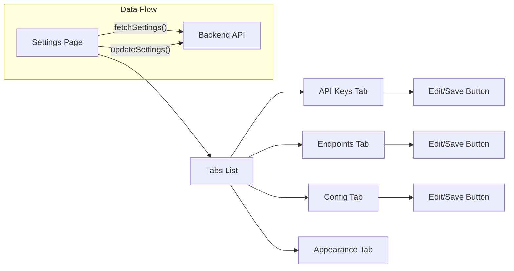
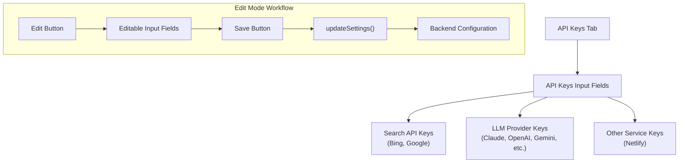
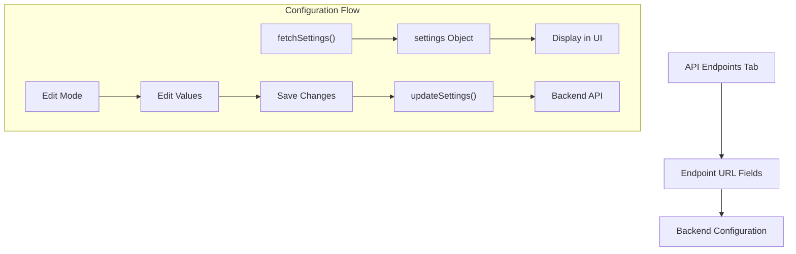
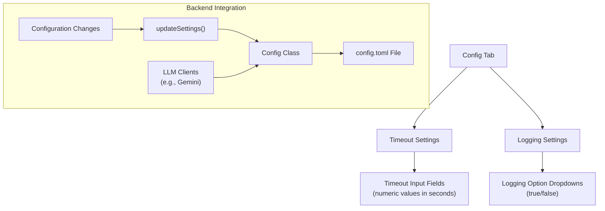
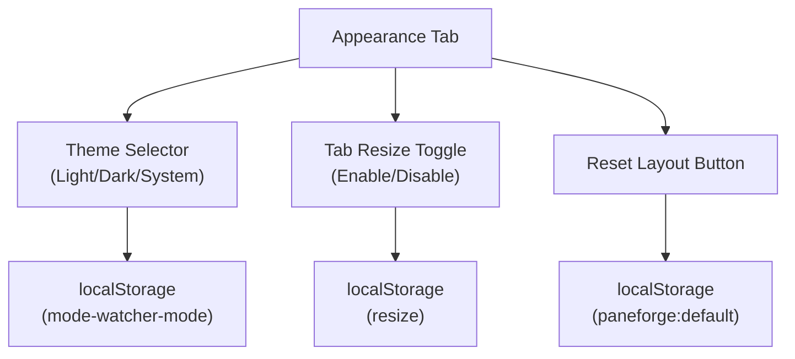
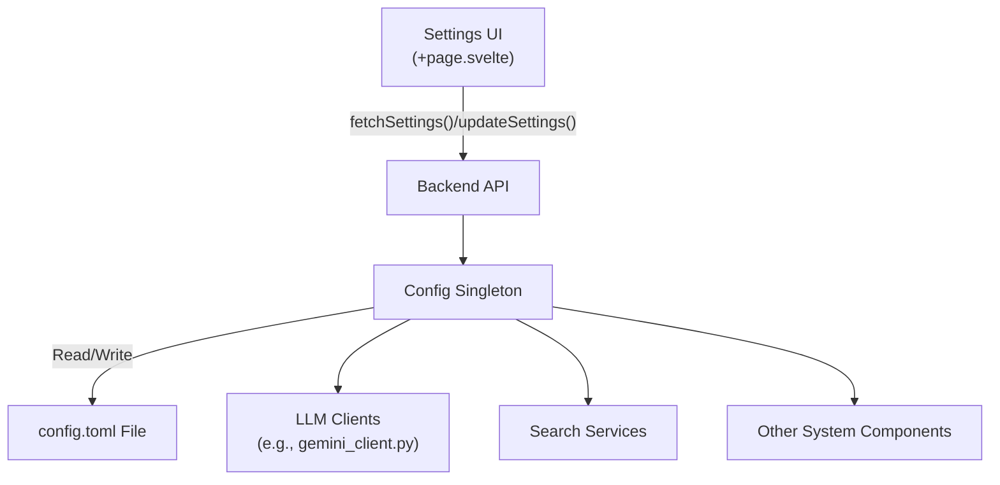

<!-- source: DeepWiki mcp.deepwiki.com · repo stitionai/devika · page 6.4 Settings and Configuration · fetched 2026-10-27 -->

# Settings and Configuration

Relevant source files

The following files were used as context for generating this wiki page:

- [setup.sh](setup.sh)
- [src/llm/gemini_client.py](src/llm/gemini_client.py)
- [ui/src/lib/components/Sidebar.svelte](ui/src/lib/components/Sidebar.svelte)
- [ui/src/routes/settings/+page.svelte](ui/src/routes/settings/+page.svelte)

This page provides a comprehensive guide to Devika's settings interface, which allows users to configure API keys, endpoints, system behavior, and appearance options. The settings page provides a centralized location for managing all configuration aspects of Devika through the user interface.

## Accessing Settings

The Settings page can be accessed through the sidebar navigation component by clicking on the Settings icon, which navigates to the `/settings` route.

Sources: [ui/src/lib/components/Sidebar.svelte:12-16]()

## Settings Interface Overview

The Settings page is organized into four tabs, each containing related configuration options:

Sources: [ui/src/routes/settings/+page.svelte:87-325]()

When the Settings page is loaded, it fetches the current configuration from the backend using the `fetchSettings()` function from the API module. Any changes made to the settings are sent to the backend using the `updateSettings()` function.

Sources: [ui/src/routes/settings/+page.svelte:43-59](), [ui/src/routes/settings/+page.svelte:61-77]()

## API Keys Configuration

The API Keys tab allows you to configure API keys for various external services used by Devika:

1. Search services:
   - Bing
   - Google Search
   - Google Search Engine ID

2. LLM providers:
   - Claude
   - OpenAI
   - Gemini
   - Mistral
   - Groq

3. Other services:
   - Netlify

Sources: [ui/src/routes/settings/+page.svelte:100-145]()

### Editing API Keys

1. Click the "Edit" button to enable editing mode
2. Enter or update the API keys in the corresponding fields
3. Click "Save" to save your changes

The keys are displayed as password fields when not in edit mode for security.

Sources: [ui/src/routes/settings/+page.svelte:108-118](), [ui/src/routes/settings/+page.svelte:124-144]()

## API Endpoints Configuration

The API Endpoints tab allows you to configure the endpoint URLs for various API services:

Sources: [ui/src/routes/settings/+page.svelte:146-188]()

### Editing API Endpoints

1. Click the "Edit" button to enable editing mode
2. Update the endpoint URLs in the corresponding fields
3. Click "Save" to save your changes

The endpoint configuration is particularly important for connecting to the correct API services, including LLM providers and search engines.

Sources: [ui/src/routes/settings/+page.svelte:152-163](), [ui/src/routes/settings/+page.svelte:168-187]()

## Config Settings

The Config tab provides access to system configuration settings including timeouts and logging options:

Sources: [ui/src/routes/settings/+page.svelte:190-266](), [src/llm/gemini_client.py:8-10]()

### Timeout Settings

Configure various timeout settings (in seconds) for different operations:

1. Click the "Edit" button to enable editing mode
2. Update the timeout values in the numeric input fields
3. Click "Save" to save your changes

Timeouts are critical for controlling how long various operations (like LLM calls or search requests) can run before timing out.

Sources: [ui/src/routes/settings/+page.svelte:197-214]()

### Logging Settings

Configure logging options for the system:

1. Click the "Edit" button to enable editing mode
2. Select "true" or "false" from the dropdown for each logging option
3. Click "Save" to save your changes

Logging settings control what information is recorded in system logs for debugging and monitoring purposes.

Sources: [ui/src/routes/settings/+page.svelte:218-241]()

## Appearance Settings

The Appearance tab allows you to customize the UI appearance:

Sources: [ui/src/routes/settings/+page.svelte:267-325]()

### Theme Settings

Select a theme for the UI:
- Light
- Dark
- System (follows your system theme)

The selection is stored in the browser's localStorage under the key 'mode-watcher-mode'.

Sources: [ui/src/routes/settings/+page.svelte:14-25](), [ui/src/routes/settings/+page.svelte:273-286]()

### Tab Resize

Enable or disable the ability to resize tabs in the interface. This setting is stored in localStorage under the key 'resize'.

Sources: [ui/src/routes/settings/+page.svelte:27-34](), [ui/src/routes/settings/+page.svelte:293-304]()

### Reset Layout

Reset the UI layout to default settings by clicking the "Reset" button. This removes the 'paneforge:default' item from localStorage, which stores the custom layout configuration.

Sources: [ui/src/routes/settings/+page.svelte:312-322]()

## Backend Configuration Integration

The UI settings interface connects to the backend configuration system, which uses a Config singleton class to manage settings stored in a config.toml file. This configuration is accessed by various system components, such as LLM clients, which retrieve their API keys and other settings from this central configuration system.

Sources: [src/llm/gemini_client.py:8-10](), [ui/src/routes/settings/+page.svelte:2]()

## Configuration Update Process

When settings are updated through the UI:

1. The UI collects changed values from input fields
2. The `save()` function is called, which:
   - Compares the current settings with the original settings to identify changes
   - Calls `updateSettings()` with only the changed values
   - Toggles edit mode off

The backend then updates the configuration in the config.toml file, which affects how various system components operate.

Sources: [ui/src/routes/settings/+page.svelte:61-77]()

---

