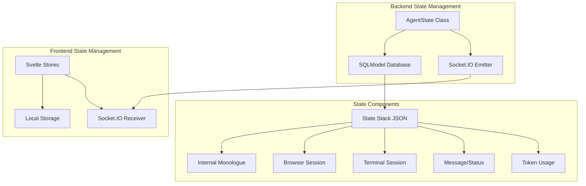
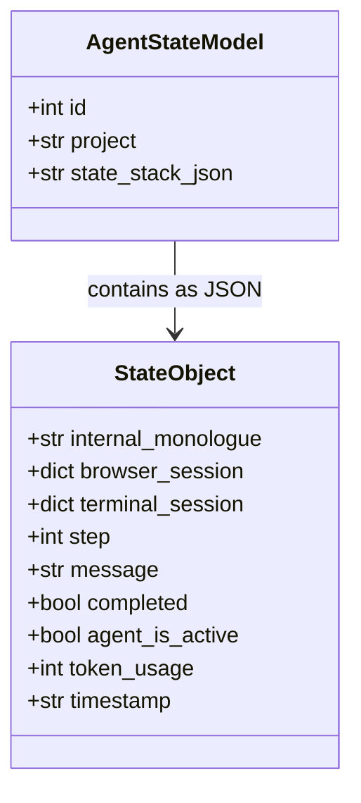
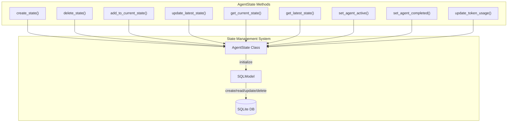
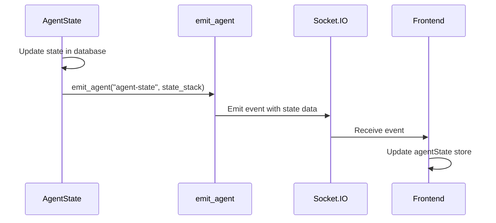
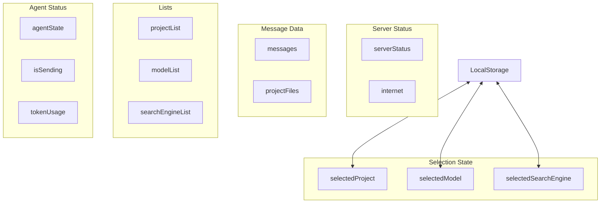
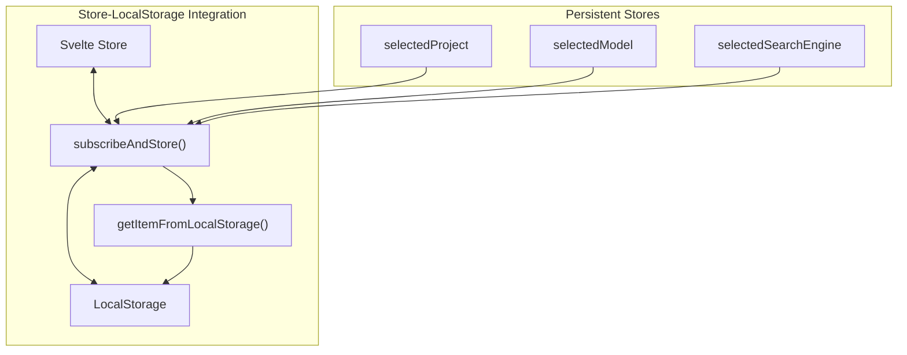
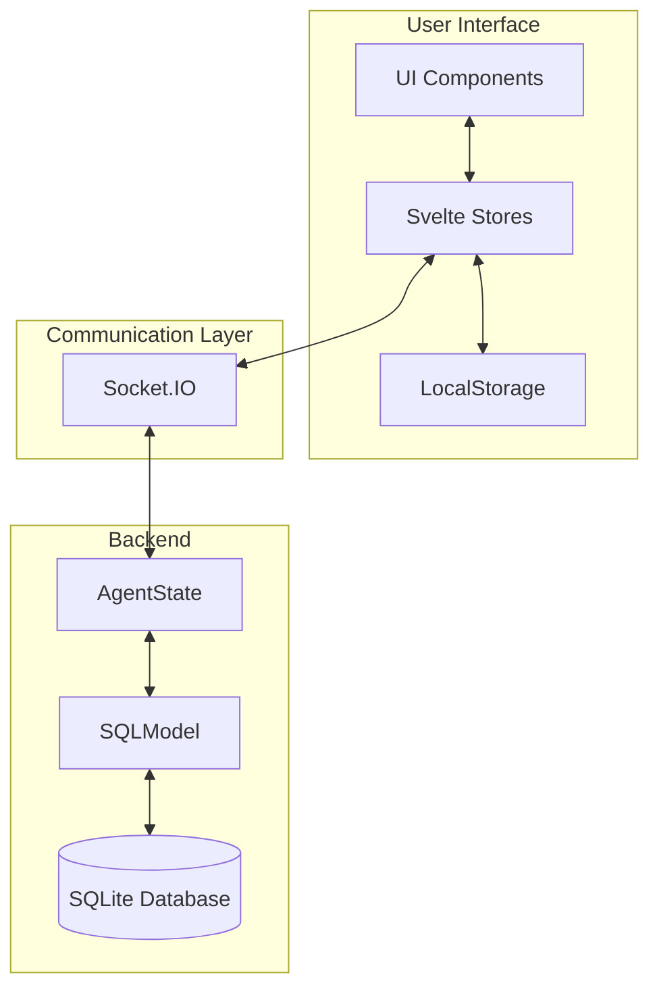
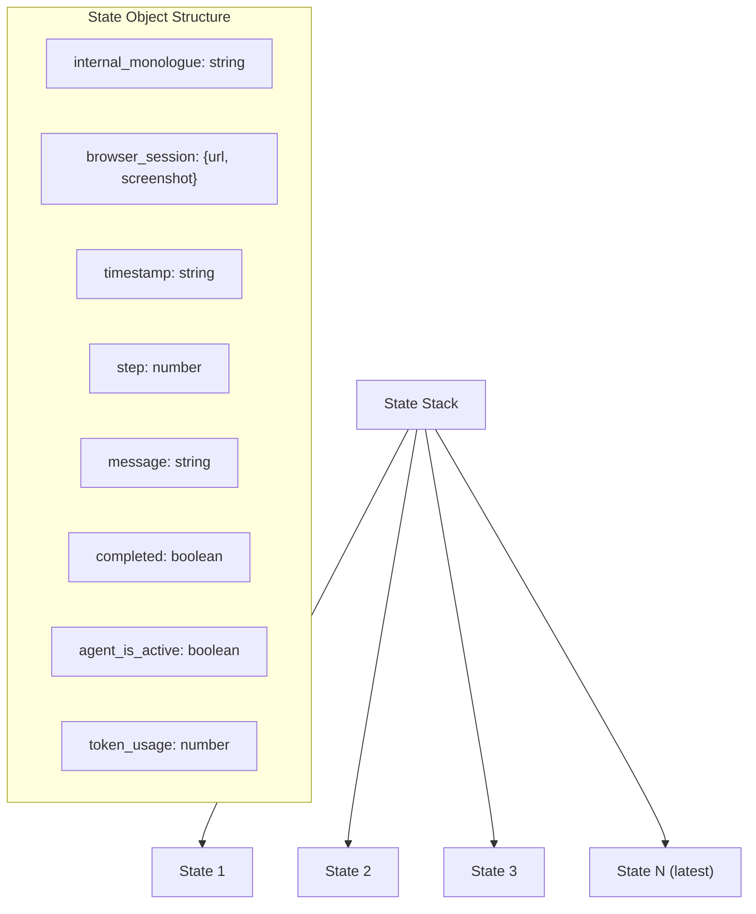
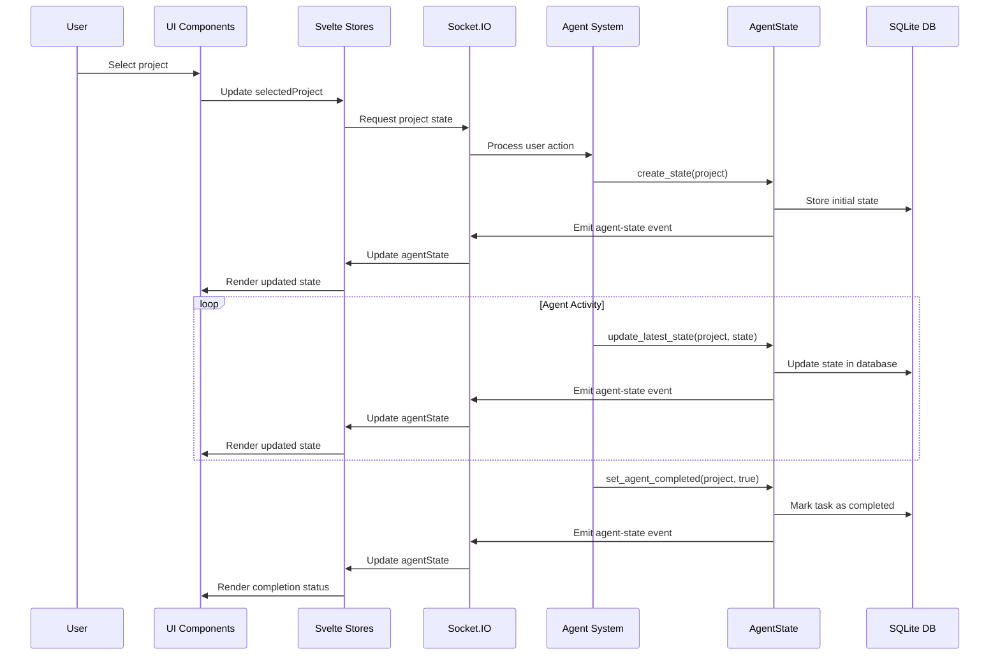

<!-- source: DeepWiki mcp.deepwiki.com · repo stitionai/devika · page 7 State Management · fetched 2026-10-27 -->

# State Management

Relevant source files

The following files were used as context for generating this wiki page:

- [src/state.py](src/state.py)
- [ui/src/lib/store.js](ui/src/lib/store.js)

This document explains how Devika manages and persists state throughout the system. State management is a critical component that tracks the agent's progress, maintains session information, and synchronizes information between the frontend and backend.

For information about how the agent system works with this state, see [Agent System Architecture](#2.2).

## Overview

Devika's state management system serves several key purposes:

1. **Persistence**: Maintaining agent state between sessions
2. **Progress tracking**: Recording step-by-step progress of agent operations
3. **Status monitoring**: Tracking agent activity and task completion
4. **Communication**: Synchronizing state between frontend and backend
5. **Resource tracking**: Monitoring token usage

Sources: [src/state.py:18-176](), [ui/src/lib/store.js:1-49]()

## Backend State Management

The backend state management is handled by the `AgentState` class, which provides an interface to a SQLite database for storing and retrieving state information.

### AgentState Structure

Each project has its own state record, containing a stack of state objects in JSON format. The state structure is defined in the `new_state()` method:

Sources: [src/state.py:10-16](), [src/state.py:25-45]()

### Key Methods

The `AgentState` class provides the following methods for state management:

| Method | Purpose | Implementation |
|--------|---------|----------------|
| `create_state()` | Initialize state for a new project | Creates a new state stack with initial state |
| `delete_state()` | Remove state for a project | Deletes all state records for the specified project |
| `add_to_current_state()` | Add a new state to the stack | Appends a state object to the existing stack |
| `update_latest_state()` | Modify the most recent state | Updates the last item in the state stack |
| `get_current_state()` | Retrieve the entire state stack | Returns the complete state history for a project |
| `get_latest_state()` | Get the most recent state | Returns the last item in the state stack |
| `set_agent_active()` | Update agent activity status | Sets the `agent_is_active` flag in the current state |
| `set_agent_completed()` | Mark agent task as completed | Sets the `completed` flag in the current state |
| `update_token_usage()` | Track token consumption | Increments the `token_usage` counter in the current state |

Sources: [src/state.py:47-176]()

### Database Interaction

The state management system uses SQLModel to interact with a SQLite database:

Sources: [src/state.py:18-24](), [src/state.py:47-176]()

### State Notification System

When state changes occur, the backend emits Socket.IO events to notify the frontend of these changes:

Sources: [src/state.py:55](), [src/state.py:78](), [src/state.py:100](), [src/state.py:123](), [src/state.py:147]()

## Frontend State Management

The frontend uses Svelte stores for reactive state management, with some values persisted in localStorage.

### Svelte Store Structure

Sources: [ui/src/lib/store.js:22-48]()

### Store-LocalStorage Integration

The frontend state system uses helper functions to sync certain stores with localStorage for persistence between page reloads:

Sources: [ui/src/lib/store.js:4-19](), [ui/src/lib/store.js:34-36]()

## State Flow Between Frontend and Backend

The complete state flow in Devika combines both frontend and backend state management systems:

Sources: [src/state.py:18-176](), [ui/src/lib/store.js:1-49]()

## State Data Structure

The agent state is stored as a stack of state objects, each representing a point in time during the agent's execution:

Sources: [src/state.py:25-45]()

## Integration with the Agent System

The state management system is closely integrated with the agent system:

1. The agent updates its internal monologue, which is stored in the state
2. Browser and terminal sessions are tracked as part of the state
3. Agent activity status is tracked to monitor if the agent is currently processing
4. Completion status indicates when the agent has finished its task
5. Token usage is tracked for resource monitoring

This integration allows for:
- Persistence of agent progress between sessions
- Real-time monitoring of agent activity
- Precise tracking of resource usage
- Historical review of agent actions

Sources: [src/state.py:109-154]()

## State Lifecycle

The lifecycle of state in the Devika system follows this pattern:

Sources: [src/state.py:47-55](), [src/state.py:87-100](), [src/state.py:132-147]()

## Conclusion

Devika's state management system provides a robust foundation for tracking agent activity, persisting state between sessions, and synchronizing information between frontend and backend. The combination of SQLite for backend persistence and Svelte stores with localStorage for frontend state creates a comprehensive solution that maintains the application's state throughout its lifecycle.

The design allows for:
- Step-by-step tracking of agent progress
- Historical review of agent actions through the state stack
- Persistent storage of project-specific state
- Real-time updates to the UI through Socket.IO events
- Token usage monitoring for resource management

This state management architecture is essential for Devika's operation as an agentic AI software engineer, providing the continuity and persistence needed for complex, multi-step operations.

---

