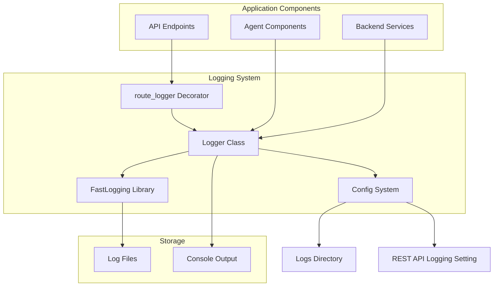
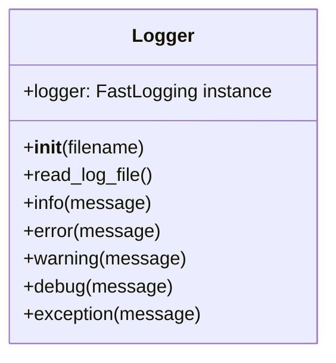
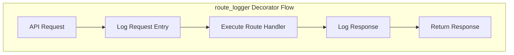
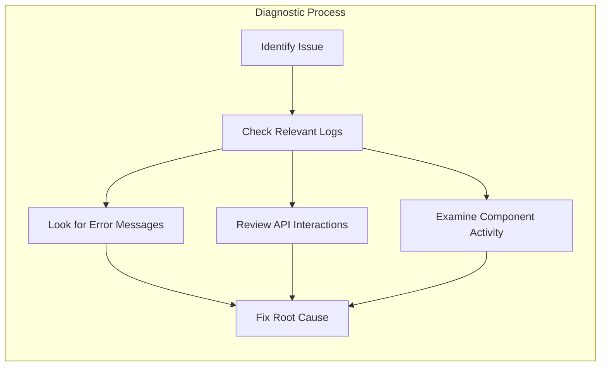
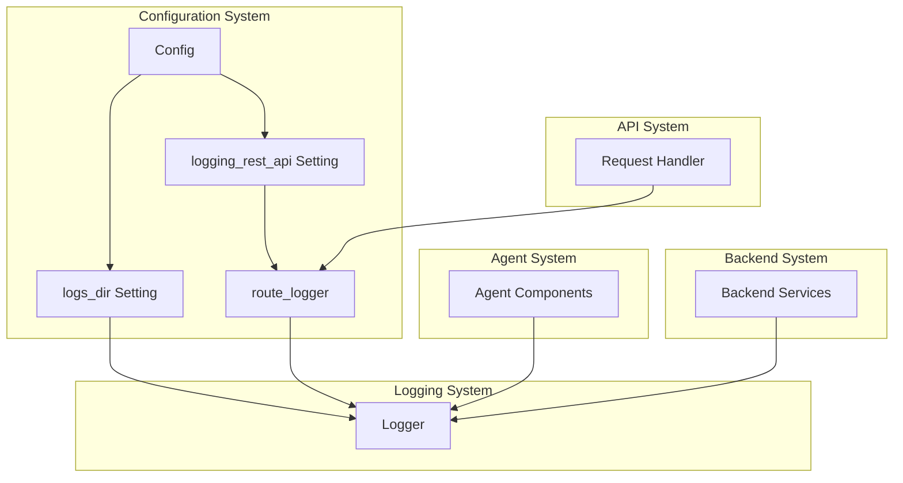

<!-- source: DeepWiki mcp.deepwiki.com · repo stitionai/devika · page 8 Logging and Diagnostics · fetched 2026-10-27 -->

# Logging and Diagnostics

<details>
<summary>Relevant source files</summary>

The following files were used as context for generating this wiki page:

- [.github/pull_request_template.md](.github/pull_request_template.md)
- [src/logger.py](src/logger.py)

</details>


This document describes the logging and diagnostics system in Devika. It covers the architecture of the logging system, how to use logging throughout the codebase, configuration options, and diagnostics capabilities.

## Logging Architecture

The Devika logging system is built around a centralized `Logger` class that provides standardized logging functionality throughout the application. The system is designed to be simple but effective, offering consistent log formatting and storage while integrating with the application's configuration system.



The logging system is implemented in the `Logger` class within the `logger.py` file. This class wraps the FastLogging library and provides standardized methods for different log levels.

Sources: [src/logger.py:9-37]()

## Core Components

### Logger Class

The `Logger` class is the main component of the logging system. It initializes a log file based on the configured logs directory and provides methods for different logging levels.



Key features of the `Logger` class:
- Initializes a log file in the configured directory
- Supports multiple log levels (info, error, warning, debug, exception)
- Provides console output with color coding
- Ensures log messages are flushed immediately to disk
- Offers a method to read log file contents

Sources: [src/logger.py:9-37]()

### Route Logger Decorator

The `route_logger` decorator factory creates decorators that can be applied to Flask route handlers to automatically log API requests and responses. This feature provides comprehensive visibility into API traffic.



The decorator:
- Logs the route path and HTTP method on entry
- Executes the route handler function
- Logs the response data on exit (with special handling for file responses and sensitive data)
- Can be enabled/disabled via configuration

Sources: [src/logger.py:40-78]()

## Using the Logger

### Basic Logging

To use the logger in any component of Devika, you first need to instantiate the `Logger` class and then call the appropriate method for the log level you need:

```python
from src.logger import Logger

# Create logger instance
logger = Logger(filename="custom_log_file.log")  # Optional custom filename

# Log messages at different levels
logger.info("This is an informational message")
logger.warning("This is a warning message")
logger.error("This is an error message")
logger.debug("This is a debug message")

# Log exceptions
try:
    # Some code that might raise an exception
    result = 1 / 0
except Exception as e:
    logger.exception(f"Error calculating result: {e}")
```

Each logging method automatically flushes the log to ensure messages are written immediately to the log file.

Sources: [src/logger.py:19-37]()

### Route Logging

For Flask routes, the `route_logger` decorator provides automatic logging of requests and responses:

```python
from flask import Flask
from src.logger import Logger, route_logger

app = Flask(__name__)
logger = Logger(filename="api.log")

@app.route("/api/example", methods=["GET"])
@route_logger(logger)
def example_route():
    # Route implementation
    return {"status": "success"}
```

The decorator will log:
- The route path and HTTP method when a request is received
- The response data when the request is complete
- Special handling for file responses and sensitive data (like settings)

Sources: [src/logger.py:40-78]()

## Configuration

The logging system is integrated with Devika's configuration system, allowing for customization of logging behavior.

### Log File Location

Log files are stored in a directory specified in the configuration. The default location is determined by the `Config` class:

```python
logs_dir = config.get_logs_dir()
```

When initializing a logger, you can specify a custom filename, which will be stored in the configured logs directory:

```python
logger = Logger(filename="custom_component.log")
```

Sources: [src/logger.py:10-13]()

### API Logging Configuration

REST API logging can be enabled or disabled through the configuration system:

```python
log_enabled = Config().get_logging_rest_api()
```

When disabled, no API requests or responses will be logged, even if the `route_logger` decorator is applied.

Sources: [src/logger.py:48](), [src/logger.py:55-56](), [src/logger.py:65-72]()

## Diagnostics Capabilities

### Reading Log Files

The `Logger` class provides a method to read the contents of the current log file:

```python
logger = Logger()
log_contents = logger.read_log_file()
```

This can be useful for displaying logs in the UI or for debugging purposes.

Sources: [src/logger.py:15-17]()

### Troubleshooting with Logs

The logging system in Devika is designed to help diagnose issues by providing detailed information about the system's operation. Here are some ways to use the logging system for troubleshooting:

1. **Check API interactions**: API logs show both incoming requests and outgoing responses, helping to identify issues in API communication.

2. **Error diagnosis**: The `exception` logging method captures both the error message and the stack trace, providing context for debugging.

3. **Activity monitoring**: The various log levels (info, debug, warning, error) can help track different aspects of the system's operation.

4. **Check for configuration issues**: Logs often contain information about configuration loading and validation, which can help diagnose configuration problems.



Sources: [src/logger.py:15-37]()

## Integration with Other Systems

The logging system is designed to integrate with other components of Devika. Here's how it connects with other systems:



The logging system:
- Relies on the configuration system for settings
- Is used by agents for tracking their activities
- Records API interactions through the route_logger decorator
- Provides diagnostic data for the entire application

Sources: [src/logger.py:6](), [src/logger.py:11-12](), [src/logger.py:48]()

## Best Practices

When using the logging system in Devika, consider these best practices:

1. **Choose the appropriate log level**:
   - `info`: General information about system operation
   - `debug`: Detailed information useful for debugging
   - `warning`: Potential issues that don't prevent operation
   - `error`: Errors that may impact functionality
   - `exception`: For capturing exceptions with stack traces

2. **Include context in log messages**: Log messages should include enough context to understand what happened without requiring additional information.

3. **Log at entry and exit points** of significant operations, similar to how the `route_logger` decorator works.

4. **Don't log sensitive information** such as API keys, passwords, or personal data.

5. **Use custom log files** for specific components when appropriate to make it easier to isolate logs for troubleshooting.

Sources: [src/logger.py:19-37](), [src/logger.py:40-78]()

---

