# Page: Overview

# Overview

<details>
<summary>Relevant source files</summary>

The following files were used as context for generating this wiki page:

- [.gitignore](.gitignore)
- [README.md](README.md)

</details>


This document provides an introduction to Devika, an agentic AI software engineer designed to understand human instructions, break them down into steps, and write code to achieve objectives. For detailed information about the system architecture, see [System Architecture](#2).

## What is Devika?

Devika is an advanced AI software engineer that can understand high-level human instructions, break them down into steps, research relevant information, and write code to achieve given objectives. It utilizes large language models, planning and reasoning algorithms, and web browsing capabilities to intelligently develop software.

Designed as an AI pair programmer, Devika can handle complex coding tasks with minimal human guidance. Whether creating new features, fixing bugs, or developing entire projects, Devika streamlines the software development process.

Devika is modeled after Devin by Cognition AI and aims to be an open-source alternative with the goal of matching or exceeding Devin's performance on software engineering benchmarks.

Sources: [README.md:26-33]()

## System Architecture Overview

The following diagram illustrates the high-level architecture of Devika, showing the primary components and their interactions:

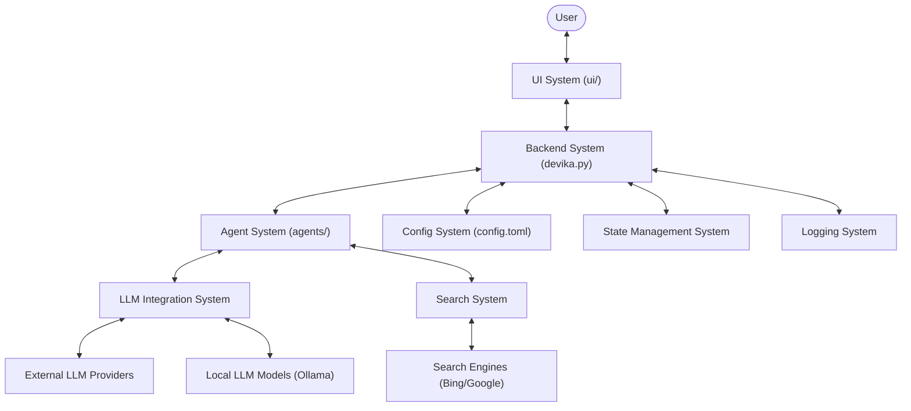

Sources: [README.md:51-53]()

## Key Features

Devika provides a comprehensive set of capabilities for AI-assisted software development:

| Feature | Description |
|---------|-------------|
| **Multi-Model LLM Support** | Integrates with Claude 3, GPT-4, Gemini, Mistral, Groq, and Local LLMs via Ollama |
| **AI Planning & Reasoning** | Advanced planning capabilities to break down complex tasks |
| **Research Capabilities** | Contextual keyword extraction and web browsing for information gathering |
| **Code Generation** | Writing code in multiple programming languages |
| **State Tracking** | Dynamic agent state tracking and visualization |
| **Natural Language Interface** | Chat-based interaction for human-AI collaboration |
| **Project Management** | Project-based organization and file management |
| **Extensible Architecture** | Modular design for adding new features and integrations |

Sources: [README.md:39-50]()

## Agent System Architecture

Devika's intelligence comes from its agent system - a collection of specialized AI agents that collaborate to accomplish software engineering tasks:

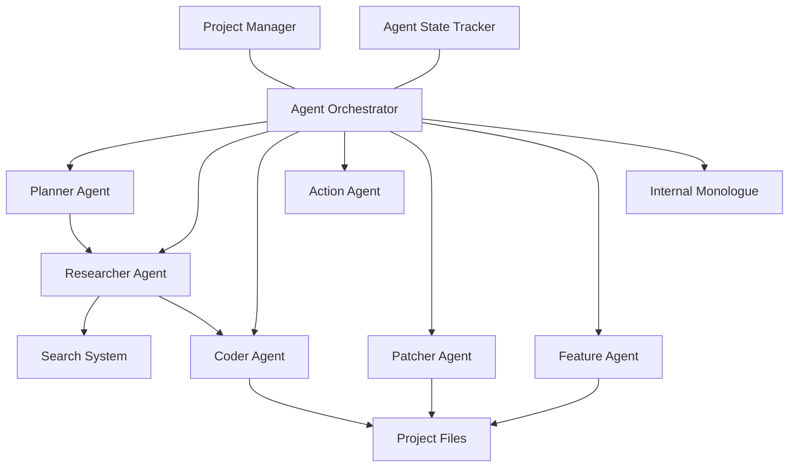

When a user submits a request, the workflow typically follows these steps:

1. The `PlannerAgent` breaks down the task into manageable steps
2. The `ResearcherAgent` gathers required information using the Search System
3. The `CoderAgent` writes the necessary code
4. The `PatcherAgent` fixes any issues in the code
5. The `FeatureAgent` implements specific features
6. The `ActionAgent` performs necessary actions in the system
7. The `InternalMonologue` maintains context and reasoning throughout the process

All these agents are coordinated by the `AgentOrchestrator`, which ensures they work together effectively to complete the user's request.

Sources: [README.md:40-42]()

## User Interface and Communication

Devika provides a web-based user interface with the following components:

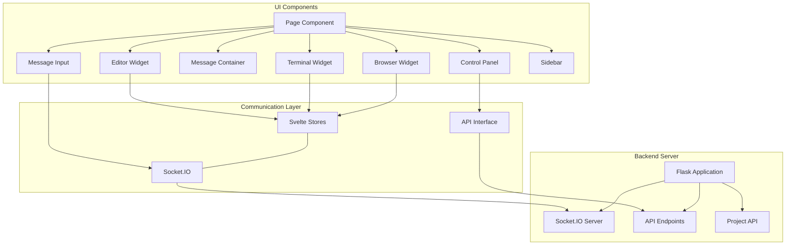

Users interact with Devika by:
1. Sending natural language instructions through the chat interface
2. Viewing generated code in the editor widget
3. Running and testing code in the terminal
4. Monitoring Devika's web research in the browser widget
5. Managing projects and configurations through the control panel

Sources: [README.md:116-127]()

## LLM Integration System

Devika integrates with multiple language models through an abstraction layer:

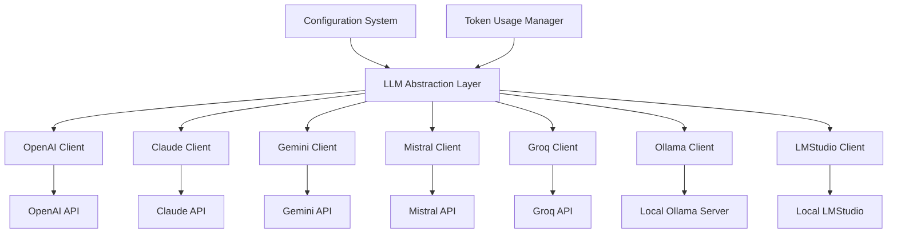

The LLM integration system allows Devika to leverage various language models, with Claude 3 recommended for optimal performance.

Sources: [README.md:41](), [README.md:130-143]()

## Configuration System

Devika requires certain configuration settings and API keys to function properly. When you first run Devika, it creates a `config.toml` file in the root directory. Configuration options include:

- API keys for various services (OpenAI, Claude, Gemini, Mistral, Groq, search engines)
- API endpoints for LLMs and search services
- Storage paths and system settings
- Logging configuration

These settings can be managed through the UI's settings page or by directly editing the configuration file.

Sources: [README.md:130-151]()

## Getting Started

To get started with Devika:

1. Install the required dependencies (Python 3.10-3.11, Node.js, bun)
2. Clone the repository and set up the environment
3. Configure API keys for LLMs and search engines
4. Run the backend server and frontend UI

For detailed installation instructions, see [Installation and Deployment](#3).

Sources: [README.md:56-114]()

## Further Reading

For more detailed information about specific components of Devika, refer to the following sections:
- [System Architecture](#2) - Detailed overview of the system architecture
- [LLM Integration Architecture](#2.1) - Details about the LLM integration system
- [Agent System Architecture](#2.2) - In-depth explanation of the agent system
- [Frontend Architecture](#2.3) - Overview of the frontend system
- [Configuration](#4) - Comprehensive guide to configuring Devika

---

# Page: System Architecture

# System Architecture

<details>
<summary>Relevant source files</summary>

The following files were used as context for generating this wiki page:

- [.gitignore](.gitignore)
- [README.md](README.md)
- [devika.py](devika.py)
- [src/agents/agent.py](src/agents/agent.py)
- [src/config.py](src/config.py)

</details>


This document provides a high-level overview of Devika's system architecture, explaining how different components interact to create a cohesive agentic AI software engineering system. For detailed information about specific subsystems, please refer to the corresponding subsections: [LLM Integration Architecture](#2.1), [Agent System Architecture](#2.2), and [Frontend Architecture](#2.3).

## Architectural Overview

Devika is built using a modular, service-oriented architecture with clear separation of concerns. The system consists of several key components that work together to provide an AI assistant capable of understanding requirements, researching solutions, writing code, and assisting with software development tasks.

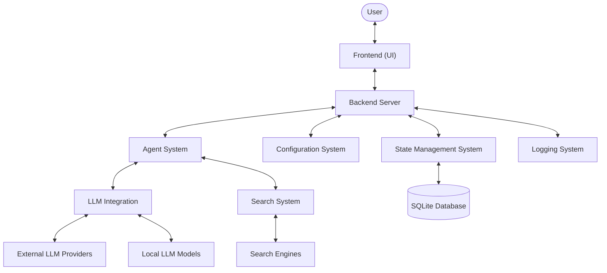

Sources: [devika.py:1-210](), [README.md:51-53]()

## Core Components

### Backend Server

The backend server is built using Flask and Socket.IO to provide both RESTful API endpoints and real-time communication capabilities. It serves as the central hub connecting the frontend with the agent system, configuration management, and state tracking.

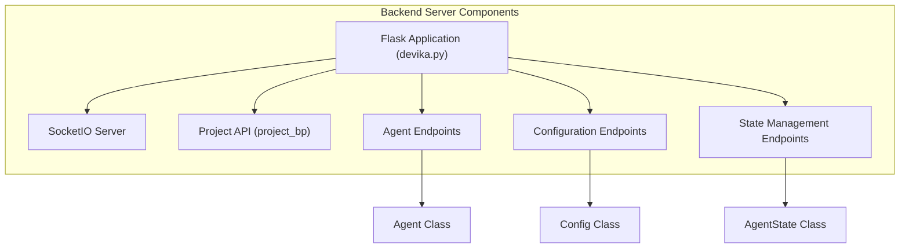

Key components in the backend:

- **Flask Application**: Serves as the main web server, handling HTTP requests and responses
- **Socket.IO Server**: Enables real-time bidirectional communication between the client and server
- **Project API**: Manages project-related operations through a dedicated Blueprint
- **Agent Endpoints**: Interfaces with the Agent System to process user requests
- **Configuration Endpoints**: Provides access to configuration settings
- **State Management Endpoints**: Tracks and reports on agent state

Sources: [devika.py:11-35](), [devika.py:52-204]()

### Configuration System

The Configuration System manages all settings through a centralized `Config` class implemented as a singleton. This ensures consistent access to configuration throughout the application.

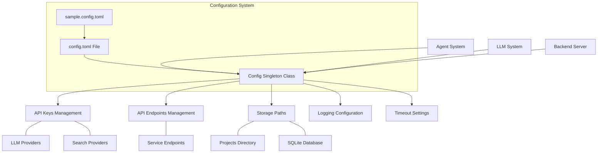

The Config class:
- Loads settings from `config.toml` with fallback to `sample.config.toml` if not found
- Provides getters and setters for all configuration values
- Includes configuration for API keys, endpoints, storage locations, and operational parameters
- Updates configuration in real-time when settings are changed through the UI

Sources: [src/config.py:1-196](), [devika.py:187-199]()

### State Management System

The State Management System tracks the current state of agents, projects, and interactions through the `AgentState` class. It maintains:

- Agent activity status (active/inactive)
- Completion status of tasks
- Internal monologue content
- Browser session information
- Terminal session history
- Token usage statistics

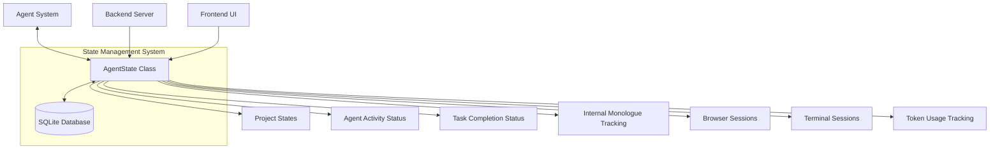

Sources: [devika.py:114-178](), [src/agents/agent.py:297-300]()

### Agent System

The Agent System is the core intelligence of Devika, orchestrating specialized agents to handle different aspects of software development. The `Agent` class serves as the orchestrator, coordinating the activities of specialized agent components.

```mermaid
graph TD
    subgraph "Agent System"
        AgentClass["Agent Class (Orchestrator)"]
        PlannerAgent["Planner Agent"]
        ResearcherAgent["Researcher Agent"]
        FormatterAgent["Formatter Agent"]
        CoderAgent["Coder Agent"] 
        ActionAgent["Action Agent"]
        InternalMonologueAgent["Internal Monologue Agent"]
        AnswerAgent["Answer Agent"]
        RunnerAgent["Runner Agent"]
        FeatureAgent["Feature Agent"]
        PatcherAgent["Patcher Agent"]
        ReporterAgent["Reporter Agent"]
        DecisionAgent["Decision Agent"]
    end
    
    AgentClass --> PlannerAgent
    AgentClass --> ResearcherAgent
    AgentClass --> FormatterAgent
    AgentClass --> CoderAgent
    AgentClass --> ActionAgent
    AgentClass --> InternalMonologueAgent
    AgentClass --> AnswerAgent
    AgentClass --> RunnerAgent
    AgentClass --> FeatureAgent
    AgentClass --> PatcherAgent
    AgentClass --> ReporterAgent
    AgentClass --> DecisionAgent
    
    AgentClass --> ProjectManager["Project Manager"]
    AgentClass --> AgentState["Agent State"]
    AgentClass --> BrowserSearch["Browser Search"]
    
    BrowserSearch --> BingSearch["Bing Search"]
    BrowserSearch --> GoogleSearch["Google Search"] 
    BrowserSearch --> DuckDuckGoSearch["DuckDuckGo Search"]
```

Key agent components:
- **Planner**: Creates step-by-step plans for tasks
- **Researcher**: Identifies information needs and formulates search queries
- **Formatter**: Formats information for processing by other agents
- **Coder**: Generates code based on requirements and research
- **Action**: Determines appropriate actions based on user interactions
- **Internal Monologue**: Maintains agent's internal thinking process
- **Feature**: Implements new features in existing code
- **Patcher**: Fixes bugs and issues in code
- **Reporter**: Generates documentation and reports

Sources: [src/agents/agent.py:1-66](), [src/agents/agent.py:269-366]()

### LLM Integration

The LLM Integration System provides a unified interface to multiple language model providers, including both cloud-based and local options.

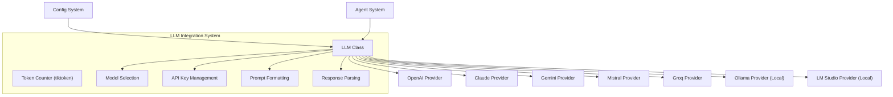

The LLM Integration System:
- Supports multiple LLM providers through a common interface
- Manages API keys and endpoints for each provider
- Tracks token usage for cost monitoring
- Handles timeout and retry logic for API calls

Sources: [src/agents/agent.py:41-63](), [devika.py:64-65]()

### Search System

The Search System enables Devika to perform web searches to gather information for research and problem-solving. It supports multiple search engines:

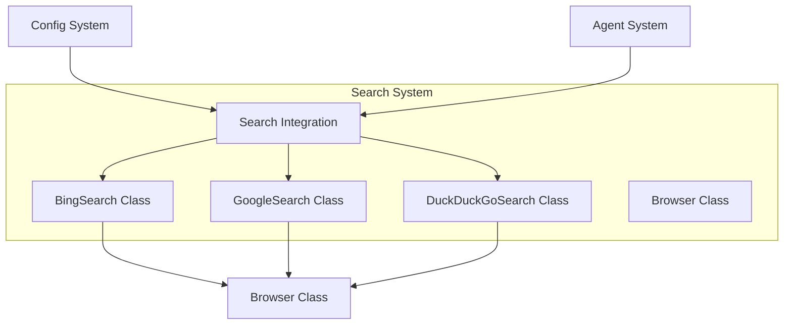

The Search System:
- Interfaces with multiple search engines (Bing, Google, DuckDuckGo)
- Uses a browser automation component to extract information from web pages
- Processes and formats search results for agent consumption

Sources: [src/agents/agent.py:79-116]()

## Data Flow and Process

The following diagram illustrates the typical data flow for a user request in Devika:

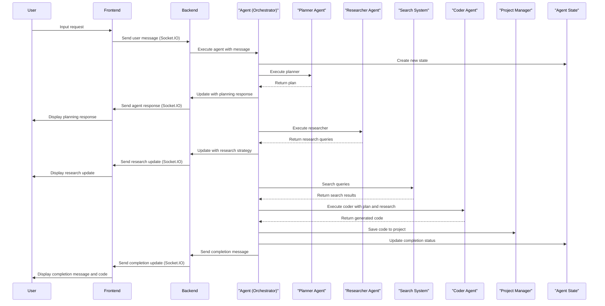

Sources: [src/agents/agent.py:269-366](), [devika.py:77-103]()

## Implementation Details

### Backend Server (Flask & Socket.IO)

The main backend server is implemented in `devika.py`, which sets up a Flask application with Socket.IO integration:

- The server listens on port 1337
- Socket.IO is used for real-time communication with the frontend
- REST API endpoints handle various operations:
  - Project management
  - Agent state retrieval
  - Configuration management
  - Browser and terminal session management
  - Token usage tracking
  - Logging and diagnostics

The backend exposes multiple endpoints for interaction with the frontend:

| Endpoint | Method | Description |
|----------|--------|-------------|
| `/api/data` | GET | Retrieves project list, available models, and search engines |
| `/api/messages` | POST | Retrieves messages for a specific project |
| `/api/is-agent-active` | POST | Checks if an agent is active for a project |
| `/api/get-agent-state` | POST | Gets the latest state for a project |
| `/api/get-browser-snapshot` | GET | Retrieves a browser snapshot |
| `/api/get-browser-session` | GET | Gets the browser session for a project |
| `/api/get-terminal-session` | GET | Gets the terminal session for a project |
| `/api/token-usage` | GET | Retrieves token usage statistics |
| `/api/settings` | GET/POST | Gets or updates configuration settings |

Sources: [devika.py:28-205]()

### Configuration Management

The configuration system is implemented as a singleton class in `src/config.py`. It:

- Loads configuration from `config.toml` (creating it from `sample.config.toml` if not found)
- Provides getters and setters for all configuration values
- Persists configuration changes to disk
- Maintains settings for:
  - API keys for various services
  - API endpoints
  - Storage paths
  - Logging settings
  - Timeout configurations

Sources: [src/config.py:5-196]()

### Agent Orchestration

The Agent class in `src/agents/agent.py` serves as the main orchestrator for Devika's intelligence:

- Initializes all specialized agent components
- Maintains the flow of execution through different phases
- Handles first-time execution and subsequent interactions differently
- Manages context and state through the AgentState system
- Coordinates web searches through the search system
- Tracks contextual keywords for better understanding of user requests

The main execution flow is handled by the `execute` method, which:
1. Plans the approach using the Planner agent
2. Updates internal monologue to track thought process
3. Identifies research needs via the Researcher agent
4. Performs web searches if needed
5. Generates code using the Coder agent
6. Updates project files and state

For subsequent interactions, the `subsequent_execute` method determines the appropriate action based on the current context:
- Answer questions
- Run code
- Deploy a project
- Add features
- Fix bugs
- Generate reports

Sources: [src/agents/agent.py:36-366]()

## Deployment Architecture

Devika can be deployed using Docker Compose, which orchestrates three containers:

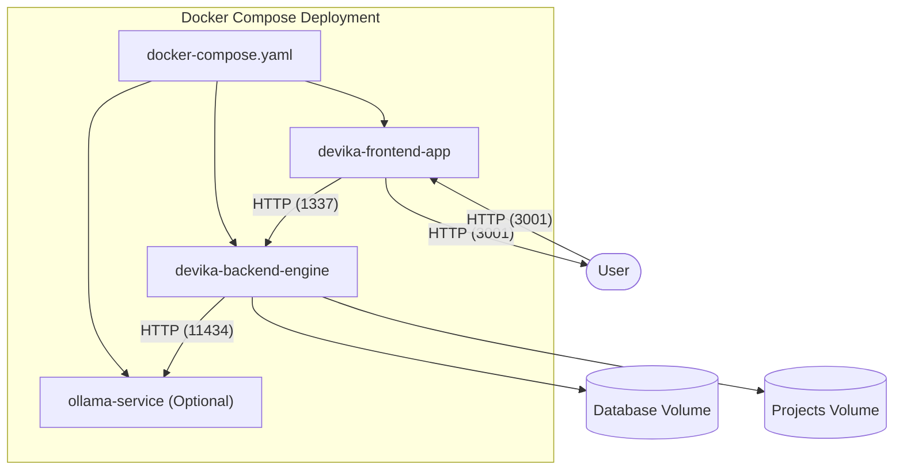

The deployment architecture consists of:
- **Backend Container**: Runs the Flask server with the core Devika logic
- **Frontend Container**: Serves the SvelteKit UI application
- **Ollama Container**: (Optional) Provides local LLM capabilities for environments without access to cloud APIs

Sources: [README.md:57-129]()

## Summary

Devika's system architecture follows a modular, loosely-coupled approach with clear separation of concerns. The core components - Agent System, LLM Integration, Search System, and State Management - work together through the Backend Server to provide a seamless experience for users interacting through the Frontend.

The architecture emphasizes:
- **Flexibility**: Supporting multiple LLM providers and search engines
- **Extensibility**: New agents can be added to enhance capabilities
- **State Management**: Persistent tracking of agent activities and project state
- **Real-time Communication**: Socket.IO enables immediate feedback to users

For more detailed information about specific subsystems, refer to the dedicated wiki pages for each component.

---

# Page: LLM Integration Architecture

# LLM Integration Architecture

<details>
<summary>Relevant source files</summary>

The following files were used as context for generating this wiki page:

- [sample.config.toml](sample.config.toml)
- [src/agents/researcher/prompt.jinja2](src/agents/researcher/prompt.jinja2)
- [src/llm/groq_client.py](src/llm/groq_client.py)
- [src/llm/llm.py](src/llm/llm.py)
- [src/llm/lm_studio_client.py](src/llm/lm_studio_client.py)
- [src/llm/mistral_client.py](src/llm/mistral_client.py)
- [src/llm/openai_client.py](src/llm/openai_client.py)

</details>


This document details the architecture of Devika's LLM Integration System, which provides a unified interface for interacting with multiple language model providers. The LLM Integration System serves as a critical abstraction layer that enables Devika's agent system to leverage different LLMs interchangeably, providing flexibility, resilience, and maintainability.

For information about how the Agent System uses LLMs, see [Agent System Architecture](#2.2).
For details on implementing custom LLM interfaces, see [LLM Interface](#5.3).

## Architecture Overview

The LLM Integration System is built around a central abstraction layer (`LLM` class) that interfaces with various LLM provider clients. This architecture enables seamless switching between different LLM providers while maintaining consistent behavior.

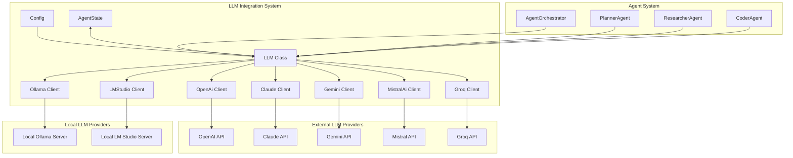

Sources: [src/llm/llm.py:27-28](), [src/llm/llm.py:101-109]()

## Core Components

### LLM Abstraction Layer

The `LLM` class located in `src/llm/llm.py` serves as the primary interface for interacting with language models. This class provides:

1. A unified interface for sending prompts to various LLM providers
2. Model enumeration and selection
3. Token usage tracking
4. Timeout handling and error management

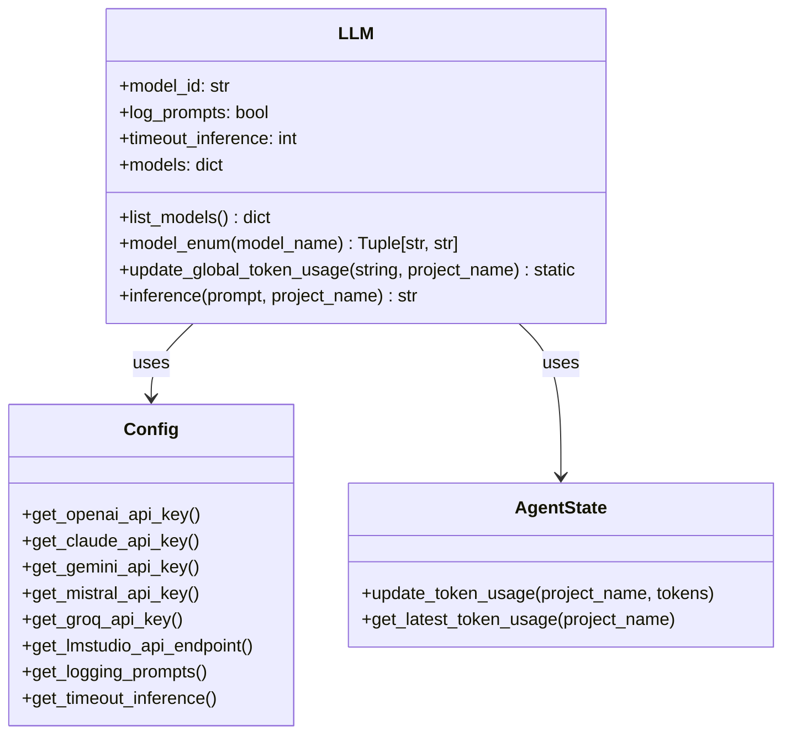

Sources: [src/llm/llm.py:28-71](), [src/llm/llm.py:73-156]()

### LLM Provider Clients

Each LLM provider has its own client implementation that handles the specifics of communicating with that provider's API. All clients implement a consistent `inference` method that accepts a model ID and prompt, returning the model's response.

| Provider | Client Class | File Path |
|----------|-------------|-----------|
| OpenAI | `OpenAi` | src/llm/openai_client.py |
| Claude | `Claude` | src/llm/claude_client.py |
| Gemini | `Gemini` | src/llm/gemini_client.py |
| Mistral | `MistralAi` | src/llm/mistral_client.py |
| Groq | `Groq` | src/llm/groq_client.py |
| Ollama | `Ollama` | src/llm/ollama_client.py |
| LM Studio | `LMStudio` | src/llm/lm_studio_client.py |

Example client implementation (OpenAI):

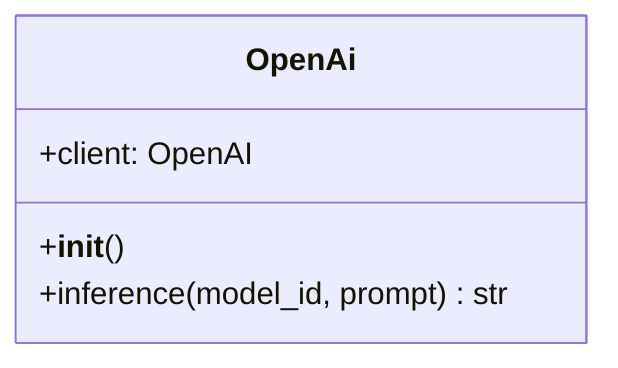

Sources: [src/llm/openai_client.py:6-24](), [src/llm/groq_client.py:6-24](), [src/llm/mistral_client.py:7-26](), [src/llm/lm_studio_client.py:8-30]()

## Inference Workflow

The following sequence diagram illustrates the flow of an inference request through the LLM Integration System:

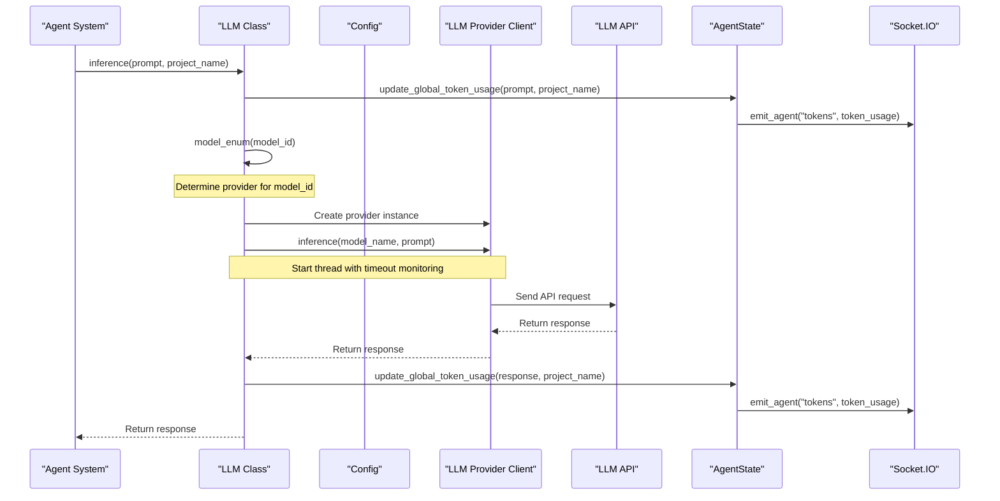

Sources: [src/llm/llm.py:92-156]()

## Supported Models

The LLM Integration System supports a wide range of models from various providers:

| Provider | Models |
|----------|--------|
| Claude | Claude 3 Opus, Claude 3 Sonnet, Claude 3 Haiku |
| OpenAI | GPT-4o-mini, GPT-4o, GPT-4 Turbo, GPT-3.5 Turbo |
| Google | Gemini 1.0 Pro, Gemini 1.5 Flash, Gemini 1.5 Pro |
| Mistral | Mistral 7b, Mistral 8x7b, Mistral Medium, Mistral Small, Mistral Large |
| Groq | LLAMA3 8B, LLAMA3 70B, LLAMA2 70B, Mixtral, GEMMA 7B |
| Ollama | (dynamically populated based on available local models) |
| LM Studio | Local Model |

Sources: [src/llm/llm.py:33-68]()

## Configuration

The LLM Integration System relies on the Configuration System to provide API keys and endpoints for each LLM provider. These configurations are stored in the `config.toml` file:

| Configuration Section | Keys | Purpose |
|-----------------------|------|---------|
| API_KEYS | CLAUDE, OPENAI, GEMINI, MISTRAL, GROQ | API keys for external providers |
| API_ENDPOINTS | OLLAMA, LM_STUDIO, OPENAI | Endpoints for LLM services |
| TIMEOUT | INFERENCE | Timeout setting for LLM requests |
| LOGGING | LOG_PROMPTS | Whether to log prompts and responses |

Sources: [sample.config.toml:9-34]()

## Token Usage Tracking

The LLM Integration System tracks token usage through the `AgentState` class:

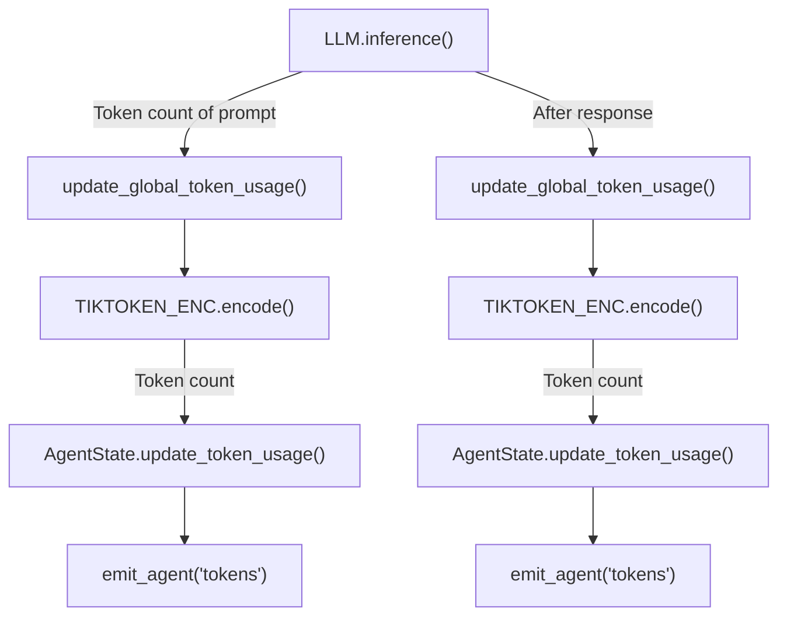

Sources: [src/llm/llm.py:84-90](), [src/llm/llm.py:93-94](), [src/llm/llm.py:154]()

## Error Handling and Timeouts

The LLM Integration System implements robust error handling and timeout mechanisms:

1. Inference requests are executed in a separate thread with a configurable timeout
2. Regular status updates are emitted via Socket.IO during inference
3. If inference takes longer than expected, a warning is emitted
4. If inference exceeds the timeout threshold, the request is terminated
5. Errors from LLM providers are caught and reported via Socket.IO

Sources: [src/llm/llm.py:111-146]()

## Integration with Agent System

The Agent System interacts with the LLM Integration System primarily through the `LLM` class. Agents create prompts (often using Jinja2 templates) and pass them to the LLM class for processing. The Agent System is responsible for interpreting the LLM responses and taking appropriate actions.

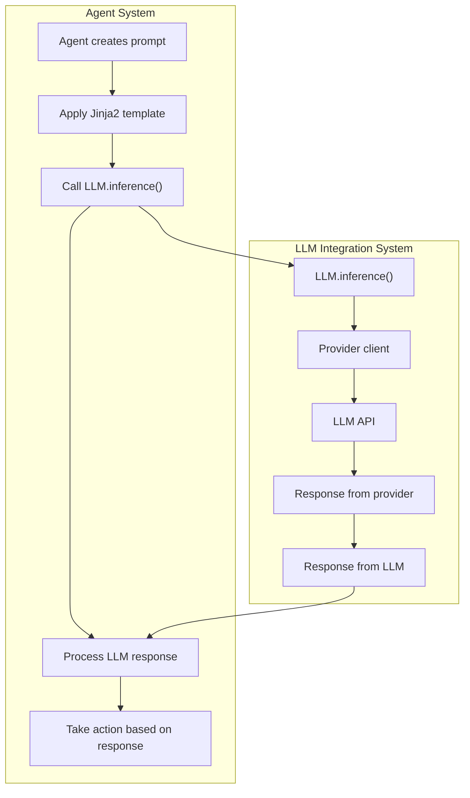

Sources: [src/agents/researcher/prompt.jinja2:1-40]()

## Summary

The LLM Integration Architecture provides a flexible, extensible system for interacting with various language model providers. Its key features include:

1. A unified interface for all LLM providers
2. Support for both cloud-based and local LLMs
3. Configurable behavior through the Configuration System
4. Token usage tracking
5. Robust error handling and timeout mechanisms
6. Seamless integration with the Agent System

This architecture allows Devika to leverage a wide range of language models while maintaining consistent behavior and providing fallback options if specific providers are unavailable.

---

# Page: Agent System Architecture

# Agent System Architecture

<details>
<summary>Relevant source files</summary>

The following files were used as context for generating this wiki page:

- [src/agents/agent.py](src/agents/agent.py)
- [src/agents/coder/coder.py](src/agents/coder/coder.py)
- [src/agents/feature/feature.py](src/agents/feature/feature.py)
- [src/agents/patcher/patcher.py](src/agents/patcher/patcher.py)
- [src/state.py](src/state.py)
- [ui/src/lib/components/EditorWidget.svelte](ui/src/lib/components/EditorWidget.svelte)

</details>


## Purpose and Scope

This document describes the agent system architecture of Devika, detailing how different agents collaborate to accomplish software engineering tasks. It covers the agent orchestration, specialized agent types, execution flows, state management, and inter-agent communication patterns. For implementation details of individual agents, see [Agent System](#5.1). For detailed information about code generation capabilities, see [Code Generation](#5.2).

## Agent System Overview

The agent system is the core of Devika's functionality, employing multiple specialized agents that work together to understand, research, plan, and implement software solutions. Each agent has a specific role in the overall workflow, orchestrated by a central coordinator.

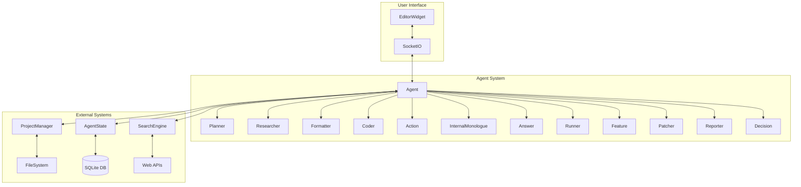

Sources: [src/agents/agent.py:36-66]()

## Agent Types and Responsibilities

The agent system includes several specialized agents with distinct responsibilities:

| Agent Type | Primary Responsibility |
|------------|------------------------|
| Planner | Creates step-by-step plans for implementing user requests |
| Researcher | Identifies information needs and formulates search queries |
| Formatter | Processes and structures raw information from web searches |
| Coder | Generates code based on plans and research |
| Action | Determines appropriate actions based on user input |
| InternalMonologue | Provides reasoning and thought process visibility |
| Feature | Implements new features to existing codebases |
| Patcher | Fixes bugs and issues in existing code |
| Runner | Executes code and provides runtime feedback |
| Answer | Provides direct responses to user inquiries |
| Reporter | Generates documentation and reports |
| Decision | Makes high-level decisions about task execution approach |

Sources: [src/agents/agent.py:46-62]()

## Agent State Management

Each agent operation is tracked in a state management system that persists information about the agent's activities, thought processes, and outputs.

```mermaid
classDiagram
    class AgentStateModel {
        +int id
        +string project
        +string state_stack_json
    }
    
    class AgentState {
        +new_state()
        +create_state(project)
        +delete_state(project)
        +add_to_current_state(project, state)
        +get_current_state(project)
        +update_latest_state(project, state)
        +get_latest_state(project)
        +set_agent_active(project, is_active)
        +is_agent_active(project)
        +set_agent_completed(project, is_completed)
        +is_agent_completed(project)
        +update_token_usage(project, token_usage)
        +get_latest_token_usage(project)
    }
    
    AgentState -- AgentStateModel : manages
```

The state includes:
- Internal monologue representing agent thoughts
- Browser session data (URL, screenshots)
- Terminal session data (commands, outputs)
- Execution step tracking
- Completion status
- Token usage metrics
- Timestamps

Sources: [src/state.py:10-45](), [src/state.py:102-176]()

## Agent Execution Flows

### Primary Execution Flow

The main execution flow begins with user input and progresses through planning, research, and code generation:

```mermaid
sequenceDiagram
    participant User
    participant Agent
    participant Planner
    participant Researcher
    participant Coder
    participant AgentState
    participant ProjectManager
    
    User->>Agent: Input prompt
    Agent->>ProjectManager: Record user input
    Agent->>AgentState: Create initial state
    Agent->>Planner: Execute(prompt)
    Planner-->>Agent: Plan
    Agent->>Agent: Update contextual keywords
    Agent->>InternalMonologue: Execute(plan)
    InternalMonologue-->>Agent: Internal reasoning
    Agent->>AgentState: Record internal monologue
    Agent->>Researcher: Execute(plan, keywords)
    Researcher-->>Agent: Search queries
    
    alt If queries exist
        Agent->>User: Notify about web search
        Agent->>SearchEngine: Query(queries)
        SearchEngine-->>Agent: Search results
    end
    
    alt If user input needed
        Agent->>User: Ask for additional info
        Agent->>Agent: Wait for user response
        User-->>Agent: Additional info
    end
    
    Agent->>Coder: Execute(plan, user_context, search_results)
    Coder-->>Agent: Generated code
    Agent->>ProjectManager: Save code to project
    Agent->>AgentState: Set as completed
    Agent->>User: Notify completion
```

Sources: [src/agents/agent.py:270-365]()

### Subsequent Execution Flow

For follow-up interactions, a different flow is used:

```mermaid
flowchart TD
    Start["User input received"] --> RecordMessage["Record message in project"]
    RecordMessage --> SetActive["Set agent active"]
    SetActive --> Action["Execute Action agent"]
    
    Action --> ActionDecision{"Determine action type"}
    
    ActionDecision -->|"answer"| Answer["Execute Answer agent"]
    ActionDecision -->|"run"| Runner["Execute Runner agent"]
    ActionDecision -->|"deploy"| Deploy["Deploy via Netlify"]
    ActionDecision -->|"feature"| Feature["Execute Feature agent"]
    ActionDecision -->|"bug"| Patcher["Execute Patcher agent"]
    ActionDecision -->|"report"| Reporter["Execute Reporter agent"]
    
    Answer --> Complete["Set agent as completed"]
    Runner --> Complete
    Deploy --> Complete
    Feature --> SaveCode["Save generated code"]
    Patcher --> SaveCode
    Reporter --> GeneratePDF["Generate PDF document"]
    
    SaveCode --> Complete
    GeneratePDF --> Complete
    
    Complete --> End["Notify user of completion"]
```

Sources: [src/agents/agent.py:179-267]()

## Agent Integration with Code Generation

The Coder, Patcher, and Feature agents follow similar patterns for code generation and integration with the file system:

1. Render a prompt template with context
2. Call LLM for code generation
3. Validate and parse the response
4. Emulate code writing in the UI
5. Save code to the project directory

```mermaid
sequenceDiagram
    participant Agent as "Agent (Coder/Patcher/Feature)"
    participant LLM
    participant AgentState
    participant FileSystem
    participant Socket
    
    Agent->>Agent: Render prompt with context
    Agent->>LLM: Request inference
    LLM-->>Agent: Response with code
    Agent->>Agent: Validate response format
    
    loop For each file
        Agent->>AgentState: Create new state entry
        Agent->>AgentState: Update terminal session data
        Agent->>Socket: Emit code update event
        Agent->>FileSystem: Save file to project
    end
```

Sources: [src/agents/coder/coder.py:88-112](), [src/agents/patcher/patcher.py:88-110](), [src/agents/feature/feature.py:88-108]()

## Agent-UI Communication

The agent system communicates with the UI through Socket.IO events, enabling real-time updates of agent activities:

```mermaid
graph TD
    subgraph "Backend"
        Agent["Agent System"]
        StateSystem["AgentState"]
        EmitFunction["emit_agent()"]
    end
    
    subgraph "Frontend"
        Socket["Socket.IO Client"]
        EditorWidget["EditorWidget"]
        MessageContainer["Message Container"]
        TerminalWidget["Terminal Widget"]
    end
    
    Agent --> StateSystem
    StateSystem --> EmitFunction
    EmitFunction --> Socket
    
    Socket -->|"code"| EditorWidget
    Socket -->|"agent-state"| TerminalWidget
    Socket -->|"message"| MessageContainer
```

When code is modified by agents:
1. The agent emits a 'code' event with file data
2. The EditorWidget receives the event via Socket.IO
3. The editor updates to display the new code

Sources: [src/agents/coder/coder.py:109-112](), [ui/src/lib/components/EditorWidget.svelte:55-60]()

## Decision-Making Process

The agent can make high-level decisions about how to approach a task using the Decision agent:

```mermaid
flowchart TD
    Start["User prompt received"] --> Decision["Execute Decision agent"]
    Decision --> Parse["Parse decision response"]
    
    Parse --> Functions{"Determine function"}
    
    Functions -->|"git_clone"| GitClone["Clone repository"]
    Functions -->|"generate_pdf_document"| PDF["Generate PDF document"]
    Functions -->|"browser_interaction"| Browser["Browser interaction"]
    Functions -->|"coding_project"| Coding["Start coding workflow"]
    
    Coding --> Plan["Execute Planner"]
    Plan --> Research["Execute Researcher"]
    Research --> Search["Perform web search"]
    Search --> Code["Execute Coder"]
    Code --> SaveCode["Save code to project"]
```

Sources: [src/agents/agent.py:128-177]()

## Implementation Details

### Agent Initialization

All agents are initialized with a base language model and stored as properties of the main Agent class:

```python
def __init__(self, base_model: str, search_engine: str, browser: Browser = None):
    # Initialize agents
    self.planner = Planner(base_model=base_model)
    self.researcher = Researcher(base_model=base_model)
    self.formatter = Formatter(base_model=base_model)
    self.coder = Coder(base_model=base_model)
    # ... and other agents
```

Sources: [src/agents/agent.py:36-66]()

### Web Search Capability

The Agent implements search functionality that:
1. Takes a list of queries
2. Selects an appropriate search engine
3. Retrieves and visits search results
4. Captures screenshots for UI feedback
5. Formats the results for agent consumption

Sources: [src/agents/agent.py:79-116]()

### Context Management

The agent system maintains contextual awareness through:
1. Tracking keywords from previous interactions
2. Maintaining conversation history
3. Preserving code state across interactions
4. Sharing context between agents via the state system

Sources: [src/agents/agent.py:118-126]()

---

# Page: Frontend Architecture

# Frontend Architecture

<details>
<summary>Relevant source files</summary>

The following files were used as context for generating this wiki page:

- [ui/src/app.pcss](ui/src/app.pcss)
- [ui/src/lib/api.js](ui/src/lib/api.js)
- [ui/src/lib/icons.js](ui/src/lib/icons.js)
- [ui/src/lib/store.js](ui/src/lib/store.js)
- [ui/src/routes/+layout.svelte](ui/src/routes/+layout.svelte)
- [ui/src/routes/+page.svelte](ui/src/routes/+page.svelte)

</details>


This document provides a technical overview of the frontend architecture of Devika's user interface system. It covers the component structure, state management approach, communication mechanisms with the backend, and styling methodology. For information about the broader system architecture, see [System Architecture](#2), and for backend component details, see [Agent System Architecture](#2.2).

## Overview

Devika's frontend is built with Svelte and uses TailwindCSS for styling. The interface provides a comprehensive environment for users to interact with Devika's AI capabilities through multiple specialized widgets including code editors, terminal emulators, and browser windows.

```mermaid
graph TD
    subgraph "Frontend Architecture"
        UI["UI Components"] --> State["State Management"]
        UI --> Communication["Backend Communication"]
        UI --> Styling["Styling System"]
        
        State --> Stores["Svelte Stores"]
        State --> LocalStorage["LocalStorage Persistence"]
        
        Communication --> APIInterface["API Interface"]
        Communication --> SocketIO["Socket.IO Client"]
        
        Styling --> TailwindCSS["TailwindCSS"]
        Styling --> ThemeSystem["Theme System"]
    end
    
    subgraph "Backend Server"
        FlaskApp["Flask Application"]
        SocketServer["Socket.IO Server"]
        APIEndpoints["REST API Endpoints"]
    end
    
    Communication -->|"HTTP/WebSocket"| Backend["Backend Server"]
```

Sources:
- [ui/src/lib/store.js]()
- [ui/src/lib/api.js]()
- [ui/src/routes/+page.svelte]()

## Component Structure

The UI is organized as a hierarchical component tree with a main layout that encapsulates the page components.

```mermaid
graph TD
    Layout["+layout.svelte"] --> Sidebar["Sidebar.svelte"]
    Layout --> Page["+page.svelte"]
    Layout --> Toaster["Toaster"]
    Layout --> ModeWatcher["ModeWatcher"]
    
    Page --> ControlPanel["ControlPanel.svelte"]
    Page --> MessageContainer["MessageContainer.svelte"]
    Page --> MessageInput["MessageInput.svelte"]
    Page --> BrowserWidget["BrowserWidget.svelte"]
    Page --> TerminalWidget["TerminalWidget.svelte"]
    Page --> EditorWidget["EditorWidget.svelte"]
```

Sources:
- [ui/src/routes/+layout.svelte:1-15]()
- [ui/src/routes/+page.svelte:1-56]()

### Main Layout

The application's main layout (`+layout.svelte`) provides the structure for all pages and includes:

- A sidebar for navigation
- A toaster notification system for alerts
- A theme mode watcher
- A slot for page content

```javascript
<main>
  <div class="h-dvh w-full flex">
      <Toaster richColors/>
      <ModeWatcher />
      <Sidebar />
      <slot />
  </div>
</main>
```

Sources:
- [ui/src/routes/+layout.svelte:1-15]()

### Main Page

The main page component (`+page.svelte`) integrates the primary UI widgets:

1. **ControlPanel** - Provides project, model, and search engine selection
2. **MessageContainer** - Displays conversation history
3. **MessageInput** - Allows sending messages to Devika
4. **BrowserWidget** - Shows web browser interactions
5. **TerminalWidget** - Displays terminal command outputs
6. **EditorWidget** - Code editor for viewing and modifying project files

The page layout uses TailwindCSS flex containers to organize these components:

```javascript
<div class="flex h-full flex-col flex-1 gap-4 p-4 overflow-hidden">
  <ControlPanel />
  <div class="flex h-full overflow-x-scroll">
    <div class="flex flex-1 min-w-[calc(100vw-120px)] h-full gap-2">
      <div class="flex flex-col gap-2 w-full h-full pr-4">
        <MessageContainer />
        <MessageInput />
      </div>
      <div class="flex flex-col gap-4 h-full w-full p-2">
        <BrowserWidget />
        <TerminalWidget />
      </div>
    </div>
    <div class="flex flex-col gap-2 min-w-[calc(100vw-120px)] h-full pr-4 p-2">
      <EditorWidget />
    </div>
  </div>
</div>
```

Sources:
- [ui/src/routes/+page.svelte:1-56]()

## State Management

Devika's frontend uses Svelte's reactive store system combined with browser localStorage for state persistence across sessions.

```mermaid
graph TD
    Store["store.js"]
    
    subgraph "Server Status"
        ServerStatus["serverStatus"]
        Internet["internet"]
    end
    
    subgraph "Content Data"
        Messages["messages"]
        ProjectFiles["projectFiles"]
    end
    
    subgraph "Selection State"
        SelectedProject["selectedProject"]
        SelectedModel["selectedModel"]
        SelectedSearchEngine["selectedSearchEngine"]
    end
    
    subgraph "Available Options"
        ProjectList["projectList"]
        ModelList["modelList"]
        SearchEngineList["searchEngineList"]
    end
    
    subgraph "Agent State"
        AgentState["agentState"]
        IsSending["isSending"]
        TokenUsage["tokenUsage"]
    end
    
    Store --> ServerStatus
    Store --> Internet
    Store --> Messages
    Store --> ProjectFiles
    Store --> SelectedProject
    Store --> SelectedModel
    Store --> SelectedSearchEngine
    Store --> ProjectList
    Store --> ModelList
    Store --> SearchEngineList
    Store --> AgentState
    Store --> IsSending
    Store --> TokenUsage
    
    SelectedProject -->|"localStorage"| Browser["Browser Storage"]
    SelectedModel -->|"localStorage"| Browser
    SelectedSearchEngine -->|"localStorage"| Browser
```

Sources:
- [ui/src/lib/store.js:1-49]()

### Svelte Stores

The `store.js` file defines several writable Svelte stores:

| Store Category | Store Variables | Purpose |
|----------------|-----------------|---------|
| Server Status | `serverStatus`, `internet` | Track backend connectivity |
| Content Data | `messages`, `projectFiles` | Store conversation and file contents |
| Selection State | `selectedProject`, `selectedModel`, `selectedSearchEngine` | Track user selections |
| Available Options | `projectList`, `modelList`, `searchEngineList` | Available choices for selections |
| Agent State | `agentState`, `isSending`, `tokenUsage` | Track agent execution state |

Sources:
- [ui/src/lib/store.js:21-48]()

### LocalStorage Persistence

Selected values are persisted in localStorage using helper functions:

```javascript
// Helper function to get item from localStorage
function getItemFromLocalStorage(key, defaultValue) {
    const storedValue = localStorage.getItem(key);
    if (storedValue) {
        return storedValue;
    }
    localStorage.setItem(key, defaultValue);
    return defaultValue;
}

// Helper function to handle subscription and local storage setting
function subscribeAndStore(store, key, defaultValue) {
    store.set(getItemFromLocalStorage(key, defaultValue));
    store.subscribe(value => {
        localStorage.setItem(key, value);
    });
}
```

The following values are persisted:
- `selectedProject`
- `selectedModel`
- `selectedSearchEngine`

Sources:
- [ui/src/lib/store.js:3-19]()
- [ui/src/lib/store.js:34-36]()

## Backend Communication

Devika's frontend communicates with the backend server through two primary channels:

1. **REST API** - For standard request/response interactions
2. **Socket.IO** - For real-time updates and streaming responses

```mermaid
graph TD
    subgraph "Frontend"
        APIModule["api.js"]
        SocketConnection["socket"]
        Components["UI Components"]
    end
    
    subgraph "Backend"
        FlaskApp["Flask Application"]
        RestAPI["REST API Endpoints"]
        SocketServer["Socket.IO Server"]
    end
    
    APIModule -->|"HTTP Requests"| RestAPI
    SocketConnection -->|"WebSocket"| SocketServer
    
    Components -->|"Call"| APIModule
    Components -->|"Subscribe to"| SocketConnection
    
    subgraph "API Functions"
        ServerStatus["checkServerStatus()"]
        InitialData["fetchInitialData()"]
        ProjectOps["createProject()"]
        ProjectOps --> DeleteProject["deleteProject()"]
        Messages["fetchMessages()"]
        AgentExec["executeAgent()"]
        AgentState["fetchAgentState()"]
        ProjectFiles["fetchProjectFiles()"]
        BrowserSnap["getBrowserSnapshot()"]
        Settings["fetchSettings()/updateSettings()"]
    end
    
    APIModule --> ServerStatus
    APIModule --> InitialData
    APIModule --> ProjectOps
    APIModule --> Messages
    APIModule --> AgentExec
    APIModule --> AgentState
    APIModule --> ProjectFiles
    APIModule --> BrowserSnap
    APIModule --> Settings
```

Sources:
- [ui/src/lib/api.js:1-165]()

### API Interface

The frontend's `api.js` module provides functions for communicating with the backend:

#### Server Configuration
- `checkServerStatus()` - Verifies backend availability
- `fetchInitialData()` - Retrieves projects, models, and search engines
- `fetchSettings()` / `updateSettings()` - Manages system settings

#### Project Management
- `createProject(projectName)` - Creates a new project
- `deleteProject(projectName)` - Deletes an existing project
- `fetchProjectFiles()` - Retrieves files from the current project

#### Agent Interaction
- `executeAgent(prompt)` - Sends user prompt to the agent
- `fetchAgentState()` - Gets agent's current state
- `fetchMessages()` - Retrieves conversation history

#### Auxiliary Functions
- `getBrowserSnapshot(snapshotPath)` - Gets browser snapshots
- `checkInternetStatus()` - Checks internet connectivity
- `fetchLogs()` - Retrieves system logs

Sources:
- [ui/src/lib/api.js:29-165]()

### Socket.IO Integration

Real-time communication is handled through Socket.IO:

```javascript
export const API_BASE_URL = import.meta.env.VITE_API_BASE_URL || getApiBaseUrl();
export const socket = io(API_BASE_URL, { autoConnect: false });
```

The connection is initialized during the main page component's mount:

```javascript
onMount(() => {
  const load = async () => {
    await checkInternetStatus();
    if(!(await checkServerStatus())) {
      toast.error("Failed to connect to server");
      return;
    }
    serverStatus.set(true);
    await initializeSockets();
  };
  load();
});
```

Sources:
- [ui/src/lib/api.js:26-27]()
- [ui/src/routes/+page.svelte:21-36]()

## Styling System

Devika's frontend uses TailwindCSS for consistent, utility-based styling with theme support.

```mermaid
graph TD
    subgraph "Styling"
        TailwindCSS["app.pcss"]
        BaseStyles["@tailwind base"]
        ComponentStyles["@tailwind components"]
        UtilityStyles["@tailwind utilities"]
        
        Variables["CSS Variables"]
        LightTheme["Light Theme Variables"]
        DarkTheme["Dark Theme Variables (.dark)"]
        
        Components["UI Components"]
    end
    
    TailwindCSS --> BaseStyles
    TailwindCSS --> ComponentStyles
    TailwindCSS --> UtilityStyles
    
    BaseStyles --> Variables
    Variables --> LightTheme
    Variables --> DarkTheme
    
    Components -->|"Use"| UtilityStyles
    LightTheme -->|"Apply to"| Components
    DarkTheme -->|"Apply to"| Components
```

Sources:
- [ui/src/app.pcss:1-137]()

### TailwindCSS Configuration

The application uses TailwindCSS utilities for layout and styling:

```css
@tailwind base;
@tailwind components;
@tailwind utilities;
```

Sources:
- [ui/src/app.pcss:1-3]()

### Theme Variables

CSS variables define the color schemes for both light and dark themes:

```css
:root {
  --primary: #2F3337;
  --background: #ffffff;
  --secondary: #f1f2f5;
  /* Additional variables */
}

.dark {
  --primary: #ECECEC;
  --background: #1D1F21;
  --secondary: #2F3337;
  /* Additional variables */
}
```

These variables control interface elements including:
- Text colors and backgrounds
- Window borders and outlines
- Terminal and browser window appearances
- UI component states

Sources:
- [ui/src/app.pcss:5-79]()

## Icon System

The UI uses a centralized icon system defined in `icons.js`:

```mermaid
graph TD
    IconsModule["icons.js"] --> IconsObject["Icons object"]
    
    IconsObject --> HomeIcon["HOME"]
    IconsObject --> SettingsIcon["SETTINGS"]
    IconsObject --> LogsIcon["LOGS"]
    IconsObject --> XIcon["X"]
    IconsObject --> ChevronDownIcon["ChevronDown"]
    IconsObject --> CheckIcon["Check"]
    IconsObject --> CornerDownLeftIcon["CornerDownLeft"]
    IconsObject --> FolderIcon["Folder"]
    IconsObject --> FileIcon["File"]
    
    IconsObject -->|"Used by"| UIComponents["UI Components"]
```

Sources:
- [ui/src/lib/icons.js:1-11]()

The icon system exports an object with SVG icon definitions that can be used throughout the application:

```javascript
export const Icons = {
    HOME: '<svg width="23" height="23" viewBox="0 0 23 23" fill="none" xmlns="http://www.w3.org/2000/svg">...</svg>',
    SETTINGS: '<svg width="23" height="23" viewBox="0 0 23 23" fill="none" xmlns="http://www.w3.org/2000/svg">...</svg>',
    // Additional icons
};
```

Sources:
- [ui/src/lib/icons.js:1-11]()

## Initialization Flow

When the frontend application loads, it follows this sequence:

```mermaid
sequenceDiagram
    participant Browser
    participant UI as UI Components
    participant Store as Svelte Stores
    participant API as API Interface
    participant Socket as Socket.IO
    participant Backend

    Browser->>UI: Load application
    UI->>Store: Initialize stores
    Store->>Browser: Retrieve localStorage values
    UI->>API: checkInternetStatus()
    UI->>API: checkServerStatus()
    API->>Backend: GET /api/status
    Backend-->>API: Status response
    API-->>UI: Server status
    UI->>Store: Update serverStatus
    
    UI->>Socket: initializeSockets()
    Socket->>Backend: Connect to Socket.IO
    Backend-->>Socket: Connection established
    
    UI->>API: fetchInitialData()
    API->>Backend: GET /api/data
    Backend-->>API: Project, model, search data
    API->>Store: Update projectList, modelList, etc.
    
    alt Selected project exists
        UI->>API: fetchMessages()
        API->>Backend: POST /api/messages
        Backend-->>API: Conversation history
        API->>Store: Update messages
        
        UI->>API: fetchAgentState()
        API->>Backend: POST /api/get-agent-state
        Backend-->>API: Agent state
        API->>Store: Update agentState
        
        UI->>API: fetchProjectFiles()
        API->>Backend: GET /api/get-project-files
        Backend-->>API: Project files
        API->>Store: Update projectFiles
    end
```

Sources:
- [ui/src/routes/+page.svelte:21-36]()
- [ui/src/lib/api.js:29-135]()

This initialization sequence ensures the frontend has all necessary data and connections before enabling user interaction.

---

# Page: Installation and Deployment

# Installation and Deployment

<details>
<summary>Relevant source files</summary>

The following files were used as context for generating this wiki page:

- [.gitignore](.gitignore)
- [Makefile](Makefile)
- [README.md](README.md)
- [app.dockerfile](app.dockerfile)
- [devika.dockerfile](devika.dockerfile)
- [docker-compose.yaml](docker-compose.yaml)
- [requirements.txt](requirements.txt)
- [ui/src/routes/logs/+page.svelte](ui/src/routes/logs/+page.svelte)

</details>


This document provides comprehensive instructions for installing and deploying Devika, an agentic AI software engineer. You'll find both manual installation steps for development environments and Docker-based deployment options for production or containerized setups. For information about configuring Devika after installation, see [Configuration](#4).

## System Requirements

Before installing Devika, ensure your system meets the following requirements:

| Component | Requirement |
|-----------|-------------|
| Python    | >= 3.10 and < 3.12 |
| Node.js   | >= 18 |
| JavaScript Runtime | bun |
| Package Managers | uv (Python), npm/bun (JavaScript) |
| Storage   | At least 2GB free space (more if using local LLMs) |

### Required Software

- **uv**: Python package manager - [GitHub Repository](https://github.com/astral-sh/uv)
- **bun**: JavaScript runtime - [Installation Guide](https://bun.sh/docs/installation)
- **Ollama** (Optional): For local LLM support

Sources: [README.md:59-68]()

## Manual Installation

The manual installation process involves setting up both the backend (Python) and frontend (JavaScript) components separately.

### Backend Setup

1. Clone the Devika repository:
   ```bash
   git clone https://github.com/stitionai/devika.git
   ```

2. Navigate to the project directory:
   ```bash
   cd devika
   ```

3. Create a virtual environment and install the required dependencies:
   ```bash
   uv venv
   
   # On macOS and Linux
   source .venv/bin/activate
   
   # On Windows
   .venv\Scripts\activate
   
   uv pip install -r requirements.txt
   ```

4. Install Playwright for browsing capabilities:
   ```bash
   playwright install --with-deps
   ```

5. Start the Devika server:
   ```bash
   python devika.py
   ```

   If everything is working correctly, you should see:
   ```
   root: INFO   : Devika is up and running!
   ```

Sources: [README.md:74-107]()

### Frontend Setup

1. Open a new terminal and navigate to the UI directory:
   ```bash
   cd ui/
   ```

2. Install the frontend dependencies:
   ```bash
   bun install
   ```

3. Start the frontend development server:
   ```bash
   bun run start
   ```

4. Access the Devika web interface by opening a browser and navigating to `http://127.0.0.1:3001`

Sources: [README.md:108-114]()

## Manual Installation Architecture

```mermaid
graph TD
    User["User Browser"] <-->|"HTTP:3001"| Frontend["Frontend Server\n(Bun)"]
    Frontend <-->|"HTTP:1337"| Backend["Backend Server\n(Python/Flask)"]
    Backend <-->|"Local Filesystem"| Projects["Project Files"]
    Backend <-->|"SQLite"| Database["SQLite Database"]
    Backend <-->|"HTTP"| LLMProviders["External LLM Providers\n(OpenAI/Claude/Gemini/etc)"]
    Backend <-->|"HTTP:11434"| Ollama["Local Ollama\n(Optional)"]
    Backend <-->|"HTTP"| SearchEngines["Search Engines\n(Bing/Google)"]

    subgraph "Local Machine"
        Frontend
        Backend
        Projects
        Database
        Ollama
    end
```

Sources: [README.md:40-49](), [requirements.txt:1-34]()

## Docker-based Deployment

Docker-based deployment is recommended for production environments or when you want a more isolated and consistent setup.

### Prerequisites

- Docker and docker-compose installed on your system

### Using docker-compose

The Devika repository includes a `docker-compose.yaml` file that defines three services:
- `ollama-service`: Local LLM service
- `devika-backend-engine`: Devika's Python backend
- `devika-frontend-app`: Devika's web frontend

To deploy Devika using docker-compose:

1. Clone the repository:
   ```bash
   git clone https://github.com/stitionai/devika.git
   cd devika
   ```

2. Start the services:
   ```bash
   docker-compose up --build
   ```

3. Access Devika through your browser at `http://localhost:3000`

Sources: [docker-compose.yaml:1-61]()

### Using Makefile Commands

The repository includes a Makefile that simplifies Docker operations:

```bash
# Check if Docker and docker-compose are installed
make deps

# Set up the environment
make setup

# Start the Docker services
make compose-up

# Stop the Docker services
make compose-down

# Remove Docker images and volumes (complete cleanup)
make compose-destroy
```

Sources: [Makefile:1-33]()

## Docker Deployment Architecture

```mermaid
graph TD
    User["User Browser"] <-->|"HTTP:3000"| FrontendContainer["devika-frontend-app\n(Container)"]
    FrontendContainer <-->|"HTTP:1337"| BackendContainer["devika-backend-engine\n(Container)"]
    BackendContainer <-->|"Docker Volume"| Volume["devika-backend-dbstore\n(Persistent Volume)"]
    BackendContainer <-->|"HTTP:11434"| OllamaContainer["ollama-service\n(Container)"]
    BackendContainer <-->|"HTTP"| LLMProviders["External LLM Providers\n(OpenAI/Claude/etc)"]
    BackendContainer <-->|"HTTP"| SearchEngines["Search Engines\n(Bing/Google)"]

    subgraph "Docker Network (devika-subnetwork)"
        FrontendContainer
        BackendContainer
        OllamaContainer
        Volume
    end
```

Sources: [docker-compose.yaml:1-61]()

## Docker Components and File Relationships

```mermaid
graph TD
    DockerComposeFile["docker-compose.yaml"] -->|"defines"| BackendService["devika-backend-engine\nservice"]
    DockerComposeFile -->|"defines"| FrontendService["devika-frontend-app\nservice"]
    DockerComposeFile -->|"defines"| OllamaService["ollama-service\nservice"]
    
    BackendService -->|"uses"| DevikaDockerfile["devika.dockerfile"]
    FrontendService -->|"uses"| AppDockerfile["app.dockerfile"]
    
    DevikaDockerfile -->|"installs"| RequirementsTxt["requirements.txt"]
    DevikaDockerfile -->|"copies"| SrcDir["src/ directory"]
    DevikaDockerfile -->|"copies"| ConfigFiles["config.toml &\nsample.config.toml"]
    DevikaDockerfile -->|"copies"| DevikaScript["devika.py"]
    
    AppDockerfile -->|"copies"| UIDir["ui/ directory"]
    
    BackendService -->|"mounts"| DbVolume["devika-backend-dbstore\nvolume"]
    BackendService -->|"connects to"| OllamaService
    FrontendService -->|"connects to"| BackendService
    
    BackendService -->|"exposes"| Port1337["Port 1337"]
    FrontendService -->|"exposes"| Port3000["Port 3000"] 
    OllamaService -->|"exposes"| Port11434["Port 11434"]
```

Sources: [docker-compose.yaml:1-61](), [devika.dockerfile:1-39](), [app.dockerfile:1-29]()

## Configuration for Deployment

### Environment Variables

The Docker deployment uses these environment variables:

- `OLLAMA_HOST`: URL for the Ollama service (default: `http://ollama-service:11434`)
- `VITE_API_BASE_URL`: URL for the backend API (default: `http://127.0.0.1:1337`)

Sources: [docker-compose.yaml:29-31](), [docker-compose.yaml:46-47]()

### Volume Management

The deployment uses a Docker volume (`devika-backend-dbstore`) to persist:
- Project files
- Agent state information
- Database files

Sources: [docker-compose.yaml:37-38](), [docker-compose.yaml:60-61]()

### Network Configuration

By default, the Docker deployment exposes these ports:
- `3000`: Frontend web interface
- `1337`: Backend API
- `11434`: Ollama service

Sources: [docker-compose.yaml:6-9](), [docker-compose.yaml:25-28](), [docker-compose.yaml:50-53]()

## Dockerfile Details

### Backend Dockerfile (`devika.dockerfile`)

The backend Dockerfile:
1. Uses Debian 12 as the base image
2. Sets up a non-root user for security
3. Installs Python and the `uv` package manager
4. Installs Python dependencies from `requirements.txt`
5. Installs Playwright for web browsing capabilities
6. Copies the Devika source code, configuration files, and main script
7. Sets up a volume mount point for persistent storage
8. Starts the Devika server when the container runs

Sources: [devika.dockerfile:1-39]()

### Frontend Dockerfile (`app.dockerfile`)

The frontend Dockerfile:
1. Uses Debian 12 as the base image
2. Sets up a non-root user for security
3. Installs Node.js and the Bun JavaScript runtime
4. Copies the UI code and configuration files
5. Installs frontend dependencies
6. Starts the frontend server when the container runs

Sources: [app.dockerfile:1-29]()

## Verification and Troubleshooting

### Verifying Installation

After installing and starting Devika, verify the installation by:

1. Checking that the backend service is running at http://localhost:1337/
2. Accessing the web interface at:
   - Docker installation: http://localhost:3000
   - Manual installation: http://localhost:3001
3. Viewing logs:
   - Manual installation: Check the terminal output
   - Docker installation: `docker-compose logs`
   - Web interface: Navigate to http://localhost:3000/logs or http://localhost:3001/logs

Sources: [ui/src/routes/logs/+page.svelte:1-64]()

### Common Issues

**Backend fails to start**:
- Check Python version compatibility (must be 3.10 or 3.11)
- Verify all dependencies are installed correctly
- Ensure API keys are properly configured (if needed)

**Frontend fails to load**:
- Verify Node.js version (must be 18+)
- Check that bun is installed correctly
- Ensure the backend is running and accessible

**Docker deployment issues**:
- Verify Docker and docker-compose are installed
- Check port availability (no conflicts on ports 3000, 1337, or 11434)
- Ensure sufficient system resources

## Post-Installation Setup

After successfully installing Devika, you'll need to:

1. Configure API keys for LLM providers (OpenAI, Anthropic, etc.)
2. Configure search engine access (Bing, Google)
3. Create or select a project to work on

For detailed configuration instructions, see [Configuration](#4).

---

# Page: Configuration

# Configuration

<details>
<summary>Relevant source files</summary>

The following files were used as context for generating this wiki page:

- [sample.config.toml](sample.config.toml)
- [src/config.py](src/config.py)
- [src/llm/groq_client.py](src/llm/groq_client.py)
- [src/llm/lm_studio_client.py](src/llm/lm_studio_client.py)

</details>


The Configuration system in Devika provides a centralized mechanism for managing settings across all components of the application. This document details how to configure Devika through its configuration file, explains the architecture of the configuration system, and provides guidance on available options and their impacts.

For information about accessing configuration through the UI, see [Settings and Configuration](#6.4).

## Configuration Architecture

Devika uses a singleton configuration pattern that ensures consistent access to configuration data throughout the application. The configuration is stored in a TOML file (`config.toml`) and accessed through a centralized `Config` class.

```mermaid
graph TD
    subgraph "Configuration System"
        ConfigFile["config.toml (TOML file)"]
        SampleConfig["sample.config.toml (Template)"]
        ConfigClass["Config Class (Singleton)"]
    end
    
    subgraph "System Components"
        LLMSystem["LLM Integration System"]
        AgentSystem["Agent System"]
        SearchSystem["Search System"]
        StorageSystem["Storage System"]
        LoggingSystem["Logging System"]
        UISystem["UI System"]
    end
    
    SampleConfig --> ConfigFile
    ConfigFile --> ConfigClass
    
    ConfigClass --> LLMSystem
    ConfigClass --> AgentSystem
    ConfigClass --> SearchSystem
    ConfigClass --> StorageSystem
    ConfigClass --> LoggingSystem
    ConfigClass --> UISystem
```

Sources: [src/config.py:1-196](), [sample.config.toml:1-34]()

## Configuration File

The configuration is stored in `config.toml` in TOML format. If this file doesn't exist when Devika starts, it will be automatically created from `sample.config.toml`. The configuration file has several main sections:

| Section | Purpose | Example Keys |
|---------|---------|-------------|
| STORAGE | Defines paths for data storage | SQLITE_DB, PROJECTS_DIR |
| API_KEYS | Contains API keys for external services | OPENAI, CLAUDE, BING |
| API_ENDPOINTS | Defines URLs for various APIs | OLLAMA, OPENAI, BING |
| LOGGING | Controls logging behavior | LOG_REST_API, LOG_PROMPTS |
| TIMEOUT | Sets timeout limits | INFERENCE |

Here's a representation of the configuration structure:

```mermaid
graph TD
    Config["config.toml"] --> Storage["STORAGE Section"]
    Config --> APIKeys["API_KEYS Section"]
    Config --> APIEndpoints["API_ENDPOINTS Section"]
    Config --> Logging["LOGGING Section"]
    Config --> Timeout["TIMEOUT Section"]
    
    Storage --> StoragePaths["Storage Paths:
    - SQLITE_DB
    - SCREENSHOTS_DIR
    - PDFS_DIR
    - PROJECTS_DIR
    - LOGS_DIR
    - REPOS_DIR"]
    
    APIKeys --> ExternalAPIKeys["External API Keys:
    - BING
    - GOOGLE_SEARCH
    - CLAUDE
    - OPENAI
    - GEMINI
    - MISTRAL
    - GROQ
    - NETLIFY"]
    
    APIEndpoints --> ServiceEndpoints["Service Endpoints:
    - BING
    - GOOGLE
    - OLLAMA
    - LM_STUDIO
    - OPENAI"]
    
    Logging --> LoggingSettings["Logging Settings:
    - LOG_REST_API
    - LOG_PROMPTS"]
    
    Timeout --> TimeoutSettings["Timeout Settings:
    - INFERENCE"]
```

Sources: [sample.config.toml:1-34]()

## Configuration Implementation

The configuration is managed by the `Config` class in `src/config.py`, which implements the Singleton pattern to ensure that configuration is consistent throughout the application.

```mermaid
classDiagram
    class Config {
        -_instance: Config
        -config: dict
        +__new__(cls): Config
        -_load_config(): void
        +get_config(): dict
        +get_*(): various
        +set_*(): void
        +save_config(): void
        +update_config(data): void
    }
    
    note for Config "Singleton pattern ensures\nonly one config instance exists"
```

Key features of the Config class:

1. **Singleton Pattern**: Ensures only one instance of the configuration exists.
2. **Automatic Creation**: Creates `config.toml` from the sample if it doesn't exist.
3. **Missing Key Detection**: Compares with sample config to add any missing keys.
4. **Accessor Methods**: Provides methods to get and set specific config values.
5. **Persistence**: Changes to configuration are saved back to the TOML file.

Sources: [src/config.py:5-196]()

## Configuration Sections

### Storage Configuration

The STORAGE section defines file paths for different storage needs:

```toml
[STORAGE]
SQLITE_DB = "data/db/devika.db"
SCREENSHOTS_DIR = "data/screenshots"
PDFS_DIR = "data/pdfs"
PROJECTS_DIR = "data/projects"
LOGS_DIR = "data/logs"
REPOS_DIR = "data/repos"
```

These paths are used throughout the application to store different types of data:
- `SQLITE_DB`: Path to the SQLite database used for state management
- `SCREENSHOTS_DIR`: Directory for storing screenshots
- `PDFS_DIR`: Directory for storing PDFs (documentation, etc.)
- `PROJECTS_DIR`: Directory for storing user projects
- `LOGS_DIR`: Directory for storing log files
- `REPOS_DIR`: Directory for storing git repositories

Sources: [sample.config.toml:1-7](), [src/config.py:87-103]()

### API Keys Configuration

The API_KEYS section contains keys for external services:

```toml
[API_KEYS]
BING = "<YOUR_BING_API_KEY>"
GOOGLE_SEARCH = "<YOUR_GOOGLE_SEARCH_API_KEY>"
GOOGLE_SEARCH_ENGINE_ID = "<YOUR_GOOGLE_SEARCH_ENGINE_ID>"
CLAUDE = "<YOUR_CLAUDE_API_KEY>"
OPENAI = "<YOUR_OPENAI_API_KEY>"
GEMINI = "<YOUR_GEMINI_API_KEY>"
MISTRAL = "<YOUR_MISTRAL_API_KEY>"
GROQ = "<YOUR_GROQ_API_KEY>"
NETLIFY = "<YOUR_NETLIFY_API_KEY>"
```

These keys are required for various integrations:
- Search services (Bing, Google)
- LLM providers (OpenAI, Claude, Gemini, Mistral, Groq)
- Deployment services (Netlify)

Sources: [sample.config.toml:9-18](), [src/config.py:48-85]()

### API Endpoints Configuration

The API_ENDPOINTS section defines URLs for various APIs:

```toml
[API_ENDPOINTS]
BING = "https://api.bing.microsoft.com/v7.0/search"
GOOGLE = "https://www.googleapis.com/customsearch/v1"
OLLAMA = "http://127.0.0.1:11434"
LM_STUDIO = "http://localhost:1234/v1"
OPENAI = "https://api.openai.com/v1"
```

These endpoints allow Devika to communicate with:
- Search services (Bing, Google)
- Local LLM servers (Ollama, LM Studio)
- Cloud LLM providers (OpenAI)

Sources: [sample.config.toml:20-26](), [src/config.py:45-74]()

### Logging Configuration

The LOGGING section controls logging behavior:

```toml
[LOGGING]
LOG_REST_API = "true"
LOG_PROMPTS = "false"
```

These settings determine:
- `LOG_REST_API`: Whether to log REST API calls
- `LOG_PROMPTS`: Whether to log LLM prompts (can be verbose)

Sources: [sample.config.toml:29-31](), [src/config.py:105-109]()

### Timeout Configuration

The TIMEOUT section sets timeout limits:

```toml
[TIMEOUT]
INFERENCE = 60
```

This setting defines:
- `INFERENCE`: Maximum time (in seconds) to wait for LLM inference responses

Sources: [sample.config.toml:33-34](), [src/config.py:111-112]()

## Configuration Usage Flow

When Devika starts, the configuration is loaded and made available to all components. Here's how the configuration flow works:

```mermaid
sequenceDiagram
    participant App as "Application"
    participant Config as "Config Class"
    participant FileSystem as "File System"
    participant Components as "System Components"
    
    App->>Config: First request for config
    Config->>FileSystem: Check if config.toml exists
    
    alt config.toml doesn't exist
        Config->>FileSystem: Read sample.config.toml
        Config->>FileSystem: Create config.toml
    else config.toml exists
        Config->>FileSystem: Read config.toml
        Config->>FileSystem: Read sample.config.toml
        Config->>Config: Add missing keys from sample
        Config->>FileSystem: Update config.toml if needed
    end
    
    Config->>App: Return config instance
    App->>Components: Initialize with config
    
    Components->>Config: Get specific config values
    Config->>Components: Return requested values
    
    Components->>Config: Set/update config
    Config->>FileSystem: Save updated config.toml
```

Sources: [src/config.py:8-40](), [src/config.py:182-196]()

## Accessing Configuration in Code

Components access configuration through the singleton `Config` class. Here's how different parts of the system use it:

```mermaid
graph TD
    subgraph "Config Access Examples"
        LLMClient["LLM Clients (e.g., Groq)"]
        LMStudio["LM Studio Client"]
        OtherSystems["Other System Components"]
    end
    
    subgraph "Config Class Methods"
        GetConfig["get_config()"]
        GetSpecific["get_*() methods (e.g., get_groq_api_key())"]
        SetConfig["set_*() methods (e.g., set_openai_api_key())"]
        UpdateConfig["update_config(data)"]
        SaveConfig["save_config()"]
    end
    
    LLMClient --"1. Initialize"--> GetSpecific
    LLMClient --"2. Use API key to create client"--> ExternalAPI["External API"]
    
    LMStudio --"Get endpoint URL"--> GetSpecific
    
    OtherSystems --"Access configuration"--> GetConfig
    OtherSystems --"Change configuration"--> SetConfig
    SetConfig --> SaveConfig
    
    UpdateConfig --> SaveConfig
```

Example from the Groq client:
```python
def __init__(self):
    config = Config()
    api_key = config.get_groq_api_key()
    self.client = _Groq(api_key=api_key)
```

Example from the LM Studio client:
```python
def __init__(self):
    try:
        self.api_endpoint = Config().get_lmstudio_api_endpoint()
        self.client = OpenAI(base_url=self.api_endpoint, api_key="not-needed")
        log.info("LM Studio available")
    except:
        self.api_endpoint = None
        self.client = None
        log.warning("LM Studio not available")
        log.warning("Make sure to set the LM Studio API endpoint in the config")
```

Sources: [src/llm/groq_client.py:6-24](), [src/llm/lm_studio_client.py:8-30]()

## Modifying Configuration

The configuration can be modified in several ways:

1. **Directly editing the config.toml file**
2. **Using the Config class API in code:**
   ```python
   config = Config()
   config.set_openai_api_key("your-key-here")
   ```
3. **Using the bulk update method for multiple changes:**
   ```python
   config = Config()
   config.update_config({
       "API_KEYS": {
           "OPENAI": "new-key-here",
           "CLAUDE": "another-key-here"
       }
   })
   ```
4. **Through the UI settings interface** (see [Settings and Configuration](#6.4))

Sources: [src/config.py:114-180](), [src/config.py:186-196]()

## Best Practices

1. **API Keys Security**: Never commit your real API keys to version control. The sample config uses placeholder values for a reason.

2. **Local Development**: For local development, create your own `config.toml` file with your personal API keys.

3. **Production Deployment**: In production environments, consider using environment variables or secret management systems and updating the config programmatically.

4. **Extending Configuration**: When adding new configurable options:
   - Add them to `sample.config.toml` first
   - Add appropriate getter/setter methods to the `Config` class
   - Document the new options

5. **Configuration Validation**: While the current implementation doesn't extensively validate configuration values, consider adding validation if working with critical settings.

---

# Page: Core Components

# Core Components

<details>
<summary>Relevant source files</summary>

The following files were used as context for generating this wiki page:

- [.gitignore](.gitignore)
- [README.md](README.md)
- [devika.py](devika.py)
- [src/state.py](src/state.py)

</details>


This document provides a technical overview of the core components that make up the Devika system, including their purpose, structure, and interactions. It focuses on the fundamental building blocks that enable Devika to function as an agentic AI software engineer.

For detailed information on specific subsystems, see the following related wiki pages:
- For detailed agent system information, see [Agent System](#5.1)
- For code generation specifics, see [Code Generation](#5.2)
- For LLM integration details, see [LLM Interface](#5.3)
- For search capabilities, see [Search and Research](#5.4)

## Core Components Overview

Devika is built on a modular architecture with several key components working together to provide an AI software engineering assistant.

```mermaid
graph TD
    User["User"] <--> Backend["Backend System"]
    Backend <--> AgentSystem["Agent System"]
    Backend <--> StateSystem["State Management System"]
    Backend <--> ConfigSystem["Configuration System"]
    Backend <--> LoggingSystem["Logging System"]
    
    AgentSystem <--> LLMSystem["LLM Integration System"]
    AgentSystem <--> SearchSystem["Search System"]
    
    ProjectManager["ProjectManager"] <--> Backend
    ProjectManager <--> FileSystem["File System"]
    
    AgentSystem -- "stores state" --> StateSystem
    ConfigSystem -- "configures" --> LLMSystem
    Backend -- "logs events" --> LoggingSystem
```

Sources: [devika.py:11-26](), [README.md:51-53]()

## Backend System

The backend system serves as the central nervous system of Devika, handling communication with the frontend, managing API endpoints, and orchestrating the other components.

### Flask Application

The backend is built on Flask, providing HTTP endpoints and Socket.IO for real-time communication.

```mermaid
graph LR
    subgraph "Backend API Endpoints"
        API["/api/data"] --> ProjectList["Project List"]
        API --> ModelList["LLM Models List"]
        API --> SearchEngines["Search Engines List"]
        Socket["user-message Socket"] --> AgentExecution["Agent Execution"]
        States["/api/get-agent-state"] --> StateRetrieval["State Retrieval"]
        BrowserAPI["/api/get-browser-session"] --> BrowserStateRetrieval["Browser State"]
        TerminalAPI["/api/get-terminal-session"] --> TerminalStateRetrieval["Terminal State"]
        TokenAPI["/api/token-usage"] --> TokenRetrieval["Token Usage"]
        SettingsAPI["/api/settings"] --> ConfigRetrieval["Configuration"]
    end
```

Sources: [devika.py:59-205]()

The backend initializes several core components during startup:

```mermaid
graph TD
    DevikaInit["init_devika()"] --> AppInit["Flask App Initialization"]
    AppInit --> ManagerInit["ProjectManager Initialization"]
    AppInit --> StateInit["AgentState Initialization"]
    AppInit --> ConfigInit["Config Initialization"]
    AppInit --> LoggerInit["Logger Initialization"]
    AppInit --> SocketIOInit["SocketIO Initialization"]
```

Sources: [devika.py:7-8](), [devika.py:28-49]()

## Agent System

The Agent System is responsible for processing user requests, breaking them down into tasks, and executing those tasks through specialized agents.

```mermaid
graph TD
    Agent["Agent Class"] --> AgentState["AgentState"]
    Agent --> LLM["LLM"]
    Agent -- "execute()" --> ExecuteMethod["Initial Execution"]
    Agent -- "subsequent_execute()" --> SubsequentMethod["Follow-up Execution"]
    
    ExecuteMethod --> AgentOrchestrator["Agent Orchestration"]
    SubsequentMethod --> AgentOrchestrator
    
    AgentOrchestrator --> Planner["Planner Agent"]
    AgentOrchestrator --> Researcher["Researcher Agent"]
    AgentOrchestrator --> Coder["Coder Agent"]
    AgentOrchestrator --> Action["Action Agent"]
    AgentOrchestrator --> Patcher["Patcher Agent"]
    AgentOrchestrator --> Feature["Feature Agent"]
```

Sources: [devika.py:85-103]()

## State Management System

The State Management System tracks and persists the state of agents and their interactions with the system.

```mermaid
graph TD
    AgentStateClass["AgentState Class"] --> SQLiteDB["SQLite Database (AgentStateModel)"]
    AgentStateClass -- "create_state()" --> NewState["New Agent State"]
    AgentStateClass -- "update_latest_state()" --> StateUpdate["State Updates"]
    AgentStateClass -- "get_latest_state()" --> StateRetrieval["State Retrieval"]
    
    StateStructure["State Structure"] --> InternalMonologue["internal_monologue"]
    StateStructure --> BrowserSession["browser_session"]
    StateStructure --> TerminalSession["terminal_session"]
    StateStructure --> StepCount["step"]
    StateStructure --> CompletionStatus["completed"]
    StateStructure --> AgentStatus["agent_is_active"]
    StateStructure --> TokenUsage["token_usage"]
    
    AgentStateClass -- "emit_agent()" --> SocketIO["Socket.IO Events"]
```

Sources: [src/state.py:1-177]()

### State Persistence

Agent state is persisted in a SQLite database using SQLModel:

```mermaid
graph LR
    AgentStateModel["AgentStateModel"] --> id["id (PK)"]
    AgentStateModel --> project["project"]
    AgentStateModel --> state_stack_json["state_stack_json"]
    
    state_stack_json -- "JSON serialization" --> StateStack["Array of State Objects"]
```

Sources: [src/state.py:10-16](), [src/state.py:25-45]()

## Configuration System

The Configuration System manages application settings, including API keys, endpoints, and other configuration parameters.

```mermaid
graph TD
    ConfigClass["Config Class"] --> ConfigFile["config.toml"]
    ConfigClass -- "get_config()" --> ConfigRetrieval["Configuration Retrieval"]
    ConfigClass -- "update_config()" --> ConfigUpdate["Configuration Updates"]
    
    ConfigStructure["Configuration Structure"] --> APIKeys["API Keys (OpenAI, Claude, etc.)"]
    ConfigStructure --> APIEndpoints["API Endpoints"]
    ConfigStructure --> StoragePaths["Storage Paths"]
    ConfigStructure --> LoggingConfig["Logging Configuration"]
    
    APIKeys --> OpenAI["OPENAI"]
    APIKeys --> Claude["CLAUDE"]
    APIKeys --> Gemini["GEMINI"]
    APIKeys --> Mistral["MISTRAL"]
    APIKeys --> Groq["GROQ"]
    APIKeys --> SearchEngines["BING, GOOGLE_SEARCH"]
```

Sources: [devika.py:190-198](), [README.md:130-151]()

## LLM Integration System

The LLM Integration System provides a unified interface to various language models, allowing Devika to leverage different AI capabilities.

```mermaid
graph TD
    LLMClass["LLM Class"] --> ModelList["list_models()"]
    LLMClass --> LLMAbstraction["LLM Abstraction Layer"]
    
    LLMAbstraction --> OpenAI["OpenAI Client"]
    LLMAbstraction --> Claude["Claude Client"]
    LLMAbstraction --> Gemini["Gemini Client"]
    LLMAbstraction --> Mistral["Mistral Client"]
    LLMAbstraction --> Groq["Groq Client"]
    LLMAbstraction --> Ollama["Ollama Client (Local LLMs)"]
```

Sources: [devika.py:63-64](), [README.md:41]()

## Project Management

The Project Management system handles the organization and management of user projects.

```mermaid
graph TD
    ProjectManagerClass["ProjectManager Class"] -- "get_project_list()" --> ProjectList["Project List"]
    ProjectManagerClass -- "get_messages()" --> ProjectMessages["Project Messages"]
    
    ProjectManagerClass --> FileSystem["Project Files"]
    Agent["Agent System"] --> ProjectManagerClass
```

Sources: [devika.py:46](), [devika.py:59-73]()

## Logging System

The Logging System captures events and diagnostics throughout the application.

```mermaid
graph LR
    LoggerClass["Logger Class"] -- "info()" --> LogInfo["Information Logs"]
    LoggerClass -- "warning()" --> LogWarning["Warning Logs"]
    LoggerClass -- "error()" --> LogError["Error Logs"]
    LoggerClass -- "read_log_file()" --> LogRetrieval["Log File Retrieval"]
    
    RouteLogger["route_logger Decorator"] --> LoggerClass
    
    LoggerClass --> LogFile["Log Files"]
```

Sources: [devika.py:49](), [devika.py:181-184]()

## Communication Between Components

Components in Devika communicate through several mechanisms:

```mermaid
graph TD
    Flask["Flask Routes"] --> API["API Endpoints"]
    SocketIO["Socket.IO Events"] --> RealTime["Real-time Updates"]
    
    API --> ConfigSystem["Configuration System"]
    API --> ProjectManager["Project Manager"]
    API --> AgentState["Agent State"]
    
    RealTime --> AgentState
    RealTime --> AgentSystem["Agent System"]
    
    AgentSystem -- "uses" --> LLM["LLM Integration"]
    AgentSystem -- "updates" --> AgentState
    AgentSystem -- "uses" --> ProjectManager
    
    ConfigSystem -- "configures" --> LLM
    ConfigSystem -- "configures" --> AgentSystem
```

Sources: [devika.py:53-56](), [devika.py:77-103]()

## System Initialization Flow

When Devika starts, the following initialization sequence occurs:

```mermaid
sequenceDiagram
    participant main as "devika.py:main"
    participant init as "init_devika()"
    participant flask as "Flask App"
    participant managers as "Component Managers"
    participant socket as "SocketIO"
    
    main->>init: Call init_devika()
    init->>flask: Initialize Flask application
    flask->>managers: Initialize ProjectManager
    flask->>managers: Initialize AgentState
    flask->>managers: Initialize Config
    flask->>managers: Initialize Logger
    flask->>socket: Initialize SocketIO
    main->>flask: Register routes and blueprints
    main->>socket: Register socket events
    main->>flask: Start server (socketio.run)
```

Sources: [devika.py:7-8](), [devika.py:207-209]()

The core components of Devika work together to provide a comprehensive AI software engineering assistant capable of understanding user requirements, researching solutions, and generating code to meet those requirements.

---

# Page: Agent System

# Agent System

<details>
<summary>Relevant source files</summary>

The following files were used as context for generating this wiki page:

- [src/agents/agent.py](src/agents/agent.py)
- [src/agents/coder/coder.py](src/agents/coder/coder.py)
- [src/agents/feature/feature.py](src/agents/feature/feature.py)
- [src/agents/patcher/patcher.py](src/agents/patcher/patcher.py)
- [ui/src/lib/components/EditorWidget.svelte](ui/src/lib/components/EditorWidget.svelte)

</details>


## Purpose and Scope

The Agent System is the core orchestration layer of Devika that coordinates multiple specialized AI agents to understand user requirements, research necessary information, generate code, fix bugs, and add features to projects. This document explains the architecture, components, and workflow of the Agent System.

For details on how code is specifically generated, patched, or enhanced, see [Code Generation](#5.2).

## Agent System Architecture

The Agent System follows a hierarchical architecture where an orchestrator manages multiple specialized agents to execute complex software engineering tasks.

```mermaid
graph TD
    subgraph "Agent Orchestrator"
        Agent["Agent"] --> Planner["Planner"]
        Agent --> Researcher["Researcher"]
        Agent --> Formatter["Formatter"]
        Agent --> Coder["Coder"]
        Agent --> Action["Action"]
        Agent --> InternalMonologue["InternalMonologue"]
        Agent --> Answer["Answer"]
        Agent --> Runner["Runner"]
        Agent --> Feature["Feature"]
        Agent --> Patcher["Patcher"]
        Agent --> Reporter["Reporter"]
        Agent --> Decision["Decision"]
    end
    
    subgraph "Support Systems"
        ProjectManager["ProjectManager"]
        AgentState["AgentState"]
        BrowserSearch["Web Search"]
    end
    
    Agent <--> ProjectManager
    Agent <--> AgentState
    Agent <--> BrowserSearch
    
    subgraph "I/O Systems"
        FileSystem["Project Files"]
        UserInterface["User Interface"]
    end
    
    Coder --> FileSystem
    Patcher --> FileSystem
    Feature --> FileSystem
    
    Agent <--> UserInterface
```

Sources: [src/agents/agent.py:36-67]()

## Agent Initialization

The Agent System is initialized with a base language model and a search engine configuration. During initialization, it creates instances of all specialized agents.

```python
def __init__(self, base_model: str, search_engine: str, browser: Browser = None):
    # Initialize all specialized agents with the same base model
    self.planner = Planner(base_model=base_model)
    self.researcher = Researcher(base_model=base_model)
    self.formatter = Formatter(base_model=base_model)
    self.coder = Coder(base_model=base_model)
    self.action = Action(base_model=base_model)
    self.internal_monologue = InternalMonologue(base_model=base_model)
    self.answer = Answer(base_model=base_model)
    self.runner = Runner(base_model=base_model)
    self.feature = Feature(base_model=base_model)
    self.patcher = Patcher(base_model=base_model)
    self.reporter = Reporter(base_model=base_model)
    self.decision = Decision(base_model=base_model)
    
    # Initialize support systems
    self.project_manager = ProjectManager()
    self.agent_state = AgentState()
    self.engine = search_engine
    self.tokenizer = tiktoken.get_encoding("cl100k_base")
```

Sources: [src/agents/agent.py:36-67]()

## Specialized Agents

The Agent System comprises several specialized agents, each with a specific role in the software development process:

| Agent | Purpose |
|-------|---------|
| Planner | Breaks down user requests into actionable steps |
| Researcher | Generates search queries and gathers information |
| Formatter | Formats and structures gathered information |
| Coder | Generates code based on research and requirements |
| Action | Determines what action to take for a given request |
| InternalMonologue | Provides reasoning about approach and decisions |
| Answer | Generates textual responses to user queries |
| Runner | Executes code and returns results |
| Feature | Adds new features to existing code |
| Patcher | Fixes bugs and issues in code |
| Reporter | Generates documentation and reports |
| Decision | Makes high-level decisions about approach |

Sources: [src/agents/agent.py:46-62]()

## Primary Workflow

The main execution flow in the Agent System follows a sequential process from planning to implementation:

```mermaid
sequenceDiagram
    participant User
    participant Agent as Agent Orchestrator
    participant Planner
    participant Researcher
    participant Browser as Web Browser
    participant Coder
    participant FileSystem
    
    User->>Agent: Submit prompt
    Agent->>Agent: Create project state
    Agent->>Planner: Execute plan creation
    Planner-->>Agent: Return plan
    Agent->>Agent: Parse plan response
    Agent->>Agent: Extract focus & update keywords
    Agent->>InternalMonologue: Generate reasoning
    Agent->>Agent: Update state with monologue
    Agent->>Researcher: Execute research
    Researcher-->>Agent: Return research needs
    
    alt Research Needed
        Agent->>User: Notify about web search
        Agent->>Browser: Search queries
        Browser-->>Agent: Return search results
    else No Research Needed
        Agent->>User: Proceed without searching
    end
    
    alt User Input Needed
        Agent->>User: Ask for more information
        User-->>Agent: Provide information
    end
    
    Agent->>Coder: Execute code generation
    Coder-->>Agent: Return generated code
    Agent->>FileSystem: Save code to project
    Agent->>User: Notify task completion
```

Sources: [src/agents/agent.py:269-365]()

## Secondary Workflow (Subsequent Interactions)

After the initial code generation, the Agent System handles follow-up requests through a different workflow:

```mermaid
sequenceDiagram
    participant User
    participant Agent as Agent Orchestrator
    participant ActionAgent as Action Agent
    participant AnswerAgent as Answer Agent
    participant RunnerAgent as Runner Agent
    participant FeatureAgent as Feature Agent
    participant PatcherAgent as Patcher Agent
    participant ReporterAgent as Reporter Agent
    participant FileSystem
    
    User->>Agent: Submit follow-up request
    Agent->>Agent: Record user message
    Agent->>ActionAgent: Determine action type
    ActionAgent-->>Agent: Return action decision
    
    alt action == "answer"
        Agent->>AnswerAgent: Generate answer
        AnswerAgent-->>Agent: Return answer
    else action == "run"
        Agent->>RunnerAgent: Execute code
        RunnerAgent-->>Agent: Return execution results
    else action == "feature"
        Agent->>FeatureAgent: Generate feature code
        FeatureAgent-->>Agent: Return feature code
        Agent->>FileSystem: Save feature code
    else action == "bug"
        Agent->>PatcherAgent: Fix code issues
        PatcherAgent-->>Agent: Return fixed code
        Agent->>FileSystem: Save fixed code
    else action == "report"
        Agent->>ReporterAgent: Generate documentation
        ReporterAgent-->>Agent: Return documentation
        Agent->>User: Provide documentation link
    end
    
    Agent->>User: Respond with results
```

Sources: [src/agents/agent.py:179-267]()

## Code Generation Agents

### Coder Agent

The Coder Agent is responsible for generating code based on a detailed plan, user context, and search results.

```mermaid
graph TD
    subgraph "Coder Agent Process"
        RenderPrompt["render()"] --> LLMInference["llm.inference()"]
        LLMInference --> ValidateResponse["validate_response()"]
        ValidateResponse --> EmulateCodeWriting["emulate_code_writing()"]
        EmulateCodeWriting --> SaveCode["save_code_to_project()"]
    end
    
    subgraph "Response Format"
        ValidateResponse --> ParseCodeBlocks["Parse code blocks"]
        ParseCodeBlocks --> FileStructure["Create file structure"]
    end
    
    subgraph "UI Integration"
        EmulateCodeWriting --> EmitSocket["emit_agent('code', data)"]
        EmitSocket --> UIUpdate["Update editor UI"]
    end
```

Sources: [src/agents/coder/coder.py:16-134]()

### Patcher Agent

The Patcher Agent specializes in fixing bugs and issues in existing code:

```mermaid
graph TD
    subgraph "Patcher Agent Process"
        Input["Input: conversation, code, error"] --> RenderPrompt["render()"]
        RenderPrompt --> LLMInference["llm.inference()"]
        LLMInference --> ValidateResponse["validate_response()"]
        ValidateResponse --> EmulateCodeWriting["emulate_code_writing()"]
        EmulateCodeWriting --> SaveCode["save_code_to_project()"]
    end
    
    subgraph "State Management"
        EmulateCodeWriting --> UpdateState["Update agent state"]
        UpdateState --> EmitUI["Emit UI update"]
    end
```

Sources: [src/agents/patcher/patcher.py:15-138]()

### Feature Agent

The Feature Agent adds new functionality to existing code:

```mermaid
graph TD
    subgraph "Feature Agent Process"
        Input["Input: conversation, existing code"] --> RenderPrompt["render()"]
        RenderPrompt --> LLMInference["llm.inference()"]
        LLMInference --> ValidateResponse["validate_response()"]
        ValidateResponse --> EmulateCodeWriting["emulate_code_writing()"]
        EmulateCodeWriting --> SaveCode["save_code_to_project()"]
    end
```

Sources: [src/agents/feature/feature.py:16-128]()

## Code Emulation and UI Integration

When code is generated, patched, or enhanced, the system emulates the code writing process and updates the UI:

```mermaid
graph TD
    subgraph "Code Emulation Process"
        EmulateCodeWriting["emulate_code_writing()"] --> LoopFiles["Loop through files"]
        LoopFiles --> CreateState["Create new agent state"]
        CreateState --> UpdateInternalMonologue["Update internal monologue"]
        UpdateInternalMonologue --> UpdateTerminalSession["Update terminal session"]
        UpdateTerminalSession --> AddStateToProject["Add state to project"]
        AddStateToProject --> EmitSocketEvent["Emit socket.io event"]
    end
    
    subgraph "UI Handling"
        EmitSocketEvent["emit_agent('code', {...})"] --> UIListener["socket.on('code', function)"]
        UIListener --> CheckSource["Check source (coder/patcher/feature)"]
        
        CheckSource -->|"from === 'coder'"| RecreateEditor["reCreateEditor()"]
        CheckSource -->|"otherwise"| PatchOrFeature["patchOrFeature()"]
        
        RecreateEditor --> UpdateModels["Update monaco models"]
        PatchOrFeature --> UpdateExistingModels["Update existing models"]
    end
```

Sources: [src/agents/coder/coder.py:90-112](), [src/agents/patcher/patcher.py:90-110](), [src/agents/feature/feature.py:88-108](), [ui/src/lib/components/EditorWidget.svelte:54-67]()

## Decision Making Process

The Agent Orchestrator makes decisions about how to handle user requests using the Decision agent:

```mermaid
flowchart TD
    subgraph "Decision Making"
        UserPrompt["User prompt"] --> DecisionAgent["Decision.execute()"]
        DecisionAgent --> ParseDecision["Parse decision"]
        ParseDecision --> DetermineFunction["Determine function to execute"]
    end
    
    subgraph "Function Handlers"
        DetermineFunction -->|"function == 'git_clone'"| GitClone["Handle git clone"]
        DetermineFunction -->|"function == 'generate_pdf_document'"| GeneratePDF["Generate PDF document"]
        DetermineFunction -->|"function == 'browser_interaction'"| BrowserInteraction["Handle browser interaction"]
        DetermineFunction -->|"function == 'coding_project'"| CodingProject["Handle coding project"]
    end
    
    subgraph "Coding Project Flow"
        CodingProject --> ExecutePlanner["Execute planner"]
        ExecutePlanner --> ExecuteResearcher["Execute researcher"]
        ExecuteResearcher --> SearchQueries["Search queries"]
        SearchQueries --> ExecuteCoder["Execute coder"]
        ExecuteCoder --> SaveCode["Save code to project"]
    end
```

Sources: [src/agents/agent.py:128-177]()

## Web Search Integration

The Agent System can perform web searches to gather information for research:

```mermaid
graph TD
    subgraph "Search Process"
        SearchQueries["search_queries()"] --> LoopQueries["Loop through queries"]
        LoopQueries --> SelectSearchEngine["Select search engine"]
        SelectSearchEngine --> ExecuteSearch["Execute search"]
        ExecuteSearch --> GetFirstLink["Get first link"]
        GetFirstLink --> OpenPage["Open page"]
        OpenPage --> CaptureScreenshot["Capture screenshot"]
        CaptureScreenshot --> ExtractText["Extract text"]
        ExtractText --> FormatResults["Format results"]
        FormatResults --> ReturnResults["Return results"]
    end
    
    subgraph "Search Engines"
        SelectSearchEngine -->|"engine == 'bing'"| BingSearch["BingSearch"]
        SelectSearchEngine -->|"engine == 'google'"| GoogleSearch["GoogleSearch"]
        SelectSearchEngine -->|"otherwise"| DuckDuckGoSearch["DuckDuckGoSearch"]
    end
```

Sources: [src/agents/agent.py:79-116]()

## Agent State Management

The Agent System maintains state for each project, tracking the agent's progress, internal monologue, browser sessions, and terminal sessions:

```mermaid
graph TD
    subgraph "Agent State Management"
        CreateState["create_state()"] --> NewState["new_state()"]
        NewState --> SetAgentActive["set_agent_active()"]
        SetAgentActive --> AddToCurrentState["add_to_current_state()"]
        AddToCurrentState --> GetLatestState["get_latest_state()"]
        GetLatestState --> SetAgentCompleted["set_agent_completed()"]
    end
    
    subgraph "State Components"
        NewState --> InternalMonologue["internal_monologue"]
        NewState --> BrowserSession["browser_session"]
        NewState --> TerminalSession["terminal_session"]
        NewState --> TokenUsage["token_usage"]
    end
```

Sources: [src/agents/agent.py:277-300](), [src/agents/coder/coder.py:96-107]()

## Conclusion

The Agent System in Devika provides a comprehensive framework for orchestrating multiple specialized AI agents to perform software engineering tasks. Through careful coordination of planning, research, code generation, and other specialized functions, the system can understand user requirements and turn them into working code.

The system's modular design allows for easy extension and modification of agent behaviors, while the state management and UI integration provide a seamless experience for users interacting with the generated code.

---

# Page: Code Generation

# Code Generation

<details>
<summary>Relevant source files</summary>

The following files were used as context for generating this wiki page:

- [src/agents/coder/coder.py](src/agents/coder/coder.py)
- [src/agents/feature/feature.py](src/agents/feature/feature.py)
- [src/agents/patcher/patcher.py](src/agents/patcher/patcher.py)
- [ui/src/lib/components/EditorWidget.svelte](ui/src/lib/components/EditorWidget.svelte)

</details>


This document details Devika's code generation system, which is responsible for creating, patching, and enhancing code based on user requests and system feedback. The code generation system consists of three specialized agents that work together to produce high-quality code: the Coder, Patcher, and Feature agents.

For information about the broader Agent System architecture, see [Agent System Architecture](#2.2) and [Agent System](#5.1).

## Overview

The code generation system is a core component of Devika that translates high-level plans and user requirements into executable code. It handles several distinct scenarios:

1. **Initial code generation** - Creating new code files from scratch based on plans
2. **Error fixing** - Patching existing code to fix runtime errors or bugs
3. **Feature addition** - Extending existing codebases with new functionality

Each scenario is handled by a specialized agent with prompt templates tailored to the specific task.

```mermaid
graph TD
    subgraph "Code Generation System"
        Coder["Coder Agent"]
        Patcher["Patcher Agent"]
        Feature["Feature Agent"]
    end
    
    subgraph "Input Sources"
        Plan["Step-by-step Plan"]
        UserContext["User Context"]
        SearchResults["Search Results"]
        Conversation["Conversation History"]
        ErrorMsg["Error Messages"]
        ExistingCode["Existing Codebase"]
        SystemOS["System OS Info"]
    end
    
    subgraph "Output Targets"
        ProjectFiles["Project Files"]
        UIDisplay["Editor Widget Display"]
        StateUpdate["Agent State Updates"]
    end
    
    Plan --> Coder
    UserContext --> Coder
    SearchResults --> Coder
    
    Conversation --> Patcher
    ExistingCode --> Patcher
    ErrorMsg --> Patcher
    SystemOS --> Patcher
    
    Conversation --> Feature
    ExistingCode --> Feature
    SystemOS --> Feature
    
    Coder --> ProjectFiles
    Patcher --> ProjectFiles
    Feature --> ProjectFiles
    
    Coder --> UIDisplay
    Patcher --> UIDisplay
    Feature --> UIDisplay
    
    Coder --> StateUpdate
    Patcher --> StateUpdate
    Feature --> StateUpdate
```

Sources: [src/agents/coder/coder.py:1-135](), [src/agents/patcher/patcher.py:1-139](), [src/agents/feature/feature.py:1-129]()

## Agent Components

### Coder Agent

The Coder agent is responsible for generating code from scratch based on the detailed plan created by the Planner agent. It takes the following inputs:

- **Step-by-step plan**: The plan developed by the Planner agent
- **User context**: The original request and additional context
- **Search results**: Information gathered by the Researcher agent

```mermaid
flowchart TD
    subgraph "Coder Agent"
        direction TB
        Init["__init__()"]
        Render["render()"]
        Execute["execute()"]
        Validate["validate_response()"]
        SaveCode["save_code_to_project()"]
        EmulateWriting["emulate_code_writing()"]
    end
    
    LLM["LLM"]
    Config["Config"]
    AgentState["AgentState"]
    FileSystem["File System"]
    Socket["Socket.IO"]
    
    Init -->|"Creates"| Config
    Init -->|"Creates"| LLM
    
    Execute -->|"Calls"| Render
    Render -->|"Creates prompt"| Execute
    Execute -->|"Sends prompt to"| LLM
    LLM -->|"Returns response"| Execute
    Execute -->|"Validates with"| Validate
    Execute -->|"Calls"| EmulateWriting
    EmulateWriting -->|"Updates"| AgentState
    EmulateWriting -->|"Emits via"| Socket
    Execute -->|"Returns valid_response"| EmulateWriting
    EmulateWriting -->|"Saves to"| FileSystem
```

Sources: [src/agents/coder/coder.py:16-134]()

### Patcher Agent

The Patcher agent is responsible for fixing errors in existing code. It's invoked when code execution results in errors or when the user reports issues. It takes the following inputs:

- **Conversation**: The conversation history with the user
- **Code markdown**: The existing codebase in markdown format
- **Commands**: The commands that were executed
- **Error**: The error message that was generated
- **System OS**: Information about the operating system

```mermaid
flowchart TD
    subgraph "Patcher Agent"
        direction TB
        Init["__init__()"]
        Render["render()"]
        Execute["execute()"]
        Validate["validate_response()"]
        SaveCode["save_code_to_project()"]
        EmulateWriting["emulate_code_writing()"]
    end
    
    LLM["LLM"]
    Config["Config"]
    AgentState["AgentState"]
    FileSystem["File System"]
    Socket["Socket.IO"]
    
    Init -->|"Creates"| Config
    Init -->|"Creates"| LLM
    
    Execute -->|"Calls"| Render
    Render -->|"Creates prompt"| Execute
    Execute -->|"Sends prompt to"| LLM
    LLM -->|"Returns response"| Execute
    Execute -->|"Validates with"| Validate
    Execute -->|"Calls"| EmulateWriting
    EmulateWriting -->|"Updates"| AgentState
    EmulateWriting -->|"Emits via"| Socket
    Execute -->|"Returns valid_response"| EmulateWriting
    EmulateWriting -->|"Saves to"| FileSystem
```

Sources: [src/agents/patcher/patcher.py:15-138]()

### Feature Agent

The Feature agent is responsible for adding new features to existing code. It's invoked when the user requests enhancements to the current codebase. It takes the following inputs:

- **Conversation**: The conversation history with the user
- **Code markdown**: The existing codebase in markdown format
- **System OS**: Information about the operating system

```mermaid
flowchart TD
    subgraph "Feature Agent"
        direction TB
        Init["__init__()"]
        Render["render()"]
        Execute["execute()"]
        Validate["validate_response()"]
        SaveCode["save_code_to_project()"]
        EmulateWriting["emulate_code_writing()"]
    end
    
    LLM["LLM"]
    Config["Config"]
    AgentState["AgentState"]
    FileSystem["File System"]
    Socket["Socket.IO"]
    
    Init -->|"Creates"| Config
    Init -->|"Creates"| LLM
    
    Execute -->|"Calls"| Render
    Render -->|"Creates prompt"| Execute
    Execute -->|"Sends prompt to"| LLM
    LLM -->|"Returns response"| Execute
    Execute -->|"Validates with"| Validate
    Execute -->|"Calls"| EmulateWriting
    EmulateWriting -->|"Updates"| AgentState
    EmulateWriting -->|"Emits via"| Socket
    Execute -->|"Returns valid_response"| EmulateWriting
    EmulateWriting -->|"Saves to"| FileSystem
```

Sources: [src/agents/feature/feature.py:16-128]()

## Code Generation Process

The code generation process follows a common pattern across all three agent types:

```mermaid
sequenceDiagram
    participant Agent as "Agent (Coder/Patcher/Feature)"
    participant LLM as "LLM"
    participant FileSystem as "File System"
    participant AgentState as "Agent State"
    participant Socket as "Socket.IO"
    participant UI as "UI (Editor Widget)"
    
    Agent->>Agent: Render prompt with Jinja2 template
    Agent->>LLM: Send prompt for inference
    LLM->>Agent: Return generated code response
    Agent->>Agent: Validate response format
    
    loop For each file in response
        Agent->>AgentState: Update state to show code writing
        Agent->>Socket: Emit code file data
    end
    
    Socket->>UI: Update editor with code files
    
    loop For each file in response
        Agent->>FileSystem: Save file to project directory
    end
```

Sources: [src/agents/coder/coder.py:114-134](), [src/agents/patcher/patcher.py:112-138](), [src/agents/feature/feature.py:110-128]()

### Code Response Format

All three agent types expect and validate a similar response format from the LLM. The response is expected to have code blocks for each file following a specific structure:

```
~~~
File: `path/to/file1`
```
code for file1
```

File: `path/to/file2`
```
code for file2
```
~~~
```

The code generation system processes this format by:
1. Extracting the content between the `~~~` delimiters
2. Parsing the content to identify file paths and their associated code
3. Converting this into a list of dictionaries with `file` and `code` keys
4. Using this structured data for display and file system operations

Sources: [src/agents/coder/coder.py:34-66](), [src/agents/patcher/patcher.py:40-67](), [src/agents/feature/feature.py:37-64]()

## UI Integration

The code generation system communicates with the UI through Socket.IO events. When code is generated, the agents emit a `code` event with the file data and a `from` field indicating which agent generated the code.

```mermaid
flowchart LR
    subgraph "Backend"
        Coder["Coder Agent"]
        Patcher["Patcher Agent"]
        Feature["Feature Agent"]
        Socket["Socket.IO Server"]
    end
    
    subgraph "Frontend"
        SocketClient["Socket.IO Client"]
        EditorWidget["Editor Widget"]
        Monaco["Monaco Editor"]
    end
    
    Coder -->|"emit_agent('code', {files, from: 'coder'})"| Socket
    Patcher -->|"emit_agent('code', {files, from: 'patcher'})"| Socket
    Feature -->|"emit_agent('code', {files, from: 'feature'})"| Socket
    
    Socket -->|"code event"| SocketClient
    SocketClient -->|"data"| EditorWidget
    
    EditorWidget -->|"if data.from === 'coder': reCreateEditor()"| Monaco
    EditorWidget -->|"else: patchOrFeature()"| Monaco
```

The Editor Widget handles the code differently based on its source:
- Code from the Coder agent replaces all existing files with new ones
- Code from the Patcher or Feature agents updates existing files or adds new ones

Sources: [src/agents/coder/coder.py:90-112](), [src/agents/patcher/patcher.py:90-110](), [src/agents/feature/feature.py:88-108](), [ui/src/lib/components/EditorWidget.svelte:54-67]()

## Agent State Management

Each code generation agent updates the Agent State during code generation to provide visual feedback to the user. This creates the illusion of the agent writing code in real-time.

```mermaid
flowchart TD
    subgraph "emulate_code_writing function"
        GetState["Get latest state"]
        CreateNewState["Create new state"]
        UpdateMonologue["Set internal_monologue"]
        UpdateTerminal["Set terminal session"]
        AddToFiles["Add to files list"]
        UpdateState["Update current state"]
        EmitCode["Emit code event"]
    end
    
    AgentState["AgentState Singleton"]
    Socket["Socket.IO"]
    
    GetState -->|"get_latest_state(project_name)"| AgentState
    CreateNewState -->|"new_state()"| AgentState
    UpdateMonologue --> CreateNewState
    UpdateTerminal --> CreateNewState
    AddToFiles --> CreateNewState
    UpdateState -->|"add_to_current_state(project_name, new_state)"| AgentState
    EmitCode -->|"emit_agent('code', {files, from})"| Socket
    
    GetState --> CreateNewState --> UpdateMonologue --> UpdateTerminal --> AddToFiles --> UpdateState --> EmitCode
```

Sources: [src/agents/coder/coder.py:90-112](), [src/agents/patcher/patcher.py:90-110](), [src/agents/feature/feature.py:88-108]()

## Interaction Between Components

The following diagram shows how the different components of the code generation system interact with each other and external systems:

```mermaid
graph TD
    subgraph "Agent Orchestration"
        Orchestrator["Agent Orchestrator"]
    end
    
    subgraph "Code Generation"
        Coder["Coder Agent"]
        Patcher["Patcher Agent"]
        Feature["Feature Agent"]
    end
    
    subgraph "External Systems"
        LLM["LLM Client"]
        Config["Config Singleton"]
        AgentState["AgentState Singleton"]
        Socket["Socket.IO"]
        FileSystem["File System"]
    end
    
    subgraph "UI Components"
        EditorWidget["Editor Widget"]
        Monaco["Monaco Editor"]
    end
    
    Orchestrator -->|"invokes"| Coder
    Orchestrator -->|"invokes on error"| Patcher
    Orchestrator -->|"invokes for enhancements"| Feature
    
    Coder -->|"uses"| LLM
    Patcher -->|"uses"| LLM
    Feature -->|"uses"| LLM
    
    Coder -->|"configures from"| Config
    Patcher -->|"configures from"| Config
    Feature -->|"configures from"| Config
    
    Coder -->|"updates"| AgentState
    Patcher -->|"updates"| AgentState
    Feature -->|"updates"| AgentState
    
    Coder -->|"emits via"| Socket
    Patcher -->|"emits via"| Socket
    Feature -->|"emits via"| Socket
    
    Coder -->|"writes to"| FileSystem
    Patcher -->|"writes to"| FileSystem
    Feature -->|"writes to"| FileSystem
    
    Socket -->|"code event"| EditorWidget
    EditorWidget -->|"updates"| Monaco
```

Sources: [src/agents/coder/coder.py:1-135](), [src/agents/patcher/patcher.py:1-139](), [src/agents/feature/feature.py:1-129](), [ui/src/lib/components/EditorWidget.svelte:1-99]()

## Key Methods

The following table summarizes the key methods shared by all three agent types:

| Method | Purpose | Input | Output |
|--------|---------|-------|--------|
| `__init__` | Initialize the agent with configuration and LLM | `base_model` (string) | Agent instance |
| `render` | Create a prompt using a Jinja2 template | Various context data | Formatted prompt (string) |
| `validate_response` | Parse and validate the LLM response | `response` (string) | List of file dictionaries or False |
| `save_code_to_project` | Save generated code to project files | `response` (list), `project_name` (string) | Directory path (string) |
| `emulate_code_writing` | Update agent state and emit code events | `code_set` (list), `project_name` (string) | None |
| `execute` | Main method to run the code generation process | Various context data, `project_name` (string) | Valid response or False |

Sources: [src/agents/coder/coder.py:16-134](), [src/agents/patcher/patcher.py:15-138](), [src/agents/feature/feature.py:16-128]()

## Summary

The Code Generation system in Devika consists of three specialized agents (Coder, Patcher, and Feature) that work together to create, fix, and enhance code. Each agent follows a similar pattern of:
1. Preparing a prompt with relevant context
2. Sending the prompt to an LLM for inference
3. Validating and processing the LLM's response
4. Emulating code writing through agent state updates
5. Emitting events to update the UI
6. Saving the generated code to the project directory

This modular approach allows Devika to handle different code generation scenarios with specialized prompts while maintaining a consistent workflow and response format.

---

# Page: LLM Interface

# LLM Interface

<details>
<summary>Relevant source files</summary>

The following files were used as context for generating this wiki page:

- [src/init.py](src/init.py)
- [src/llm/llm.py](src/llm/llm.py)
- [src/llm/ollama_client.py](src/llm/ollama_client.py)

</details>


The LLM Interface provides a unified abstraction layer that allows Devika to interact with various language model providers through a consistent API. This component serves as the bridge between the Agent System and different Large Language Model (LLM) services, enabling agents to leverage AI capabilities without dealing with provider-specific implementation details.

For information about the Agent System that uses this interface, see [Agent System](#5.1). For details on how code generation utilizes LLMs, see [Code Generation](#5.2).

## 1. Architecture Overview

The LLM Interface implements a provider-agnostic abstraction layer that supports multiple LLM services:

```mermaid
graph TD
    A["Agent System"] --> B["LLM Class"]
    B --> C["Model Selection"]
    C --> D["Provider Client"]
    D --> E["LLM API/Server"]
    
    B --> F["Token Usage Tracking"]
    F --> G["AgentState"]
    
    B --> H["Timeout/Error Handling"]
    
    D1["OpenAi"] --> E
    D2["Claude"] --> E
    D3["Gemini"] --> E
    D4["MistralAi"] --> E
    D5["Groq"] --> E
    D6["Ollama"] --> E
    D7["LMStudio"] --> E
```

Sources: [src/llm/llm.py]()

## 2. Core Components

The LLM Interface consists of the following key components:

1. **Central LLM Class**: The main `LLM` class that provides the abstraction layer
2. **Provider Clients**: Specialized clients for each LLM provider
3. **Model Registry**: A dictionary of supported models and their mappings
4. **Token Tracking**: Mechanism for tracking token usage
5. **Timeout Handling**: System to prevent inference operations from hanging

Sources: [src/llm/llm.py:28-156]()

## 3. Supported Models and Providers

Devika supports multiple LLM providers through dedicated client implementations:

| Provider | Models | Client Class |
|----------|--------|-------------|
| OpenAI | GPT-4o-mini, GPT-4o, GPT-4 Turbo, GPT-3.5 Turbo | `OpenAi` |
| Claude (Anthropic) | Claude 3 Opus, Claude 3 Sonnet, Claude 3 Haiku | `Claude` |
| Google | Gemini 1.0 Pro, Gemini 1.5 Flash, Gemini 1.5 Pro | `Gemini` |
| Mistral AI | Mistral 7b, 8x7b, Medium, Small, Large | `MistralAi` |
| Groq | LLAMA3 8B, LLAMA3 70B, LLAMA2 70B, Mixtral, GEMMA 7B | `Groq` |
| Ollama | Any model available in local Ollama installation | `Ollama` |
| LM Studio | Local models | `LMStudio` |

The complete list of supported models is defined in the `models` dictionary in the `LLM` class.

Sources: [src/llm/llm.py:33-71]()

## 4. LLM Class Implementation

The core of the LLM Interface is the `LLM` class:

```mermaid
classDiagram
    class LLM {
        +String model_id
        +Boolean log_prompts
        +Integer timeout_inference
        +Dictionary models
        +__init__(model_id: String)
        +list_models() Dictionary
        +model_enum(model_name: String) Tuple
        +update_global_token_usage(string: String, project_name: String) void
        +inference(prompt: String, project_name: String) String
    }
    
    LLM --> "OpenAi" : uses
    LLM --> "Claude" : uses
    LLM --> "Gemini" : uses
    LLM --> "MistralAi" : uses
    LLM --> "Groq" : uses
    LLM --> "Ollama" : uses
    LLM --> "LMStudio" : uses
```

The key methods in the `LLM` class include:

- `__init__(model_id)`: Initializes the class with a specific model ID 
- `list_models()`: Returns the dictionary of available models
- `model_enum(model_name)`: Maps a model name to its provider and ID
- `update_global_token_usage(string, project_name)`: Tracks token usage
- `inference(prompt, project_name)`: Performs the inference operation

Sources: [src/llm/llm.py:28-156]()

## 5. Provider Client Interface

Each LLM provider has a dedicated client that implements a common interface pattern. All clients must implement an `inference(model_id, prompt)` method that returns the model's response as a string.

Here's an example of the Ollama client implementation:

```mermaid
graph TD
    A["LLM Class"] --> B["Ollama Client"]
    B --> C["ollama.Client"]
    C --> D["Local Ollama Server"]
    
    B --> E["inference(model_id, prompt)"]
    E --> F["ollama.generate()"]
    F --> G["return response['response']"]
```

The Ollama client connects to a local Ollama server and provides access to the models available on that server.

Sources: [src/llm/ollama_client.py:8-25]()

## 6. Inference Process Flow

The inference process is the core functionality of the LLM Interface, handled by the `inference` method:

```mermaid
sequenceDiagram
    participant AS as "Agent System"
    participant LLM as "LLM Class"
    participant TU as "Token Usage Tracking"
    participant MC as "Model Client"
    participant API as "LLM API/Server"
    
    AS->>LLM: inference(prompt, project_name)
    LLM->>TU: update_global_token_usage(prompt, project_name)
    LLM->>LLM: model_enum(model_id)
    LLM->>MC: Get appropriate client
    
    LLM->>LLM: Start ThreadPoolExecutor
    LLM->>MC: inference(model_name, prompt)
    MC->>API: Make API request
    
    loop Every 0.5 seconds
        LLM->>LLM: Check elapsed time
        LLM->>AS: emit_agent("inference", status)
    end
    
    API->>MC: Return response
    MC->>LLM: Return response
    LLM->>TU: update_global_token_usage(response, project_name)
    LLM->>AS: Return response
```

The inference process includes:
1. Tracking token usage for the prompt
2. Identifying the appropriate model provider
3. Selecting the correct client implementation
4. Running the inference in a separate thread with timeout monitoring
5. Tracking token usage for the response
6. Returning the model's response

Sources: [src/llm/llm.py:92-156]()

## 7. Token Usage Tracking

Token usage tracking is implemented in the `update_global_token_usage` method:

```mermaid
graph TD
    A["update_global_token_usage(string, project_name)"] --> B["Calculate tokens using tiktoken"]
    B --> C["agentState.update_token_usage(project_name, token_usage)"]
    C --> D["emit_agent('tokens', {'token_usage': total})"]
```

The method:
1. Calculates the number of tokens in the string using the tiktoken library
2. Updates the token usage in the global agent state
3. Emits an event with the total token usage

Sources: [src/llm/llm.py:84-90]()

## 8. Error Handling and Timeout Mechanism

To ensure system responsiveness, the `inference` method includes a sophisticated timeout and error handling mechanism:

```mermaid
graph TD
    A["inference method"] --> B["concurrent.futures.ThreadPoolExecutor()"]
    B --> C["executor.submit(model.inference, ...)"]
    
    C --> D{"Check elapsed time"}
    D -->|"< 5 seconds"| E["emit_agent('inference', {'type': 'time', ...})"]
    D -->|"= 5 seconds"| F["emit_agent('inference', {'type': 'warning', ...})"]
    D -->|"> timeout_inference"| G["raise TimeoutError"]
    
    E --> D
    F --> D
    
    G --> H["logger.error(...)"]
    G --> I["emit_agent('inference', {'type': 'error', ...})"]
    G --> J["sys.exit()"]
    
    C --> K{"future.done()?"}
    K -->|"Yes"| L["response = future.result()"]
    K -->|"No"| D
    
    L --> M["Return response"]
```

The implementation:
1. Uses Python's `concurrent.futures` to run the inference in a separate thread
2. Monitors the elapsed time and emits progress events
3. Raises a timeout error if the inference takes too long
4. Catches and handles exceptions, including TimeoutError

Sources: [src/llm/llm.py:111-145]()

## 9. Model Registry and Selection

Models are organized by provider in a dictionary structure that maps display names to provider-specific identifiers:

```mermaid
graph TD
    A["models dictionary"] --> B["CLAUDE"]
    A --> C["OPENAI"]
    A --> D["GOOGLE"]
    A --> E["MISTRAL"]
    A --> F["GROQ"]
    A --> G["OLLAMA"]
    A --> H["LM_STUDIO"]
    
    B --> B1["('Claude 3 Opus', 'claude-3-opus-20240229')"]
    B --> B2["('Claude 3 Sonnet', 'claude-3-sonnet-20240229')"]
    B --> B3["('Claude 3 Haiku', 'claude-3-haiku-20240307')"]
    
    C --> C1["('GPT-4o-mini', 'gpt-4o-mini')"]
    C --> C2["('GPT-4o', 'gpt-4o')"]
    C --> C3["('GPT-4 Turbo', 'gpt-4-turbo')"]
    C --> C4["('GPT-3.5 Turbo', 'gpt-3.5-turbo-0125')"]
    
    G --> G1["Dynamic list from Ollama.models"]
```

The model selection is handled by the `model_enum` method, which maps a display name to its provider and internal identifier. Ollama models are dynamically loaded from the local Ollama server during initialization.

Sources: [src/llm/llm.py:33-71](), [src/llm/llm.py:76-82]()

## 10. Provider-Specific Implementation Details

### Ollama Client Example

The Ollama client demonstrates how provider-specific implementations work:

1. Initialization checks for Ollama availability by attempting to connect to the configured endpoint
2. If Ollama is available, it fetches the list of available models
3. The `inference` method simply calls Ollama's generate API with the specified model and prompt

```python
def inference(self, model_id: str, prompt: str) -> str:
    response = self.client.generate(
        model=model_id,
        prompt=prompt.strip(),
        options={"temperature": 0}
    )
    return response['response']
```

Sources: [src/llm/ollama_client.py:8-25]()

## 11. Integration with Agent System

The LLM Interface is used by various components of the Agent System:

```mermaid
graph TD
    A["Agent System"] --> B["Agent Orchestrator"]
    B --> C["Planner Agent"]
    B --> D["Researcher Agent"]
    B --> E["Coder Agent"]
    B --> F["Other Agents"]
    
    C --> G["LLM Interface"]
    D --> G
    E --> G
    F --> G
    
    G --> H["LLM.inference()"]
    H --> I["Provider Clients"]
    I --> J["External/Local LLMs"]
```

Each agent uses the LLM Interface to generate content, answer questions, or perform other AI-driven tasks. The interface provides a consistent way to interact with different language models regardless of the underlying provider.

Sources: System Architecture diagrams

## 12. Configuration

The LLM Interface uses the central Config system to obtain:

- API endpoints for different providers
- Timeout settings for inference operations
- Logging preferences
- Other provider-specific configuration

For example, the Ollama client uses the Config system to get the Ollama API endpoint:

```python
self.client = ollama.Client(Config().get_ollama_api_endpoint())
```

Sources: [src/llm/llm.py:31-32](), [src/llm/ollama_client.py:11]()

## Conclusion

The LLM Interface provides a crucial abstraction layer that enables Devika to leverage multiple language model providers through a consistent API. Key features include:

- Support for multiple LLM providers (OpenAI, Claude, Google, Mistral, Groq, Ollama, LM Studio)
- A unified interface for model selection and inference
- Token usage tracking for monitoring and billing
- Robust timeout and error handling
- Real-time progress reporting during inference

This design allows the Agent System to utilize different language models based on availability, performance requirements, and user preferences, without modifying its implementation.

---

# Page: Search and Research

# Search and Research

<details>
<summary>Relevant source files</summary>

The following files were used as context for generating this wiki page:

- [src/agents/agent.py](src/agents/agent.py)
- [src/browser/search.py](src/browser/search.py)

</details>


## Purpose and Scope

This document explains how Devika performs web searches and conducts research to gather information needed for code generation and problem-solving. The search and research capabilities enable Devika to access up-to-date information from the web, enhancing its ability to generate accurate and relevant code solutions.

This page focuses specifically on the web search functionality and how it integrates with the researcher agent. For information about the overall agent system architecture, see [Agent System Architecture](#2.2). For details about how the gathered information is used in code generation, see [Code Generation](#5.2).

## Architecture Overview

The search and research system in Devika consists of multiple components that work together to retrieve relevant information from the web based on the requirements derived from user prompts.

```mermaid
flowchart TD
    subgraph "Agent"
        A["Agent.execute()"] --> P["Planner.execute()"]
        P --> IM["InternalMonologue.execute()"]
        IM --> R["Researcher.execute()"]
        R --> SQ["Agent.search_queries()"]
        SQ --> WS["WebSearch"]
        WS --> OP["Browser.open_page()"]
        OP --> F["Formatter.execute()"]
        F --> C["Coder.execute()"]
    end

    subgraph "Search Engines"
        WS --> BING["BingSearch"]
        WS --> GOOGLE["GoogleSearch"]
        WS --> DDG["DuckDuckGoSearch"]
    end

    BING --> BAPI["Bing API"]
    GOOGLE --> GAPI["Google Search API"]
    DDG --> DAPI["DuckDuckGo Web Scraping"]
```

Sources: [src/agents/agent.py:67-116](), [src/agents/agent.py:270-355]()

## Search Engine Integration

Devika supports three different search engines that can be configured according to preference or availability:

1. **Bing Search** - Uses the Bing Search API
2. **Google Search** - Uses the Google Custom Search API
3. **DuckDuckGo Search** - Uses web scraping techniques

Each search engine implementation follows a common interface pattern with `search()` and `get_first_link()` methods, allowing them to be used interchangeably in the system.

### Search Engine Selection

The search engine to use is specified during Agent initialization and stored in the `self.engine` property:

```mermaid
flowchart TD
    A["Agent.__init__()"] --> SE["search_engine parameter"]
    SE --> |"engine == 'bing'"| B["BingSearch"]
    SE --> |"engine == 'google'"| G["GoogleSearch"]
    SE --> |"otherwise"| D["DuckDuckGoSearch"]
```

Sources: [src/agents/agent.py:37-68](), [src/agents/agent.py:79-89]()

### Search Engine Implementations

Each search engine provides slightly different implementations but follows the same basic functionality:

```mermaid
classDiagram
    class SearchEngine {
        +search(query)
        +get_first_link()
    }
    
    class BingSearch {
        -bing_api_key
        -bing_api_endpoint
        -query_result
        +search(query)
        +get_first_link()
    }
    
    class GoogleSearch {
        -google_search_api_key
        -google_search_engine_ID
        -google_search_api_endpoint
        -query_result
        +search(query)
        +get_first_link()
    }
    
    class DuckDuckGoSearch {
        -asession
        -query_result
        +search(query)
        +get_first_link()
        -duck(query)
        -_get_url(method, url, data)
        -extract_vqd(html_bytes)
        -text_extract_json(html_bytes)
        -normalize_url(url)
        -normalize(raw_html)
    }
    
    SearchEngine <|-- BingSearch
    SearchEngine <|-- GoogleSearch
    SearchEngine <|-- DuckDuckGoSearch
```

Sources: [src/browser/search.py:10-167]()

## Research Workflow

The research workflow in Devika follows these steps:

1. The Planner agent analyzes the user's prompt and creates a plan
2. The Researcher agent identifies specific queries needed for research
3. The Agent executes these queries using the configured search engine
4. The browser opens the first link from each search result
5. The page content is extracted and formatted
6. The formatted results are provided to the Coder agent

```mermaid
sequenceDiagram
    participant U as "User"
    participant A as "Agent"
    participant P as "Planner"
    participant R as "Researcher"
    participant S as "Search Engine"
    participant B as "Browser"
    participant F as "Formatter"
    participant C as "Coder"
    
    U->>A: prompt
    A->>P: execute(prompt)
    P-->>A: plan
    A->>R: execute(plan, context_keywords)
    R-->>A: queries
    
    loop For each query
        A->>S: search(query)
        S-->>A: query_result
        A->>S: get_first_link()
        S-->>A: link
        A->>B: open_page(link)
        B-->>A: page_data
        A->>F: execute(data)
        F-->>A: formatted_results
    end
    
    A->>C: execute(plan, user_context, search_results)
    C-->>A: code
```

Sources: [src/agents/agent.py:270-356]()

## Search Query Execution

The `search_queries` method is the core function that handles the execution of search queries. It takes a list of queries and returns a dictionary of search results.

Key steps in the method include:
1. Initializing the appropriate search engine based on configuration
2. Executing each query in sequence
3. Retrieving the first link from each search result
4. Opening the web page using a browser instance
5. Extracting and formatting the content from the page
6. Collecting all results in a dictionary keyed by the original query

```mermaid
flowchart TD
    A["search_queries()"] --> B["Initialize search engine"]
    B --> C["For each query"]
    C --> D["search(query)"]
    D --> E["get_first_link()"]
    E --> F["open_page(link)"]
    F --> G["screenshot()"]
    G --> H["extract_text()"]
    H --> I["formatter.execute()"]
    I --> J["Return results dictionary"]
```

Sources: [src/agents/agent.py:79-116]()

## Search Engine Configuration

Each search engine requires specific API keys or configuration, which are retrieved from the central Config system:

| Search Engine | Required Configuration |
|--------------|------------------------|
| Bing         | `bing_api_key`, `bing_api_endpoint` |
| Google       | `google_search_api_key`, `google_search_engine_ID`, `google_search_api_endpoint` |
| DuckDuckGo   | No API key required, uses web scraping |

Sources: [src/browser/search.py:11-39]()

## Researcher Agent Integration

The Researcher agent is responsible for determining what information needs to be gathered from the web. It analyzes the plan created by the Planner agent and generates:

1. A list of specific search queries to execute
2. Optional follow-up questions to ask the user

```mermaid
flowchart TD
    A["execute() in Agent"] --> B["planner.execute(prompt)"]
    B --> C["researcher.execute(plan, context_keywords)"]
    C --> D["{'queries': [...], 'ask_user': '...'}"]
    D --> E["search_queries(queries)"]
    E --> F["coder.execute(plan, user_context, search_results)"]
```

The Researcher's output contains two key components:
- `queries`: A list of specific search terms to look up on the web
- `ask_user`: Optional follow-up questions if user input is needed for clarification

Sources: [src/agents/agent.py:302-319]()

## User Interaction During Research

If the Researcher agent determines that additional information is needed from the user, Devika will:

1. Pause the agent's execution
2. Display the question to the user
3. Wait for a response
4. Resume execution with the user's input

This creates an interactive research process where Devika can clarify requirements before proceeding with code generation.

```mermaid
sequenceDiagram
    participant A as "Agent"
    participant R as "Researcher"
    participant U as "User"
    participant PM as "ProjectManager"
    
    A->>R: execute(plan, context_keywords)
    R-->>A: {queries, ask_user}
    
    alt If ask_user is not empty
        A->>PM: add_message_from_devika(ask_user)
        A->>A: set_agent_active(false)
        
        loop Until user responds
            A->>PM: get_latest_message_from_user()
            PM-->>A: latest_message
            
            alt If user has responded
                A->>A: ask_user_prompt = latest_message
                A->>PM: add_message_from_devika("Thanks!")
                A->>A: set_agent_active(true)
            else
                A->>A: sleep(5)
            end
        end
    end
    
    A->>A: search_queries(queries)
```

Sources: [src/agents/agent.py:321-341]()

## Context Keyword Collection

Devika maintains context awareness throughout the research process by collecting and updating contextual keywords from various inputs:

1. The `collected_context_keywords` list accumulates important terms over time
2. The SentenceBert model extracts keywords from prompts and inputs
3. These keywords help focus and refine the research queries

```mermaid
flowchart TD
    A["update_contextual_keywords(sentence)"] --> B["SentenceBert(sentence)"]
    B --> C["extract_keywords()"]
    C --> D["Add keywords to collected_context_keywords"]
    D --> E["Return updated keyword list"]
```

Sources: [src/agents/agent.py:118-126]()

## Browser Interaction

After identifying a relevant link, Devika opens the page in a browser to extract useful information:

1. The `open_page` method starts a browser instance
2. It navigates to the URL, takes a screenshot, and extracts text
3. The screenshot is sent to the UI for display to the user
4. The text content is formatted and prepared for use in code generation

This process allows Devika to gather visual context and textual information from web pages.

Sources: [src/agents/agent.py:69-77](), [src/agents/agent.py:110-112]()

## Integration with Code Generation

The search results collected through this system are ultimately passed to the Coder agent. The Coder uses this information alongside the original plan and user context to generate appropriate code solutions.

The search results are provided as a dictionary where:
- Keys are the original search queries
- Values are the formatted text extracted from the relevant web pages

This structured format makes it easy for the Coder agent to reference specific information during code generation.

Sources: [src/agents/agent.py:349-355]()

---

# Page: User Interface

# User Interface

<details>
<summary>Relevant source files</summary>

The following files were used as context for generating this wiki page:

- [ui/package.json](ui/package.json)
- [ui/src/app.pcss](ui/src/app.pcss)
- [ui/src/lib/icons.js](ui/src/lib/icons.js)
- [ui/src/routes/+layout.svelte](ui/src/routes/+layout.svelte)
- [ui/src/routes/+page.svelte](ui/src/routes/+page.svelte)

</details>


This document provides an overview of Devika's user interface system, explaining its structure, main components, and how they interact to enable effective communication with the AI agent. The UI is designed as an integrated environment for instructing the AI, viewing its responses, and interacting with generated code.

For specific details about project operations in the UI, see [Project Management](#6.1). For details on the messaging system, see [Chat Interface](#6.2). For specifics on code and terminal interactions, see [Editor and Terminal](#6.3). For configuring the system through the UI, see [Settings and Configuration](#6.4).

## UI Architecture Overview

Devika's user interface is built using a modern web technology stack centered around Svelte/SvelteKit with a component-based architecture. The UI communicates with the backend server via RESTful API calls and real-time Socket.IO connections.

**UI Component Architecture Diagram**
```mermaid
graph TD
    subgraph "UI_Layout"
        Layout["Layout Component<br>(+layout.svelte)"]
        Sidebar["Sidebar"]
        MainContent["Main Content Area<br>(+page.svelte)"]
        Layout --> Sidebar
        Layout --> MainContent
    end

    subgraph "Main_Components"
        MainContent --> ControlPanel["ControlPanel"]
        MainContent --> MessagingArea["Messaging Area"]
        MainContent --> ToolWidgets["Tool Widgets"]
        
        MessagingArea --> MessageContainer["MessageContainer"]
        MessagingArea --> MessageInput["MessageInput"]
        
        ToolWidgets --> BrowserWidget["BrowserWidget"]
        ToolWidgets --> TerminalWidget["TerminalWidget"]
        ToolWidgets --> EditorWidget["EditorWidget"]
    end

    subgraph "Communication_Layer"
        APIInterface["API Interface"]
        SocketIO["Socket.IO Client"]
    end

    subgraph "Backend_Server"
        FlaskBackend["Flask Backend"]
        SocketServer["Socket.IO Server"]
    end

    MainContent --> APIInterface
    MainContent --> SocketIO
    APIInterface --> FlaskBackend
    SocketIO --> SocketServer
```

Sources: [ui/src/routes/+page.svelte:1-57](), [ui/src/routes/+layout.svelte:1-16]()

## Technology Stack

The UI is built with the following core technologies:

| Component | Technology | Purpose |
|-----------|------------|---------|
| Framework | Svelte/SvelteKit | Component-based UI framework |
| Styling | Tailwind CSS | Utility-first CSS framework |
| Code Editor | Monaco Editor | Advanced code editing capabilities |
| Terminal | Xterm.js | Terminal emulation |
| Real-time Communication | Socket.IO | Bidirectional communication with backend |
| UI Components | Bits-UI, paneforge | UI component libraries |
| Notifications | svelte-sonner | Toast notifications |

Sources: [ui/package.json:1-41]()

## Main Components

### Layout and Navigation

The UI follows a standard IDE-like layout with a sidebar for navigation and main content area containing the interaction elements.

**UI Layout Structure Diagram**
```mermaid
flowchart LR
    subgraph "Layout"
        Sidebar["Sidebar<br>Navigation & Controls"]
        MainArea["Main Content Area"]
    end

    subgraph "Main Content Components"
        ControlPanel["ControlPanel<br>Project & Agent Controls"]
        Chat["Chat Interface<br>MessageContainer + MessageInput"]
        Tools["Tool Widgets<br>Browser, Terminal, Editor"]
    end

    Sidebar --- MainArea
    MainArea --- ControlPanel
    MainArea --- Chat
    MainArea --- Tools
```

Sources: [ui/src/routes/+layout.svelte:1-16](), [ui/src/routes/+page.svelte:39-57]()

### Control Panel

The Control Panel provides access to project-related controls and agent interaction options. It serves as the primary interface for managing projects and initiating agent tasks.

Sources: [ui/src/routes/+page.svelte:5-5](), [ui/src/routes/+page.svelte:40-40]()

### Chat Interface

The Chat Interface consists of two primary components:

1. **MessageContainer**: Displays the conversation history between the user and Devika, including user requests and agent responses.
2. **MessageInput**: Provides an input field for users to communicate with Devika by typing instructions, questions, or commands.

These components enable the primary interaction method with the agent system.

Sources: [ui/src/routes/+page.svelte:6-7](), [ui/src/routes/+page.svelte:45-46]()

### Tool Widgets

Devika's UI includes three specialized tool widgets that enable interaction with code and web resources:

**Tool Widgets Diagram**
```mermaid
graph TD
    subgraph "Tool_Widgets"
        BrowserWidget["BrowserWidget<br>Web content viewing"]
        TerminalWidget["TerminalWidget<br>Command execution"]
        EditorWidget["EditorWidget<br>Code editing"]
    end

    BrowserWidget --> WebContent["Displays search results<br>and web content"]
    TerminalWidget --> CommandExecution["Allows running commands<br>and viewing output"]
    EditorWidget --> CodeEditing["Displays and allows<br>editing of project code"]
```

- **BrowserWidget**: Allows Devika to display web search results, documentation, and other online resources during the research phase.
- **TerminalWidget**: Provides terminal functionality for command execution, allowing Devika to run installation commands, tests, and other CLI operations.
- **EditorWidget**: Displays and allows editing of code files. This is where Devika presents generated code and where users can make modifications.

Sources: [ui/src/routes/+page.svelte:8-10](), [ui/src/routes/+page.svelte:49-51](), [ui/src/routes/+page.svelte:54-54]()

## UI Interaction Flow

The following diagram illustrates how users interact with Devika through the UI and how information flows between the different components:

**UI Interaction Flow Diagram**
```mermaid
sequenceDiagram
    actor User
    participant MessageInput as "MessageInput"
    participant SocketIO as "Socket.IO Client"
    participant Backend as "Backend Server"
    participant MessageContainer as "MessageContainer"
    participant ToolWidgets as "Tool Widgets"

    User->>MessageInput: Enter instruction/question
    MessageInput->>SocketIO: Send message
    SocketIO->>Backend: Forward to server
    Backend->>Backend: Process with agent system
    Backend->>SocketIO: Send agent response
    SocketIO->>MessageContainer: Display agent message
    Backend->>SocketIO: Send tool updates
    SocketIO->>ToolWidgets: Update Browser/Terminal/Editor
    ToolWidgets->>User: Display visual feedback
```

Sources: [ui/src/routes/+page.svelte:13-36]()

## Theme Support

The UI supports both light and dark themes through CSS variables defined in the application stylesheet. The theme system controls colors for all major UI elements including backgrounds, text, borders, and specialized components like the terminal and browser widgets.

**Theme Variables Sample**
```
Light theme colors:
- Background: #ffffff
- Foreground: #303438
- Secondary: #f1f2f5
- Border: #E4E3E8

Dark theme colors:
- Background: #1D1F21
- Foreground: #dcdcdc
- Secondary: #2F3337
- Border: #2B2F34
```

Sources: [ui/src/app.pcss:5-79]()

## Component Communication

The UI components communicate with the backend server through two primary mechanisms:

1. **API Calls**: For non-real-time operations like checking server status, loading project data, and basic configuration.
2. **Socket.IO**: For real-time updates like agent messages, terminal output, browser content changes, and code updates.

The Socket.IO connection is initialized when the main page loads and is used throughout the session for bidirectional communication.

Sources: [ui/src/routes/+page.svelte:13-36]()

## UI Icons and Visual Elements

The UI uses a set of custom SVG icons defined in the icons.js file to represent various functions and navigation elements throughout the interface. This includes icons for home navigation, settings, logs, folders, files, and various UI controls.

Sources: [ui/src/lib/icons.js:1-11]()

---

# Page: Project Management

# Project Management

<details>
<summary>Relevant source files</summary>

The following files were used as context for generating this wiki page:

- [ui/src/lib/components/ControlPanel.svelte](ui/src/lib/components/ControlPanel.svelte)
- [ui/src/lib/store.js](ui/src/lib/store.js)

</details>


This document explains how users can create, select, and manage projects within the Devika system. Project management is a fundamental aspect of Devika that allows users to organize their work into distinct projects, each with its own state, messages, and files.

For information about interacting with projects through the chat interface, see [Chat Interface](#6.2). For details on viewing and editing project files, see [Editor and Terminal](#6.3).

## Project Management Interface

Devika provides a straightforward interface for managing projects through the Control Panel at the top of the UI. The project management interface consists primarily of a dropdown menu that displays the currently selected project and allows users to select, create, or delete projects.

```mermaid
graph TD
    subgraph "Project Management Interface"
        ProjectButton["Project Button"]
        ProjectDropdown["Project Dropdown"]
        NewProjectButton["New Project Button"]
        ProjectList["Project List Items"]
        DeleteButtons["Delete Project Buttons"]
    end

    ProjectButton -->|"Click"| ProjectDropdown
    ProjectDropdown --> NewProjectButton
    ProjectDropdown --> ProjectList
    ProjectList --> DeleteButtons

    UserAction["User Action"] -->|"Click New Project"| CreateProject["Create Project"]
    UserAction -->|"Select Project"| SelectProject["Select Project"]
    UserAction -->|"Delete Project"| DeleteProject["Delete Project"]

    CreateProject -->|"Updates"| ProjectInterface["Project Interface State"]
    SelectProject -->|"Updates"| ProjectInterface
    DeleteProject -->|"Updates"| ProjectInterface

    ProjectInterface -->|"Displays in"| ProjectButton
    ProjectInterface -->|"Populates"| ProjectList
```

Sources: [ui/src/lib/components/ControlPanel.svelte:90-139]()

## Project Operations

### Creating a Project

To create a new project in Devika:

1. Click on the project dropdown button in the Control Panel
2. Select "new project" from the dropdown menu
3. Enter a name for your project when prompted
4. The system will create the project and automatically select it

When a new project is created, Devika resets the token usage counter, clears any messages, and initializes a fresh agent state.

```mermaid
sequenceDiagram
    participant "User" as U
    participant "UI" as UI
    participant "API" as API
    participant "Backend" as B
    participant "State Store" as S

    U->>UI: Click "new project"
    UI->>U: Prompt for project name
    U->>UI: Enter project name
    UI->>API: createProject(projectName)
    API->>B: POST /api/project/create
    B->>B: Create project directory
    B-->>API: Success response
    API-->>UI: Project created
    UI->>S: Update selectedProject
    UI->>S: Reset token usage
    UI->>S: Clear messages
    UI->>S: Reset agent state
    UI->>API: fetchMessages()
    UI->>API: fetchAgentState()
    UI->>API: fetchProjectFiles()
    API->>B: Fetch data for new project
    B-->>API: Project data
    API-->>UI: Update UI with project data
```

Sources: [ui/src/lib/components/ControlPanel.svelte:23-34](), [ui/src/lib/store.js:30-36]()

### Selecting a Project

To select an existing project:

1. Click on the project dropdown button in the Control Panel
2. Choose a project from the list of available projects

When a project is selected, Devika loads the messages, agent state, and project files associated with that project. The selected project name is stored in the browser's localStorage, allowing Devika to automatically restore your last selected project when you return.

```mermaid
sequenceDiagram
    participant "User" as U
    participant "UI" as UI
    participant "API" as API
    participant "Backend" as B
    participant "localStorage" as LS

    U->>UI: Click project dropdown
    UI->>UI: Show project list
    U->>UI: Select project
    UI->>API: selectProject(projectName)
    UI->>LS: Store selectedProject
    UI->>API: fetchMessages()
    API->>B: GET /api/messages
    B-->>API: Project messages
    API-->>UI: Update messages store
    UI->>API: fetchAgentState()
    API->>B: GET /api/agent/state
    B-->>API: Agent state
    API-->>UI: Update agentState store
    UI->>API: fetchProjectFiles()
    API->>B: GET /api/project/files
    B-->>API: Project files
    API-->>UI: Update projectFiles store
```

Sources: [ui/src/lib/components/ControlPanel.svelte:7-13](), [ui/src/lib/store.js:34]()

### Deleting a Project

To delete a project:

1. Click on the project dropdown button in the Control Panel
2. Find the project you want to delete in the list
3. Click the trash can icon next to the project name
4. Confirm the deletion when prompted

When a project is deleted, Devika removes all associated files and data. This action cannot be undone.

```mermaid
sequenceDiagram
    participant "User" as U
    participant "UI" as UI
    participant "API" as API
    participant "Backend" as B
    participant "State Store" as S

    U->>UI: Click trash icon for project
    UI->>U: Confirm deletion dialog
    U->>UI: Confirm deletion
    UI->>API: deleteProject(projectName)
    API->>B: DELETE /api/project/delete
    B->>B: Remove project files
    B-->>API: Success response
    API-->>UI: Project deleted
    UI->>API: fetchInitialData()
    API->>B: GET /api/initial-data
    B-->>API: Updated project list
    API-->>UI: Update project list
    UI->>S: Clear selectedProject
    UI->>S: Reset token usage
    UI->>S: Clear messages
    UI->>S: Reset agent state
    UI->>localStorage: Clear selectedProject
```

Sources: [ui/src/lib/components/ControlPanel.svelte:35-46](), [ui/src/lib/store.js:3-11]()

## Project Data Architecture

Devika manages project data through a combination of frontend stores and backend storage. The following diagram illustrates the architecture of project data management:

```mermaid
graph TD
    subgraph "Frontend Stores"
        SelectedProject["selectedProject (Svelte Store)"]
        ProjectList["projectList (Svelte Store)"]
        Messages["messages (Svelte Store)"]
        ProjectFiles["projectFiles (Svelte Store)"]
        AgentState["agentState (Svelte Store)"]
    end

    subgraph "Local Storage"
        LocalStorageProject["localStorage: selectedProject"]
    end

    subgraph "API Interface"
        CreateProjectAPI["createProject()"]
        DeleteProjectAPI["deleteProject()"]
        FetchMessagesAPI["fetchMessages()"]
        FetchProjectFilesAPI["fetchProjectFiles()"]
        FetchAgentStateAPI["fetchAgentState()"]
        FetchInitialDataAPI["fetchInitialData()"]
    end

    subgraph "Backend Storage"
        ProjectDirectories["Project Directories"]
        ProjectMessages["Project Messages Database"]
        ProjectAgentState["Project Agent State"]
    end

    User -->|"Interacts with"| ControlPanel["ControlPanel.svelte"]
    
    ControlPanel -->|"Updates"| SelectedProject
    ControlPanel -->|"Reads"| ProjectList
    ControlPanel -->|"Calls"| CreateProjectAPI
    ControlPanel -->|"Calls"| DeleteProjectAPI
    ControlPanel -->|"Calls"| FetchMessagesAPI
    ControlPanel -->|"Calls"| FetchProjectFilesAPI
    ControlPanel -->|"Calls"| FetchAgentStateAPI
    ControlPanel -->|"Calls"| FetchInitialDataAPI
    
    SelectedProject -->|"Persists to"| LocalStorageProject
    LocalStorageProject -->|"Initializes"| SelectedProject
    
    CreateProjectAPI -->|"Creates"| ProjectDirectories
    DeleteProjectAPI -->|"Removes"| ProjectDirectories
    FetchMessagesAPI -->|"Retrieves"| ProjectMessages
    FetchMessagesAPI -->|"Updates"| Messages
    FetchProjectFilesAPI -->|"Retrieves"| ProjectDirectories
    FetchProjectFilesAPI -->|"Updates"| ProjectFiles
    FetchAgentStateAPI -->|"Retrieves"| ProjectAgentState
    FetchAgentStateAPI -->|"Updates"| AgentState
    FetchInitialDataAPI -->|"Lists"| ProjectDirectories
    FetchInitialDataAPI -->|"Updates"| ProjectList
```

Sources: [ui/src/lib/components/ControlPanel.svelte:3-4](), [ui/src/lib/store.js:30-40]()

## Project State Persistence

Devika uses a combination of browser localStorage and backend storage to ensure project state persistence:

### Frontend State Persistence

The currently selected project is stored in the browser's localStorage, allowing Devika to restore your project selection when you return to the application. This is implemented in the store.js file:

```mermaid
flowchart TD
    subgraph "Store Initialization"
        A["Create Svelte writable store"]
        B["Get value from localStorage"]
        C["Set initial store value"]
        D["Subscribe to store changes"]
        E["Update localStorage on change"]
    end
    
    A --> B
    B --> C
    C --> D
    D --> E
    
    subgraph "Store Usage"
        F["selectedProject.set()"]
        G["Update UI"]
        H["Write to localStorage"]
    end
    
    F --> G
    F --> H
```

Sources: [ui/src/lib/store.js:3-19](), [ui/src/lib/store.js:30-36]()

### Backend State Persistence

When a project is selected, Devika loads the following data from the backend:

1. **Messages**: Previous conversation history with the agent
2. **Agent State**: The current state of the agent, including its internal monologue and context
3. **Project Files**: Source code and other files in the project

This data is stored on the backend and loaded when a project is selected.

## Management Table

The following table summarizes the key project management operations and their corresponding code implementations:

| Operation | User Interface | Function | Implementation Location |
|-----------|---------------|----------|-------------------------|
| Create Project | New Project button in dropdown | `createNewProject()` | [ui/src/lib/components/ControlPanel.svelte:23-34]() |
| Select Project | Project list in dropdown | `selectProject(project)` | [ui/src/lib/components/ControlPanel.svelte:7-13]() |
| Delete Project | Trash icon next to project name | `deleteproject(project)` | [ui/src/lib/components/ControlPanel.svelte:35-46]() |
| Store Selected Project | Automatic on selection | `subscribeAndStore()` | [ui/src/lib/store.js:14-19]() |

Sources: [ui/src/lib/components/ControlPanel.svelte:7-46](), [ui/src/lib/store.js:14-19]()

## Integration with Other Components

Project management is central to Devika's functionality and integrates with several other components:

1. **Chat Interface**: The conversation history is project-specific and loaded when a project is selected
2. **Editor Interface**: The files shown in the editor are specific to the selected project
3. **Agent System**: The agent's state and context are tied to the selected project
4. **Token Usage**: Token usage is tracked per project

When switching between projects, Devika ensures that all components are updated with the appropriate project-specific data.

Sources: [ui/src/lib/components/ControlPanel.svelte:3-4](), [ui/src/lib/components/ControlPanel.svelte:8-11]()

---

# Page: Chat Interface

# Chat Interface

<details>
<summary>Relevant source files</summary>

The following files were used as context for generating this wiki page:

- [ui/src/lib/components/MessageInput.svelte](ui/src/lib/components/MessageInput.svelte)
- [ui/src/lib/components/ui/sonner/sonner.svelte](ui/src/lib/components/ui/sonner/sonner.svelte)
- [ui/src/lib/sockets.js](ui/src/lib/sockets.js)

</details>


The Chat Interface is the primary means of communication between users and Devika's agent system. This document explains how users interact with Devika through the chat interface, how messages are processed, and how the interface provides feedback during agent execution.

For information about the editor and terminal interfaces, see [Editor and Terminal](#6.3). For details on the overall UI architecture, see [Frontend Architecture](#2.3).

## Overview

The chat interface provides a conversational experience allowing users to:
- Send instructions to Devika as natural language messages
- View agent responses and generated code
- Monitor agent status and internal thought processes
- Track token usage and model inference time

```mermaid
graph TD
    subgraph "User Interaction Layer"
        UserInput["User Input"] --> MessageInput["MessageInput Component"]
        MessageInput --> MessageSend["Message Sanitization & Sending"]
        MessageSend --> SocketEmit["Socket Emit"]
    end
    
    subgraph "Communication Layer"
        SocketEmit --> BackendReceive["Backend Socket Server"]
        BackendReceive --> AgentSystem["Agent System"]
        AgentSystem --> BackendResponse["Backend Response"]
        BackendResponse --> SocketReceive["Socket Receive"]
    end
    
    subgraph "Display Layer"
        SocketReceive --> MessageDisplay["Message Container"]
        SocketReceive --> StatusUpdates["Status Updates"]
        SocketReceive --> Notifications["Toast Notifications"]
    end
    
    StatusUpdates --> AgentStateDisplay["Agent State Display"]
    StatusUpdates --> InferenceTimeDisplay["Inference Time Display"]
    StatusUpdates --> TokenCounter["Token Usage Counter"]
```

Sources: [ui/src/lib/components/MessageInput.svelte:1-139](), [ui/src/lib/sockets.js:1-93]()

## Components of the Chat Interface

### Message Input

The message input component allows users to type and send instructions to Devika. It includes:

1. A textarea for entering messages
2. A token counter showing the estimated token usage
3. A send button for submitting messages
4. Status indicators for agent state and model inference time

The component handles several important functions:
- Sanitizing user input to prevent XSS attacks
- Tracking token count for user awareness
- Disabling input while the agent is processing
- Providing visual feedback on agent status

```mermaid
classDiagram
    class MessageInput {
        -messageInput: string
        -isSending: boolean
        -inference_time: number
        +handleSendMessage()
        +setTokenSize()
        +escapeHTML()
    }
    
    class AgentState {
        +agent_is_active: boolean
        +internal_monologue: string
        +completed: boolean
    }
    
    class Socket {
        +emitMessage()
        +socketListener()
    }
    
    MessageInput --> Socket: Sends messages via
    MessageInput --> AgentState: Subscribes to
    Socket --> AgentState: Updates
```

Sources: [ui/src/lib/components/MessageInput.svelte:1-139]()

### Message Flow

When a user sends a message through the chat interface, it follows this process:

1. User types a message and presses Enter or clicks the send button
2. Input is sanitized using DOMPurify and HTML escaping
3. Message is sent via Socket.IO to the backend with project and model information
4. Backend processes the message through the agent system
5. Agent responses and status updates are sent back via Socket.IO
6. Frontend updates the UI with new messages and status information

```mermaid
sequenceDiagram
    participant User
    participant MessageInput as "Message Input Component"
    participant Socket as "Socket.IO"
    participant Backend as "Backend Server"
    participant Agent as "Agent System"
    
    User->>MessageInput: Types message
    MessageInput->>MessageInput: Count tokens
    User->>MessageInput: Submits message
    MessageInput->>MessageInput: Sanitize & escape HTML
    MessageInput->>Socket: emitMessage("user-message", payload)
    Socket->>Backend: user-message event
    Backend->>Agent: Process message
    
    Note over Agent: Agent performs tasks
    
    Agent->>Backend: Updates & responses
    Backend->>Socket: server-message event
    Socket->>MessageInput: Display message
    Backend->>Socket: agent-state event
    Socket->>MessageInput: Update agent status
    Backend->>Socket: inference event
    Socket->>MessageInput: Update inference time
```

Sources: [ui/src/lib/components/MessageInput.svelte:36-64](), [ui/src/lib/sockets.js:8-73]()

## Feedback and Notifications

The chat interface provides several types of feedback to keep the user informed:

### Status Indicators

1. **Agent Status**: Shows whether the agent is active or inactive
2. **Inference Time**: Displays how long model inference takes in seconds
3. **Token Counter**: Shows the estimated token count of the current message

### Toast Notifications

The system uses toast notifications to display:
- Error messages (e.g., model connection failures)
- Warning messages (e.g., potential issues with execution)
- Informational messages
- Agent's internal monologue (thoughts)

These notifications appear in the bottom-left corner of the screen and provide real-time insights into the agent's processing.

```mermaid
flowchart TD
    subgraph "Socket Events"
        SocketEvents["Socket Event Listener"]
        SocketEvents --> ServerMessage["server-message"]
        SocketEvents --> AgentState["agent-state"]
        SocketEvents --> Tokens["tokens"]
        SocketEvents --> Inference["inference"]
        SocketEvents --> Info["info"]
    end

    subgraph "UI Updates"
        ServerMessage --> MessageDisplay["Update Message Display"]
        AgentState --> StatusUpdate["Update Agent Status"]
        AgentState --> MonologueCheck["Check for New Monologue"]
        Tokens --> TokenUpdate["Update Token Usage"]
        Inference --> InferenceUpdate["Update Inference Time"]
        Info --> ToastDisplay["Display Toast Notification"]
        MonologueCheck --> |"If changed"| ToastDisplay
    end
```

Sources: [ui/src/lib/sockets.js:20-72](), [ui/src/lib/components/ui/sonner/sonner.svelte:1-22]()

## Message Input Implementation

The message input component is implemented as a Svelte component that combines several key features:

1. **Input Handling**:
   - Textarea for message entry
   - Character to token calculation
   - Enter key handling for submission

2. **Status Display**:
   - Agent status indicator (Active/Inactive)
   - Model inference time

3. **Socket Communication**:
   - Sends user messages with project and model context
   - Receives and processes agent responses

```mermaid
graph TD
    subgraph "MessageInput Component"
        TextArea["Textarea Element"]
        SendButton["Send Button"]
        AgentStatusDisplay["Agent Status Display"]
        InferenceTimeDisplay["Inference Time Display"]
        TokenCounter["Token Counter"]
    end
    
    TextArea --> TokenCalculation["Token Calculation"]
    TextArea --> MessageSubmission["Message Submission"]
    SendButton --> MessageSubmission
    
    MessageSubmission --> InputSanitization["Input Sanitization"]
    InputSanitization --> SocketEmission["Socket Emission"]
    
    AgentState["Agent State Store"] --> AgentStatusDisplay
    TokenUsage["Token Usage Store"] --> TokenCounter
    SocketInference["Socket Inference Event"] --> InferenceTimeDisplay
```

Sources: [ui/src/lib/components/MessageInput.svelte:1-139]()

## Socket Communication

The chat interface relies heavily on Socket.IO for real-time communication with the backend. The socket functions enable:

1. **Message Transmission**:
   - Sending user messages to the backend
   - Receiving agent responses

2. **State Synchronization**:
   - Updating agent state in real-time
   - Tracking token usage
   - Monitoring model inference time

3. **Error Handling**:
   - Displaying toast notifications for errors and warnings
   - Communicating system status to the user

The `sockets.js` module provides the following key functions:

| Function | Purpose |
|----------|---------|
| `initializeSockets()` | Sets up socket connection and event listeners |
| `destroySockets()` | Cleans up socket connections and listeners |
| `emitMessage(channel, message)` | Sends a message to the server on the specified channel |
| `socketListener(channel, callback)` | Sets up a custom event listener for the specified channel |

Sources: [ui/src/lib/sockets.js:1-93]()

## User Experience Flow

```mermaid
stateDiagram-v2
    [*] --> Ready
    Ready --> Sending: User submits message
    Sending --> Processing: Backend receives message
    Processing --> AgentActive: Agent starts working
    AgentActive --> AgentComplete: Agent completes task
    AgentActive --> Error: Agent encounters error
    Error --> Ready: Reset state
    AgentComplete --> Ready: Reset state

    state Ready {
        [*] --> InputEnabled
        InputEnabled --> WaitingForInput
        WaitingForInput --> InputEnabled
    }

    state Sending {
        [*] --> InputDisabled
        InputDisabled --> WaitingForServer
    }

    state AgentActive {
        [*] --> MonologueUpdates
        MonologueUpdates --> StateUpdates
        StateUpdates --> ResultsStreaming
    }
```

Sources: [ui/src/lib/components/MessageInput.svelte:36-64](), [ui/src/lib/sockets.js:8-73]()

## Integration with Stores and State Management

The chat interface integrates with several Svelte stores to maintain state:

1. **messages**: Stores the conversation history
2. **agentState**: Tracks the current state of the agent
3. **isSending**: Boolean flag that indicates if a message is being processed
4. **tokenUsage**: Tracks token consumption by the models

These stores allow the UI to reactively update as the agent processes user requests and generates responses.

```mermaid
graph TD
    subgraph "Svelte Stores"
        MessageStore["messages store"]
        AgentStateStore["agentState store"]
        IsSendingStore["isSending store"]
        TokenUsageStore["tokenUsage store"]
    end
    
    subgraph "Socket Events"
        ServerMessage["server-message event"]
        AgentStateEvent["agent-state event"]
        TokensEvent["tokens event"]
        InferenceEvent["inference event"]
    end
    
    subgraph "UI Components"
        MessageInput["MessageInput Component"]
        MessageDisplay["Message Display Component"]
        StatusIndicators["Status Indicators"]
    end
    
    ServerMessage --> MessageStore
    AgentStateEvent --> AgentStateStore
    TokensEvent --> TokenUsageStore
    InferenceEvent --> IsSendingStore
    
    MessageStore --> MessageDisplay
    AgentStateStore --> StatusIndicators
    AgentStateStore --> IsSendingStore
    IsSendingStore --> MessageInput
```

Sources: [ui/src/lib/sockets.js:2-4](), [ui/src/lib/components/MessageInput.svelte:4-18]()

## Security Considerations

The chat interface implements several security measures:

1. **Input Sanitization**: Uses DOMPurify to sanitize user input and prevent XSS attacks
2. **HTML Escaping**: Escapes special HTML characters to prevent injection attacks
3. **Input Validation**: Ensures input is not empty before sending

These measures help protect the system from potentially malicious inputs.

Sources: [ui/src/lib/components/MessageInput.svelte:22-50]()

## Summary

The Chat Interface is a crucial component of Devika that enables natural language interaction with the agent system. It processes user messages, displays agent responses, and provides real-time feedback on agent status and performance. The interface leverages Socket.IO for real-time communication and implements reactive UI updates using Svelte stores and components.

---

# Page: Editor and Terminal

# Editor and Terminal

<details>
<summary>Relevant source files</summary>

The following files were used as context for generating this wiki page:

- [ui/src/lib/components/BrowserWidget.svelte](ui/src/lib/components/BrowserWidget.svelte)
- [ui/src/lib/components/TerminalWidget.svelte](ui/src/lib/components/TerminalWidget.svelte)
- [ui/src/routes/+layout.js](ui/src/routes/+layout.js)

</details>


This document provides a detailed explanation of the Editor and Terminal interfaces in Devika, which enable users to view and interact with code. These interfaces are critical components of the user experience, allowing users to inspect code generated by Devika's agents and view the output of commands executed in the terminal.

For information about the main chat interface, see [Chat Interface](#6.2).

## Overview of Code Interaction Interfaces

Devika provides two primary interfaces for interacting with code:

1. **Editor Interface** - For viewing and potentially editing code files
2. **Terminal Interface** - For viewing command execution and output

These components work together with the rest of the UI to provide a comprehensive development environment within Devika.

```mermaid
graph TD
    subgraph "Code Interaction Interfaces"
        Editor["EditorWidget"]
        Terminal["TerminalWidget"]
    end
    
    subgraph "State Management"
        Store["agentState Store"]
    end
    
    subgraph "Backend Components"
        AgentSystem["Agent System"]
        TerminalSession["Terminal Session"]
    end
    
    User(("User")) --> Editor
    User --> Terminal
    
    Editor <--> Store
    Terminal <--> Store
    
    Store <--> AgentSystem
    AgentSystem --> TerminalSession
    TerminalSession --> Store
```

Sources: [ui/src/lib/components/TerminalWidget.svelte:1-103]()

## Terminal Interface

The Terminal interface provides a way to view commands executed by Devika and their output. It's implemented as a simulated terminal that displays command history and results in a familiar terminal-like interface.

### Terminal Features

- Displays commands executed by the agent
- Shows command output in a scrollable terminal window
- Updates automatically as new commands are executed
- Visual styling that mimics a native terminal application
- Read-only interface (user input is disabled)

### Technical Implementation

The Terminal is implemented using the XTerm.js library, which provides a terminal emulator for the web. The component subscribes to the `agentState` store to receive updates about terminal sessions.

```mermaid
graph TD
    subgraph "TerminalWidget Component"
        Terminal["@xterm/xterm Terminal"]
        FitAddon["@xterm/addon-fit FitAddon"]
        StateSubscription["agentState Subscription"]
    end
    
    subgraph "Data Flow"
        AgentState["agentState Store"]
        TerminalSession["terminal_session Object"]
        CommandExec["Command Execution"]
    end
    
    AgentState --> TerminalSession
    TerminalSession --> StateSubscription
    StateSubscription --> Terminal
    
    CommandExec --> TerminalSession
    
    Terminal --> Display["Terminal Display"]
    FitAddon --> Terminal
```

Sources: [ui/src/lib/components/TerminalWidget.svelte:1-103]()

### Terminal Widget Structure

The TerminalWidget is structured with the following components:

| Component | Purpose |
|-----------|---------|
| Terminal title bar | Displays the terminal title with decorative window dots |
| Terminal content | XTerm.js terminal emulator showing commands and output |
| FitAddon | Ensures the terminal properly fits its container |

The terminal receives its data through the `agentState` store, specifically from the `terminal_session` object which contains:
- `command`: The current/last command being executed
- `output`: The output of the command
- `title`: The title to display in the terminal window

### Code Implementation

The TerminalWidget is implemented in Svelte and initializes an XTerm.js terminal that subscribes to the `agentState` store. When new terminal session data is received, it updates the display with the command and output.

Key implementation details:
- Terminal instantiation occurs in the `onMount` lifecycle function
- Terminal theme is derived from CSS variables for consistent styling
- The widget subscribes to the `agentState` store and updates when changes occur
- Only displays changes (compares with previous state)
- Uses `FitAddon` to ensure proper terminal sizing

Sources: [ui/src/lib/components/TerminalWidget.svelte:1-103]()

## Browser Widget

While not directly part of the Editor and Terminal interfaces, the Browser Widget complements these interfaces by providing a way to view web content. This is particularly useful for research tasks or viewing documentation.

### Browser Widget Features

- Displays screenshots of web pages
- Shows the current URL in a read-only address bar
- Receives screenshots via Socket.IO
- Visual styling that mimics a web browser

```mermaid
graph TD
    subgraph "BrowserWidget Component"
        URLBar["URL Input (Read-only)"]
        BrowserContent["Browser Content Area"]
        SocketListener["Socket.IO Listener"]
    end
    
    subgraph "Data Flow"
        AgentState["agentState Store"]
        BrowserSession["browser_session Object"]
        Screenshot["Screenshot Data"]
        Socket["Socket.IO Connection"]
    end
    
    AgentState --> BrowserSession
    BrowserSession --> URLBar
    BrowserSession --> BrowserContent
    
    Socket --> SocketListener
    SocketListener --> Screenshot
    Screenshot --> BrowserContent
    
    BrowserContent --> Display["Browser Display"]
```

Sources: [ui/src/lib/components/BrowserWidget.svelte:1-50]()

## Integration with Agent System

The Editor and Terminal interfaces are tightly integrated with Devika's agent system, particularly with the Coder, Patcher, and Feature agents that generate and modify code.

### Terminal-Agent Integration

```mermaid
graph TD
    subgraph "UI Layer"
        TerminalWidget["TerminalWidget"]
    end
    
    subgraph "State Management"
        AgentState["agentState Store"]
    end
    
    subgraph "Agent System"
        CoderAgent["Coder Agent"]
        PatcherAgent["Patcher Agent"]
        FeatureAgent["Feature Agent"]
        ActionAgent["Action Agent"]
    end
    
    CoderAgent --> CommandExecution["Command Execution"]
    PatcherAgent --> CommandExecution
    FeatureAgent --> CommandExecution
    ActionAgent --> CommandExecution
    
    CommandExecution --> TerminalSession["terminal_session"]
    TerminalSession --> AgentState
    AgentState --> TerminalWidget
```

Sources: [ui/src/lib/components/TerminalWidget.svelte:1-103]()

## User Interface Elements

The Terminal and Browser widgets share a similar visual design that mimics native desktop applications:

1. **Window chrome** - Both widgets feature a title bar with:
   - Three decorative dots mimicking window control buttons 
   - A title area displaying either "Terminal" or the current URL
   
2. **Content area** - The main display area showing:
   - Terminal: Command output with simulated prompt
   - Browser: Screenshot of web content

3. **Styling** - Customizable through CSS variables:
   - Terminal colors for background, foreground, cursor
   - Window chrome and border styling

This consistent design provides a familiar interface for users while maintaining a cohesive look and feel.

Sources: 
- [ui/src/lib/components/TerminalWidget.svelte:70-85]()
- [ui/src/lib/components/BrowserWidget.svelte:13-39]()

## Technical Specifics

### Terminal Widget Implementation

The TerminalWidget uses XTerm.js with the following configuration:

| Setting | Value | Purpose |
|---------|-------|---------|
| disableStdin | true | Makes terminal read-only |
| cursorBlink | true | Visual indicator of terminal activity |
| convertEol | true | Proper line ending conversion |
| theme | Customized | Matches application theme via CSS variables |

The terminal subscribes to the `agentState` store and updates when:
- A new command is executed
- New output is generated
- The terminal title changes

The component handles resizing via the FitAddon to ensure the terminal properly fits its container regardless of window size.

Sources: [ui/src/lib/components/TerminalWidget.svelte:16-29]()

### Browser Widget Implementation

The BrowserWidget:
- Displays screenshots from browser sessions
- Updates the URL display based on the current browser session
- Receives screenshot updates via Socket.IO events
- Provides a placeholder tip when no screenshot is available

Sources: [ui/src/lib/components/BrowserWidget.svelte:1-50]()

## Single-Page Application Architecture

It's worth noting that Devika uses a client-side rendering approach, as evidenced by the `+layout.js` file setting `ssr = false`. This means all UI components, including the Editor and Terminal interfaces, are rendered on the client side after the application loads.

Sources: [ui/src/routes/+layout.js:1-2]()

## Conclusion

The Editor and Terminal interfaces in Devika provide essential tools for viewing and interacting with code. The Terminal widget offers a familiar command-line experience for viewing command execution and output, while the Browser widget complements these interfaces by providing access to web content.

These interfaces are tightly integrated with Devika's agent system, ensuring that users can observe and interact with the work being done by the AI agents. The consistent design and real-time updates create a seamless experience for users working with Devika.

---

# Page: Settings and Configuration

# Settings and Configuration

<details>
<summary>Relevant source files</summary>

The following files were used as context for generating this wiki page:

- [setup.sh](setup.sh)
- [src/llm/gemini_client.py](src/llm/gemini_client.py)
- [ui/src/lib/components/Sidebar.svelte](ui/src/lib/components/Sidebar.svelte)
- [ui/src/routes/settings/+page.svelte](ui/src/routes/settings/+page.svelte)

</details>


This page provides a comprehensive guide to Devika's settings interface, which allows users to configure API keys, endpoints, system behavior, and appearance options. The settings page provides a centralized location for managing all configuration aspects of Devika through the user interface.

## Accessing Settings

The Settings page can be accessed through the sidebar navigation component by clicking on the Settings icon, which navigates to the `/settings` route.

```mermaid
graph TD
    sidebar["Sidebar Component"] --> settingsBtn["Settings Button"]
    settingsBtn --> settingsPage["Settings Page</br>(/settings route)"]
```

Sources: [ui/src/lib/components/Sidebar.svelte:12-16]()

## Settings Interface Overview

The Settings page is organized into four tabs, each containing related configuration options:

```mermaid
graph LR
    settingsPage["Settings Page"] --> tabsList["Tabs List"]
    tabsList --> apiKeysTab["API Keys Tab"]
    tabsList --> endpointsTab["Endpoints Tab"]
    tabsList --> configTab["Config Tab"]
    tabsList --> appearanceTab["Appearance Tab"]
    
    apiKeysTab --> editSaveBtn1["Edit/Save Button"]
    endpointsTab --> editSaveBtn2["Edit/Save Button"]
    configTab --> editSaveBtn3["Edit/Save Button"]
    
    subgraph "Data Flow"
        settingsPage -- "fetchSettings()" --> backendAPI["Backend API"]
        settingsPage -- "updateSettings()" --> backendAPI
    end
```

Sources: [ui/src/routes/settings/+page.svelte:87-325]()

When the Settings page is loaded, it fetches the current configuration from the backend using the `fetchSettings()` function from the API module. Any changes made to the settings are sent to the backend using the `updateSettings()` function.

Sources: [ui/src/routes/settings/+page.svelte:43-59](), [ui/src/routes/settings/+page.svelte:61-77]()

## API Keys Configuration

The API Keys tab allows you to configure API keys for various external services used by Devika:

1. Search services:
   - Bing
   - Google Search
   - Google Search Engine ID

2. LLM providers:
   - Claude
   - OpenAI
   - Gemini
   - Mistral
   - Groq

3. Other services:
   - Netlify

```mermaid
graph TD
    apiKeysTab["API Keys Tab"] --> apiKeysFields["API Keys Input Fields"]
    apiKeysFields --> searchKeys["Search API Keys</br>(Bing, Google)"]
    apiKeysFields --> llmKeys["LLM Provider Keys</br>(Claude, OpenAI, Gemini, etc.)"]
    apiKeysFields --> otherKeys["Other Service Keys</br>(Netlify)"]
    
    subgraph "Edit Mode Workflow"
        editBtn["Edit Button"] --> inputFields["Editable Input Fields"]
        inputFields --> saveBtn["Save Button"]
        saveBtn --> updateSettings["updateSettings()"]
        updateSettings --> backend["Backend Configuration"]
    end
```

Sources: [ui/src/routes/settings/+page.svelte:100-145]()

### Editing API Keys

1. Click the "Edit" button to enable editing mode
2. Enter or update the API keys in the corresponding fields
3. Click "Save" to save your changes

The keys are displayed as password fields when not in edit mode for security.

Sources: [ui/src/routes/settings/+page.svelte:108-118](), [ui/src/routes/settings/+page.svelte:124-144]()

## API Endpoints Configuration

The API Endpoints tab allows you to configure the endpoint URLs for various API services:

```mermaid
graph TD
    endpointsTab["API Endpoints Tab"] --> endpointFields["Endpoint URL Fields"]
    endpointFields --> backendConfig["Backend Configuration"]
    
    subgraph "Configuration Flow"
        fetchSettings["fetchSettings()"] --> configStore["settings Object"]
        configStore --> displayValues["Display in UI"]
        editMode["Edit Mode"] --> editValues["Edit Values"]
        editValues --> saveChanges["Save Changes"]
        saveChanges --> updateSettings["updateSettings()"]
        updateSettings --> backendAPI["Backend API"]
    end
```

Sources: [ui/src/routes/settings/+page.svelte:146-188]()

### Editing API Endpoints

1. Click the "Edit" button to enable editing mode
2. Update the endpoint URLs in the corresponding fields
3. Click "Save" to save your changes

The endpoint configuration is particularly important for connecting to the correct API services, including LLM providers and search engines.

Sources: [ui/src/routes/settings/+page.svelte:152-163](), [ui/src/routes/settings/+page.svelte:168-187]()

## Config Settings

The Config tab provides access to system configuration settings including timeouts and logging options:

```mermaid
graph TD
    configTab["Config Tab"] --> timeoutSection["Timeout Settings"]
    configTab --> loggingSection["Logging Settings"]
    
    timeoutSection --> timeoutFields["Timeout Input Fields</br>(numeric values in seconds)"]
    loggingSection --> loggingDropdowns["Logging Option Dropdowns</br>(true/false)"]
    
    subgraph "Backend Integration"
        configChanges["Configuration Changes"] --> updateSettings["updateSettings()"]
        updateSettings --> configClass["Config Class"]
        configClass --> configToml["config.toml File"]
        
        llmClients["LLM Clients</br>(e.g., Gemini)"] --> configClass
    end
```

Sources: [ui/src/routes/settings/+page.svelte:190-266](), [src/llm/gemini_client.py:8-10]()

### Timeout Settings

Configure various timeout settings (in seconds) for different operations:

1. Click the "Edit" button to enable editing mode
2. Update the timeout values in the numeric input fields
3. Click "Save" to save your changes

Timeouts are critical for controlling how long various operations (like LLM calls or search requests) can run before timing out.

Sources: [ui/src/routes/settings/+page.svelte:197-214]()

### Logging Settings

Configure logging options for the system:

1. Click the "Edit" button to enable editing mode
2. Select "true" or "false" from the dropdown for each logging option
3. Click "Save" to save your changes

Logging settings control what information is recorded in system logs for debugging and monitoring purposes.

Sources: [ui/src/routes/settings/+page.svelte:218-241]()

## Appearance Settings

The Appearance tab allows you to customize the UI appearance:

```mermaid
graph TD
    appearanceTab["Appearance Tab"] --> themeSelector["Theme Selector</br>(Light/Dark/System)"]
    appearanceTab --> resizeToggle["Tab Resize Toggle</br>(Enable/Disable)"]
    appearanceTab --> resetLayout["Reset Layout Button"]
    
    themeSelector --> localStorage1["localStorage</br>(mode-watcher-mode)"]
    resizeToggle --> localStorage2["localStorage</br>(resize)"]
    resetLayout --> localStorage3["localStorage</br>(paneforge:default)"]
```

Sources: [ui/src/routes/settings/+page.svelte:267-325]()

### Theme Settings

Select a theme for the UI:
- Light
- Dark
- System (follows your system theme)

The selection is stored in the browser's localStorage under the key 'mode-watcher-mode'.

Sources: [ui/src/routes/settings/+page.svelte:14-25](), [ui/src/routes/settings/+page.svelte:273-286]()

### Tab Resize

Enable or disable the ability to resize tabs in the interface. This setting is stored in localStorage under the key 'resize'.

Sources: [ui/src/routes/settings/+page.svelte:27-34](), [ui/src/routes/settings/+page.svelte:293-304]()

### Reset Layout

Reset the UI layout to default settings by clicking the "Reset" button. This removes the 'paneforge:default' item from localStorage, which stores the custom layout configuration.

Sources: [ui/src/routes/settings/+page.svelte:312-322]()

## Backend Configuration Integration

```mermaid
graph TD
    uiSettings["Settings UI</br>(+page.svelte)"] -- "fetchSettings()/updateSettings()" --> backendAPI["Backend API"]
    backendAPI --> configClass["Config Singleton"]
    configClass -- "Read/Write" --> configToml["config.toml File"]
    
    configClass --> llmClients["LLM Clients</br>(e.g., gemini_client.py)"]
    configClass --> searchServices["Search Services"]
    configClass --> otherComponents["Other System Components"]
```

The UI settings interface connects to the backend configuration system, which uses a Config singleton class to manage settings stored in a config.toml file. This configuration is accessed by various system components, such as LLM clients, which retrieve their API keys and other settings from this central configuration system.

Sources: [src/llm/gemini_client.py:8-10](), [ui/src/routes/settings/+page.svelte:2]()

## Configuration Update Process

When settings are updated through the UI:

1. The UI collects changed values from input fields
2. The `save()` function is called, which:
   - Compares the current settings with the original settings to identify changes
   - Calls `updateSettings()` with only the changed values
   - Toggles edit mode off

The backend then updates the configuration in the config.toml file, which affects how various system components operate.

Sources: [ui/src/routes/settings/+page.svelte:61-77]()

---

# Page: State Management

# State Management

<details>
<summary>Relevant source files</summary>

The following files were used as context for generating this wiki page:

- [src/state.py](src/state.py)
- [ui/src/lib/store.js](ui/src/lib/store.js)

</details>


This document explains how Devika manages and persists state throughout the system. State management is a critical component that tracks the agent's progress, maintains session information, and synchronizes information between the frontend and backend.

For information about how the agent system works with this state, see [Agent System Architecture](#2.2).

## Overview

Devika's state management system serves several key purposes:

1. **Persistence**: Maintaining agent state between sessions
2. **Progress tracking**: Recording step-by-step progress of agent operations
3. **Status monitoring**: Tracking agent activity and task completion
4. **Communication**: Synchronizing state between frontend and backend
5. **Resource tracking**: Monitoring token usage

```mermaid
graph TD
    subgraph "Backend State Management"
        AS["AgentState Class"] --> SM["SQLModel Database"]
        AS --> SIO["Socket.IO Emitter"]
    end

    subgraph "Frontend State Management"
        SS["Svelte Stores"] --> LS["Local Storage"]
        SS --> SIOR["Socket.IO Receiver"]
    end

    SIO --> SIOR
    
    subgraph "State Components"
        SM --> S["State Stack JSON"]
        S --> IM["Internal Monologue"]
        S --> BS["Browser Session"]
        S --> TS["Terminal Session"] 
        S --> MS["Message/Status"]
        S --> TU["Token Usage"]
    end
```

Sources: [src/state.py:18-176](), [ui/src/lib/store.js:1-49]()

## Backend State Management

The backend state management is handled by the `AgentState` class, which provides an interface to a SQLite database for storing and retrieving state information.

### AgentState Structure

Each project has its own state record, containing a stack of state objects in JSON format. The state structure is defined in the `new_state()` method:

```mermaid
classDiagram
    class AgentStateModel {
        +int id
        +str project
        +str state_stack_json
    }
    
    class StateObject {
        +str internal_monologue
        +dict browser_session
        +dict terminal_session
        +int step
        +str message
        +bool completed
        +bool agent_is_active
        +int token_usage
        +str timestamp
    }
    
    AgentStateModel --> StateObject: contains as JSON
```

Sources: [src/state.py:10-16](), [src/state.py:25-45]()

### Key Methods

The `AgentState` class provides the following methods for state management:

| Method | Purpose | Implementation |
|--------|---------|----------------|
| `create_state()` | Initialize state for a new project | Creates a new state stack with initial state |
| `delete_state()` | Remove state for a project | Deletes all state records for the specified project |
| `add_to_current_state()` | Add a new state to the stack | Appends a state object to the existing stack |
| `update_latest_state()` | Modify the most recent state | Updates the last item in the state stack |
| `get_current_state()` | Retrieve the entire state stack | Returns the complete state history for a project |
| `get_latest_state()` | Get the most recent state | Returns the last item in the state stack |
| `set_agent_active()` | Update agent activity status | Sets the `agent_is_active` flag in the current state |
| `set_agent_completed()` | Mark agent task as completed | Sets the `completed` flag in the current state |
| `update_token_usage()` | Track token consumption | Increments the `token_usage` counter in the current state |

Sources: [src/state.py:47-176]()

### Database Interaction

The state management system uses SQLModel to interact with a SQLite database:

```mermaid
graph TD
    subgraph "State Management System"
        AS["AgentState Class"]
        SM["SQLModel"]
        DB[("SQLite DB")]
        
        AS --> |"initialize"| SM
        SM --> |"create/read/update/delete"| DB
    end
    
    subgraph "AgentState Methods"
        CM["create_state()"]
        DM["delete_state()"]
        AM["add_to_current_state()"]
        UM["update_latest_state()"]
        GM["get_current_state()"]
        GL["get_latest_state()"]
        SA["set_agent_active()"]
        SC["set_agent_completed()"]
        TU["update_token_usage()"]
    end
    
    CM --> AS
    DM --> AS
    AM --> AS
    UM --> AS
    GM --> AS
    GL --> AS
    SA --> AS
    SC --> AS
    TU --> AS
```

Sources: [src/state.py:18-24](), [src/state.py:47-176]()

### State Notification System

When state changes occur, the backend emits Socket.IO events to notify the frontend of these changes:

```mermaid
sequenceDiagram
    participant AgentState
    participant emit_agent
    participant Socket.IO
    participant Frontend
    
    AgentState->>AgentState: Update state in database
    AgentState->>emit_agent: emit_agent("agent-state", state_stack)
    emit_agent->>Socket.IO: Emit event with state data
    Socket.IO->>Frontend: Receive event
    Frontend->>Frontend: Update agentState store
```

Sources: [src/state.py:55](), [src/state.py:78](), [src/state.py:100](), [src/state.py:123](), [src/state.py:147]()

## Frontend State Management

The frontend uses Svelte stores for reactive state management, with some values persisted in localStorage.

### Svelte Store Structure

```mermaid
graph TD
    subgraph "Server Status"
        SS["serverStatus"]
        IN["internet"]
    end
    
    subgraph "Message Data"
        MS["messages"]
        PF["projectFiles"]
    end
    
    subgraph "Selection State"
        SP["selectedProject"]
        SM["selectedModel"]
        SSE["selectedSearchEngine"]
    end
    
    subgraph "Lists"
        PL["projectList"]
        ML["modelList"]
        SEL["searchEngineList"]
    end
    
    subgraph "Agent Status"
        AS["agentState"]
        IS["isSending"]
        TU["tokenUsage"]
    end
    
    LS["LocalStorage"] <--> SP
    LS <--> SM
    LS <--> SSE
```

Sources: [ui/src/lib/store.js:22-48]()

### Store-LocalStorage Integration

The frontend state system uses helper functions to sync certain stores with localStorage for persistence between page reloads:

```mermaid
flowchart TD
    subgraph "Store-LocalStorage Integration"
        SS["Svelte Store"] <--> SF["subscribeAndStore()"]
        SF <--> LS["LocalStorage"]
        SF --> GI["getItemFromLocalStorage()"]
        GI --> LS
    end
    
    subgraph "Persistent Stores"
        SP["selectedProject"]
        SM["selectedModel"] 
        SSE["selectedSearchEngine"]
    end
    
    SP --> SF
    SM --> SF
    SSE --> SF
```

Sources: [ui/src/lib/store.js:4-19](), [ui/src/lib/store.js:34-36]()

## State Flow Between Frontend and Backend

The complete state flow in Devika combines both frontend and backend state management systems:

```mermaid
graph TD
    subgraph "User Interface"
        UI["UI Components"]
        SS["Svelte Stores"]
        LS["LocalStorage"]
    end
    
    subgraph "Communication Layer"
        SIO["Socket.IO"]
    end
    
    subgraph "Backend"
        AS["AgentState"]
        SM["SQLModel"]
        DB[("SQLite Database")]
    end
    
    UI <--> SS
    SS <--> LS
    SS <--> SIO
    SIO <--> AS
    AS <--> SM
    SM <--> DB
```

Sources: [src/state.py:18-176](), [ui/src/lib/store.js:1-49]()

## State Data Structure

The agent state is stored as a stack of state objects, each representing a point in time during the agent's execution:

```mermaid
graph TD
    SS["State Stack"] --> S1["State 1"]
    SS --> S2["State 2"]
    SS --> S3["State 3"]
    SS --> SN["State N (latest)"]
    
    subgraph "State Object Structure"
        IM["internal_monologue: string"]
        BS["browser_session: {url, screenshot}"]
        TS["terminal_session: {command, output, title}"]
        ST["step: number"]
        MS["message: string"]
        CO["completed: boolean"]
        AA["agent_is_active: boolean"]
        TU["token_usage: number"]
        TS["timestamp: string"]
    end
```

Sources: [src/state.py:25-45]()

## Integration with the Agent System

The state management system is closely integrated with the agent system:

1. The agent updates its internal monologue, which is stored in the state
2. Browser and terminal sessions are tracked as part of the state
3. Agent activity status is tracked to monitor if the agent is currently processing
4. Completion status indicates when the agent has finished its task
5. Token usage is tracked for resource monitoring

This integration allows for:
- Persistence of agent progress between sessions
- Real-time monitoring of agent activity
- Precise tracking of resource usage
- Historical review of agent actions

Sources: [src/state.py:109-154]()

## State Lifecycle

The lifecycle of state in the Devika system follows this pattern:

```mermaid
sequenceDiagram
    participant User
    participant UI as UI Components
    participant Store as Svelte Stores
    participant Socket as Socket.IO
    participant Agent as Agent System
    participant StateManager as AgentState
    participant DB as SQLite DB
    
    User->>UI: Select project
    UI->>Store: Update selectedProject
    Store->>Socket: Request project state
    Socket->>Agent: Process user action
    Agent->>StateManager: create_state(project)
    StateManager->>DB: Store initial state
    StateManager->>Socket: Emit agent-state event
    Socket->>Store: Update agentState
    Store->>UI: Render updated state
    
    loop Agent Activity
        Agent->>StateManager: update_latest_state(project, state)
        StateManager->>DB: Update state in database
        StateManager->>Socket: Emit agent-state event
        Socket->>Store: Update agentState
        Store->>UI: Render updated state
    end
    
    Agent->>StateManager: set_agent_completed(project, true)
    StateManager->>DB: Mark task as completed
    StateManager->>Socket: Emit agent-state event
    Socket->>Store: Update agentState
    Store->>UI: Render completion status
```

Sources: [src/state.py:47-55](), [src/state.py:87-100](), [src/state.py:132-147]()

## Conclusion

Devika's state management system provides a robust foundation for tracking agent activity, persisting state between sessions, and synchronizing information between frontend and backend. The combination of SQLite for backend persistence and Svelte stores with localStorage for frontend state creates a comprehensive solution that maintains the application's state throughout its lifecycle.

The design allows for:
- Step-by-step tracking of agent progress
- Historical review of agent actions through the state stack
- Persistent storage of project-specific state
- Real-time updates to the UI through Socket.IO events
- Token usage monitoring for resource management

This state management architecture is essential for Devika's operation as an agentic AI software engineer, providing the continuity and persistence needed for complex, multi-step operations.

---

# Page: Logging and Diagnostics

# Logging and Diagnostics

<details>
<summary>Relevant source files</summary>

The following files were used as context for generating this wiki page:

- [.github/pull_request_template.md](.github/pull_request_template.md)
- [src/logger.py](src/logger.py)

</details>


This document describes the logging and diagnostics system in Devika. It covers the architecture of the logging system, how to use logging throughout the codebase, configuration options, and diagnostics capabilities.

## Logging Architecture

The Devika logging system is built around a centralized `Logger` class that provides standardized logging functionality throughout the application. The system is designed to be simple but effective, offering consistent log formatting and storage while integrating with the application's configuration system.

```mermaid
graph TD
    subgraph "Logging System"
        L["Logger Class"] --> FL["FastLogging Library"]
        L --> CFG["Config System"]
        RL["route_logger Decorator"] --> L
    end
    
    subgraph "Application Components"
        AC["Agent Components"] --> L
        BE["Backend Services"] --> L
        API["API Endpoints"] --> RL
    end
    
    subgraph "Storage"
        FL --> LF["Log Files"]
        L --> C["Console Output"]
    end
    
    CFG --> LOGDIR["Logs Directory"]
    CFG --> LOGAPI["REST API Logging Setting"]
```

The logging system is implemented in the `Logger` class within the `logger.py` file. This class wraps the FastLogging library and provides standardized methods for different log levels.

Sources: [src/logger.py:9-37]()

## Core Components

### Logger Class

The `Logger` class is the main component of the logging system. It initializes a log file based on the configured logs directory and provides methods for different logging levels.

```mermaid
classDiagram
    class Logger {
        +logger: FastLogging instance
        +__init__(filename)
        +read_log_file()
        +info(message)
        +error(message)
        +warning(message)
        +debug(message)
        +exception(message)
    }
```

Key features of the `Logger` class:
- Initializes a log file in the configured directory
- Supports multiple log levels (info, error, warning, debug, exception)
- Provides console output with color coding
- Ensures log messages are flushed immediately to disk
- Offers a method to read log file contents

Sources: [src/logger.py:9-37]()

### Route Logger Decorator

The `route_logger` decorator factory creates decorators that can be applied to Flask route handlers to automatically log API requests and responses. This feature provides comprehensive visibility into API traffic.

```mermaid
flowchart TB
    subgraph "route_logger Decorator Flow"
        A["API Request"] --> B["Log Request Entry"]
        B --> C["Execute Route Handler"]
        C --> D["Log Response"]
        D --> E["Return Response"]
    end
```

The decorator:
- Logs the route path and HTTP method on entry
- Executes the route handler function
- Logs the response data on exit (with special handling for file responses and sensitive data)
- Can be enabled/disabled via configuration

Sources: [src/logger.py:40-78]()

## Using the Logger

### Basic Logging

To use the logger in any component of Devika, you first need to instantiate the `Logger` class and then call the appropriate method for the log level you need:

```python
from src.logger import Logger

# Create logger instance
logger = Logger(filename="custom_log_file.log")  # Optional custom filename

# Log messages at different levels
logger.info("This is an informational message")
logger.warning("This is a warning message")
logger.error("This is an error message")
logger.debug("This is a debug message")

# Log exceptions
try:
    # Some code that might raise an exception
    result = 1 / 0
except Exception as e:
    logger.exception(f"Error calculating result: {e}")
```

Each logging method automatically flushes the log to ensure messages are written immediately to the log file.

Sources: [src/logger.py:19-37]()

### Route Logging

For Flask routes, the `route_logger` decorator provides automatic logging of requests and responses:

```python
from flask import Flask
from src.logger import Logger, route_logger

app = Flask(__name__)
logger = Logger(filename="api.log")

@app.route("/api/example", methods=["GET"])
@route_logger(logger)
def example_route():
    # Route implementation
    return {"status": "success"}
```

The decorator will log:
- The route path and HTTP method when a request is received
- The response data when the request is complete
- Special handling for file responses and sensitive data (like settings)

Sources: [src/logger.py:40-78]()

## Configuration

The logging system is integrated with Devika's configuration system, allowing for customization of logging behavior.

### Log File Location

Log files are stored in a directory specified in the configuration. The default location is determined by the `Config` class:

```python
logs_dir = config.get_logs_dir()
```

When initializing a logger, you can specify a custom filename, which will be stored in the configured logs directory:

```python
logger = Logger(filename="custom_component.log")
```

Sources: [src/logger.py:10-13]()

### API Logging Configuration

REST API logging can be enabled or disabled through the configuration system:

```python
log_enabled = Config().get_logging_rest_api()
```

When disabled, no API requests or responses will be logged, even if the `route_logger` decorator is applied.

Sources: [src/logger.py:48](), [src/logger.py:55-56](), [src/logger.py:65-72]()

## Diagnostics Capabilities

### Reading Log Files

The `Logger` class provides a method to read the contents of the current log file:

```python
logger = Logger()
log_contents = logger.read_log_file()
```

This can be useful for displaying logs in the UI or for debugging purposes.

Sources: [src/logger.py:15-17]()

### Troubleshooting with Logs

The logging system in Devika is designed to help diagnose issues by providing detailed information about the system's operation. Here are some ways to use the logging system for troubleshooting:

1. **Check API interactions**: API logs show both incoming requests and outgoing responses, helping to identify issues in API communication.

2. **Error diagnosis**: The `exception` logging method captures both the error message and the stack trace, providing context for debugging.

3. **Activity monitoring**: The various log levels (info, debug, warning, error) can help track different aspects of the system's operation.

4. **Check for configuration issues**: Logs often contain information about configuration loading and validation, which can help diagnose configuration problems.

```mermaid
flowchart LR
    subgraph "Diagnostic Process"
        A["Identify Issue"] --> B["Check Relevant Logs"]
        B --> C["Look for Error Messages"]
        B --> D["Review API Interactions"]
        B --> E["Examine Component Activity"]
        C --> F["Fix Root Cause"]
        D --> F
        E --> F
    end
```

Sources: [src/logger.py:15-37]()

## Integration with Other Systems

The logging system is designed to integrate with other components of Devika. Here's how it connects with other systems:

```mermaid
graph TD
    subgraph "Logging System"
        L["Logger"]
    end
    
    subgraph "Configuration System"
        C["Config"] --> LD["logs_dir Setting"]
        C --> LA["logging_rest_api Setting"]
        LD --> L
        LA --> RL["route_logger"]
    end
    
    subgraph "API System"
        R["Request Handler"] --> RL
        RL --> L
    end
    
    subgraph "Agent System"
        A["Agent Components"] --> L
    end
    
    subgraph "Backend System"
        B["Backend Services"] --> L
    end
```

The logging system:
- Relies on the configuration system for settings
- Is used by agents for tracking their activities
- Records API interactions through the route_logger decorator
- Provides diagnostic data for the entire application

Sources: [src/logger.py:6](), [src/logger.py:11-12](), [src/logger.py:48]()

## Best Practices

When using the logging system in Devika, consider these best practices:

1. **Choose the appropriate log level**:
   - `info`: General information about system operation
   - `debug`: Detailed information useful for debugging
   - `warning`: Potential issues that don't prevent operation
   - `error`: Errors that may impact functionality
   - `exception`: For capturing exceptions with stack traces

2. **Include context in log messages**: Log messages should include enough context to understand what happened without requiring additional information.

3. **Log at entry and exit points** of significant operations, similar to how the `route_logger` decorator works.

4. **Don't log sensitive information** such as API keys, passwords, or personal data.

5. **Use custom log files** for specific components when appropriate to make it easier to isolate logs for troubleshooting.

Sources: [src/logger.py:19-37](), [src/logger.py:40-78]()

---

# Page: Contributing

# Contributing

<details>
<summary>Relevant source files</summary>

The following files were used as context for generating this wiki page:

- [.github/ISSUE_TEMPLATE/feature_request.md](.github/ISSUE_TEMPLATE/feature_request.md)
- [.github/ISSUE_TEMPLATE/issue.md](.github/ISSUE_TEMPLATE/issue.md)
- [.gitignore](.gitignore)
- [README.md](README.md)

</details>


This document provides guidelines for contributing to the Devika project, an agentic AI software engineer. It outlines the process for reporting issues, suggesting features, setting up a development environment, and submitting code contributions.

## Overview of the Contribution Process

The Devika project welcomes contributions from developers of all skill levels. Whether you're fixing a bug, adding a feature, or improving documentation, your help is appreciated!

```mermaid
flowchart TD
    A["Find an Issue/Feature to Work On"] --> B["Fork Repository"]
    B --> C["Clone Repository Locally"]
    C --> D["Set Up Development Environment"]
    D --> E["Create Feature Branch"]
    E --> F["Make Changes"]
    F --> G["Run Tests"]
    G --> H["Commit Changes"]
    H --> I["Push to Fork"]
    I --> J["Create Pull Request"]
    J --> K["Code Review Process"]
    K -- "Changes Requested" --> F
    K -- "Approved" --> L["Merge into Main"]
```

Sources: [README.md:155-157]()

## Setting Up Development Environment

To contribute to Devika, you'll need to set up a local development environment. The project requires specific versions of Python, Node.js, and other tools.

### Prerequisites

- Python >= 3.10 and < 3.12
- Node.js >= 18
- bun (JavaScript runtime)
- uv (Python package manager)
- Optional: Ollama (for local LLM testing)

### Setup Steps

```mermaid
flowchart LR
    A["Clone Repository"] --> B["Install Dependencies"]
    B --> C["Configure Environment"]
    C --> D["Run Backend Server"]
    D --> E["Run Frontend UI"]
    
    subgraph "Install Dependencies"
        B1["Install uv"]
        B2["Create Python venv"]
        B3["Install Python requirements"]
        B4["Install bun"]
        B5["Install UI dependencies"]
        B6["Install Playwright browsers"]
    end
    
    B --> B1 --> B2 --> B3
    B --> B4 --> B5 --> B6
```

Follow these steps to set up your development environment:

1. **Fork and clone the repository**:
   ```bash
   git clone https://github.com/YOUR_USERNAME/devika.git
   cd devika
   ```

2. **Set up the Python environment**:
   ```bash
   uv venv
   source .venv/bin/activate  # On Windows: .venv\Scripts\activate
   uv pip install -r requirements.txt
   ```

3. **Install Playwright for browser capabilities**:
   ```bash
   playwright install --with-deps
   ```

4. **Set up the frontend environment**:
   ```bash
   cd ui/
   bun install
   ```

5. **Configure the application**:
   - Copy `sample.config.toml` to `config.toml` and add your API keys as needed
   - For full functionality, set up API keys for LLM providers and search engines

Sources: [README.md:58-152]()

## Project Structure

Understanding the codebase structure will help you make effective contributions.

```mermaid
graph TD
    subgraph "Devika Project Structure"
        Root["Repository Root"] --> Backend["Backend System"]
        Root --> Frontend["Frontend (UI)"]
        Root --> Docs["Documentation"]
        Root --> Config["Configuration Files"]
        
        Backend --> AgentSystem["Agent System"]
        Backend --> LLMSystem["LLM Integration"]
        Backend --> SearchSystem["Search System"]
        Backend --> StateSystem["State Management"]
        
        Frontend --> Components["UI Components"]
        Frontend --> Store["State Store"]
        Frontend --> ApiInterface["API Interface"]
    end
```

Key components for contributors to understand:

- **Agent System**: The core of Devika that orchestrates different specialized agents
- **LLM Integration**: Abstractions for working with various language models
- **Frontend**: Svelte-based UI system with components for interaction
- **Search System**: Components for performing web searches and research
- **Configuration**: System for managing API keys and settings

Sources: [README.md:51-53]()

## Reporting Issues

When reporting issues, please use the issue template provided in the repository.

1. Check if a similar issue already exists
2. Use the issue template to provide:
   - A clear description of the issue
   - Steps to reproduce
   - Expected behavior
   - Screenshots and logs
   - Configuration details

```mermaid
flowchart LR
    A["Identify Issue"] --> B["Search Existing Issues"]
    B -- "Issue Not Found" --> C["Create New Issue"]
    C --> D["Fill Template"]
    D --> E["Add Labels"]
    E --> F["Submit Issue"]
    
    B -- "Issue Found" --> G["Comment on Existing Issue"]
```

Sources: [.github/ISSUE_TEMPLATE/issue.md:1-38]()

## Suggesting Features

For feature suggestions, use the feature request template.

1. Describe the problem the feature would solve
2. Explain your proposed solution
3. Mention any alternatives you've considered
4. Provide additional context if needed

Sources: [.github/ISSUE_TEMPLATE/feature_request.md:1-21]()

## Code Contribution Guidelines

### Branching Strategy

```mermaid
gitGraph
    commit id: "main"
    branch feature-branch
    checkout feature-branch
    commit id: "implement feature"
    commit id: "fix bugs"
    commit id: "add tests"
    checkout main
    merge feature-branch id: "pull request"
```

1. Create a branch from `main` with a descriptive name
2. Make your changes in small, focused commits
3. Keep your branch updated with the main branch
4. Submit a pull request when ready

### Coding Standards

The project follows these general coding standards:

- Follow PEP 8 style guide for Python code
- Use type hints in Python code
- Write descriptive commit messages
- Include comments and docstrings where appropriate
- Write tests for new features and bug fixes

### Pull Request Process

1. Ensure your code passes all tests
2. Update documentation as needed
3. Submit your pull request with a clear description of the changes
4. Be responsive to feedback and code review comments
5. Make requested changes and update your pull request

## Architecture Overview for Contributors

To effectively contribute, it's important to understand how the different components of Devika relate to each other.

```mermaid
graph TD
    User["User"] <--> UI["UI System (Svelte)"]
    UI <--> Backend["Backend System (Flask)"]
    Backend <--> AgentSystem["AgentSystem"]
    Backend <--> ConfigSystem["Config"]
    Backend <--> StateSystem["StateManager"]
    
    AgentSystem --> AgentOrchestrator["AgentOrchestrator"]
    AgentOrchestrator --> Planner["Planner"]
    AgentOrchestrator --> Researcher["Researcher"]
    AgentOrchestrator --> Coder["Coder"]
    AgentOrchestrator --> Action["Action"]
    AgentOrchestrator --> Patcher["Patcher"]
    
    AgentSystem --> LLMSystem["LLMSystem"]
    LLMSystem --> Clients["LLM Clients (OpenAI, Claude, etc.)"]
```

Sources: [README.md:51-53]()

## Testing

Before submitting a pull request, ensure:

1. All tests pass
2. New features have appropriate test coverage
3. Existing functionality is not broken
4. The application can start and run correctly

## Documentation

Contributions to documentation are highly valuable:

1. Ensure README and other documentation is kept up to date
2. Document new features, APIs, or changes to behavior
3. Add or update comments and docstrings in code
4. Consider updating the wiki when adding significant features

## Community and Communication

Join the community to discuss development and get help:

- GitHub Discussions: [https://github.com/stitionai/devika/discussions](https://github.com/stitionai/devika/discussions)
- Discord Server: Use the invite link from the README to join the community Discord

Sources: [README.md:160-163]()

## Development Environment Structure

This diagram shows how the development environment components relate to each other:

```mermaid
graph TD
    subgraph "Development Environment"
        DevBackend["Backend Server (Python Flask)"]
        DevFrontend["Frontend Server (Svelte/Bun)"]
        ConfigFile["config.toml"]
        Database["SQLite Database"]
        LLMProvider["LLM Provider (API or Local)"]
        SearchEngine["Search Engine API"]
    end
    
    Developer["Developer"] --> GitRepo["Git Repository"]
    GitRepo --> DevBackend
    GitRepo --> DevFrontend
    
    DevBackend <--> ConfigFile
    DevBackend <--> Database
    DevBackend <--> LLMProvider
    DevBackend <--> SearchEngine
    
    Developer <--> DevBackend
    Developer <--> DevFrontend
    DevFrontend <--> DevBackend
```

Sources: [README.md:72-114](), [.gitignore:1-163]()

## License

The Devika project is released under the MIT License. By contributing to the project, you agree to license your contributions under the same license.

Sources: [README.md:165-167]()