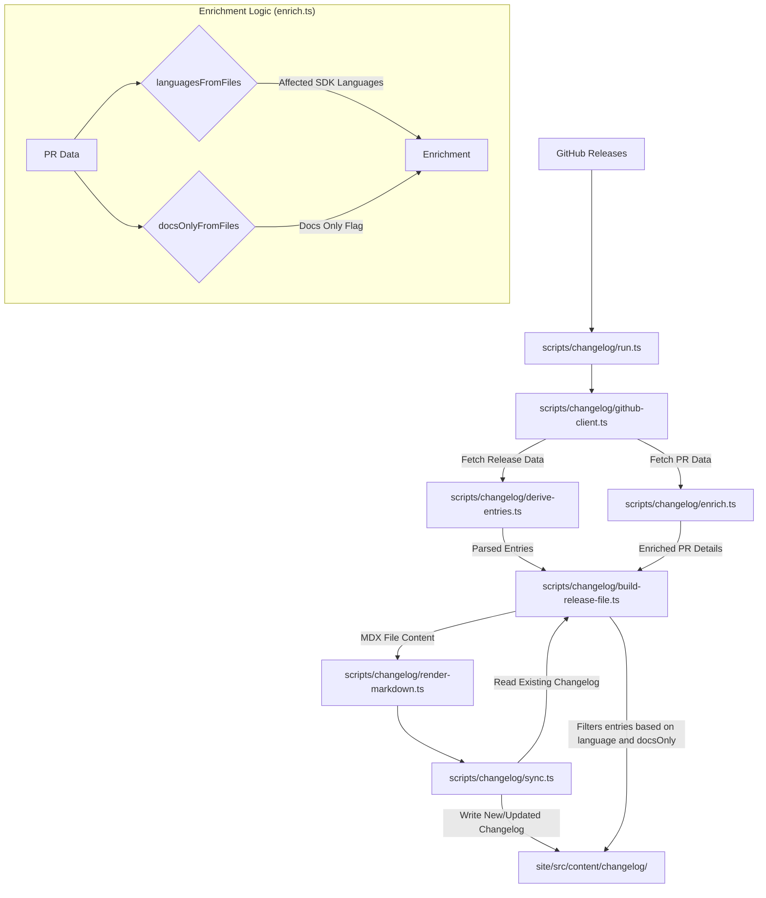

<!-- source: DeepWiki mcp.deepwiki.com · repo strands-agents/sdk-python · page 10.2 Content Authoring and Code Snippets · fetched 2026-10-27 -->

# Content Authoring and Code Snippets

<details>
<summary>Relevant source files</summary>

The following files were used as context for generating this wiki page:

- [.agents/references/mdx-authoring.md](.agents/references/mdx-authoring.md)
- [site/AGENTS.md](site/AGENTS.md)
- [site/scripts/changelog/build-release-file.ts](site/scripts/changelog/build-release-file.ts)
- [site/scripts/changelog/derive-entries.ts](site/scripts/changelog/derive-entries.ts)
- [site/scripts/changelog/enrich.ts](site/scripts/changelog/enrich.ts)
- [site/scripts/changelog/github-client.ts](site/scripts/changelog/github-client.ts)
- [site/scripts/changelog/parse-release-body.ts](site/scripts/changelog/parse-release-body.ts)
- [site/scripts/changelog/render-markdown.ts](site/scripts/changelog/render-markdown.ts)
- [site/scripts/changelog/run.ts](site/scripts/changelog/run.ts)
- [site/scripts/changelog/sync.ts](site/scripts/changelog/sync.ts)
- [site/src/components/overrides/MarkdownContent.astro](site/src/components/overrides/MarkdownContent.astro)
- [site/src/config/navigation.yml](site/src/config/navigation.yml)
- [site/src/content.config.ts](site/src/content.config.ts)
- [site/src/content/authors.yaml](site/src/content/authors.yaml)
- [site/src/content/blog/inside-agentic-football-cup.mdx](site/src/content/blog/inside-agentic-football-cup.mdx)
- [site/src/content/blog/introducing-harness-optimizer.mdx](site/src/content/blog/introducing-harness-optimizer.mdx)
- [site/src/content/blog/multimodal-evaluators-mllm-as-a-judge-image-to-text-strands-evals.mdx](site/src/content/blog/multimodal-evaluators-mllm-as-a-judge-image-to-text-strands-evals.mdx)
- [site/src/content/blog/resources/harness-optimizer/benchmark-results.png](site/src/content/blog/resources/harness-optimizer/benchmark-results.png)
- [site/src/content/catalog/strands-github-storage.yaml](site/src/content/catalog/strands-github-storage.yaml)
- [site/src/content/docs/contribute/contributing/extensions.mdx](site/src/content/docs/contribute/contributing/extensions.mdx)
- [site/src/content/docs/contribute/index.mdx](site/src/content/docs/contribute/index.mdx)
- [site/src/content/docs/examples/README.mdx](site/src/content/docs/examples/README.mdx)
- [site/src/content/docs/examples/python/agents_workflows.mdx](site/src/content/docs/examples/python/agents_workflows.mdx)
- [site/src/content/docs/examples/python/file_operations.mdx](site/src/content/docs/examples/python/file_operations.mdx)
- [site/src/content/docs/integrations/storage/github.mdx](site/src/content/docs/integrations/storage/github.mdx)
- [site/src/plugins/remark-mkdocs-snippets.ts](site/src/plugins/remark-mkdocs-snippets.ts)
- [site/src/util/integration-content.ts](site/src/util/integration-content.ts)
- [site/test/changelog/build-release-file.test.ts](site/test/changelog/build-release-file.test.ts)
- [site/test/changelog/enrich.test.ts](site/test/changelog/enrich.test.ts)
- [site/test/languages-schema.test.ts](site/test/languages-schema.test.ts)

</details>


This page details the conventions and tools used for authoring content on the Strands Agents SDK documentation site. It covers MDX authoring patterns, how code snippets are managed and included, the structure of the integration catalog, and the automated changelog synchronization process.

## MDX Authoring Conventions

The documentation site uses Astro with Starlight and MDX for content authoring. This allows for a combination of Markdown syntax with JSX components, enabling rich and interactive documentation.

### Auto-Imported Components: `Tabs`, `Tab`, and `Syntax`

The `<Tabs>`, `<Tab>`, and `<Syntax>` components are globally available in MDX files, meaning they do not require explicit import statements [site/.agents/references/mdx-authoring.md:6-6]().

*   **`<Tabs>` and `<Tab>`**: Used for presenting content that varies by language (Python/TypeScript) or other categories. Tabs with matching labels automatically synchronize across the page [site/.agents/references/mdx-authoring.md:7-8]().

    ```mdx
    <Tabs>
      <Tab label="Python">
        ```python
        from strands import Agent
        agent = Agent(tools=[my_tool])
        ```
      </Tab>
      <Tab label="TypeScript">
        ```typescript
        --8<-- "user-guide/concepts/agents/example.ts:basic_agent"
        ```
      </Tab>
    </Tabs>
    ```
    Sources: [site/.agents/references/mdx-authoring.md:9-22]()

*   **`<Syntax>`**: Designed for referencing language-specific identifiers (method names, parameters, class names, short expressions) within prose [site/.agents/references/mdx-authoring.md:24-27](). It renders as inline `<code>` by default and reacts live to the global language toggle without requiring a page reload [site/.agents/references/mdx-authoring.md:32-33]().

    ```mdx
    Use <Syntax py=".as_tool()" ts=".asTool()" /> to customize the tool name.
    The <Syntax py="Agent.retry_strategy" ts="Agent.retryStrategy" /> parameter controls retry behavior.
    ```
    Sources: [site/.agents/references/mdx-authoring.md:28-31]()

    **When to use `<Syntax>` vs `<Tabs>`**:
    *   `<Syntax>`: For single identifiers or short expressions that differ by language, embedded within a prose sentence [site/.agents/references/mdx-authoring.md:35-36]().
    *   `<Tabs>`: For code blocks, multi-line examples, or content that is structurally different between languages [site/.agents/references/mdx-authoring.md:37-38]().

    Authors should use `<Syntax>` instead of manually spelling out both language variants in prose [site/.agents/references/mdx-authoring.md:40-40]().

### Callout Syntax

Starlight-native admonitions (`:::note`, `:::tip`, `:::caution`, `:::danger`) are available but should be used sparingly due to their visual prominence [site/.agents/references/mdx-authoring.md:101-103]().

*   `:::note`: For non-actionable context or clarifications [site/.agents/references/mdx-authoring.md:106-107]().
*   `:::tip`: For optional improvements or shortcuts [site/.agents/references/mdx-authoring.md:108-109]().
*   `:::caution`: For non-obvious gotchas or costs, especially when failure is silent or hard to diagnose [site/.agents/references/mdx-authoring.md:110-112]().
*   `:::danger`: Reserved for actions that destroy work, lose data, or have no recovery path [site/.agents/references/mdx-authoring.md:113-114]().

    ```markdown
    :::note[Optional Title]
    Informational content.
    :::

    :::tip
    Helpful suggestion.
    :::

    :::caution
    Proceed carefully.
    :::

    :::danger[Breaking Change]
    This will break existing code.
    :::
    ```
    Sources: [site/.agents/references/mdx-authoring.md:112-128]()

### Frontmatter Schema

Each MDX page requires `title` and `description` in its frontmatter [site/.agents/references/mdx-authoring.md:135-138](). Optional fields like `languages`, `community`, `experimental`, `integrationType`, `category`, `redirectFrom`, `tags`, and `sourceLinks` are validated by Zod in `site/src/content.config.ts` [site/.agents/references/mdx-authoring.md:141-153](). These fields drive contextual banners and other site features [site/src/components/overrides/MarkdownContent.astro:23-30]().

It's important not to set `languages: [python, typescript]` as listing all supported languages is redundant; the field should be omitted when a feature is available in all languages [site/.agents/references/mdx-authoring.md:156-157]().

Sources: [site/.agents/references/mdx-authoring.md:131-157]()

## Code Snippet Inclusion with `remark-mkdocs-snippets`

The documentation uses the `remark-mkdocs-snippets` plugin to include code snippets from runnable source files directly into MDX pages [site/.agents/references/mdx-authoring.md:46-47](). This ensures that code examples are always up-to-date and runnable.

### `--8<--` Directive

The core of snippet inclusion is the `--8<--` directive, which references named regions within source files [site/.agents/references/mdx-authoring.md:47-48](). Paths within this directive are resolved relative to `site/src/content/docs/` [site/.agents/references/mdx-authoring.md:97-97]().

**Snippet Structure**:
1.  **Imports file**: A sibling `*_imports.ts` file contains import statements, with each import set wrapped in `[start:name_imports]` and `[end:name_imports]` markers [site/.agents/references/mdx-authoring.md:48-54]().
2.  **Body file**: The main `.ts` or `.py` file contains the runnable code, with the snippet body wrapped in `[start:name]` and `[end:name]` markers [site/.agents/references/mdx-authoring.md:61-66](). For TypeScript, snippet bodies are often wrapped in functions for scoping [site/.agents/references/mdx-authoring.md:50-50]().
3.  **MDX page**: Both the imports and the body are pulled into a *single* code block using two `--8<--` directives, separated by a blank line [site/.agents/references/mdx-authoring.md:73-81](). This presents a continuous, copy-pasteable code example to the reader.

    ```typescript
    // traces_imports.ts
    // --8<-- [start:code_configuration_option1_imports]
    import { Agent } from '@strands-agents/sdk'
    // --8<-- [end:code_configuration_option1_imports]
    ```
    Sources: [site/.agents/references/mdx-authoring.md:55-59]()

    ```typescript
    // traces.ts
    async function codeConfigurationOption1() {
      // --8<-- [start:code_configuration_option1]
      const agent = new Agent({
        systemPrompt: 'You are a helpful AI assistant',
      })
      // --8<-- [end:code_configuration_option1]
    }
    ```
    Sources: [site/.agents/references/mdx-authoring.md:62-69]()

    ````markdown
    ```typescript
    --8<-- "user-guide/observability-evaluation/traces_imports.ts:code_configuration_option1_imports"

    --8<-- "user-guide/observability-evaluation/traces.ts:code_configuration_option1"
    ```
    ````
    Sources: [site/.agents/references/mdx-authoring.md:77-81]()

    **Important**: Each include should *not* be wrapped in its own fence, as this creates disconnected code blocks [site/.agents/references/mdx-authoring.md:85-95]().

### Dedenting and Markers

The `remark-mkdocs-snippets` plugin automatically handles dedenting of the included code. The `[start:...]` and `[end:...]` markers define the exact region of code to be included.

### TypeScript Snippet Scoping

When a TypeScript file contains multiple snippets that might use the same variable names, each snippet body should be wrapped in a function. The `[start:...]` and `[end:...]` markers are placed *inside* these functions to ensure proper scoping and prevent variable conflicts [site/.agents/references/mdx-authoring.md:160-162]().

Sources: [site/.agents/references/mdx-authoring.md:46-97]()

## Integration Catalog YAML Format

The integration catalog, located under `site/src/content/catalog/`, uses a YAML format to define entries for various integrations like model providers, tools, and session managers [site/src/content/catalog/strands-github-storage.yaml](). Each entry is validated against the `catalogEntrySchema` defined in `site/src/content.config.ts` [site/src/content.config.ts:105-162]().

The `catalogEntrySchema` ensures consistency and correctness of integration metadata:
*   `name`: Display name of the integration.
*   `description`: A brief summary.
*   `integrationType`: Categorizes the integration (e.g., `model-provider`, `tool`, `session-manager`) [site/src/content.config.ts:111-121](). This field is kept in sync with `IntegrationType` in `site/src/util/integration-content.ts` [site/src/util/integration-content.ts:13-22]().
*   `sdk`: Specifies which SDK's ecosystem the integration belongs to (`agents` or `evals`) [site/src/content.config.ts:123-124]().
*   `languages`: An object specifying Python and TypeScript support. Each language can optionally define a `package` name as published on PyPI or npm [site/src/content.config.ts:127-132](). An empty block (`python: {}`) indicates support without a specific installable package [site/src/content.config.ts:90-93]().
*   `github`: A URL to the integration's GitHub repository [site/src/content.config.ts:136-136]().
*   `docsPage`: An optional internal docs collection ID (e.g., `docs/integrations/tools/strands-deepgram`) [site/src/content.config.ts:138-139]().
*   `docsUrl`: An optional external URL to the integration's own setup instructions [site/src/content.config.ts:141-144]().
*   `featured`: A boolean indicating if the integration should be featured [site/src/content.config.ts:146-146]().
*   `badges`: An array of badges (e.g., `verified`) [site/src/content.config.ts:147-147]().
*   `addedDate`: The date the integration was added, used for the "New" badge [site/src/content.config.ts:149-149]().

The schema includes `superRefine` checks to ensure logical consistency, such as requiring at least one language block and preventing `evals` SDK entries from specifying a language [site/src/content.config.ts:154-162]().

```mermaid
graph TD
    A[MDX Page Frontmatter] --> B{Zod Validation in content.config.ts}
    B -- docsSchema --> C[Starlight Docs Collection]
    B -- catalogEntrySchema --> D[Catalog Collection]
    B -- changelogFrontmatterSchema --> E[Changelog Collection]

    subgraph "content.config.ts"
        direction LR
        ZodSchema[z.object({...})]
        docsLanguagesSchema[docsLanguagesSchema]
        catalogEntrySchema[catalogEntrySchema]
        changelogFrontmatterSchema[changelogFrontmatterSchema]
    end

    subgraph "site/src/content/"
        direction LR
        DocsContent[docs/]
        CatalogContent[catalog/]
        ChangelogContent[changelog/]
    end

    A -- "languages field" --> docsLanguagesSchema
    CatalogYAML[catalog/*.yaml] --> catalogEntrySchema
    ChangelogMDX[changelog/*.md] --> changelogFrontmatterSchema

    docsLanguagesSchema -- "Validates language support" --> DocsContent
    catalogEntrySchema -- "Validates integration metadata" --> CatalogContent
    changelogFrontmatterSchema -- "Validates release metadata" --> ChangelogContent

    C -- "Renders contextual banners" --> F[MarkdownContent.astro]
    D -- "Populates /integrations page" --> G[integrations.astro]
    E -- "Generates changelog pages" --> H[Changelog Page]
```
**Diagram: Content Schema Validation Flow**
Sources: [site/src/content.config.ts:1-162](), [site/src/util/integration-content.ts:13-22](), [site/src/components/overrides/MarkdownContent.astro:10-30]()

## Changelog Sync Pipeline

The changelog is automatically synchronized from GitHub releases to MDX files in `site/src/content/changelog/`. This process involves several scripts that parse release information, enrich it with PR details, and render it into a structured Markdown format.

### Pipeline Overview

1.  **`run.ts`**: The entry point for the changelog sync, orchestrating the entire process.
2.  **`github-client.ts`**: Handles API calls to GitHub to fetch release and pull request data.
3.  **`derive-entries.ts`**: Extracts changelog entries from GitHub release bodies or compare APIs.
4.  **`enrich.ts`**: Enriches each entry with additional details from its corresponding Pull Request (PR), such as `area-*` labels, breaking change flags, commit SHAs, author, and affected SDK languages [site/scripts/changelog/enrich.ts:1-5]().
    *   **Language Detection**: Determines affected SDK languages by inspecting changed file paths. `strands-py/` indicates Python, `strands-ts/` indicates TypeScript [site/scripts/changelog/enrich.ts:11-14](). Root `package-lock.json` changes are attributed to TypeScript [site/scripts/changelog/enrich.ts:20-22]().
    *   **`docsOnly` Flag**: A PR is marked `docsOnly` if all changed files are under `site/`, `docs/`, or are top-level documentation files (e.g., `README.md`, `AGENTS.md`) [site/scripts/changelog/enrich.ts:28-55]().
5.  **`build-release-file.ts`**: Constructs the final MDX file content for a given release. It filters entries based on the release stream's language and the `docsOnly` flag [site/scripts/changelog/build-release-file.ts:45-54]().
6.  **`render-markdown.ts`**: Renders the structured release data into Markdown format.
7.  **`sync.ts`**: Manages the overall synchronization, including reading existing changelog files and merging new entries while preserving existing content [site/scripts/changelog/build-release-file.ts:100-100]().

### Data Flow


**Diagram: Changelog Sync Pipeline**
Sources: [site/scripts/changelog/run.ts](), [site/scripts/changelog/github-client.ts](), [site/scripts/changelog/derive-entries.ts](), [site/scripts/changelog/enrich.ts](), [site/scripts/changelog/build-release-file.ts](), [site/scripts/changelog/render-markdown.ts](), [site/scripts/changelog/sync.ts]()

### Monorepo Stream Filtering

For monorepo releases (e.g., `python/vX.Y.Z` or `typescript/vX.Y.Z`), the `buildReleaseFile` function filters changelog entries. An entry is dropped from a stream if:
*   It is marked as `docsOnly` [site/scripts/changelog/build-release-file.ts:49-49]().
*   It explicitly touches only the *other* SDK language (e.g., a TypeScript-only PR appearing in the Python stream) [site/scripts/changelog/build-release-file.ts:50-54]().
Entries with empty or unknown language signals are *kept*, as they might represent pre-monorepo changes or changes to shared infrastructure [site/scripts/changelog/build-release-file.ts:52-54]().

Sources: [site/scripts/changelog/build-release-file.ts:45-54](), [site/scripts/changelog/enrich.ts:103-122](), [site/test/changelog/build-release-file.test.ts:113-167](), [site/test/changelog/enrich.test.ts:99-119]()

---

