<!-- source: DeepWiki mcp.deepwiki.com · repo strands-agents/sdk-python · page 2 Agent System · fetched 2026-10-27 -->

# Agent System

<details>
<summary>Relevant source files</summary>

The following files were used as context for generating this wiki page:

- [strands-py/src/strands/agent/agent.py](strands-py/src/strands/agent/agent.py)
- [strands-py/src/strands/event_loop/event_loop.py](strands-py/src/strands/event_loop/event_loop.py)
- [strands-py/tests/strands/event_loop/test_event_loop.py](strands-py/tests/strands/event_loop/test_event_loop.py)
- [strands-py/tests/strands/event_loop/test_event_loop_metadata.py](strands-py/tests/strands/event_loop/test_event_loop_metadata.py)
- [strands-py/tests/strands/event_loop/test_event_loop_structured_output.py](strands-py/tests/strands/event_loop/test_event_loop_structured_output.py)
- [strands-ts/src/agent/__tests__/agent.hook.test.ts](strands-ts/src/agent/__tests__/agent.hook.test.ts)
- [strands-ts/src/agent/__tests__/agent.model-retry.test.ts](strands-ts/src/agent/__tests__/agent.model-retry.test.ts)
- [strands-ts/src/agent/__tests__/agent.test.ts](strands-ts/src/agent/__tests__/agent.test.ts)
- [strands-ts/src/agent/agent.ts](strands-ts/src/agent/agent.ts)
- [strands-ts/src/conversation-manager/__tests__/null-conversation-manager.test.ts](strands-ts/src/conversation-manager/__tests__/null-conversation-manager.test.ts)
- [strands-ts/src/hooks/__tests__/events.test.ts](strands-ts/src/hooks/__tests__/events.test.ts)
- [strands-ts/src/hooks/events.ts](strands-ts/src/hooks/events.ts)
- [strands-ts/src/index.ts](strands-ts/src/index.ts)
- [strands-ts/src/types/agent.ts](strands-ts/src/types/agent.ts)
- [strands-ts/src/types/messages.ts](strands-ts/src/types/messages.ts)

</details>


The Agent system is the central orchestrator of the Strands Agents SDK, coordinating interactions between language models, tools, conversation history, and extensibility mechanisms. This page provides an overview of the Agent's architecture, lifecycle, and core responsibilities across both Python and TypeScript implementations.

For detailed information about specific subsystems, see:
- [Agent Class and Initialization](#2.1)
- [Event Loop and Execution Flow](#2.2)
- [Streaming Responses](#2.3)
- [Conversation Management](#2.4)
- [Agent State and Session Management](#2.5)
- [Error Handling and Recovery](#2.6)

Sources: [strands-py/src/strands/agent/agent.py:1-111](), [strands-ts/src/agent/agent.ts:125-177]()

## Core Architecture

The `Agent` class serves as the main entry point for all SDK interactions. It delegates specialized responsibilities to subsystems while maintaining overall execution control. The architecture is consistent across Python and TypeScript, using a common set of abstractions.

### Agent System Components
Title: Agent Architecture and Code Entities

```mermaid
graph TB
    Agent["Agent<br/>(strands-ts/src/agent/agent.ts:166)"]
    
    subgraph "Model Layer"
        model["model: Model<br/>(strands-ts/src/models/model.ts:32)"]
    end
    
    subgraph "Conversation State"
        messages["messages: Message[]<br/>(strands-ts/src/types/messages.ts:70)"]
        system_prompt["systemPrompt: SystemPrompt"]
        state["appState: StateStore<br/>(strands-ts/src/state-store.ts:12)"]
    end
    
    subgraph "Tool Management"
        tool_registry["toolRegistry: ToolRegistry<br/>(strands-ts/src/registry/tool-registry.ts:36)"]
        tool_executor["toolExecutor: ToolExecutor<br/>(ConcurrentToolExecutor, SequentialToolExecutor)"]
        tool_caller["tool: ToolCallerProxy<br/>(strands-ts/src/agent/tool-caller.ts:95)"]
    end
    
    subgraph "Extensibility"
        hooks["hooks: HookRegistry<br/>(strands-ts/src/hooks/registry.ts:52)"]
        middleware["middleware: MiddlewareRegistry<br/>(strands-ts/src/middleware/index.ts:54)"]
        plugins["plugins: PluginRegistry<br/>(strands-ts/src/plugins/registry.ts:44)"]
    end
    
    subgraph "Execution Control"
        conversation_manager["conversationManager:<br/>ConversationManager"]
        retry_strategy["retryStrategy:<br/>RetryStrategy"]
        interrupt_state["interruptState:<br/>InterruptState"]
    end
    
    subgraph "Observability"
        tracer["tracer: Tracer<br/>(strands-ts/src/telemetry/tracer.ts:102)"]
        metrics["metrics: AgentMetrics<br/>(strands-ts/src/telemetry/meter.ts:103)"]
    end
    
    Agent --> model
    Agent --> messages
    Agent --> state
    Agent --> tool_registry
    Agent --> tool_executor
    Agent --> tool_caller
    Agent --> hooks
    Agent --> middleware
    Agent --> plugins
    Agent --> conversation_manager
    Agent --> retry_strategy
    Agent --> interrupt_state
    Agent --> tracer
    Agent --> metrics
```


**Component Responsibilities:**

| Component | Purpose | Python Reference | TypeScript Reference |
|-----------|---------|------------------|----------------------|
| `model` | LLM Provider | `Model` [strands-py/src/strands/models/model.py:66]() | `Model` [strands-ts/src/models/model.ts:32]() |
| `messages` | History | `Messages` [strands-py/src/strands/types/content.py:87]() | `Message[]` [strands-ts/src/types/messages.ts:84]() |
| `tool_registry` | Tool Store | `ToolRegistry` [strands-py/src/strands/tools/registry.py:79]() | `ToolRegistry` [strands-ts/src/registry/tool-registry.ts:36]() |
| `hooks` | Events | `HookRegistry` [strands-py/src/strands/hooks/registry.py:57]() | `HookRegistry` [strands-ts/src/hooks/registry.ts:52]() |
| `middleware` | Interception | `MiddlewareRegistry` [strands-py/src/strands/_middleware/__init__.py:47]() | `MiddlewareRegistry` [strands-ts/src/middleware/index.ts:54]() |
| `state` | Durable State | `AgentState` [strands-py/src/strands/agent/state.py:104]() | `StateStore` [strands-ts/src/state-store.ts:12]() |

Sources: [strands-ts/src/agent/agent.ts:1-160](), [strands-py/src/strands/agent/agent.py:166-332]()

## Execution Lifecycle

The Agent's execution follows a predictable lifecycle from invocation through response generation, managed by a central event loop.

Title: Natural Language to Code Execution Flow
```mermaid
sequenceDiagram
    participant User as "User Input (Natural Language)"
    participant Agent as "Agent.invoke() / stream()"
    participant Loop as "event_loop_cycle() (strands-py/src/strands/event_loop/event_loop.py:186)"
    participant Hooks as "HookRegistry (Events)"
    participant Model as "Model.stream() (LLM Provider)"
    participant Tools as "ToolExecutor (Code Execution)"
    
    User->>Agent: "Analyze this data"
    Agent->>Hooks: BeforeInvocationEvent
    Agent->>Loop: Run Cycle
    
    Loop->>Hooks: BeforeModelCallEvent
    Loop->>Model: Invoke LLM
    Model-->>Loop: StreamEvents (Deltas)
    Loop->>Hooks: AfterModelCallEvent
    
    alt Tool Use Requested
        Loop->>Hooks: BeforeToolsEvent
        Loop->>Tools: execute(ToolUseBlock)
        Tools-->>Loop: ToolResultBlock
        Loop->>Hooks: AfterToolsEvent
        Loop->>Loop: Recurse (Next Cycle)
    else Final Response
        Loop-->>Agent: EventLoopStopEvent
    end
    
    Agent->>Hooks: AfterInvocationEvent
    Agent-->>User: "Here is the analysis..."
```

**Key Execution Methods:**
- **`Agent.invoke()` / `invoke_async()`**: Collects all streaming events and returns a final `AgentResult` [strands-py/src/strands/agent/agent.py:465]().
- **`Agent.stream()` / `stream_async()`**: Yields events (deltas, tool calls, etc.) as they occur [strands-ts/src/agent/agent.ts:688]().
- **`event_loop_cycle()`**: The core logic that orchestrates a single turn of model inference and tool execution [strands-py/src/strands/event_loop/event_loop.py:186]().

Sources: [strands-py/src/strands/agent/agent.py:418-876](), [strands-ts/src/agent/agent.ts:688-797](), [strands-py/src/strands/event_loop/event_loop.py:186-210]()

## Subsystem Overviews

### Agent Class and Initialization
The `Agent` class is initialized with a `model`, optional `tools`, `system_prompt`, and `plugins`. It supports concurrency control via an internal lock and `ConcurrentInvocationMode` [strands-py/src/strands/types/agent.py:83](). For details, see [Agent Class and Initialization](#2.1).

### Event Loop and Execution Flow
The event loop manages the "Reasoning Loop". It handles recursion (via `recurse_event_loop`), validates execution limits (turns, tokens), and executes middleware stages like `InvokeModelStage` [strands-ts/src/middleware/index.ts:54](). For details, see [Event Loop and Execution Flow](#2.2).

### Streaming Responses
The SDKs provide a unified streaming interface. `AgentStreamEvent` wraps model deltas, tool starts, and final results [strands-ts/src/types/agent.ts:202](). For details, see [Streaming Responses](#2.3).

### Conversation Management
`ConversationManager` implementations (e.g., `SlidingWindowConversationManager`) control the context window by pruning or summarizing history [strands-ts/src/conversation-manager/sliding-window-conversation-manager.ts:45](). For details, see [Conversation Management](#2.4).

### Agent State and Session Management
Agents can persist state across sessions using `SessionManager` [strands-py/src/strands/session/session_manager.py:72](). This includes the conversation history and the `AgentState` key-value store. For details, see [Agent State and Session Management](#2.5).

### Error Handling and Recovery
The system includes specialized exceptions like `ContextWindowOverflowException` and `ModelThrottledException` [strands-ts/src/errors.ts:32](). It uses `RetryStrategy` to handle transient failures. For details, see [Error Handling and Recovery](#2.6).

Sources: [strands-ts/src/agent/agent.ts:45-54](), [strands-py/src/strands/agent/agent.py:92-104](), [strands-ts/src/types/agent.ts:58-180]()

---

