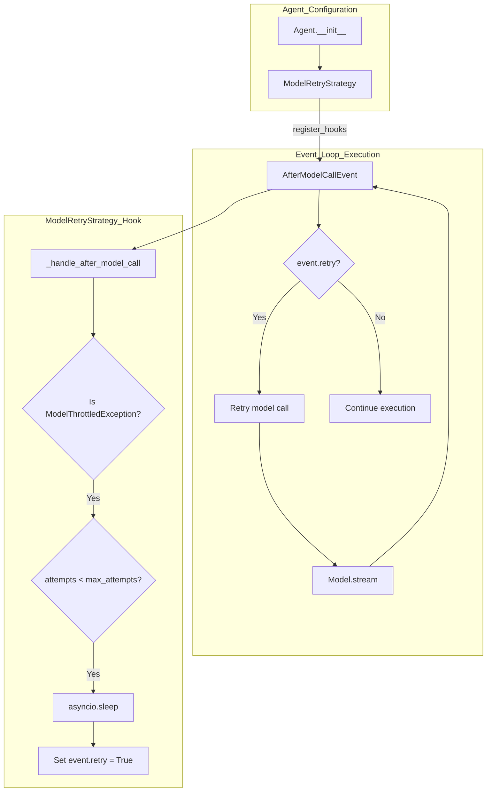
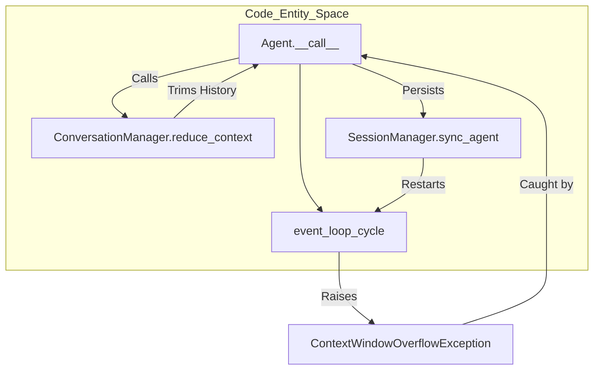
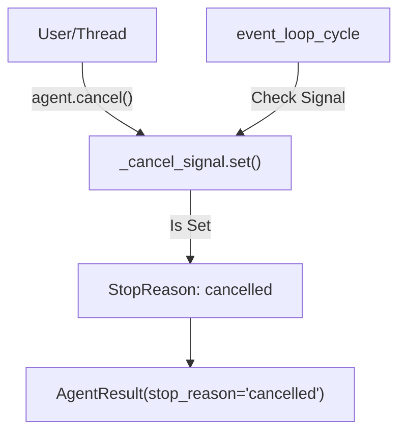
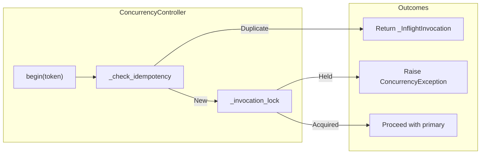

<!-- source: DeepWiki mcp.deepwiki.com · repo strands-agents/sdk-python · page 2.6 Error Handling and Recovery · fetched 2026-10-27 -->

# Error Handling and Recovery

<details>
<summary>Relevant source files</summary>

The following files were used as context for generating this wiki page:

- [site/src/content/docs/user-guide/concepts/agents/prompts.mdx](site/src/content/docs/user-guide/concepts/agents/prompts.mdx)
- [site/src/content/docs/user-guide/concepts/agents/retry-strategies.mdx](site/src/content/docs/user-guide/concepts/agents/retry-strategies.mdx)
- [site/src/content/docs/user-guide/concepts/agents/snapshots.mdx](site/src/content/docs/user-guide/concepts/agents/snapshots.mdx)
- [site/src/content/docs/user-guide/concepts/agents/state.mdx](site/src/content/docs/user-guide/concepts/agents/state.mdx)
- [site/src/content/docs/user-guide/concepts/agents/structured-output.mdx](site/src/content/docs/user-guide/concepts/agents/structured-output.mdx)
- [site/src/content/docs/user-guide/concepts/model-providers/google.mdx](site/src/content/docs/user-guide/concepts/model-providers/google.mdx)
- [site/src/content/docs/user-guide/concepts/multi-agent/agents-as-tools.mdx](site/src/content/docs/user-guide/concepts/multi-agent/agents-as-tools.mdx)
- [site/src/content/docs/user-guide/safety-security/trusted-message-history.mdx](site/src/content/docs/user-guide/safety-security/trusted-message-history.mdx)
- [strands-py/src/strands/__init__.py](strands-py/src/strands/__init__.py)
- [strands-py/src/strands/agent/_concurrency.py](strands-py/src/strands/agent/_concurrency.py)
- [strands-py/src/strands/agent/agent.py](strands-py/src/strands/agent/agent.py)
- [strands-py/src/strands/event_loop/_retry.py](strands-py/src/strands/event_loop/_retry.py)
- [strands-py/src/strands/event_loop/event_loop.py](strands-py/src/strands/event_loop/event_loop.py)
- [strands-py/src/strands/storage/__init__.py](strands-py/src/strands/storage/__init__.py)
- [strands-py/src/strands/tools/_caller.py](strands-py/src/strands/tools/_caller.py)
- [strands-py/src/strands/types/exceptions.py](strands-py/src/strands/types/exceptions.py)
- [strands-py/tests/strands/agent/test_agent.py](strands-py/tests/strands/agent/test_agent.py)
- [strands-py/tests/strands/agent/test_agent_retry.py](strands-py/tests/strands/agent/test_agent_retry.py)
- [strands-py/tests/strands/agent/test_concurrency.py](strands-py/tests/strands/agent/test_concurrency.py)
- [strands-py/tests/strands/agent/test_retry.py](strands-py/tests/strands/agent/test_retry.py)
- [strands-py/tests/strands/event_loop/test_event_loop.py](strands-py/tests/strands/event_loop/test_event_loop.py)
- [strands-py/tests/strands/event_loop/test_event_loop_metadata.py](strands-py/tests/strands/event_loop/test_event_loop_metadata.py)
- [strands-py/tests/strands/event_loop/test_event_loop_structured_output.py](strands-py/tests/strands/event_loop/test_event_loop_structured_output.py)
- [strands-py/tests/strands/storage/__init__.py](strands-py/tests/strands/storage/__init__.py)
- [strands-py/tests/strands/storage/test_in_memory_storage.py](strands-py/tests/strands/storage/test_in_memory_storage.py)
- [strands-py/tests/strands/storage/test_local_file_storage.py](strands-py/tests/strands/storage/test_local_file_storage.py)

</details>


This document describes the exception types, retry mechanisms, and error recovery patterns in the Strands Agents SDK. The SDK provides built-in error handling for common failure modes (throttling, context limits, tool failures) and extensibility through hook-based retry strategies.

For information about conversation management and context window limits, see [Conversation Management](2.4). For tool execution errors, see [Tool Execution Strategies](4.3).

## Exception Types

The SDK defines specific exception types for different failure scenarios during agent execution.

### Core Exception Hierarchy

The following diagram illustrates the relationship between the base `Exception` and the specialized SDK exceptions.

**Exception Class Relationships**

```mermaid
graph TB
    Exception["Exception"]
    EventLoopException["EventLoopException<br/>Wraps errors during event loop"]
    ContextWindowOverflowException["ContextWindowOverflowException<br/>Input exceeds model context limit"]
    ModelThrottledException["ModelThrottledException<br/>Rate limiting by model provider"]
    MaxTokensReachedException["MaxTokensReachedException<br/>Model hit max_tokens limit"]
    StructuredOutputException["StructuredOutputException<br/>Structured output tool failed"]
    ConcurrencyException["ConcurrencyException<br/>Concurrent invocations attempted"]
    SessionException["SessionException<br/>Session operation failure"]
    CheckpointException["CheckpointException<br/>Checkpoint operation failure"]
    
    Exception --> EventLoopException
    Exception --> ContextWindowOverflowException
    Exception --> ModelThrottledException
    Exception --> MaxTokensReachedException
    Exception --> StructuredOutputException
    Exception --> ConcurrencyException
    Exception --> SessionException
    Exception --> CheckpointException
```

**Sources:** [strands-py/src/strands/types/exceptions.py:1-172]()

| Exception Type | Description | Recovery Strategy |
|----------------|-------------|-------------------|
| `ContextWindowOverflowException` | Input messages exceed model's context window | Automatic context reduction via `ConversationManager` |
| `ModelThrottledException` | Model provider rate limiting requests | Automatic exponential backoff via `ModelRetryStrategy` |
| `MaxTokensReachedException` | Model stopped due to `max_tokens` configuration | Automatic message recovery via `recover_message_on_max_tokens_reached` |
| `EventLoopException` | Wraps unexpected errors during event loop execution | Propagates to caller with `request_state` attached |
| `StructuredOutputException` | LLM failed to invoke structured output tool after retries | Propagates to caller |
| `ConcurrencyException` | Attempted concurrent invocations on same agent instance | Propagates to caller; managed via `_ConcurrencyController` |
| `SessionException` | Failure during state persistence or session loading | Propagates to caller |
| `CheckpointException` | Failure during checkpoint operations | Propagates to caller |

**Sources:** [strands-py/src/strands/types/exceptions.py:6-141](), [strands-py/src/strands/event_loop/event_loop.py:42-47]()

## Retry Strategy Architecture

The SDK implements a flexible retry system through hooks and strategy patterns. The `ModelRetryStrategy` is the primary implementation for handling transient model errors.

**Retry Flow and Hook Interaction**

**Sources:** [strands-py/src/strands/event_loop/_retry.py:21-158](), [strands-py/src/strands/agent/agent.py:119-125]()

## ModelRetryStrategy Configuration

`ModelRetryStrategy` provides automatic exponential backoff specifically for `ModelThrottledException`.

### Initialization and Defaults

By default, an `Agent` initializes with a `ModelRetryStrategy` using constants from the event loop module: `INITIAL_DELAY=4`, `MAX_ATTEMPTS=6`, and `MAX_DELAY=240`.

```python
# Default behavior
agent = Agent()

# Custom retry parameters
from strands import ModelRetryStrategy
custom_strategy = ModelRetryStrategy(
    max_attempts=3, 
    initial_delay=2, 
    max_delay=60
)
agent = Agent(retry_strategy=custom_strategy)

# Explicitly disable retries
agent = Agent(retry_strategy=None)
```
**Sources:** [strands-py/src/strands/event_loop/event_loop.py:62-64](), [strands-py/src/strands/event_loop/_retry.py:37-55](), [strands-py/src/strands/agent/agent.py:182-192]()

### Exponential Backoff Calculation

The delay follows the formula: `delay = min(initial_delay * (2 ** attempt), max_delay)`. The state (attempt counter) is tracked within the strategy and used during `AfterModelCallEvent` processing.

**Sources:** [strands-py/src/strands/event_loop/_retry.py:68-82](), [strands-py/tests/strands/event_loop/test_event_loop.py:217-253]()

## Context Window Overflow Handling

When a model provider returns an error indicating the context limit is reached, the SDK raises a `ContextWindowOverflowException`.

**Context Recovery Data Flow**

**Sources:** [strands-py/src/strands/types/exceptions.py:41-49](), [strands-py/src/strands/agent/agent.py:1010-1025]() (implied by logic)

## Max Tokens Handling and Recovery

When a model reaches its `max_tokens` limit, the response is truncated. Strands raises a `MaxTokensReachedException` to prevent inconsistent states where a `toolUse` block might be incomplete.

### Message Recovery Utility

The function `recover_message_on_max_tokens_reached` is used to sanitize truncated messages before they are added to the conversation history.

1.  **Identification**: It iterates through `ContentBlock` items in the message.
2.  **Replacement**: Any block containing a `toolUse` is replaced with a `text` block explaining that the tool use was incomplete due to token limits.
3.  **Preservation**: Non-tool blocks (like preceding text) are preserved.

**Sources:** [strands-py/src/strands/event_loop/_recover_message_on_max_tokens_reached.py:16-71](), [strands-py/src/strands/event_loop/event_loop.py:50-50]()

## Cancellation and Interruption

The SDK supports graceful cancellation of agent execution via the `agent.cancel()` method.

### Cancellation Pattern

When `cancel()` is called, the agent sets an internal `_cancel_signal` (a `threading.Event`). The `event_loop_cycle` checks this signal at specific checkpoints.

**Cancellation Sequence**

**Sources:** [strands-py/src/strands/agent/agent.py:1164-1175](), [strands-py/src/strands/event_loop/event_loop.py:246-248]()

### Interrupt Handling

Interrupts are used for Human-in-the-Loop patterns, primarily during tool execution. If a tool execution is interrupted, the agent state is preserved via `_InterruptState`, and a `ToolInterruptEvent` is yielded.

**Sources:** [strands-py/src/strands/event_loop/event_loop.py:236-240](), [strands-py/src/strands/agent/agent.py:61-63]()

## Concurrency and Idempotency Control

The `_ConcurrencyController` manages how an `Agent` instance handles multiple simultaneous calls. It supports deduplication via caller-supplied idempotency tokens.

### ConcurrentInvocationMode

- `THROW`: Raises a `ConcurrencyException` if an invocation is already in progress (Default).
- `WAIT`: Blocks the subsequent call until the first completes.

### Idempotency Deduplication

If an `idempotency_token` is provided, duplicate callers will wait for the primary invocation to settle and return the same `AgentResult`. If the primary is aborted, waiters receive an `IdempotencyAbortedError`.

**Concurrency Management**

**Sources:** [strands-py/src/strands/agent/_concurrency.py:86-181](), [strands-py/src/strands/types/exceptions.py:118-138]()

---

