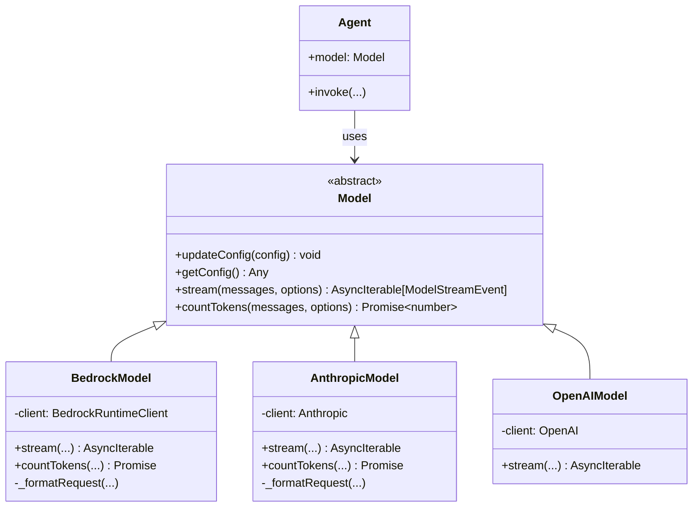
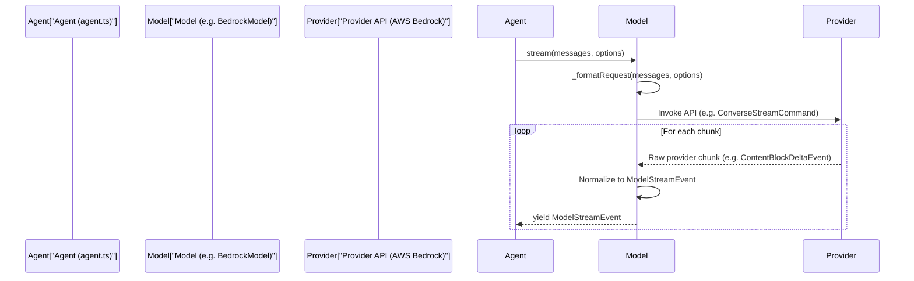

<!-- source: DeepWiki mcp.deepwiki.com · repo strands-agents/sdk-python · page 3.1 Model Provider Architecture · fetched 2026-10-27 -->

# Model Provider Architecture

<details>
<summary>Relevant source files</summary>

The following files were used as context for generating this wiki page:

- [site/src/content/docs/user-guide/concepts/model-providers/amazon-bedrock.mdx](site/src/content/docs/user-guide/concepts/model-providers/amazon-bedrock.mdx)
- [site/src/content/docs/user-guide/concepts/model-providers/anthropic.mdx](site/src/content/docs/user-guide/concepts/model-providers/anthropic.mdx)
- [site/src/content/docs/user-guide/concepts/model-providers/anthropic.ts](site/src/content/docs/user-guide/concepts/model-providers/anthropic.ts)
- [site/src/content/docs/user-guide/concepts/model-providers/anthropic_imports.ts](site/src/content/docs/user-guide/concepts/model-providers/anthropic_imports.ts)
- [strands-py/src/strands/_context_manager/modes/agentic/agentic_context.py](strands-py/src/strands/_context_manager/modes/agentic/agentic_context.py)
- [strands-py/src/strands/agent/conversation_manager/conversation_manager.py](strands-py/src/strands/agent/conversation_manager/conversation_manager.py)
- [strands-py/src/strands/models/_defaults.py](strands-py/src/strands/models/_defaults.py)
- [strands-py/src/strands/models/anthropic.py](strands-py/src/strands/models/anthropic.py)
- [strands-py/src/strands/models/bedrock.py](strands-py/src/strands/models/bedrock.py)
- [strands-py/src/strands/models/model.py](strands-py/src/strands/models/model.py)
- [strands-py/tests/strands/agent/test_conversation_manager.py](strands-py/tests/strands/agent/test_conversation_manager.py)
- [strands-py/tests/strands/agent/test_summarizing_conversation_manager.py](strands-py/tests/strands/agent/test_summarizing_conversation_manager.py)
- [strands-py/tests/strands/models/test_anthropic.py](strands-py/tests/strands/models/test_anthropic.py)
- [strands-py/tests/strands/models/test_bedrock.py](strands-py/tests/strands/models/test_bedrock.py)
- [strands-py/tests/strands/models/test_model.py](strands-py/tests/strands/models/test_model.py)
- [strands-ts/src/context-manager/modes/agentic/agentic-context.ts](strands-ts/src/context-manager/modes/agentic/agentic-context.ts)
- [strands-ts/src/conversation-manager/__tests__/conversation-manager.test.ts](strands-ts/src/conversation-manager/__tests__/conversation-manager.test.ts)
- [strands-ts/src/conversation-manager/__tests__/sliding-window-conversation-manager.test.ts](strands-ts/src/conversation-manager/__tests__/sliding-window-conversation-manager.test.ts)
- [strands-ts/src/conversation-manager/__tests__/summarizing-conversation-manager.test.ts](strands-ts/src/conversation-manager/__tests__/summarizing-conversation-manager.test.ts)
- [strands-ts/src/conversation-manager/conversation-manager.ts](strands-ts/src/conversation-manager/conversation-manager.ts)
- [strands-ts/src/conversation-manager/sliding-window-conversation-manager.ts](strands-ts/src/conversation-manager/sliding-window-conversation-manager.ts)
- [strands-ts/src/conversation-manager/summarizing-conversation-manager.ts](strands-ts/src/conversation-manager/summarizing-conversation-manager.ts)
- [strands-ts/src/models/__tests__/anthropic.test.ts](strands-ts/src/models/__tests__/anthropic.test.ts)
- [strands-ts/src/models/__tests__/bedrock.test.ts](strands-ts/src/models/__tests__/bedrock.test.ts)
- [strands-ts/src/models/__tests__/defaults.test.ts](strands-ts/src/models/__tests__/defaults.test.ts)
- [strands-ts/src/models/__tests__/google.test.ts](strands-ts/src/models/__tests__/google.test.ts)
- [strands-ts/src/models/__tests__/model.test.ts](strands-ts/src/models/__tests__/model.test.ts)
- [strands-ts/src/models/anthropic.ts](strands-ts/src/models/anthropic.ts)
- [strands-ts/src/models/bedrock.ts](strands-ts/src/models/bedrock.ts)
- [strands-ts/src/models/defaults.ts](strands-ts/src/models/defaults.ts)
- [strands-ts/src/models/google/adapters.ts](strands-ts/src/models/google/adapters.ts)
- [strands-ts/src/models/google/model.ts](strands-ts/src/models/google/model.ts)
- [strands-ts/src/models/google/types.ts](strands-ts/src/models/google/types.ts)
- [strands-ts/src/models/model.ts](strands-ts/src/models/model.ts)

</details>


## Purpose and Scope

This document describes the architecture of the model provider abstraction layer in the Strands Agents SDK. It covers the `Model` abstract base class, the `stream()` method interface, `StreamEvent` normalization, token counting (native vs. heuristic), and prompt caching strategies. For information about specific model provider implementations, see [AWS Bedrock Models](3.2), [OpenAI Models](3.3), and [LiteLLM Integration](3.4).

## Model Abstract Base Class

The `Model` class serves as the abstract interface that all model providers must implement. It defines a standardized contract for communicating with AI models, enabling the SDK to support multiple providers through a unified API.

### Code Entity Space: Model Class Hierarchy

The following diagram maps the logical architecture to the specific classes and files in the codebase.



**Sources:** [strands-ts/src/models/model.ts:150-258](), [strands-ts/src/models/bedrock.ts:262-280](), [strands-ts/src/models/anthropic.ts:87-126](), [strands-py/src/strands/models/model.py:210-258]()

### Core Methods and Properties

The `Model` abstract base class defines core methods that all implementations must provide:

| Member | Purpose | Type/Return Type |
|--------|---------|-------------|
| `updateConfig()` | Update model configuration dynamically | `void` |
| `getConfig()` | Retrieve current model configuration with resolved metadata | `BaseModelConfig` |
| `stream()` | Stream normalized events from the model | `AsyncIterable[ModelStreamEvent]` |
| `countTokens()` | Calculate input token count (native or heuristic) | `Promise<number>` |

**Sources:** [strands-ts/src/models/model.ts:150-258](), [strands-py/src/strands/models/model.py:217-258]()

## Token Counting and Estimation

The SDK provides a dual-path strategy for token counting: native API calls for accuracy and local heuristics for efficiency.

### Native vs. Heuristic Counting
- **Native Counting**: Enabled via `useNativeTokenCount: true` in config. Supported by `AnthropicModel` using the `messages.countTokens` API [strands-ts/src/models/anthropic.ts:146-170]() and `BedrockModel` using `CountTokensCommand` [strands-ts/src/models/bedrock.ts:404-436]().
- **Heuristic Estimation**: The base `Model` class provides a fallback that estimates tokens based on character counts (approx. 4 characters per token for text). [strands-ts/src/models/model.ts:246-257]()
- **Metadata Resolution**: The `resolveConfigMetadata` function automatically populates `contextWindowLimit` based on the `modelId` from a built-in lookup table if not explicitly provided. [strands-ts/src/models/model.ts:41-46](), [strands-ts/src/models/defaults.ts:62-167]()

**Sources:** [strands-ts/src/models/model.ts:41-46](), [strands-ts/src/models/anthropic.ts:62-70](), [strands-ts/src/models/bedrock.ts:404-436](), [strands-ts/src/models/defaults.ts:62-167]()

## Prompt Caching

Strands supports granular prompt caching across providers that support it (primarily Anthropic and AWS Bedrock).

### Cache Configuration
The `CacheConfig` interface allows users to define Time-To-Live (TTL) and strategies for different sections of the prompt:
- **`toolsTTL`**: Caches the tool definitions. [strands-ts/src/models/model.ts:94-98]()
- **`messagesTTL`**: Caches the conversation history up to the last user message. [strands-ts/src/models/model.ts:100-106]()
- **`ttl`**: A default TTL (e.g., `'5m'`, `'1h'`) that applies to all cache points. [strands-ts/src/models/model.ts:81-91]()

### Provider Implementation Details
- **Bedrock**: Requires non-increasing TTLs across the request (toolConfig → system → messages). Setting a longer TTL on a later checkpoint than an earlier one results in a service rejection. [strands-ts/src/models/bedrock.ts:139-144]()
- **Anthropic**: Supports `ephemeral` caching. The SDK automatically injects `cache_control` headers into formatted request blocks for text, images, and tool results. [strands-py/src/strands/models/anthropic.py:41-46]()

**Sources:** [strands-ts/src/models/model.ts:70-107](), [strands-ts/src/models/bedrock.ts:134-151](), [strands-py/src/strands/models/anthropic.py:41-46]()

## The Stream Method and Event Normalization

The `stream()` method transforms provider-specific stream chunks into a normalized `ModelStreamEvent` sequence.

### Request Flow: Code Interaction



**Sources:** [strands-ts/src/models/bedrock.ts:438-570](), [strands-ts/src/models/anthropic.ts:172-240]()

### StreamEvent Types
Normalized events ensure the `Agent` event loop can process responses consistently regardless of the backend:
- **`ModelMessageStartEvent`**: Indicates the start of an assistant response and its role. [strands-ts/src/models/streaming.ts:121-127]()
- **`ModelContentBlockDeltaEvent`**: Carries incremental updates for text, tool calls, or reasoning blocks. [strands-ts/src/models/streaming.ts:167-173]()
- **`ModelMetadataEvent`**: Provides final usage statistics (input/output tokens) and latency metrics. [strands-ts/src/models/streaming.ts:208-214]()

**Sources:** [strands-ts/src/models/streaming.ts:24-224]()

## Message Formatting Pipeline

Every provider implements an internal formatting pipeline to convert the SDK's `Message` objects into the specific schema required by the underlying API.

- **Anthropic Formatting**: Converts `document` blocks into `base64` or `text` source types and handles `thinking` blocks for reasoning models. [strands-py/src/strands/models/anthropic.py:126-193]()
- **Bedrock Formatting**: Maps SDK media types (Image, Video, Document) to Bedrock's `Converse` API structure, including support for `S3Location` sources. [strands-ts/src/models/bedrock.ts:589-730]()
- **Guardrail Integration**: `BedrockModel` supports wrapping content in `guardContent` blocks and can be configured to only evaluate the `guardrail_latest_message` to optimize costs. [strands-ts/src/models/bedrock.ts:175-200]()

**Sources:** [strands-py/src/strands/models/anthropic.py:126-193](), [strands-ts/src/models/bedrock.ts:589-730](), [strands-ts/src/models/bedrock.ts:175-200]()

## Switching Providers

The architecture allows for seamless provider switching by passing different `Model` instances to the `Agent`.

```typescript
import { Agent } from '@strands-agents/sdk'
import { BedrockModel, AnthropicModel } from '@strands-agents/sdk/models'

// Use Bedrock
const agent = new Agent({
  model: new BedrockModel({ modelId: 'anthropic.claude-3-5-sonnet-20241022-v2:0' })
})

// Switch to direct Anthropic API
agent.model = new AnthropicModel({ apiKey: 'sk-...' })
```

**Sources:** [strands-ts/src/models/bedrock.ts:262-280](), [strands-ts/src/models/anthropic.ts:87-126]()

---

