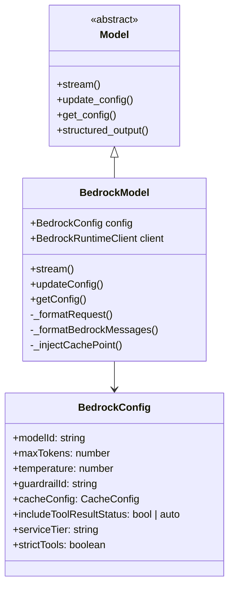
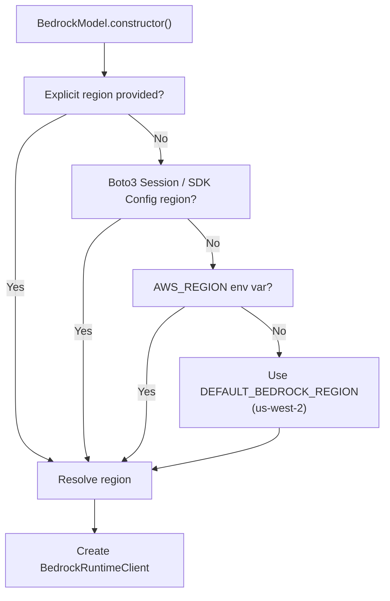

<!-- source: DeepWiki mcp.deepwiki.com · repo strands-agents/sdk-python · page 3.2 AWS Bedrock Models · fetched 2026-10-27 -->

# AWS Bedrock Models

<details>
<summary>Relevant source files</summary>

The following files were used as context for generating this wiki page:

- [site/src/content/docs/user-guide/concepts/model-providers/amazon-bedrock.mdx](site/src/content/docs/user-guide/concepts/model-providers/amazon-bedrock.mdx)
- [site/src/content/docs/user-guide/concepts/model-providers/anthropic.mdx](site/src/content/docs/user-guide/concepts/model-providers/anthropic.mdx)
- [site/src/content/docs/user-guide/concepts/model-providers/anthropic.ts](site/src/content/docs/user-guide/concepts/model-providers/anthropic.ts)
- [site/src/content/docs/user-guide/concepts/model-providers/anthropic_imports.ts](site/src/content/docs/user-guide/concepts/model-providers/anthropic_imports.ts)
- [strands-py/src/strands/models/anthropic.py](strands-py/src/strands/models/anthropic.py)
- [strands-py/src/strands/models/bedrock.py](strands-py/src/strands/models/bedrock.py)
- [strands-py/src/strands/models/model.py](strands-py/src/strands/models/model.py)
- [strands-py/tests/strands/models/test_anthropic.py](strands-py/tests/strands/models/test_anthropic.py)
- [strands-py/tests/strands/models/test_bedrock.py](strands-py/tests/strands/models/test_bedrock.py)
- [strands-ts/src/models/__tests__/anthropic.test.ts](strands-ts/src/models/__tests__/anthropic.test.ts)
- [strands-ts/src/models/__tests__/bedrock.test.ts](strands-ts/src/models/__tests__/bedrock.test.ts)
- [strands-ts/src/models/__tests__/defaults.test.ts](strands-ts/src/models/__tests__/defaults.test.ts)
- [strands-ts/src/models/__tests__/google.test.ts](strands-ts/src/models/__tests__/google.test.ts)
- [strands-ts/src/models/anthropic.ts](strands-ts/src/models/anthropic.ts)
- [strands-ts/src/models/bedrock.ts](strands-ts/src/models/bedrock.ts)
- [strands-ts/src/models/google/adapters.ts](strands-ts/src/models/google/adapters.ts)
- [strands-ts/src/models/google/model.ts](strands-ts/src/models/google/model.ts)
- [strands-ts/src/models/google/types.ts](strands-ts/src/models/google/types.ts)
- [strands-ts/src/models/model.ts](strands-ts/src/models/model.ts)

</details>


This document covers the `BedrockModel` class, which provides integration with AWS Bedrock for running foundation models. It documents configuration options, region management, prompt caching, guardrails integration, and request formatting specifics.

For general model provider architecture and the `Model` interface, see [Model Provider Architecture](3.1). For LiteLLM-based access to multiple providers, see [LiteLLM Integration](3.4).

## Overview

The `BedrockModel` class implements the `Model` interface for AWS Bedrock, enabling access to foundation models through the Bedrock Converse API. It provides Bedrock-specific features including guardrails, prompt caching, and comprehensive content block handling.

**Sources:** [strands-py/src/strands/models/bedrock.py:87-97](), [strands-ts/src/models/bedrock.ts:1-8]()

### Class Hierarchy



**Sources:** [strands-py/src/strands/models/model.py:168-174](), [strands-py/src/strands/models/bedrock.py:87-144](), [strands-ts/src/models/bedrock.ts:237-251]()

## Configuration

### BedrockConfig Options

The `BedrockConfig` defines all available configuration options for Bedrock models.

| Configuration Option | Description |
|---------------------|-------------|
| `modelId` | Bedrock model ID (e.g., "global.anthropic.claude-sonnet-4-6") |
| `maxTokens` | Maximum tokens to generate |
| `temperature` | Sampling temperature (0.0 to 1.0) |
| `cacheConfig` | Prompt caching configuration (`strategy`, `ttl`) |
| `guardrailIdentifier` | Guardrail identifier (TS) / `guardrail_id` (PY) |
| `guardrailVersion` | Guardrail version (e.g., "DRAFT" or "1") |
| `serviceTier` | Service tier: "default", "priority", or "flex" |
| `strictTools` | Enable structured output enforcement on tool definitions |
| `useNativeTokenCount`| Whether to use the native Bedrock CountTokens API |

**Sources:** [strands-py/src/strands/models/bedrock.py:99-144](), [strands-ts/src/models/bedrock.ts:150-230]()

### Initialization and Region Resolution



**Sources:** [strands-py/src/strands/models/bedrock.py:146-176](), [strands-ts/src/models/bedrock.ts:253-305]()

**Region Resolution Precedence:**
1. Explicit `region_name` (PY) / `region` (TS) parameter.
2. `boto_session.region_name` (PY) or SDK client configuration.
3. `AWS_REGION` environment variable.
4. `DEFAULT_BEDROCK_REGION` constant ("us-west-2").

**Sources:** [strands-py/src/strands/models/bedrock.py:44](), [strands-py/src/strands/models/bedrock.py:146-155](), [strands-ts/src/models/bedrock.ts:253-270]()

## Prompt Caching

Prompt caching reduces latency and cost by reusing previously processed content. Bedrock requires checkpoint TTLs to be **non-increasing** across `toolConfig` → system → messages.

### Caching Strategy

The `CacheConfig(strategy="auto")` automatically detects if a model (like Claude) supports caching and injects cache points.

| Component | Cache Behavior |
|-----------|----------------|
| **Tools** | Injected via `toolConfig` if `cache_tools` or `toolsTTL` is enabled. |
| **System** | Injected at the end of the system prompt blocks. |
| **Messages**| Injected at the end of the last assistant message. |

**Sources:** [strands-ts/src/models/bedrock.ts:134-144](), [strands-py/src/strands/models/bedrock.py:134-143](), [strands-ts/src/models/model.ts:84-90]()

### TTL Constraint
Bedrock validates that TTLs do not increase in the sequence of the prompt. If a later block has a longer TTL than an earlier one, the request is rejected with a `ValidationException`.

**Sources:** [strands-ts/src/models/bedrock.ts:139-142](), [strands-py/src/strands/models/bedrock.py:142-148]()

## Guardrails Integration

AWS Bedrock Guardrails provide content filtering. Strands integrates these into the message flow, supporting redaction and assessment of specific turns.

### Guardrail Redaction
Users can configure automatic replacement of blocked content:
- `guardrail_redact_input`: Replaces blocked user input with a placeholder (default: `[User input redacted.]`).
- `guardrail_redact_output`: Replaces blocked assistant output (default: `[Assistant output redacted.]`).

**Sources:** [strands-ts/src/models/bedrock.ts:156-168](), [strands-py/src/strands/models/bedrock.py:114-117]()

### Latest Message Assessment
The `guardrail_latest_message` flag (Python) or `latestMessageOnly` (TS logic) allows evaluating only the final user turn. This is implemented by wrapping the latest user text/image content in `guardContent` blocks.

**Sources:** [strands-py/src/strands/models/bedrock.py:118-119](), [strands-ts/src/models/bedrock.ts:191-200](), [strands-py/src/strands/models/bedrock.py:412-422]()

## Media and S3 Handling

Bedrock supports various media types. In the Python SDK, `S3Location` allows passing media stored in S3 directly to models that support it (e.g., Nova).

```python
from strands.types.media import S3Location

# Example of S3 media reference in a content block
content = [
    {
        "video": {
            "format": "mp4",
            "source": S3Location(uri="s3://my-bucket/video.mp4")
        }
    }
]
```

**Sources:** [strands-py/src/strands/models/bedrock.py:20](), [strands-py/src/strands/models/bedrock.py:488-500]()

## Implementation Details

### Llama Tool Turn Workaround
For Llama models, Bedrock's Converse API has a constraint: "Conversation blocks and tool result blocks cannot be provided in the same turn." The Python SDK includes a workaround that detects these adjacent blocks and separates them with a synthetic assistant message.

**Sources:** [strands-py/src/strands/models/bedrock.py:59-60](), [strands-py/src/strands/models/bedrock.py:336-362]()

### Token Counting
Bedrock provides a native `CountTokens` API.
- If `use_native_token_count` is `True`, the SDK calls the Bedrock API for precision.
- If `False` (default), it uses a local heuristic (approx. 4 chars per token for text).
- Failed API calls are cached in `SKIP_COUNT_TOKENS_MODELS` to avoid repeated latency on unsupported models.

**Sources:** [strands-ts/src/models/bedrock.ts:106-109](), [strands-py/src/strands/models/bedrock.py:141-143](), [strands-ts/src/models/bedrock.ts:340-365]()

### Stop Reason Normalization
Bedrock stop reasons are mapped to standard SDK reasons:
- `end_turn` → `endTurn`
- `tool_use` → `toolUse`
- `max_tokens` → `maxTokens`
- `guardrail_intervened` → `guardrailIntervened`

**Sources:** [strands-ts/src/models/bedrock.ts:114-121](), [strands-py/src/strands/models/bedrock.py:769-798]()

## Error Handling

The SDK normalizes Bedrock-specific errors into standard exceptions:
- **Throttling**: `ThrottlingException` → `ModelThrottledException`.
- **Context Overflow**: Detected via specific error message strings (e.g., "Input is too long") → `ContextWindowOverflowException`.
- **Validation**: Enriched with helpful notes for common issues like missing model access or throughput limits.

**Sources:** [strands-ts/src/models/bedrock.ts:64](), [strands-py/src/strands/models/bedrock.py:52-57](), [strands-py/src/strands/models/bedrock.py:813-852]()

---

