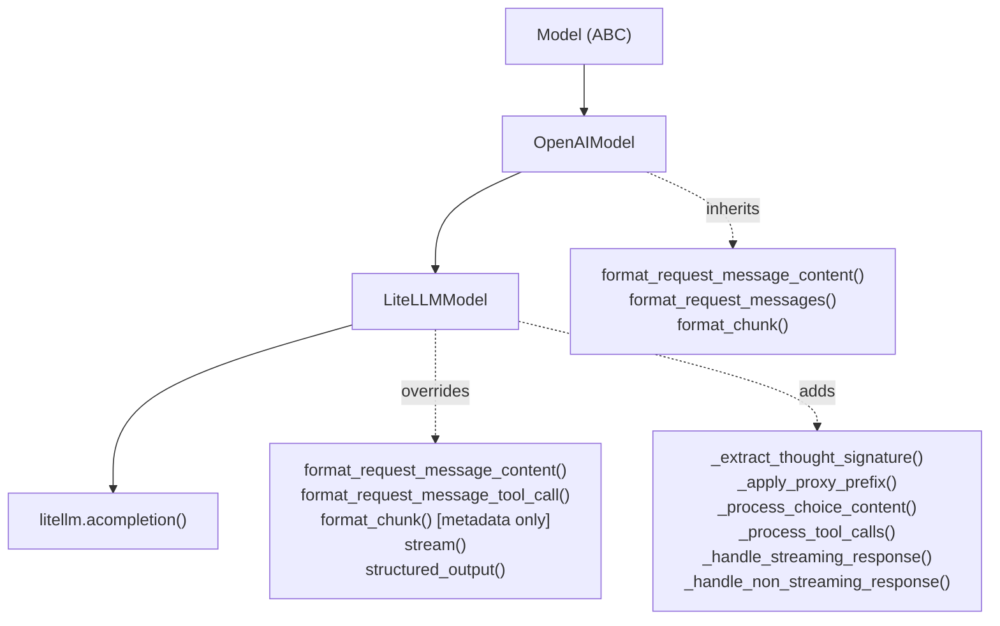
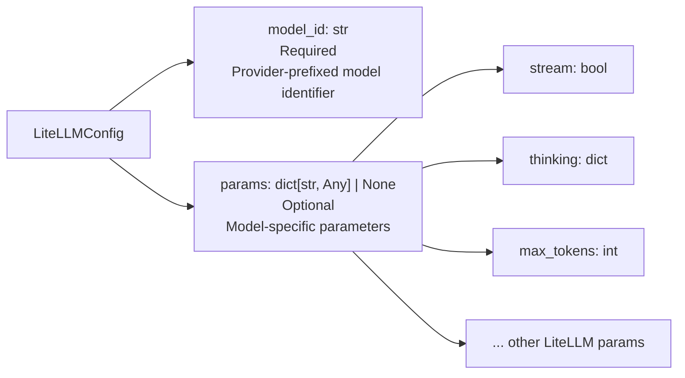
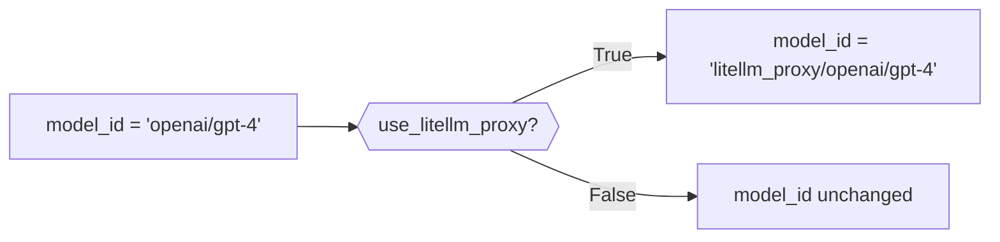
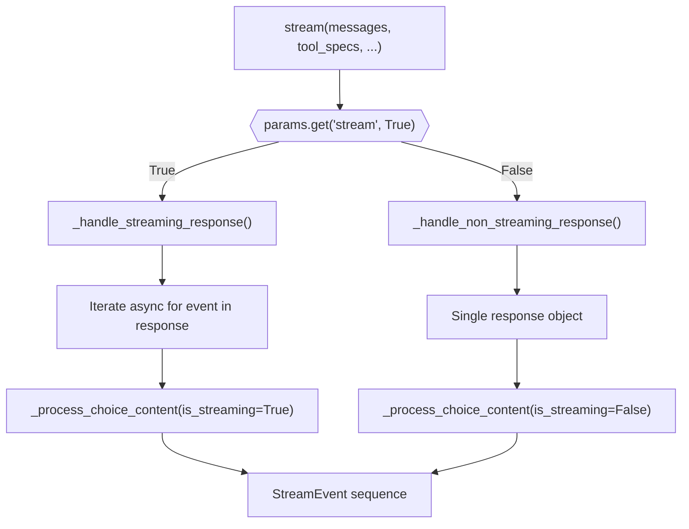
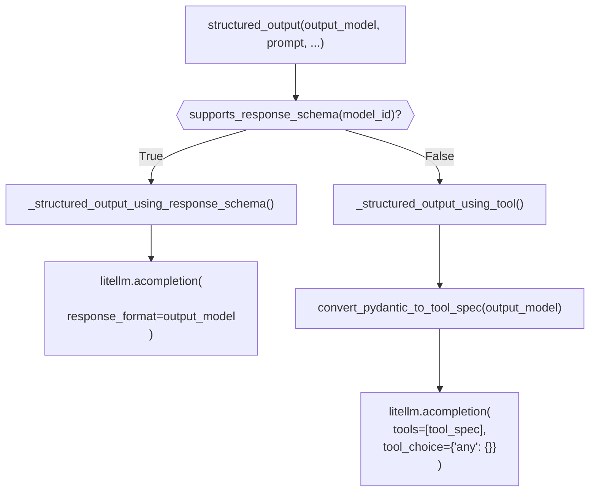

<!-- source: DeepWiki mcp.deepwiki.com · repo strands-agents/sdk-python · page 3.4 LiteLLM Multi-Provider Support · fetched 2026-10-27 -->

# LiteLLM Multi-Provider Support

<details>
<summary>Relevant source files</summary>

The following files were used as context for generating this wiki page:

- [site/docs/examples/cdk/deploy_to_apprunner/package-lock.json](site/docs/examples/cdk/deploy_to_apprunner/package-lock.json)
- [site/docs/examples/cdk/deploy_to_apprunner/package.json](site/docs/examples/cdk/deploy_to_apprunner/package.json)
- [site/docs/examples/cdk/deploy_to_ec2/package-lock.json](site/docs/examples/cdk/deploy_to_ec2/package-lock.json)
- [site/docs/examples/cdk/deploy_to_ec2/package.json](site/docs/examples/cdk/deploy_to_ec2/package.json)
- [site/docs/examples/cdk/deploy_to_fargate/package-lock.json](site/docs/examples/cdk/deploy_to_fargate/package-lock.json)
- [site/docs/examples/cdk/deploy_to_fargate/package.json](site/docs/examples/cdk/deploy_to_fargate/package.json)
- [site/docs/examples/cdk/deploy_to_lambda/package-lock.json](site/docs/examples/cdk/deploy_to_lambda/package-lock.json)
- [site/docs/examples/cdk/deploy_to_lambda/package.json](site/docs/examples/cdk/deploy_to_lambda/package.json)
- [site/scripts/api-generation-typescript.ts](site/scripts/api-generation-typescript.ts)
- [strandly/src/cli.ts](strandly/src/cli.ts)
- [strands-py/src/strands/hooks/registry.py](strands-py/src/strands/hooks/registry.py)
- [strands-py/src/strands/models/__init__.py](strands-py/src/strands/models/__init__.py)
- [strands-py/src/strands/models/litellm.py](strands-py/src/strands/models/litellm.py)
- [strands-py/src/strands/models/routing/__init__.py](strands-py/src/strands/models/routing/__init__.py)
- [strands-py/src/strands/models/routing/fallback_strategy.py](strands-py/src/strands/models/routing/fallback_strategy.py)
- [strands-py/src/strands/models/routing/router.py](strands-py/src/strands/models/routing/router.py)
- [strands-py/src/strands/models/routing/strategy.py](strands-py/src/strands/models/routing/strategy.py)
- [strands-py/tests/strands/models/routing/__init__.py](strands-py/tests/strands/models/routing/__init__.py)
- [strands-py/tests/strands/models/routing/test_fallback_strategy.py](strands-py/tests/strands/models/routing/test_fallback_strategy.py)
- [strands-py/tests/strands/models/routing/test_router.py](strands-py/tests/strands/models/routing/test_router.py)
- [strands-py/tests/strands/models/test_litellm.py](strands-py/tests/strands/models/test_litellm.py)
- [strands-py/tests_integ/models/test_model_openai.py](strands-py/tests_integ/models/test_model_openai.py)

</details>


## Purpose and Scope

This document covers the `LiteLLMModel` provider implementation, which enables access to multiple LLM providers through a unified interface using the [LiteLLM](https://docs.litellm.ai/) library. The `LiteLLMModel` class extends `OpenAIModel` to provide compatibility with 100+ LLM providers while adding LiteLLM-specific features such as proxy support, enhanced prompt caching, and adaptive structured output generation. It also details the `ModelRouter` and `FallbackStrategy` for resilient multi-provider setups.

For general information about the model provider architecture, see [Model Provider Architecture](3.1). For other specific provider implementations, see [AWS Bedrock Models](3.2) and [OpenAI Compatible Models](3.3).

---

## Architecture Overview

The `LiteLLMModel` class inherits from `OpenAIModel` and leverages LiteLLM's provider abstraction to support multiple backends through a single interface. It provides specialized handling for Gemini thought signatures and reasoning content.

### LiteLLMModel Class Hierarchy



**Sources:** [strands-py/src/strands/models/litellm.py:36-565](), [strands-py/src/strands/models/openai.py:51-124]()

### Provider Support Matrix

`LiteLLMModel` supports routing to different providers using the `model_id` format:

| Provider Pattern | Example `model_id` | Notes |
|-----------------|-------------------|-------|
| OpenAI | `openai/gpt-4o` | Direct OpenAI API |
| Anthropic | `anthropic/claude-3-sonnet` | Direct Anthropic API |
| AWS Bedrock | `bedrock/us.anthropic.claude-3-7-sonnet` | Via AWS Bedrock |
| Azure OpenAI | `azure/gpt-4` | Azure-hosted models |
| Vertex AI | `vertex_ai/gemini-pro` | Google Cloud models |
| Ollama | `ollama/llama3.3:70b` | Local Ollama instance |
| LiteLLM Proxy | `litellm_proxy/model-name` | Via LiteLLM proxy server |

**Sources:** [strands-py/src/strands/models/litellm.py:39-51](), [strands-py/tests/strands/models/test_litellm.py:64-79]()

---

## Configuration

### Basic Configuration

The `LiteLLMModel` accepts configuration through the `LiteLLMConfig` TypedDict:



**Configuration Example:**

```python
from strands.models.litellm import LiteLLMModel

model = LiteLLMModel(
    model_id="bedrock/us.anthropic.claude-3-7-sonnet-20250219-v1:0",
    params={
        "stream": True,
        "max_tokens": 4096,
        "thinking": {
            "type": "enabled",
            "budget_tokens": 1024
        }
    }
)
```

**Sources:** [strands-py/src/strands/models/litellm.py:39-73](), [strands-py/tests_integ/models/test_model_litellm.py:14-24]()

### Client Arguments

The `client_args` parameter passes configuration to the underlying `litellm.acompletion()` function:

| Argument | Type | Purpose |
|----------|------|---------|
| `api_key` | `str` | Provider API key |
| `api_base` | `str` | Custom API endpoint |
| `api_version` | `str` | API version for Azure/other versioned APIs |
| `use_litellm_proxy` | `bool` | Enable LiteLLM proxy mode |
| `timeout` | `float` | Request timeout in seconds |

**Sources:** [strands-py/src/strands/models/litellm.py:53-62](), [strands-py/tests/strands/models/test_litellm.py:20-33]()

### Proxy Configuration

When `use_litellm_proxy=True`, the model automatically applies the `litellm_proxy/` prefix to the `model_id`:



The `_apply_proxy_prefix()` method handles this transformation automatically at initialization and when configuration is updated:

**Sources:** [strands-py/src/strands/models/litellm.py:555-564](), [strands-py/tests/strands/models/test_litellm.py:64-94]()

---

## Message Formatting

### Gemini Thought Signatures

Gemini thinking models attach a `thought_signature` to function calls. `LiteLLMModel` manages this by encoding the signature into the tool call ID using the `__thought__` separator.

- **Request Formatting:** `format_request_message_tool_call` appends the signature to the ID [strands-py/src/strands/models/litellm.py:124-145]().
- **Extraction:** `_extract_thought_signature` retrieves it from `provider_specific_fields` or by splitting the ID [strands-py/src/strands/models/litellm.py:148-175]().

**Sources:** [strands-py/src/strands/models/litellm.py:31-31](), [strands-py/src/strands/models/litellm.py:124-175]()

### Content Types

`LiteLLMModel.format_request_message_content()` handles specialized content types:

| Content Type | Input Format | Output Format |
|--------------|--------------|---------------|
| **Reasoning** | `{"reasoningContent": {"reasoningText": {...}}}` | `{"type": "thinking", "signature": str, "thinking": str}` |
| **Video** | `{"video": {"source": {"bytes": str}}}` | `{"type": "video_url", "video_url": {"url": str, "detail": "auto"}}` |
| **Text** | `{"text": str}` | Handled by parent `OpenAIModel` |

**Sources:** [strands-py/src/strands/models/litellm.py:91-121](), [strands-py/tests/strands/models/test_litellm.py:97-140]()

---

## Streaming Behavior

### Dual-Mode Response Handling

`LiteLLMModel.stream()` supports both streaming and non-streaming modes based on the `params.stream` configuration:



Both code paths converge on `_process_choice_content()`, which handles both streaming deltas and complete messages uniformly.

**Sources:** [strands-py/src/strands/models/litellm.py:243-296](), [strands-py/src/strands/models/litellm.py:380-437](), [strands-py/tests_integ/models/test_model_litellm.py:108-127]()

### Content Switching and Event Generation

The `_stream_switch_content()` method manages transitions between different content types (text, reasoning, tools) during streaming to ensure proper event sequences.

**Sources:** [strands-py/src/strands/models/litellm.py:177-198](), [strands-py/tests/strands/models/test_litellm.py:683-714]()

---

## Structured Output

### Adaptive Output Strategy

`LiteLLMModel.structured_output()` implements a dual-strategy approach based on model capabilities:



The `supports_response_schema()` function from LiteLLM determines whether a provider supports native structured output via `response_format`.

**Sources:** [strands-py/src/strands/models/litellm.py:297-378](), [strands-py/tests/strands/models/test_litellm.py:317-365](), [strands-py/tests_integ/models/test_model_litellm.py:211-237]()

---

## Model Routing System

The Strands SDK provides a robust model routing system to enhance resilience and flexibility when working with multiple LLM providers. This system is built around the `ModelRouter` and `RoutingStrategy` components.

### ModelRouter

The `ModelRouter` class acts as a proxy for multiple underlying models, allowing an agent to dynamically select which model to use for a given invocation. It is itself a `Plugin` [strands-py/src/strands/models/routing/test_router.py:99-100]() and can be configured with a list of `RoutingCandidate` objects.

```python
from strands.models import LiteLLMModel
from strands.models.routing import ModelRouter, RoutingCandidate, FallbackStrategy

# Define candidate models
fast_model = LiteLLMModel(model_id="openai/gpt-3.5-turbo")
smart_model = LiteLLMModel(model_id="anthropic/claude-3-opus")
backup_model = LiteLLMModel(model_id="bedrock/us.anthropic.claude-3-sonnet")

# Create a ModelRouter with candidates and a strategy
router = ModelRouter(
    models=[
        RoutingCandidate(fast_model, name="fast-gpt", description="Good for quick tasks"),
        RoutingCandidate(smart_model, name="smart-claude", description="Best for complex reasoning"),
        backup_model, # Can also add models directly without RoutingCandidate
    ],
    strategy=FallbackStrategy() # Default strategy for failover
)

# An agent can then use this router as its model
# agent = Agent(model=router, ...)
```

The `ModelRouter` manages:
- **Candidate Models**: A list of `RoutingCandidate` objects, each wrapping an `Model` instance and optionally providing a name and description [strands-py/src/strands/models/routing/router.py:100-101]().
- **Default Model**: The first declared candidate model serves as the default if no specific routing decision is made or if the strategy declines [strands-py/src/strands/models/routing/test_router.py:150-164]().
- **Routing Strategy**: An instance of `RoutingStrategy` (or a subclass like `FallbackStrategy`) that dictates which candidate model to select [strands-py/src/strands/models/routing/router.py:102-103]().
- **Invocation State**: The router maintains per-invocation state to track attempts and successes, which is crucial for strategies like `FallbackStrategy` [strands-py/src/strands/models/routing/router.py:104-105]().

#### ModelRouter Data Flow

```mermaid
graph TD
    A[Agent.invoke()] --> B{ModelRouter.stream()}
    B --> C{_select_model(RoutingContext)}
    C --> D[RoutingStrategy.select(RoutingContext)]
    D -- "Returns RoutingCandidate | None" --> C
    C -- "Resolves to Model" --> E{Model.stream()}
    E -- "Success" --> F[Return StreamEvents]
    E -- "Failure (Exception)" --> G{Record RoutingAttempt}
    G --> C
    C -- "Strategy declines or no candidates left" --> H[Propagate Model Error]

    subgraph RoutingContext
        RC1[messages]
        RC2[system_prompt]
        RC3[tool_specs]
        RC4[candidates: List<RoutingCandidate>]
        RC5[invocation_state: Dict]
        RC6[attempts: List<RoutingAttempt>]
    end

    D -- "Uses" --> RC1
    D -- "Uses" --> RC2
    D -- "Uses" --> RC3
    D -- "Uses" --> RC4
    D -- "Uses" --> RC5
    D -- "Uses" --> RC6
```
**Sources:** [strands-py/src/strands/models/routing/router.py:102-103](), [strands-py/src/strands/models/routing/strategy.py:38-62]()

### RoutingStrategy

The `RoutingStrategy` is a `Protocol` [strands-py/src/strands/models/routing/strategy.py:65-70]() that defines how the `ModelRouter` selects a model. It is invoked:
1. Before the first model call for an invocation.
2. After each failed model call.

The strategy receives a `RoutingContext` object [strands-py/src/strands/models/routing/strategy.py:38-62]() containing:
- `messages`, `system_prompt`, `tool_specs`: The current request payload.
- `candidates`: The list of available `RoutingCandidate` objects.
- `invocation_state`: A mutable dictionary for the strategy to store state across attempts within a single invocation.
- `attempts`: A chronological list of `RoutingAttempt` objects, detailing which candidates have been tried and whether they succeeded or failed [strands-py/src/strands/models/routing/strategy.py:22-35]().

The `select` method [strands-py/src/strands/models/routing/strategy.py:72-103]() must return one of the `context.candidates` instances or `None` to indicate that the strategy declines to make a choice. If `None` is returned on the initial call, the router's default model is used. If `None` is returned after a failure, routing stops, and the last model's error is propagated.

### FallbackStrategy

The `FallbackStrategy` [strands-py/src/strands/models/routing/fallback_strategy.py:13-25]() is the default implementation of `RoutingStrategy`. It provides an ordered failover mechanism:
- It prefers candidates with the fewest recorded failures.
- Ties are broken by the order in which candidates were declared in the `ModelRouter`.
- A successful call to a candidate re-arms all candidates, clearing their "tried since last success" status and resetting the successful candidate's failure count. Other candidates retain their failure history.
- It excludes candidates that have already been tried since the last successful attempt within the current invocation.

```mermaid
graph TD
    A[Invocation Starts] --> B{FallbackStrategy.select()}
    B --> C{Filter out candidates tried since last success}
    C --> D{Sort remaining candidates by fewest failures}
    D --> E[Select top candidate]
    E -- "Candidate chosen" --> F[Model call]
    F -- "Success" --> G[Clear all "tried since last success" flags]
    F -- "Success" --> H[Reset successful candidate's failure count]
    F -- "Failure" --> I[Increment failed candidate's failure count]
    I --> B
    G --> A
    H --> A
    C -- "No available candidates" --> J[Return None (end routing)]
```
**Sources:** [strands-py/src/strands/models/routing/fallback_strategy.py:27-41](), [strands-py/src/strands/models/routing/strategy.py:106-111](), [strands-py/tests/strands/models/routing/test_fallback_strategy.py:28-36]()

---

## Provider-Specific Features

### Prompt Caching

`LiteLLMModel.format_chunk()` extracts cache metrics from metadata events:

| Cache Metric | Source Field |
|--------------|--------------|
| `cacheReadInputTokens` | `usage.prompt_tokens_details.cached_tokens` |
| `cacheWriteInputTokens` | `usage.cache_creation_input_tokens` |

**Sources:** [strands-py/src/strands/models/litellm.py:200-241](), [strands-py/tests/strands/models/test_litellm.py:633-680]()

### Reasoning Support

Extended thinking capabilities (e.g., Claude Sonnet 3.7 reasoning) are enabled through the `params.thinking` configuration. The model returns reasoning content in `reasoningContent` blocks.

**Sources:** [strands-py/src/strands/models/litellm.py:104-109](), [strands-py/tests_integ/models/test_model_litellm.py:141-155]()

---

## Error Handling

### Context Window Overflow

`LiteLLMModel.stream()` catches `ContextWindowExceededError` from the LiteLLM library and converts it to the SDK's `ContextWindowOverflowException`.

**Sources:** [strands-py/src/strands/models/litellm.py:291-293](), [strands-py/tests/strands/models/test_litellm.py:401-409]()

### Response Validation

The provider validates responses and raises descriptive errors:
- Multiple choices: `ValueError("Multiple choices found in the response.")` [strands-py/src/strands/models/litellm.py:336-336]()
- Missing tool calls: `ValueError("No tool_calls found in response")` [strands-py/src/strands/models/litellm.py:368-368]()
- Invalid JSON: `ValueError("Failed to parse or load content into model")` [strands-py/src/strands/models/litellm.py:349-349]()

**Sources:** [strands-py/src/strands/models/litellm.py:336-378]()

---

