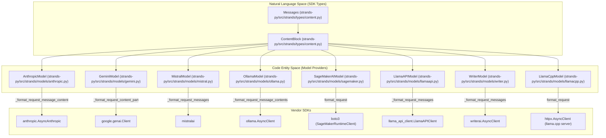
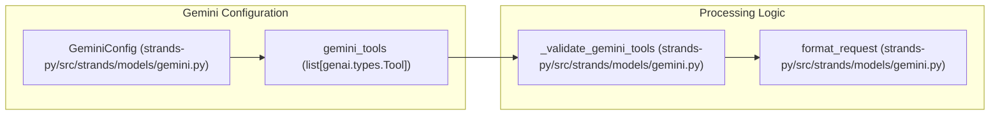

<!-- source: DeepWiki mcp.deepwiki.com · repo strands-agents/sdk-python · page 3.5 Additional Model Providers · fetched 2026-10-27 -->

# Additional Model Providers

Relevant source files

The following files were used as context for generating this wiki page:

- [site/src/content/docs/user-guide/concepts/model-providers/amazon-bedrock.mdx](site/src/content/docs/user-guide/concepts/model-providers/amazon-bedrock.mdx)
- [site/src/content/docs/user-guide/concepts/model-providers/anthropic.mdx](site/src/content/docs/user-guide/concepts/model-providers/anthropic.mdx)
- [site/src/content/docs/user-guide/concepts/model-providers/anthropic.ts](site/src/content/docs/user-guide/concepts/model-providers/anthropic.ts)
- [site/src/content/docs/user-guide/concepts/model-providers/anthropic_imports.ts](site/src/content/docs/user-guide/concepts/model-providers/anthropic_imports.ts)
- [strands-py/src/strands/models/anthropic.py](strands-py/src/strands/models/anthropic.py)
- [strands-py/src/strands/models/bedrock.py](strands-py/src/strands/models/bedrock.py)
- [strands-py/src/strands/models/gemini.py](strands-py/src/strands/models/gemini.py)
- [strands-py/src/strands/models/llamaapi.py](strands-py/src/strands/models/llamaapi.py)
- [strands-py/src/strands/models/llamacpp.py](strands-py/src/strands/models/llamacpp.py)
- [strands-py/src/strands/models/mistral.py](strands-py/src/strands/models/mistral.py)
- [strands-py/src/strands/models/model.py](strands-py/src/strands/models/model.py)
- [strands-py/src/strands/models/ollama.py](strands-py/src/strands/models/ollama.py)
- [strands-py/src/strands/models/writer.py](strands-py/src/strands/models/writer.py)
- [strands-py/tests/strands/models/test_anthropic.py](strands-py/tests/strands/models/test_anthropic.py)
- [strands-py/tests/strands/models/test_bedrock.py](strands-py/tests/strands/models/test_bedrock.py)
- [strands-py/tests/strands/models/test_gemini.py](strands-py/tests/strands/models/test_gemini.py)
- [strands-py/tests/strands/models/test_llamaapi.py](strands-py/tests/strands/models/test_llamaapi.py)
- [strands-py/tests/strands/models/test_llamacpp.py](strands-py/tests/strands/models/test_llamacpp.py)
- [strands-py/tests/strands/models/test_mistral.py](strands-py/tests/strands/models/test_mistral.py)
- [strands-py/tests/strands/models/test_ollama.py](strands-py/tests/strands/models/test_ollama.py)
- [strands-py/tests/strands/models/test_writer.py](strands-py/tests/strands/models/test_writer.py)
- [strands-py/tests_integ/models/test_model_gemini.py](strands-py/tests_integ/models/test_model_gemini.py)
- [strands-ts/src/models/__tests__/anthropic.test.ts](strands-ts/src/models/__tests__/anthropic.test.ts)
- [strands-ts/src/models/__tests__/bedrock.test.ts](strands-ts/src/models/__tests__/bedrock.test.ts)
- [strands-ts/src/models/__tests__/defaults.test.ts](strands-ts/src/models/__tests__/defaults.test.ts)
- [strands-ts/src/models/__tests__/google.test.ts](strands-ts/src/models/__tests__/google.test.ts)
- [strands-ts/src/models/anthropic.ts](strands-ts/src/models/anthropic.ts)
- [strands-ts/src/models/bedrock.ts](strands-ts/src/models/bedrock.ts)
- [strands-ts/src/models/google/adapters.ts](strands-ts/src/models/google/adapters.ts)
- [strands-ts/src/models/google/model.ts](strands-ts/src/models/google/model.ts)
- [strands-ts/src/models/google/types.ts](strands-ts/src/models/google/types.ts)
- [strands-ts/src/models/model.ts](strands-ts/src/models/model.ts)

This page documents the specialized model provider implementations within the Strands Agents SDK, including Anthropic, Google Gemini, Mistral AI, Ollama, Amazon SageMaker, LlamaCpp, Writer, and LlamaAPI. Each provider implements the base `Model` interface [strands-py/src/strands/models/model.py:210-215]() but includes specific logic for message formatting, tool calling, and streaming tailored to the respective vendor's API.

## Provider Overview and Data Flow

The SDK utilizes a unified `Messages` format [strands-py/src/strands/models/model.py:16]() (modeled after AWS Bedrock) which must be translated into provider-specific schemas. The following diagram illustrates how a generic `Message` object is transformed and routed through various provider implementations to the underlying vendor SDKs.

### Model Request Transformation Flow

**Sources:** [strands-py/src/strands/models/anthropic.py:126-185](), [strands-py/src/strands/models/gemini.py:144-178](), [strands-py/src/strands/models/mistral.py:119-146](), [strands-py/src/strands/models/ollama.py:100-150](), [strands-py/src/strands/models/sagemaker.py:200-203](), [strands-py/src/strands/models/llamaapi.py:123-161](), [strands-py/src/strands/models/writer.py:122-157](), [strands-py/src/strands/models/llamacpp.py:170-200]()

---

## Anthropic Claude

The `AnthropicModel` [strands-py/src/strands/models/anthropic.py:48]() (Python) and `AnthropicModel` [strands-ts/src/models/anthropic.ts:87]() (TypeScript) provide integration with Claude models (e.g., Claude 3.5 Sonnet, Claude 3.7 Sonnet). It supports advanced features like ephemeral prompt caching and native reasoning/thinking blocks.

### Key Features
- **Prompt Caching:** Supports `cachePoint` in `ContentBlock` to inject `cache_control: {"type": "ephemeral"}` into the Anthropic request [strands-py/src/strands/models/anthropic.py:188-190](), [strands-ts/src/models/anthropic.ts:34-36]().
- **Reasoning Blocks:** Handles `reasoningContent` by mapping it to Anthropic's `thinking` type [strands-py/src/strands/models/anthropic.py:170-175](), [strands-ts/src/models/anthropic.ts:300-305]().
- **Document Support:** Supports PDF and text documents via base64 encoding or raw text [strands-py/src/strands/models/anthropic.py:138-152](), [strands-ts/src/models/anthropic.ts:260-274]().

| Configuration Attribute | Description |
| :--- | :--- |
| `model_id` (Python) / `modelId` (TypeScript) | Anthropic model identifier (e.g., `claude-3-7-sonnet-latest`) [strands-py/src/strands/models/anthropic.py:87](), [strands-ts/src/models/anthropic.ts:95](). |
| `max_tokens` (Python) / `maxTokens` (TypeScript) | Maximum generation limit (Required) [strands-py/src/strands/models/anthropic.py:86](), [strands-ts/src/models/anthropic.ts:44](). |
| `params` | Dictionary of parameters like `temperature` or `top_p` [strands-py/src/strands/models/anthropic.py:88](), [strands-ts/src/models/anthropic.ts:48](). |
| `betas` (TypeScript) | Beta features to enable via the `anthropic-beta` header [strands-ts/src/models/anthropic.ts:59](). |
| `useNativeTokenCount` | Whether to use the native Anthropic `countTokens` API [strands-ts/src/models/anthropic.ts:69](). |
| `cacheConfig` | Configuration for prompt caching [strands-ts/src/models/anthropic.ts:78](). |

**Sources:** [strands-py/src/strands/models/anthropic.py:48-90](), [strands-py/src/strands/models/anthropic.py:126-185](), [strands-ts/src/models/anthropic.ts:40-80](), [strands-ts/src/models/anthropic.ts:260-305]()

---

## Google Gemini

`GeminiModel` [strands-py/src/strands/models/gemini.py:30]() (Python) and `GoogleModel` [strands-ts/src/models/google/model.ts:30]() (TypeScript) integrate with the Google GenAI SDK. It uniquely supports Gemini-specific tools alongside standard function calling.

### Tool Integration
Gemini distinguishes between standard function declarations and specialized tools like `GoogleSearch` or `CodeExecution`. These are configured via the `gemini_tools` attribute [strands-py/src/strands/models/gemini.py:46-51]() (Python) or `googleTools` [strands-ts/src/models/google/model.ts:49]() (TypeScript).

**Sources:** [strands-py/src/strands/models/gemini.py:46-51](), [strands-py/src/strands/models/gemini.py:99-101](), [strands-py/src/strands/models/gemini.py:200-203]()

### Features
- **Client Injection:** Allows passing a pre-configured `genai.Client` to manage lifecycle and connection pools [strands-py/src/strands/models/gemini.py:67-74](), [strands-ts/src/models/google/model.ts:69-76]().
- **Thought Blocks:** Maps `reasoningContent` to Gemini's `thought` and `thought_signature` fields [strands-py/src/strands/models/gemini.py:171-178](), [strands-ts/src/models/google/model.ts:178-183]().

**Sources:** [strands-py/src/strands/models/gemini.py:30-55](), [strands-py/src/strands/models/gemini.py:57-81](), [strands-py/src/strands/models/gemini.py:138-178](), [strands-ts/src/models/google/model.ts:30-54](), [strands-ts/src/models/google/model.ts:69-76](), [strands-ts/src/models/google/model.ts:178-183]()

---

## Mistral AI

The `MistralModel` [strands-py/src/strands/models/mistral.py:28]() supports Mistral's API for chat and text completions. It includes validation for `temperature` (recommended range 0.0-0.7) and `top_p` [strands-py/src/strands/models/mistral.py:70-85]().

### Configuration
- `model_id`: e.g., `mistral-large-latest` [strands-py/src/strands/models/mistral.py:43]().
- `stream`: Defaults to `True` [strands-py/src/strands/models/mistral.py:91-92]().

### Formatting Logic
- **Tool Results:** Mistral requires tool results to have a `role: "tool"` and a `tool_call_id`. The SDK flattens multiple content parts into a single string for Mistral's tool message format [strands-py/src/strands/models/mistral.py:166-189]().

**Sources:** [strands-py/src/strands/models/mistral.py:28-55](), [strands-py/src/strands/models/mistral.py:119-146]()

---

## Ollama (Local Models)

`OllamaModel` [strands-py/src/strands/models/ollama.py:27]() enables running agents against locally hosted models via the Ollama server.

### Message Flattening
Ollama does not support an array of content blocks within a single message. The `_format_request_message_contents` function flattens the SDK's multi-part messages into a sequence of separate message blocks that Ollama can process [strands-py/src/strands/models/ollama.py:100-150]().

### Configuration
- `host`: The address of the Ollama server [strands-py/src/strands/models/ollama.py:74]().
- `keep_alive`: Controls how long the model stays in memory (default "5m") [strands-py/src/strands/models/ollama.py:42]().

**Sources:** [strands-py/src/strands/models/ollama.py:27-58](), [strands-py/src/strands/models/ollama.py:152-173]()

---

## Amazon SageMaker AI

`SageMakerAIModel` [strands-py/src/strands/models/sagemaker.py:92]() inherits from `OpenAIModel` but overrides the transport layer to use `boto3` for invoking SageMaker endpoints [strands-py/src/strands/models/sagemaker.py:176-179]().

### Request Structure
It splits configuration into two parts:
1. **`SageMakerAIEndpointConfig`**: Infrastructure details like `endpoint_name`, `region_name`, and `inference_component_name` [strands-py/src/strands/models/sagemaker.py:120-136]().
2. **`SageMakerAIPayloadSchema`**: Model parameters like `max_tokens`, `temperature`, and `stop` [strands-py/src/strands/models/sagemaker.py:97-119]().

### User Agent
The implementation automatically appends `strands-agents` to the `user_agent_extra` in the Boto3 client configuration for telemetry purposes [strands-py/src/strands/models/sagemaker.py:165-174]().

**Sources:** [strands-py/src/strands/models/sagemaker.py:92-179]()

---

## LlamaAPI and Writer

### LlamaAPI
`LlamaAPIModel` [strands-py/src/strands/models/llamaapi.py:31]() is a specialized provider for Meta's Llama models using the `LlamaAPIClient` [strands-py/src/strands/models/llamaapi.py:15]().
- **Vision Limitations:** It explicitly filters out `reasoningContent` and `video` as they are currently unsupported [strands-py/src/strands/models/llamaapi.py:96]().
- **Message Conversion:** It handles the conversion of tool results and tool use requests into the specific Llama API schema [strands-py/src/strands/models/llamaapi.py:123-161]().

### Writer
`WriterModel` supports the Palmyra family of models via the `writerai.AsyncClient` [strands-py/src/strands/models/writer.py:29]().
- **Palmyra V5 Vision:** Includes specific logic to handle image URLs for the V5 model, while other versions are restricted to text-only contents [strands-py/src/strands/models/writer.py:85-114]().
- **Single Content Constraint:** Non-V5 models will raise a `ValueError` if multiple content blocks are provided in a single message [strands-py/src/strands/models/writer.py:150-153]().

**Sources:** [strands-py/src/strands/models/llamaapi.py:31-52](), [strands-py/src/strands/models/writer.py:29-50](), [strands-py/src/strands/models/writer.py:122-157]()

---

## LlamaCpp (Local Server)

The `LlamaCppModel` [strands-py/src/strands/models/llamacpp.py:40]() connects to a `llama.cpp` server running in OpenAI-compatible mode. It supports advanced features like grammar constraints and native multimodal support.

### Advanced Features
- **Grammar Constraints:** Supports GBNF grammar strings via the `grammar` parameter for constrained generation [strands-py/src/strands/models/llamacpp.py:118]().
- **Multimodal Support:** Handles native audio and image content blocks when using supported models (e.g., Qwen2.5-Omni) [strands-py/src/strands/models/llamacpp.py:72-85]().
- **Mirostat Sampling:** Supports `mirostat`, `mirostat_lr`, and `mirostat_ent` parameters for advanced sampling [strands-py/src/strands/models/llamacpp.py:115-117]().

**Sources:** [strands-py/src/strands/models/llamacpp.py:40-128]()

---

## Vercel AI (TypeScript)

The TypeScript SDK includes a `VercelModel` [strands-ts/src/models/vercel.ts:27]() provider for interacting with Vercel's AI SDK. This allows leveraging models hosted or proxied through Vercel's platform.

### Key Features
- **Unified API:** Provides a consistent interface for various models supported by Vercel AI SDK.
- **Streaming:** Supports streaming responses from Vercel-backed models.
- **Configuration:** Allows specifying `modelId`, `maxTokens`, `temperature`, and `topP` [strands-ts/src/models/vercel.ts:30-40]().

**Sources:** [strands-ts/src/models/vercel.ts:27-40]()

---

## Error Handling and Throttling

All providers map vendor-specific errors to common SDK exceptions:
- **Throttling:** Providers catch 429 errors and raise `ModelThrottledException` [strands-py/src/strands/models/anthropic.py:21](), [strands-py/src/strands/models/gemini.py:20](), [strands-py/src/strands/models/mistral.py:18](), [strands-py/src/strands/models/llamaapi.py:21](), [strands-py/src/strands/models/writer.py:19](), [strands-py/src/strands/models/llamacpp.py:30](), [strands-ts/src/models/anthropic.ts:15](), [strands-ts/src/models/google/model.ts:15]().
- **Context Overflow:** `AnthropicModel` uses a set of `OVERFLOW_MESSAGES` to detect when input exceeds the context window and raises `ContextWindowOverflowException` [strands-py/src/strands/models/anthropic.py:60-64](). Gemini and LlamaCpp similarly raise `ContextWindowOverflowException` upon detecting limit breaches [strands-py/src/strands/models/gemini.py:20](), [strands-py/src/strands/models/llamacpp.py:30](). The TypeScript `AnthropicModel` uses `CONTEXT_WINDOW_OVERFLOW_ERRORS` [strands-ts/src/models/anthropic.ts:25-31]() and `GoogleModel` uses `CONTEXT_WINDOW_OVERFLOW_MESSAGES` [strands-ts/src/models/google/model.ts:20-24]() for the same purpose.

**Sources:** [strands-py/src/strands/models/anthropic.py:60-64](), [strands-py/src/strands/models/gemini.py:20](), [strands-py/src/strands/models/llamacpp.py:30](), [strands-ts/src/models/anthropic.ts:25-31](), [strands-ts/src/models/google/model.ts:20-24]()

---

