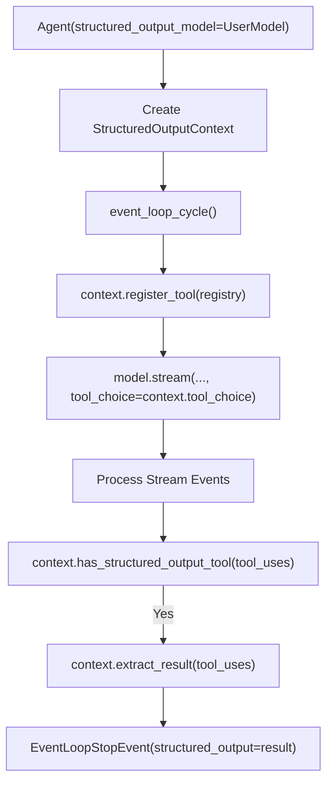

<!-- source: DeepWiki mcp.deepwiki.com · repo strands-agents/sdk-python · page 3.6 Structured Output Generation · fetched 2026-10-27 -->

# Structured Output Generation

<details>
<summary>Relevant source files</summary>

The following files were used as context for generating this wiki page:

- [strands-py/src/strands/agent/agent.py](strands-py/src/strands/agent/agent.py)
- [strands-py/src/strands/event_loop/event_loop.py](strands-py/src/strands/event_loop/event_loop.py)
- [strands-py/tests/strands/event_loop/test_event_loop.py](strands-py/tests/strands/event_loop/test_event_loop.py)
- [strands-py/tests/strands/event_loop/test_event_loop_metadata.py](strands-py/tests/strands/event_loop/test_event_loop_metadata.py)
- [strands-py/tests/strands/event_loop/test_event_loop_structured_output.py](strands-py/tests/strands/event_loop/test_event_loop_structured_output.py)
- [strands-ts/src/telemetry/__tests__/config.test.node.ts](strands-ts/src/telemetry/__tests__/config.test.node.ts)
- [strands-ts/src/telemetry/__tests__/config.test.ts](strands-ts/src/telemetry/__tests__/config.test.ts)
- [strands-ts/src/telemetry/config.ts](strands-ts/src/telemetry/config.ts)
- [strands-ts/src/tools/__tests__/zod-tool.test-d.ts](strands-ts/src/tools/__tests__/zod-tool.test-d.ts)
- [strands-ts/src/tools/tool-factory.ts](strands-ts/src/tools/tool-factory.ts)
- [strands-ts/src/tools/zod-tool.ts](strands-ts/src/tools/zod-tool.ts)
- [strands-ts/test/integ/telemetry.test.node.ts](strands-ts/test/integ/telemetry.test.node.ts)

</details>


Structured output generation enables language models to return responses conforming to predefined Pydantic schemas (Python) or Zod schemas (TypeScript), providing type-safe, validated data structures. This mechanism is implemented across different providers, with some using native API support (like OpenAI) and others using a tool-based fallback strategy (like Bedrock).

---

## Overview

The SDK provides structured output through the `Agent` and `Model` abstractions. While `Agent` methods delegate to the underlying model, the framework also includes a dedicated `StructuredOutputContext` to manage state during complex event loops.

**Key Components**:
- **Pydantic Models (Python)**: Users define the desired output structure using standard Pydantic classes [tests/strands/tools/test_structured_output.py:11-15]().
- **Zod Schemas (TypeScript)**: Users define the desired output structure using Zod schemas [strands-ts/src/tools/__tests__/zod-tool.test-d.ts:10-11]().
- **StructuredOutputTool**: A specialized tool wrapper that handles the conversion of Pydantic models into tool specifications and validates the model's response [strands-py/src/strands/tools/structured_output/structured_output_tool.py:9-12]().
- **StructuredOutputContext**: Manages per-invocation state, including forced tool choice and result storage [strands-py/src/strands/tools/structured_output/_structured_output_context.py:19-47]().
- **Utility Functions**: `convert_pydantic_to_tool_spec` transforms Pydantic models into standard tool specifications compatible with LLM provider APIs [strands-py/src/strands/tools/structured_output/structured_output_utils.py:4-4]().
- **`zod-tool` factory (TypeScript)**: Creates type-safe tools from Zod schemas, automatically generating JSON schemas for LLM consumption and validating inputs at runtime [strands-ts/src/tools/zod-tool.ts:20-45]().

Sources: [strands-py/src/strands/tools/structured_output/_structured_output_context.py:19-47](), [strands-py/src/strands/tools/structured_output/structured_output_tool.py:9-12](), [tests/strands/tools/test_structured_output.py:11-15](), [strands-py/src/strands/tools/structured_output/structured_output_utils.py:4-4](), [strands-ts/src/tools/zod-tool.ts:20-45](), [strands-ts/src/tools/__tests__/zod-tool.test-d.ts:10-11]()

---

## Architecture and Dispatch Flow

The following diagram illustrates how a request for structured output flows from the `Agent` through the `StructuredOutputContext` and into the model execution layer.

**Structured Output Orchestration Flow**



The `StructuredOutputContext` acts as the state manager, ensuring that the `StructuredOutputTool` is registered in the `ToolRegistry` and that the model is forced to use it via `tool_choice` [strands-py/src/strands/tools/structured_output/_structured_output_context.py:134-143]().

Sources: [strands-py/src/strands/tools/structured_output/_structured_output_context.py:134-143](), [tests/strands/agent/test_agent_structured_output.py:85-103](), [strands-py/src/strands/tools/structured_output/_structured_output_context.py:19-47]()

---

## Implementation Details

### StructuredOutputContext (Python)

The `StructuredOutputContext` is initialized per invocation. It tracks whether structured output is enabled and stores the validated results [strands-py/src/strands/tools/structured_output/_structured_output_context.py:22-47]().

- **Forced Mode**: When `set_forced_mode()` is called, the context configures a `tool_choice` (typically `{"any": {}}` or a specific tool name) to mandate that the model provides structured data [strands-py/src/strands/tools/structured_output/_structured_output_context.py:77-88]().
- **Result Storage**: Validated Pydantic instances are stored in a `results` map, keyed by `tool_use_id` [strands-py/src/strands/tools/structured_output/_structured_output_context.py:57-64]().
- **Extraction**: The `extract_result()` method retrieves the validated model instance from the results map once the model has finished its "tool use" [strands-py/src/strands/tools/structured_output/_structured_output_context.py:113-132]().
- **Custom Prompts**: Users can specify a `structured_output_prompt` to guide the model when forcing structure (defaults to "You must format the previous response as structured output.") [strands-py/src/strands/tools/structured_output/_structured_output_context.py:16-16](), [strands-py/src/strands/tools/structured_output/_structured_output_context.py:42-42]().

Sources: [strands-py/src/strands/tools/structured_output/_structured_output_context.py:22-47](), [strands-py/src/strands/tools/structured_output/_structured_output_context.py:77-88](), [strands-py/src/strands/tools/structured_output/_structured_output_context.py:113-132](), [strands-py/src/strands/tools/structured_output/_structured_output_context.py:16-16]()

### Schema Conversion (Python)

The utility `convert_pydantic_to_tool_spec` is the core logic for bridging the "Code Entity Space" (Pydantic models) to the "Natural Language Space" (JSON schemas for LLMs).

**Data Transformation Mapping (Python)**

| Pydantic Entity | ToolSpec Field | Code Reference |
| :--- | :--- | :--- |
| `model.__name__` | `name` | [tests/strands/tools/test_structured_output.py:44]() |
| `model.__doc__` | `description` | [tests/strands/tools/test_structured_output.py:45]() |
| `model.model_json_schema()` | `inputSchema.json` | [tests/strands/tools/test_structured_output.py:46-47]() |

The conversion supports complex Pydantic features including:
- **Literals and Enums**: Converted to JSON Schema `enum` [tests/strands/tools/test_structured_output.py:97-102]().
- **Nested Models**: Recursive properties in the JSON schema [tests/strands/tools/test_structured_output.py:136-156]().
- **Optional Fields**: Represented as union types (e.g., `["object", "null"]`) [tests/strands/tools/test_structured_output.py:158]().
- **List Constraints**: `min_length` and `max_length` map to `minItems` and `maxItems` [tests/strands/tools/test_structured_output.py:106-107]().

Sources: [strands-py/src/strands/tools/structured_output/structured_output_utils.py:4-4](), [tests/strands/tools/test_structured_output.py:40-119]()

### `zod-tool` Factory (TypeScript)

The `zod-tool` factory provides a type-safe way to define tools using Zod schemas. It automatically generates the necessary JSON schema for the LLM and performs runtime validation of tool inputs.

**`zod-tool` Configuration**

```typescript
export interface ZodToolConfig<TInput extends z.ZodType | undefined, TReturn = JSONValue> {
  name: string
  description?: string
  inputSchema?: TInput
  callback: (
    input: ZodInferred<TInput>,
    context?: ToolContext
  ) => AsyncGenerator<unknown, TReturn, never> | Promise<TReturn> | TReturn
}
```
[strands-ts/src/tools/zod-tool.ts:20-45]()

The `ZodTool` class wraps a `FunctionTool` and handles the conversion of the Zod `inputSchema` to a JSON schema using `zodSchemaToJsonSchema` [strands-ts/src/tools/zod-tool.ts:93-93](). It also ensures that the `callback` receives validated, type-inferred input [strands-ts/src/tools/zod-tool.ts:106-106]().

**`zod-tool` Example**

```typescript
import { tool } from '@strands-agents/sdk'
import { z } from 'zod'

const calculator = tool({
  name: 'calculator',
  description: 'Adds two numbers',
  inputSchema: z.object({ a: z.number(), b: z.number() }),
  callback: (input) => input.a + input.b,
})
```
[strands-ts/src/tools/tool-factory.ts:51-56]()

Sources: [strands-ts/src/tools/zod-tool.ts:20-45](), [strands-ts/src/tools/zod-tool.ts:93-93](), [strands-ts/src/tools/zod-tool.ts:106-106](), [strands-ts/src/tools/tool-factory.ts:51-56]()

---

## Provider Specific Implementations

Different providers handle structured output with varying levels of native support.

### OpenAI and LiteLLM
`OpenAIModel` and `LiteLLMModel` can leverage native response schemas when supported. For LiteLLM, `supports_response_schema` is used to determine if the underlying provider supports JSON mode or structured outputs [strands-py/src/strands/models/litellm.py:13-13](). If native support is missing, the system falls back to the `_structured_output_using_tool` mechanism [tests_integ/models/test_model_litellm.py:212-221]().

### AWS Bedrock
`BedrockModel` supports a `strict_tools` configuration [strands-py/src/strands/models/bedrock.py:104-107](). When enabled, it adds `strict: true` to tool specifications and injects `"additionalProperties": false` into object types to enforce schema compliance [strands-py/src/strands/models/bedrock.py:104-107]().

**Provider Feature Comparison**

| Provider | Mechanism | Strict Enforcement | Code Reference |
| :--- | :--- | :--- | :--- |
| OpenAI | ParsedChatCompletion | Yes | [strands-py/src/strands/models/openai.py:15-15]() |
| Bedrock | Tool-based fallback | `strict_tools: True` | [strands-py/src/strands/models/bedrock.py:104-107]() |
| LiteLLM | Native or Tool | Conditional | [strands-py/src/strands/models/litellm.py:13-13]() |

Sources: [strands-py/src/strands/models/openai.py:15-15](), [strands-py/src/strands/models/bedrock.py:104-107](), [strands-py/src/strands/models/litellm.py:13-13](), [tests_integ/models/test_model_litellm.py:212-221]()

---

## Agent Integration

The `Agent` class facilitates structured output by accepting a `structured_output_model` during initialization or at call-time [tests/strands/agent/test_agent_structured_output.py:67-71]().

**Agent Call-Time Override Flow**

```mermaid
sequenceDiagram
    participant App as "Application Code"
    participant Agent as "Agent Instance"
    participant Context as "StructuredOutputContext"
    participant Loop as "event_loop_cycle()"

    App->>Agent: __call__(prompt, structured_output_model=UserModel)
    Agent->>Context: init(UserModel)
    Agent->>Loop: run(structured_output_context=Context)
    Loop->>Context: get_tool_spec()
    Loop->>Context: register_tool(registry)
    Loop-->>Agent: yield EventLoopStopEvent(structured_output=UserModel_instance)
    Agent-->>App: AgentResult(structured_output=UserModel_instance)
```

If a `structured_output_model` is provided, the `Agent` ensures the `EventLoopStopEvent` contains the final validated Pydantic object in its `structured_output` field [tests/strands/agent/test_agent_structured_output.py:95-102](). The agent can also maintain a `_default_structured_output_model` which is used if no override is provided at invocation [tests/strands/agent/test_agent_structured_output.py:71-71]().

Sources: [tests/strands/agent/test_agent_structured_output.py:67-71](), [tests/strands/agent/test_agent_structured_output.py:85-114](), [strands-py/src/strands/tools/structured_output/_structured_output_context.py:134-143]()

---

## Streaming and Tool Choice

When using `stream_messages`, the `tool_choice` parameter is critical for forcing structured output.

- **Forced Tool Choice**: By setting `tool_choice` to a specific tool name, the model is restricted to only using the structured output tool [strands-py/src/strands/tools/structured_output/_structured_output_context.py:115-115]().
- **Any Tool Choice**: Using `{"any": {}}` forces the model to select at least one tool from the provided specs [strands-py/src/strands/tools/structured_output/_structured_output_context.py:87-87]().
- **Event Handling**: During streaming, the system monitors for `contentBlockDelta` events. Once the stream completes, the accumulated JSON is validated against the Pydantic model [tests_integ/models/test_model_bedrock.py:109-111]().

Sources: [strands-py/src/strands/tools/structured_output/_structured_output_context.py:87-87](), [tests_integ/models/test_model_bedrock.py:109-111](), [strands-py/src/strands/tools/structured_output/_structured_output_context.py:113-132]()

---

