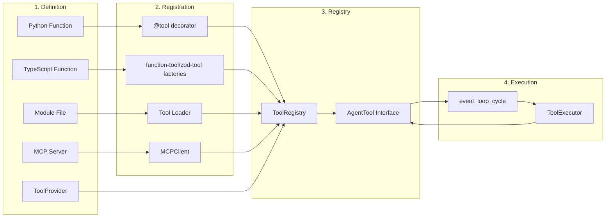
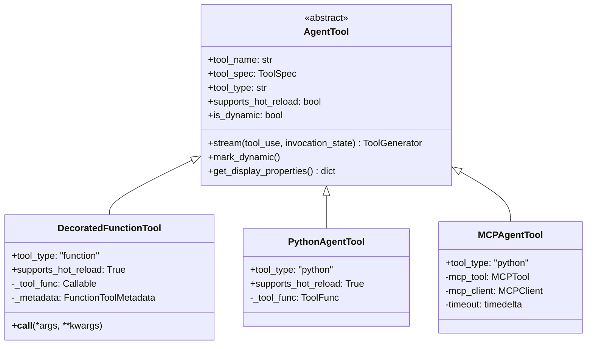
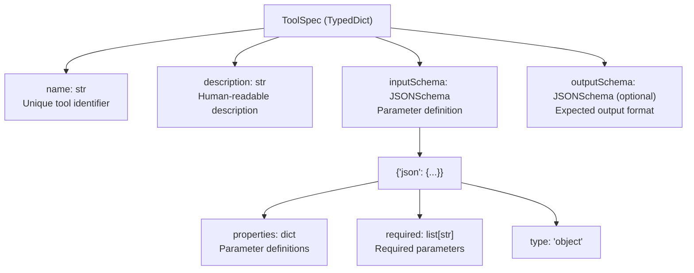
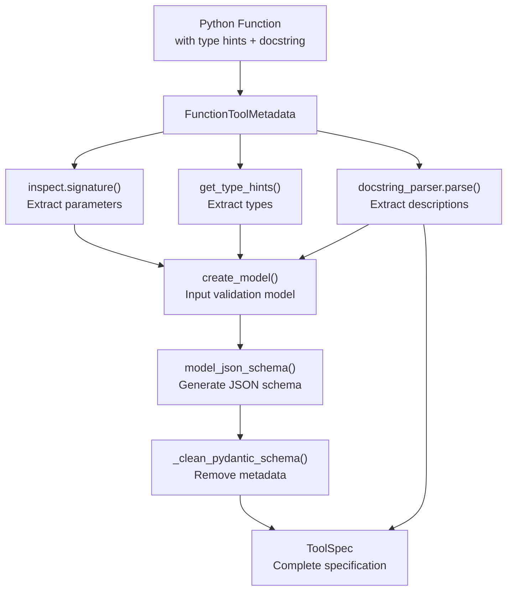
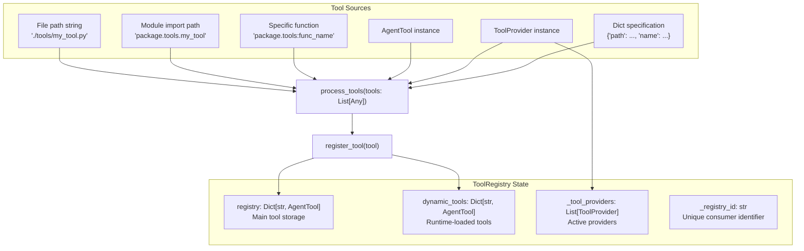
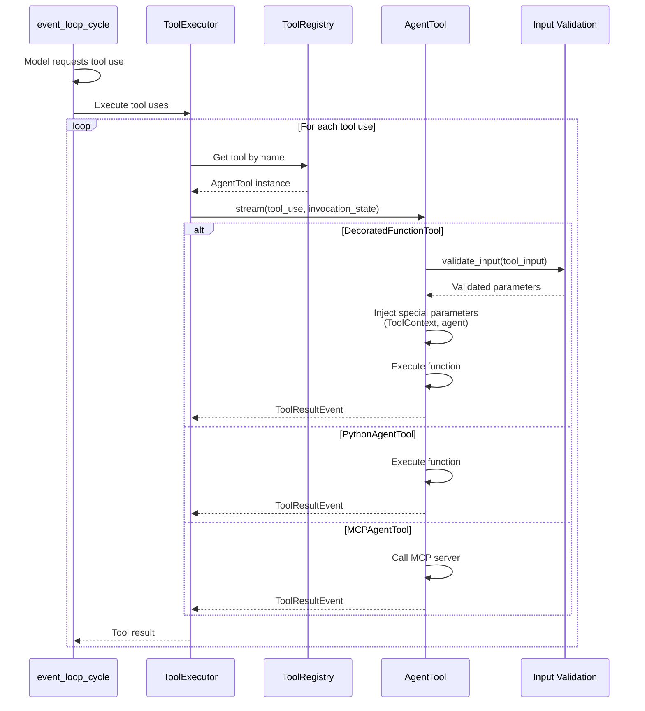

<!-- source: DeepWiki mcp.deepwiki.com · repo strands-agents/sdk-python · page 4 Tool System · fetched 2026-10-27 -->

# Tool System

<details>
<summary>Relevant source files</summary>

The following files were used as context for generating this wiki page:

- [site/src/content/docs/user-guide/concepts/agents/agent-loop.mdx](site/src/content/docs/user-guide/concepts/agents/agent-loop.mdx)
- [site/src/content/docs/user-guide/concepts/tools/vended-tools-imports.ts](site/src/content/docs/user-guide/concepts/tools/vended-tools-imports.ts)
- [site/src/content/docs/user-guide/concepts/tools/vended-tools.mdx](site/src/content/docs/user-guide/concepts/tools/vended-tools.mdx)
- [site/src/content/docs/user-guide/concepts/tools/vended-tools.ts](site/src/content/docs/user-guide/concepts/tools/vended-tools.ts)
- [strands-py/AGENTS.md](strands-py/AGENTS.md)
- [strands-py/docs/TESTING.md](strands-py/docs/TESTING.md)
- [strands-py/src/strands/experimental/tools/__init__.py](strands-py/src/strands/experimental/tools/__init__.py)
- [strands-py/src/strands/experimental/tools/stop/__init__.py](strands-py/src/strands/experimental/tools/stop/__init__.py)
- [strands-py/src/strands/experimental/tools/stop/stop.py](strands-py/src/strands/experimental/tools/stop/stop.py)
- [strands-py/src/strands/telemetry/metrics.py](strands-py/src/strands/telemetry/metrics.py)
- [strands-py/src/strands/tools/executors/_executor.py](strands-py/src/strands/tools/executors/_executor.py)
- [strands-py/src/strands/tools/executors/sequential.py](strands-py/src/strands/tools/executors/sequential.py)
- [strands-py/src/strands/tools/mcp/mcp_types.py](strands-py/src/strands/tools/mcp/mcp_types.py)
- [strands-py/src/strands/vended_tools/__init__.py](strands-py/src/strands/vended_tools/__init__.py)
- [strands-py/tests/strands/experimental/tools/test_stop.py](strands-py/tests/strands/experimental/tools/test_stop.py)
- [strands-py/tests/strands/telemetry/test_metrics.py](strands-py/tests/strands/telemetry/test_metrics.py)
- [strands-py/tests/strands/tools/executors/conftest.py](strands-py/tests/strands/tools/executors/conftest.py)
- [strands-py/tests/strands/tools/executors/test_executor.py](strands-py/tests/strands/tools/executors/test_executor.py)
- [strands-ts/AGENTS.md](strands-ts/AGENTS.md)
- [strands-ts/docs/TESTING.md](strands-ts/docs/TESTING.md)
- [strands-ts/src/experimental/vended-tools/stop/README.md](strands-ts/src/experimental/vended-tools/stop/README.md)
- [strands-ts/src/experimental/vended-tools/stop/__tests__/stop.test.ts](strands-ts/src/experimental/vended-tools/stop/__tests__/stop.test.ts)
- [strands-ts/src/vended-tools/index.ts](strands-ts/src/vended-tools/index.ts)

</details>


## Purpose and Scope

The Tool System enables agents to extend their capabilities beyond language model inference by executing custom functionality through tools. This page documents the complete architecture for defining, registering, and executing tools.

This covers:
- Tool definition patterns (decorators, modules, MCP, custom providers)
- Tool registration and discovery via `ToolRegistry`
- Tool execution strategies and streaming
- Input validation and error handling

For information about how tools are invoked during agent execution, see [Event Loop and Execution Flow](#2.2). For MCP-specific integration details, see [Model Context Protocol (MCP) Integration](#4.4).

---

## Architecture Overview

The tool system follows a four-phase lifecycle: **Definition → Registration → Discovery → Execution**. All tool types converge to a common `AgentTool` interface, enabling uniform execution regardless of implementation.

### Tool Lifecycle



**Sources:** [strands-py/src/strands/tools/registry.py:32-45](), [strands-py/src/strands/types/tools.py:212-307](), [strands-py/src/strands/tools/decorator.py:427-661]()

---

## Core Interfaces

### AgentTool Abstract Base Class

All tool implementations inherit from `AgentTool` [strands-py/src/strands/types/tools.py:212-307](), which defines the contract for tool integration:



**Key Properties:**
- `tool_name`: Unique identifier used for tool invocation [strands-py/src/strands/types/tools.py:228-233]()
- `tool_spec`: `ToolSpec` containing name, description, and JSON schema for input validation [strands-py/src/strands/types/tools.py:23-39]()
- `tool_type`: Implementation type ("function", "python", etc.) [strands-py/src/strands/types/tools.py:254-259]()
- `stream()`: Async generator yielding tool events, with final event being `ToolResultEvent` [strands-py/src/strands/types/tools.py:284-301]()

**Sources:** [strands-py/src/strands/types/tools.py:212-307](), [strands-py/src/strands/tools/decorator.py:427-661](), [strands-py/src/strands/tools/tools.py:157-236](), [strands-py/src/strands/tools/mcp/mcp_agent_tool.py:24-120]()

### ToolSpec Structure

The `ToolSpec` is a `TypedDict` modeled after the Bedrock API [strands-py/src/strands/types/tools.py:1-6]().



**Sources:** [strands-py/src/strands/types/tools.py:23-39](), [strands-py/src/strands/tools/tools.py:104-154]()

---

## Tool Definition

### Using the @tool Decorator

The `@tool` decorator [strands-py/src/strands/tools/decorator.py:676-778]() transforms Python functions into tools with automatic metadata extraction from docstrings and type hints.

**Basic Usage:**

```python
from strands import tool

@tool
def search_database(query: str, limit: int = 10) -> dict:
    """Search the database for matching records.
    
    Args:
        query: Search query string
        limit: Maximum number of results (default: 10)
    
    Returns:
        Dictionary containing search results
    """
    results = perform_search(query, limit)
    return {"status": "success", "content": [{"text": f"Found {len(results)} results"}]}
```

The decorator automatically extracts metadata using the `FunctionToolMetadata` helper [strands-py/src/strands/tools/decorator.py:79-117](). For detailed documentation on the decorator and its parameters, see [Creating Tools with @tool Decorator](#4.1).

**Sources:** [strands-py/src/strands/tools/decorator.py:676-778]()

### Metadata Extraction Process



**Key Classes:**
- `FunctionToolMetadata`: Manages metadata extraction [strands-py/src/strands/tools/decorator.py:79-421]()
- `DecoratedFunctionTool`: Wraps decorated functions [strands-py/src/strands/tools/decorator.py:427-661]()

**Special Features:**
- **ToolContext Injection**: Add `tool_context: ToolContext` parameter to access agent state and interrupt capabilities [strands-py/src/strands/tools/decorator.py:376-394]()
- **Annotated Types**: Use `Annotated[Type, "description"]` for inline parameter documentation [strands-py/src/strands/tools/decorator.py:118-170]()
- **Async Support**: Works with sync functions, async functions, and async generators [strands-py/src/strands/tools/decorator.py:578-595]()

**Sources:** [strands-py/src/strands/tools/decorator.py:79-421](), [strands-py/src/strands/tools/decorator.py:427-661]()

### Module-Based Tools

Module-based tools define a `TOOL_SPEC` dictionary and a matching function at module level [strands-py/src/strands/tools/loader.py:132-149]():

```python
# my_tool.py
TOOL_SPEC = {
    "name": "my_tool",
    "description": "Tool description",
    "inputSchema": {
        "json": {
            "type": "object",
            "properties": {
                "param": {"type": "string", "description": "Parameter"}
            },
            "required": ["param"]
        }
    }
}

def my_tool(tool_use, **invocation_state):
    # Implementation
    return {
        "toolUseId": tool_use["toolUseId"],
        "status": "success",
        "content": [{"text": "Result"}]
    }
```

These are loaded as `PythonAgentTool` instances [strands-py/src/strands/tools/tools.py:157-236]().

**Sources:** [strands-py/src/strands/tools/tools.py:157-236](), [strands-py/src/strands/tools/loader.py:132-149]()

### ToolProvider Interface

Dynamic tool providers implement the `ToolProvider` interface for runtime tool discovery and lifecycle management [strands-py/src/strands/tools/tool_provider.py:11-53](). Tool providers allow loading a collection of tools and cleaning them up when done [strands-py/src/strands/tools/tool_provider.py:14-15]().

**Sources:** [strands-py/src/strands/tools/tool_provider.py:11-53](), [strands-py/src/strands/tools/registry.py:707-723]()

---

## Tool Registry

### ToolRegistry Class

`ToolRegistry` [strands-py/src/strands/tools/registry.py:32-36]() is the central hub for tool management, providing registration, validation, and discovery.



**Core Methods:**

| Method | Purpose |
|--------|---------|
| `process_tools(tools)` | Process mixed list of tool specifications and register them [strands-py/src/strands/tools/registry.py:46-161]() |
| `register_tool(tool)` | Register single tool with validation and conflict detection [strands-py/src/strands/tools/registry.py:229-280]() |
| `replace(new_tool)` | Replace existing tool implementation (hot reload) [strands-py/src/strands/tools/registry.py:282-307]() |
| `get_all_tool_specs()` | Return list of all `ToolSpec` objects [strands-py/src/strands/tools/registry.py:564-572]() |
| `validate_tool_spec(spec)` | Validate and normalize tool specification [strands-py/src/strands/tools/registry.py:589-638]() |
| `cleanup()` | Cleanup all tool providers (call on shutdown) [strands-py/src/strands/tools/registry.py:707-723]()

For details on how tools are discovered and managed, see [Tool Registry and Discovery](#4.2).

**Sources:** [strands-py/src/strands/tools/registry.py:32-280]()

### Tool Name Validation

Tool names must match pattern `^[a-zA-Z0-9_\-]{1,}$` [strands-py/src/strands/tools/tools.py:60]() and have a maximum length of 64 [strands-py/src/strands/tools/tools.py:59](). The registry also prevents registration of duplicate names that differ only by dash or underscore [strands-py/src/strands/tools/registry.py:243-262]().

**Sources:** [strands-py/src/strands/tools/tools.py:42-72](), [strands-py/src/strands/tools/registry.py:243-262]()

---

## Tool Execution

### Execution Flow



**Sources:** [strands-py/src/strands/tools/decorator.py:542-624](), [strands-py/src/strands/tools/tools.py:219-236](), [strands-py/src/strands/tools/mcp/mcp_agent_tool.py:97-120]()

### Input Validation

`DecoratedFunctionTool` performs automatic input validation using a Pydantic model generated from the function signature [strands-py/src/strands/tools/decorator.py:116-117](). Validation occurs during the `stream` call [strands-py/src/strands/tools/decorator.py:569-577]().

For detailed execution patterns, including error handling and concurrency, see [Tool Execution Strategies](#4.3).

**Sources:** [strands-py/src/strands/tools/decorator.py:116-117](), [strands-py/src/strands/tools/decorator.py:569-577]()

---

## Tool Context and Framework Integration

### ToolContext Injection

Functions can receive a `ToolContext` parameter to access framework capabilities [strands-py/src/strands/types/tools.py:130-147]().

**ToolContext Fields:**

| Field | Type | Description |
|-------|------|-------------|
| `tool_use` | `ToolUse` | Complete tool use request with toolUseId, name, and input [strands-py/src/strands/types/tools.py:149]() |
| `agent` | `Any` | Agent instance executing the tool [strands-py/src/strands/types/tools.py:150]() |
| `invocation_state` | `dict[str, Any]` | Kwargs passed to `agent()` or `agent.invoke_async()` [strands-py/src/strands/types/tools.py:151]() |

**Sources:** [strands-py/src/strands/types/tools.py:130-151](), [strands-py/src/strands/tools/decorator.py:376-420]()

---

## Schema Normalization

### Tool Spec Normalization

The SDK normalizes tool specifications to ensure consistency across model providers [strands-py/src/strands/tools/tools.py:133-154](). This includes adding default types and descriptions to JSON schemas [strands-py/src/strands/tools/tools.py:104-131]().

**Composition Keywords:** Properties using `anyOf`, `oneOf`, `allOf`, or `not` are **not** given a default `type: "string"` [strands-py/src/strands/tools/tools.py:20-24]().

**Sources:** [strands-py/src/strands/tools/tools.py:20-24](), [strands-py/src/strands/tools/tools.py:104-154](), [strands-py/src/strands/tools/registry.py:589-638]()

---

## Tool Result Format

All tools return results in the standard `ToolResult` format [strands-py/src/strands/types/tools.py:90-102]().

```python
{
    "toolUseId": str,           # Must match the tool use request
    "status": "success" | "error",
    "content": [                # List of content blocks
        {"text": str},          # Text content
        {"json": Any},          # JSON content
        {"image": {...}},       # Image content
        {"document": {...}}     # Document content
    ]
}
```

**Sources:** [strands-py/src/strands/types/tools.py:83-102](), [strands-py/src/strands/tools/decorator.py:625-641]()

---

