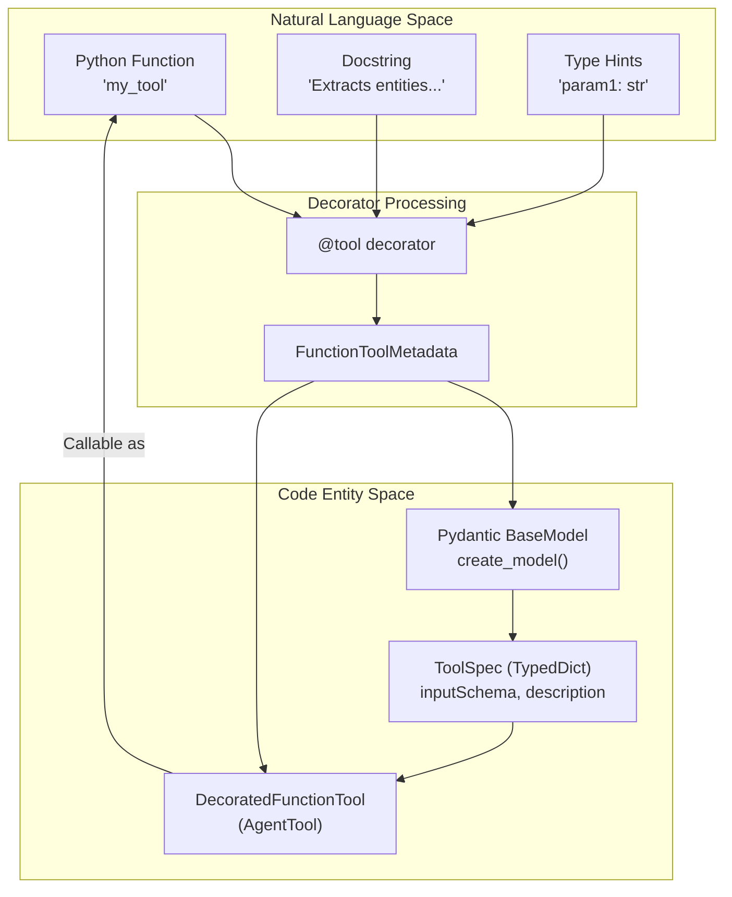
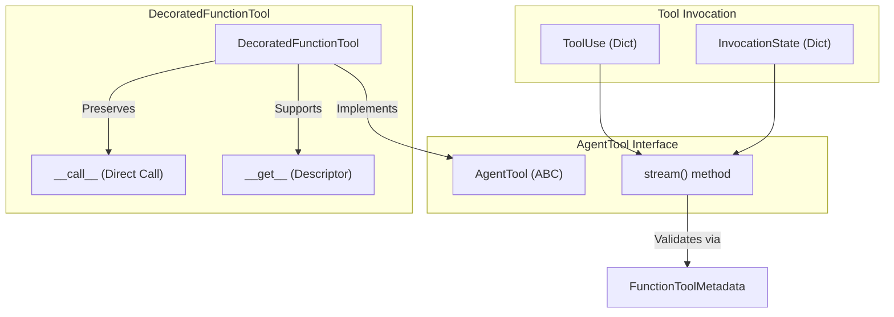

<!-- source: DeepWiki mcp.deepwiki.com · repo strands-agents/sdk-python · page 4.1 Creating Tools with @tool Decorator · fetched 2026-10-27 -->

# Creating Tools with @tool Decorator

<details>
<summary>Relevant source files</summary>

The following files were used as context for generating this wiki page:

- [strands-py/src/strands/tools/decorator.py](strands-py/src/strands/tools/decorator.py)
- [strands-py/tests/strands/tools/test_decorator.py](strands-py/tests/strands/tools/test_decorator.py)
- [strands-ts/src/__fixtures__/tool-helpers.ts](strands-ts/src/__fixtures__/tool-helpers.ts)
- [strands-ts/src/__tests__/interrupt.test.ts](strands-ts/src/__tests__/interrupt.test.ts)
- [strands-ts/src/hooks/__tests__/registry.test.ts](strands-ts/src/hooks/__tests__/registry.test.ts)
- [strands-ts/src/hooks/index.ts](strands-ts/src/hooks/index.ts)
- [strands-ts/src/hooks/registry.ts](strands-ts/src/hooks/registry.ts)
- [strands-ts/src/multiagent/__tests__/graph.tracer.test.ts](strands-ts/src/multiagent/__tests__/graph.tracer.test.ts)
- [strands-ts/src/multiagent/__tests__/state.test.ts](strands-ts/src/multiagent/__tests__/state.test.ts)
- [strands-ts/src/telemetry/__tests__/config.test.node.ts](strands-ts/src/telemetry/__tests__/config.test.node.ts)
- [strands-ts/src/telemetry/__tests__/config.test.ts](strands-ts/src/telemetry/__tests__/config.test.ts)
- [strands-ts/src/telemetry/config.ts](strands-ts/src/telemetry/config.ts)
- [strands-ts/src/tools/__tests__/tool.test.ts](strands-ts/src/tools/__tests__/tool.test.ts)
- [strands-ts/src/tools/__tests__/zod-tool.test-d.ts](strands-ts/src/tools/__tests__/zod-tool.test-d.ts)
- [strands-ts/src/tools/function-tool.ts](strands-ts/src/tools/function-tool.ts)
- [strands-ts/src/tools/tool-factory.ts](strands-ts/src/tools/tool-factory.ts)
- [strands-ts/src/tools/tool.ts](strands-ts/src/tools/tool.ts)
- [strands-ts/src/tools/zod-tool.ts](strands-ts/src/tools/zod-tool.ts)
- [strands-ts/test/integ/telemetry.test.node.ts](strands-ts/test/integ/telemetry.test.node.ts)

</details>


## Purpose and Scope

This document explains how to create agent tools using the `@tool` decorator, which transforms Python functions into `AgentTool` instances that can be used by agents. The decorator automatically extracts metadata from function signatures and docstrings, generates JSON schemas for validation, and handles both standard function calls and tool use invocations from language models.

For information about tool registration and discovery mechanisms, see [Tool Registry and Discovery](4.2). For details on how tools are executed during agent operation, see [Tool Execution Strategies](4.3). For MCP-based tools, see [Model Context Protocol (MCP) Integration](4.4).

**Sources:** [strands-py/src/strands/tools/decorator.py:1-41]()

---

## Overview

The `@tool` decorator in [strands-py/src/strands/tools/decorator.py:676-778]() provides a seamless way to convert Python functions into agent tools. It performs several key operations:

1.  **Metadata Extraction**: Analyzes function signatures, type hints, and docstrings to generate tool specifications [strands-py/src/strands/tools/decorator.py:82-90]().
2.  **Schema Generation**: Creates JSON schemas from type annotations for input validation [strands-py/src/strands/tools/decorator.py:116]().
3.  **Dual Calling Pattern**: Maintains normal function behavior while enabling tool use invocations [strands-py/src/strands/tools/decorator.py:461-512]().
4.  **Input Validation**: Uses Pydantic models to validate and coerce input parameters [strands-py/src/strands/tools/decorator.py:350-374]().
5.  **Context Injection**: Optionally provides framework context via `ToolContext` parameter [strands-py/src/strands/tools/decorator.py:376-420]().
6.  **Result Formatting**: Converts function returns to standardized `ToolResult` format [strands-py/src/strands/tools/decorator.py:625-640]().

### Decorator Syntax

The decorator supports two usage patterns:

```python
# Pattern 1: Simple decorator
@tool
def my_tool(param: str) -> str:
    return f"Result: {param}"

# Pattern 2: Decorator with configuration
@tool(name="custom_name", description="Custom description", context=True)
def my_tool(param: str, tool_context: ToolContext) -> str:
    return f"Result: {param}"
```

**Sources:** [strands-py/src/strands/tools/decorator.py:676-778](), [strands-py/tests/strands/tools/test_decorator.py:205-250]()

---

## Tool Transformation Architecture

The transformation process bridges the "Natural Language Space" (docstrings/hints) to the "Code Entity Space" (ToolSpec/AgentTool).



**Diagram: Mapping Natural Language to Code Entities**

This diagram shows how the `@tool` decorator acts as a bridge, taking human-readable documentation and type hints to construct structured code entities like `ToolSpec` and `DecoratedFunctionTool`.

**Sources:** [strands-py/src/strands/tools/decorator.py:80-220](), [strands-py/src/strands/tools/decorator.py:427-661](), [strands-py/src/strands/types/tools.py:23-40]()

---

## Metadata Extraction

### FunctionToolMetadata Class

The `FunctionToolMetadata` class in [strands-py/src/strands/tools/decorator.py:80-420]() handles all metadata extraction operations:

| Operation | Method | Description |
|-----------|--------|-------------|
| Signature Analysis | `__init__` | Extracts parameter names, types, and defaults using `inspect.signature` [strands-py/src/strands/tools/decorator.py:102-106](). |
| Docstring Parsing | `_extract_description_from_docstring` | Parses docstring, excluding Args section [strands-py/src/strands/tools/decorator.py:221-269](). |
| Type Processing | `_extract_annotated_metadata` | Handles `Annotated` types and extracts descriptions [strands-py/src/strands/tools/decorator.py:118-170](). |
| Schema Generation | `_create_input_model` | Creates Pydantic model for validation via `create_model` [strands-py/src/strands/tools/decorator.py:271-314](). |
| Schema Cleanup | `_clean_pydantic_schema` | Removes Pydantic-specific metadata for cleaner JSON schemas [strands-py/src/strands/tools/decorator.py:316-348](). |
| Input Validation | `validate_input` | Validates tool use inputs against the generated model [strands-py/src/strands/tools/decorator.py:350-374](). |
| Parameter Injection | `inject_special_parameters` | Injects `ToolContext` and `agent` into the call [strands-py/src/strands/tools/decorator.py:376-420](). |

**Sources:** [strands-py/src/strands/tools/decorator.py:80-420]()

### Docstring Processing

The decorator extracts tool descriptions from function docstrings while excluding the Args section, preserving Returns, Raises, and other sections. It uses `docstring_parser` to identify parameter descriptions in [strands-py/src/strands/tools/decorator.py:108-113]().

Supported Args section headers (case-insensitive):
- `Args:`, `Arguments:`, `Parameters:`, `Param:`, `Params:` [strands-py/src/strands/tools/decorator.py:221-269]()

**Sources:** [strands-py/src/strands/tools/decorator.py:221-269](), [strands-py/tests/strands/tools/test_decorator.py:310-474]()

### Type Hint Processing

Type hints are processed to generate JSON schemas. The decorator handles:

-   **Basic Types**: `str`, `int`, `float`, `bool` map to JSON schema primitives.
-   **Optional Types**: `Optional[T]` or `T | None` become non-required fields.
-   **Annotated Types**: `Annotated[T, "description"]` extracts inline descriptions in [strands-py/src/strands/tools/decorator.py:130-137]().
-   **Default Values**: Parameters with defaults are marked as non-required in the generated Pydantic model [strands-py/src/strands/tools/decorator.py:271-314]().

**Important Note:** Using `pydantic.Field` within `Annotated` is not supported due to complexities with Pydantic v2's immutable Core Schema [strands-py/src/strands/tools/decorator.py:140-160]().

**Sources:** [strands-py/src/strands/tools/decorator.py:119-170](), [strands-py/src/strands/tools/decorator.py:186-219]()

---

## ToolContext Injection

### Enabling Context Injection

The `@tool` decorator accepts a `context` parameter to enable framework context injection:

```python
@tool(context=True)  # Injects parameter named 'tool_context'
def my_tool(param: str, tool_context: ToolContext) -> str:
    agent = tool_context.agent
    tool_use_id = tool_context.tool_use["toolUseId"]
    return f"Processed {param}"
```

### ToolContext Structure

The `ToolContext` dataclass in [strands-py/src/strands/types/tools.py:131-164]() provides access to the agent and the specific tool invocation state:

| Field | Type | Description |
|-------|------|-------------|
| `tool_use` | `ToolUse` | Complete tool use request with `toolUseId`, `name`, `input` [strands-py/src/strands/types/tools.py:149](). |
| `agent` | `Any` | Agent instance executing the tool [strands-py/src/strands/types/tools.py:150](). |
| `invocation_state` | `dict[str, Any]` | Caller-provided kwargs from agent invocation [strands-py/src/strands/types/tools.py:151](). |

`ToolContext` also provides `_interrupt_id()` for generating unique IDs for human-in-the-loop interrupts [strands-py/src/strands/types/tools.py:153-162]().

**Sources:** [strands-py/src/strands/types/tools.py:131-164](), [strands-py/tests/strands/tools/test_decorator.py:159-161]()

---

## DecoratedFunctionTool Implementation

`DecoratedFunctionTool` in [strands-py/src/strands/tools/decorator.py:427-661]() implements the `AgentTool` interface while preserving the original function's callable behavior.



**Diagram: DecoratedFunctionTool Class Relationships**

The `DecoratedFunctionTool` uses the descriptor protocol (`__get__`) to support being used as a class method while maintaining its ability to be called directly like a regular function [strands-py/src/strands/tools/decorator.py:445-459]().

**Sources:** [strands-py/src/strands/tools/decorator.py:427-661](), [strands-py/src/strands/types/tools.py:212-307]()

---

## Execution Flow

### Tool Stream Processing

When a tool is invoked via `stream()`, the following sequence occurs:

1.  **Validation**: `metadata.validate_input(input_data)` is called [strands-py/src/strands/tools/decorator.py:545]().
2.  **Context Preparation**: Special parameters like `ToolContext` or `agent` are injected [strands-py/src/strands/tools/decorator.py:549]().
3.  **Execution**:
    -   **Sync**: Executed via `asyncio.to_thread` [strands-py/src/strands/tools/decorator.py:594]().
    -   **Async**: Awaited directly [strands-py/src/strands/tools/decorator.py:588]().
    -   **Async Generator**: Iterated to yield `ToolStreamEvent` [strands-py/src/strands/tools/decorator.py:578-586]().
4.  **Wrapping**: Results are wrapped into a `ToolResultEvent` [strands-py/src/strands/tools/decorator.py:616]().

### Return Value Handling

The `_wrap_tool_result` method in [strands-py/src/strands/tools/decorator.py:625-640]() converts function returns to `ToolResult` format. If a tool returns a dictionary already containing `status` and `content`, it is treated as a complete `ToolResult` [strands-py/src/strands/tools/decorator.py:627](). Otherwise, the return value is stringified and wrapped [strands-py/src/strands/tools/decorator.py:633]().

**Sources:** [strands-py/src/strands/tools/decorator.py:542-640](), [strands-py/tests/strands/tools/test_decorator.py:117-126]()

---

## Input Validation and Normalization

### Schema Normalization

Before being sent to a model provider, tool schemas are normalized in [strands-py/src/strands/tools/tools.py:133-154](). The `normalize_schema` function ensures essential JSON schema structure exists, such as `type: "object"` and a `properties` dictionary [strands-py/src/strands/tools/tools.py:120-122]().

### Validation Logic

The `FunctionToolMetadata.validate_input` method in [strands-py/src/strands/tools/decorator.py:350-374]() uses the generated Pydantic model to perform validation. This ensures that the model's output conforms to the expected Python types before the function body is even entered.

**Sources:** [strands-py/src/strands/tools/tools.py:104-154](), [strands-py/src/strands/tools/decorator.py:350-374]()

---

## Direct Tool Calling

The SDK allows developers to call tools directly through the agent instance using a method-style interface (e.g., `agent.tool.my_tool(param="value")`). This is facilitated by the `_ToolCaller` class in [strands-py/src/strands/tools/_caller.py:28-146]().

When a tool is called this way:
1.  The tool name is normalized (e.g., `_` to `-`) to find a match in the registry [strands-py/src/strands/tools/_caller.py:148-167]().
2.  A unique `toolUseId` is generated [strands-py/src/strands/tools/_caller.py:111]().
3.  The tool is executed via `ToolExecutor._stream` [strands-py/src/strands/tools/_caller.py:121]().
4.  If `record_direct_tool_call` is enabled, the execution is recorded in the agent's message history [strands-py/src/strands/tools/_caller.py:128-130]().

**Sources:** [strands-py/src/strands/tools/_caller.py:28-183](), [strands-py/tests/strands/tools/test_caller.py:36-55]()

---

## Error and Interrupt Handling

### Interruptions

If a tool function raises an `InterruptException`, the decorator catches it and yields a `ToolInterruptEvent` [strands-py/src/strands/tools/decorator.py:598-600](). This is used for human-in-the-loop patterns where the agent must pause for user input.

### General Errors

Any other exceptions raised during tool execution are caught, and a `ToolResultEvent` with `status: "error"` is returned [strands-py/src/strands/tools/decorator.py:611-615]().

**Sources:** [strands-py/src/strands/tools/decorator.py:597-623](), [strands-py/src/strands/types/_events.py:69-70]()

---

## TypeScript Tool Factories

The TypeScript SDK provides `function-tool` and `zod-tool` factories for creating tools, offering similar functionality to the Python `@tool` decorator. These factories are accessed via the `tool` function in [strands-ts/src/tools/tool-factory.ts:26-37]().

### `FunctionTool`

The `FunctionTool` class in [strands-ts/src/tools/function-tool.ts:100-100]() wraps a callback function and handles the conversion of its return values into `ToolResultBlock` objects. It supports synchronous, Promise-based, and AsyncGenerator-based callbacks.

```typescript
import { FunctionTool } from '@strands-agents/sdk'

const greetTool = new FunctionTool({
  name: 'greeter',
  description: 'Greets a person by name',
  inputSchema: {
    type: 'object',
    properties: { name: { type: 'string' } },
    required: ['name']
  },
  callback: (input: any) => `Hello, ${(input as { name: string }).name}!`
})
```

Key features of `FunctionTool`:
-   **`name` and `description`**: Define the tool's identity and purpose [strands-ts/src/tools/function-tool.ts:104-109]().
-   **`inputSchema`**: An optional JSON Schema for input validation. If omitted, it defaults to an empty object schema [strands-ts/src/tools/function-tool.ts:154-158]().
-   **`callback`**: The core logic of the tool. It can return a synchronous value, a `Promise`, or an `AsyncGenerator` [strands-ts/src/tools/function-tool.ts:179-206]().
-   **`stream(toolContext)`**: Executes the tool, yielding `ToolStreamEvent`s for progress updates and returning a `ToolResultBlock` [strands-ts/src/tools/function-tool.ts:175-206]().
-   **`invoke(input, context)`**: Provides a direct, type-safe way to call the tool, returning the raw result (not wrapped in `ToolResultBlock`) and consuming async generators to return only the final value [strands-ts/src/tools/function-tool.ts:210-225]().

**Sources:** [strands-ts/src/tools/function-tool.ts:100-100](), [strands-ts/src/tools/function-tool.ts:104-109](), [strands-ts/src/tools/function-tool.ts:154-158](), [strands-ts/src/tools/function-tool.ts:175-206](), [strands-ts/src/tools/function-tool.ts:210-225]()

### `ZodTool`

The `ZodTool` class in [strands-ts/src/tools/zod-tool.ts:52-55]() extends `FunctionTool` and integrates with Zod schemas for robust input validation and type inference. It is created using the `tool` factory function when a Zod schema is provided for `inputSchema`.

```typescript
import { tool } from '@strands-agents/sdk'
import { z } from 'zod'

const calculator = tool({
  name: 'calculator',
  description: 'Adds two numbers',
  inputSchema: z.object({ a: z.number(), b: z.number() }),
  callback: (input) => input.a + input.b,
})
```

Key features of `ZodTool`:
-   **`inputSchema`**: Accepts a Zod schema (`z.ZodType`) for input validation. If `z.void()` or `undefined`, the tool takes no input parameters [strands-ts/src/tools/zod-tool.ts:80-81]().
-   **Automatic JSON Schema Generation**: The Zod schema is automatically converted to a JSON Schema for the `toolSpec` [strands-ts/src/tools/zod-tool.ts:83-94]().
-   **Runtime Validation**: Input is validated against the Zod schema before the callback is executed [strands-ts/src/tools/zod-tool.ts:105-106]().
-   **Type Safety**: Provides strong type inference for the `input` parameter of the `callback` function and the `invoke` method [strands-ts/src/tools/zod-tool.ts:108-109](), [strands-ts/src/tools/zod-tool.ts:159-160]().
-   **Delegation**: Internally uses a `FunctionTool` to handle streaming and result wrapping [strands-ts/src/tools/zod-tool.ts:97-111]().

**Sources:** [strands-ts/src/tools/zod-tool.ts:52-55](), [strands-ts/src/tools/zod-tool.ts:80-81](), [strands-ts/src/tools/zod-tool.ts:83-94](), [strands-ts/src/tools/zod-tool.ts:97-111](), [strands-ts/src/tools/zod-tool.ts:105-106](), [strands-ts/src/tools/zod-tool.ts:108-109](), [strands-ts/src/tools/zod-tool.ts:159-160](), [strands-ts/src/tools/tool-factory.ts:26-37]()

### Tool Type Hierarchy

The TypeScript SDK defines a clear hierarchy for tools:

```mermaid
graph TD
    Tool["Tool (Abstract Class)"]
    InvokableTool["InvokableTool (Interface)"]
    FunctionTool["FunctionTool"]
    ZodTool["ZodTool"]

    Tool <|-- FunctionTool
    FunctionTool <|-- ZodTool
    InvokableTool <|.. FunctionTool
    InvokableTool <|.. ZodTool
```

**Diagram: TypeScript Tool Type Hierarchy**

-   **`Tool`**: The abstract base class defining the core `name`, `description`, `toolSpec`, and `stream` method that all tools must implement [strands-ts/src/tools/tool.ts:104-157]().
-   **`InvokableTool`**: An interface extending `Tool` that adds the `invoke` method for direct, type-safe execution of tools, bypassing the streaming `ToolResultBlock` wrapping [strands-ts/src/tools/tool.ts:166-180]().
-   **`FunctionTool`**: A concrete implementation of `Tool` and `InvokableTool` that wraps a generic callback function and handles result formatting and streaming [strands-ts/src/tools/function-tool.ts:100-100]().
-   **`ZodTool`**: Extends `FunctionTool` to provide Zod-based input validation and enhanced type safety [strands-ts/src/tools/zod-tool.ts:52-55]().

**Sources:** [strands-ts/src/tools/tool.ts:104-157](), [strands-ts/src/tools/tool.ts:166-180](), [strands-ts/src/tools/function-tool.ts:100-100](), [strands-ts/src/tools/zod-tool.ts:52-55]()

---

