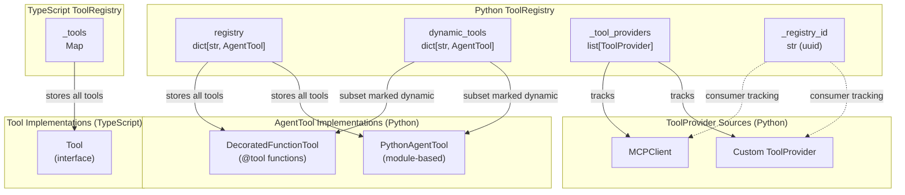
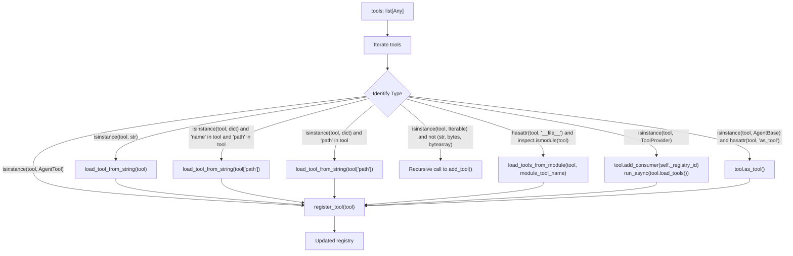
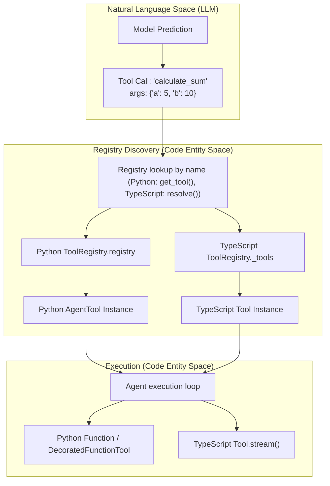
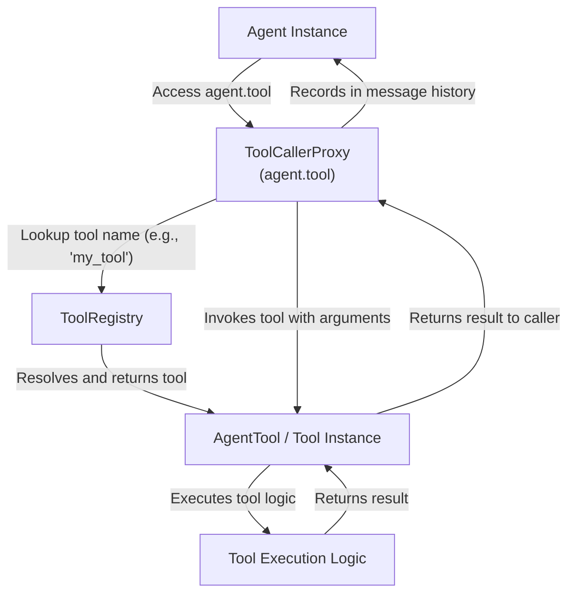

<!-- source: DeepWiki mcp.deepwiki.com · repo strands-agents/sdk-python · page 4.2 Tool Registry and Discovery · fetched 2026-10-27 -->

# Tool Registry and Discovery

<details>
<summary>Relevant source files</summary>

The following files were used as context for generating this wiki page:

- [strands-py/src/strands/tools/loader.py](strands-py/src/strands/tools/loader.py)
- [strands-py/src/strands/tools/registry.py](strands-py/src/strands/tools/registry.py)
- [strands-py/src/strands/tools/tools.py](strands-py/src/strands/tools/tools.py)
- [strands-py/src/strands/vended_interventions/cedar/__init__.py](strands-py/src/strands/vended_interventions/cedar/__init__.py)
- [strands-py/tests/strands/tools/test_registry.py](strands-py/tests/strands/tools/test_registry.py)
- [strands-py/tests/strands/tools/test_tools.py](strands-py/tests/strands/tools/test_tools.py)
- [strands-py/tests/strands/vended_interventions/cedar/test_cedar_authorization.py](strands-py/tests/strands/vended_interventions/cedar/test_cedar_authorization.py)
- [strands-py/tests/strands/vended_interventions/cedar/test_cedar_integration.py](strands-py/tests/strands/vended_interventions/cedar/test_cedar_integration.py)
- [strands-py/tests/strands/vended_interventions/cedar/test_schema_generator.py](strands-py/tests/strands/vended_interventions/cedar/test_schema_generator.py)
- [strands-ts/src/agent/__tests__/tool-caller.test.ts](strands-ts/src/agent/__tests__/tool-caller.test.ts)
- [strands-ts/src/agent/tool-caller.ts](strands-ts/src/agent/tool-caller.ts)
- [strands-ts/src/registry/__tests__/tool-registry.test.ts](strands-ts/src/registry/__tests__/tool-registry.test.ts)
- [strands-ts/src/registry/tool-registry.ts](strands-ts/src/registry/tool-registry.ts)

</details>


This page describes the `ToolRegistry` class, which serves as the central management system for tool discovery, validation, loading, and lifecycle management in the Strands Agents SDK.

## Overview

The `ToolRegistry` class in [strands-py/src/strands/tools/registry.py:30-34]() manages all tools available to an agent. It provides a unified interface for tools originating from diverse sources, including local files, Python modules, decorated functions, and external protocols like the Model Context Protocol (MCP). The TypeScript SDK also features a `ToolRegistry` [strands-ts/src/registry/tool-registry.ts:7-8]() with similar responsibilities.

**Key Capabilities:**
- **Unified Catalog**: Consolidates tools from multiple sources into a single searchable registry [strands-py/src/strands/tools/registry.py:38-44](), [strands-ts/src/registry/tool-registry.ts:8-9]().
- **Flexible Discovery**: Supports loading via file paths, module import strings, and directory scanning [strands-py/src/strands/tools/registry.py:46-71]().
- **Lifecycle Management**: Tracks `ToolProvider` instances and manages their cleanup via consumer IDs [strands-py/src/strands/tools/registry.py:41-42]().
- **Hot-Reloading**: Supports runtime updates of tools marked as dynamic [strands-py/src/strands/tools/registry.py:352-358]().
- **Name Normalization**: Automatically handles variations between hyphens and underscores to prevent collisions and resolve tool names [strands-py/src/strands/tools/registry.py:242-261](), [strands-ts/src/registry/tool-registry.ts:150-159]().

**Sources:**
- [strands-py/src/strands/tools/registry.py:30-44]()
- [strands-py/src/strands/tools/registry.py:46-71]()
- [strands-py/src/strands/tools/registry.py:242-261]()
- [strands-py/src/strands/tools/registry.py:352-358]()
- [strands-ts/src/registry/tool-registry.ts:7-8]()
- [strands-ts/src/registry/tool-registry.ts:8-9]()
- [strands-ts/src/registry/tool-registry.ts:150-159]()

## ToolRegistry Internal Structure

The registry maintains separate internal mappings to distinguish between static tools and those loaded dynamically (which may be subject to reloading).

**Title**: ToolRegistry Core Data Structures and Relationships



| Field | Type | Purpose |
|-------|------|---------|
| `registry` (Python) | `dict[str, AgentTool]` | Main mapping of tool names to `AgentTool` instances [strands-py/src/strands/tools/registry.py:38](). |
| `dynamic_tools` (Python) | `dict[str, AgentTool]` | Tracks tools that can be reloaded at runtime [strands-py/src/strands/tools/registry.py:39](). |
| `_tool_providers` (Python) | `list[ToolProvider]` | Stores external providers (e.g., `MCPClient`) to manage their lifecycle [strands-py/src/strands/tools/registry.py:41](). |
| `_registry_id` (Python) | `str` | A unique UUID used to register this registry as a consumer of providers [strands-py/src/strands/tools/registry.py:42](). |
| `_tools` (TypeScript) | `Map<string, Tool>` | Internal map storing registered tools by name [strands-ts/src/registry/tool-registry.ts:8](). |

**Sources:**
- [strands-py/src/strands/tools/registry.py:38-42]()
- [strands-ts/src/registry/tool-registry.ts:8]()

## Tool Loading with process_tools() (Python)

The `process_tools()` method is the primary mechanism for populating the Python registry. It recursively processes a list of tool specifications [strands-py/src/strands/tools/registry.py:46-71]().

**Title**: process_tools() Execution Flow (Python)



### Supported Input Formats (Python)

| Format | Example | Logic |
|--------|---------|-------|
| **File Path** | `"./tools/my_tool.py"` | Loads via `load_tools_from_file_path()` [strands-py/src/strands/tools/loader.py:88-91](). |
| **Module Path** | `"my_pkg.tools"` | Imports module and scans for `@tool` or `TOOL_SPEC` [strands-py/src/strands/tools/loader.py:94-96](). |
| **Targeted Func** | `"pkg.mod:func"` | Loads a specific decorated function from a module [strands-py/src/strands/tools/loader.py:127-143](). |
| **AgentTool** | `my_decorated_func` | Direct registration of an `AgentTool` instance [strands-py/src/strands/tools/registry.py:120-122](). |
| **ToolProvider** | `MCPClient(...)` | Adds to `_tool_providers` and calls `load_tools()` [strands-py/src/strands/tools/registry.py:130-142](). |
| **Agent Instance** | `other_agent` | Wraps the agent as a tool using `as_tool()` [strands-py/src/strands/tools/registry.py:143-146](). |

**Sources:**
- [strands-py/src/strands/tools/registry.py:72-151]()
- [strands-py/src/strands/tools/loader.py:77-149]()

## Tool Registry Operations (TypeScript)

The TypeScript `ToolRegistry` provides methods for adding, retrieving, and listing tools.

- `add(tool: Tool | Tool[])`: Registers one or more tools. Throws `ToolValidationError` if a tool's properties are invalid or its name is already registered, including name conflicts due to hyphen/underscore normalization [strands-ts/src/registry/tool-registry.ts:21-36]().
- `addOrReplace(newTools: Tool[])`: Registers tools, replacing any existing tools with the same name. Validates tool properties [strands-ts/src/registry/tool-registry.ts:45-53]().
- `get(name: string): Tool | undefined`: Retrieves a tool by its exact name [strands-ts/src/registry/tool-registry.ts:61-63]().
- `resolve(name: string): Tool`: Resolves a tool name using a specific order: exact match, underscore-to-hyphen substitution, then case-insensitive match. Throws `ToolNotFoundError` if no tool is found [strands-ts/src/registry/tool-registry.ts:76-102]().
- `remove(name: string): void`: Removes a tool by name [strands-ts/src/registry/tool-registry.ts:109-111]().
- `clear(): void`: Removes all registered tools [strands-ts/src/registry/tool-registry.ts:116-118]().
- `list(): Tool[]`: Returns an array of all registered tools [strands-ts/src/registry/tool-registry.ts:123-125]().

**Sources:**
- [strands-ts/src/registry/tool-registry.ts:21-125]()
- [strands-ts/src/registry/tool-registry.ts:150-159]()
- [strands-ts/src/errors.js:3]()

## ToolProvider Lifecycle (Python)

The `ToolProvider` interface allows external systems to provide tools while maintaining lifecycle hooks.

1. **Registration**: When a provider is added, the registry calls `add_consumer(self._registry_id)` [strands-py/src/strands/tools/registry.py:132]().
2. **Loading**: The registry invokes `await provider.load_tools()` to retrieve tool instances [strands-py/src/strands/tools/registry.py:137]().
3. **Cleanup**: When the registry is cleaned up, it calls `remove_consumer(self._registry_id)` on all providers (implementation found in `Agent.cleanup`).

This consumer-based tracking allows providers (like MCP clients) to keep connections open as long as at least one agent/registry is using them.

**Sources:**
- [strands-py/src/strands/tools/registry.py:130-142]()
- [strands-py/src/strands/tools/registry.py:41-42]()

## Hot-Reloading and Directory Discovery (Python)

The SDK supports automatic tool discovery from directories and runtime reloading.

### Directory Loading
The `Agent` can be configured to automatically load tools from a `tools/` directory in the current working directory. The registry uses `load_tools_from_file_path` to process `.py` files discovered in these locations [strands-py/src/strands/tools/loader.py:99-118]().

### Hot-Reload Logic
Hot reloading allows developers to update tool code without restarting the agent.
1. When a tool is registered, the registry checks if a tool with the same name already exists [strands-py/src/strands/tools/registry.py:242]().
2. If the existing tool supports hot reloading (`supports_hot_reload=True`), the new version replaces the old one [strands-py/src/strands/tools/registry.py:248-250]().
3. If hot reload is not supported and the names match exactly, a `ValueError` is raised [strands-py/src/strands/tools/registry.py:244-246]().

**Sources:**
- [strands-py/src/strands/tools/registry.py:242-261]()
- [strands-py/src/strands/tools/loader.py:99-118]()
- [tests/strands/tools/test_registry.py:155-172]()
- [tests/strands/tools/test_registry.py:177-196]()

## Name Normalization and Collision Prevention

To ensure compatibility across different model providers (some prefer underscores, others hyphens), the registry enforces strict naming rules:

- **Collision Detection**: The registry prevents registering tools that differ only by hyphens or underscores (e.g., `tool-like-this` and `tool_like_this`) [strands-py/src/strands/tools/registry.py:253-261](), [strands-ts/src/registry/tool-registry.ts:150-159]().
- **Normalization**: Tools are stored in the `registry` dictionary using their defined `tool_name` [strands-py/src/strands/tools/registry.py:261](). The TypeScript `ToolRegistry.resolve()` method handles name resolution with underscore-to-hyphen substitution and case-insensitivity [strands-ts/src/registry/tool-registry.ts:87-99]().

**Sources:**
- [strands-py/src/strands/tools/registry.py:253-261]()
- [strands-ts/src/registry/tool-registry.ts:87-99]()
- [strands-ts/src/registry/tool-registry.ts:150-159]()
- [tests/strands/tools/test_registry.py:63-77]()

## Tool Registry Data Flow

**Title**: Natural Language Tool Call to Code Execution Mapping



**Sources:**
- [strands-py/src/strands/tools/registry.py:38]()
- [strands-py/src/strands/tools/registry.py:209-211]()
- [strands-ts/src/registry/tool-registry.ts:8]()
- [strands-ts/src/registry/tool-registry.ts:76-102]()

## Tool Discovery via Module Scanning (Python)

The Python registry can scan entire Python modules for tools. It looks for:
1. Functions decorated with `@tool` (which become `DecoratedFunctionTool` instances) [strands-py/src/strands/tools/loader.py:162-172]().
2. Modules containing a `TOOL_SPEC` and a function matching the module name (which become `PythonAgentTool` instances) [strands-py/src/strands/tools/loader.py:175-180]().

**Sources:**
- [strands-py/src/strands/tools/loader.py:151-180]()
- [tests/strands/tools/test_registry.py:97-126]()

## ToolCallerProxy for Direct Tool Invocation

Both Python and TypeScript SDKs provide a `ToolCallerProxy` (Python: `ToolCaller`, TypeScript: `ToolCaller`) that allows direct invocation of registered tools from an agent instance using dot notation (e.g., `agent.tool.<tool_name>()`).

### Python `ToolCaller`

The Python `ToolCaller` is a dynamic proxy that intercepts attribute access to `agent.tool`. When `agent.tool.my_tool` is accessed, it looks up `my_tool` in the `ToolRegistry` and returns a callable wrapper.

```python
# Example Python usage
from strands import Agent, tool

@tool
def my_tool(param: str) -> str:
    return f"Processed: {param}"

agent = Agent(tools=[my_tool])
result = agent.tool.my_tool(param="hello")
print(result) # Output: Processed: hello
```

### TypeScript `ToolCaller`

The TypeScript `ToolCaller` is also a proxy that enables direct invocation. It resolves tool names using the `ToolRegistry.resolve()` method, which includes underscore-to-hyphen and case-insensitive matching.

```typescript
// Example TypeScript usage
import { Agent } from '@strands/sdk'
import { createTool } from '@strands/sdk/tools'

const myTool = createTool({
  name: 'my-tool',
  description: 'A sample tool',
  inputSchema: { type: 'object', properties: { param: { type: 'string' } } },
  async stream(input: { param: string }) {
    yield { type: 'text', text: `Processed: ${input.param}` }
  },
})

const agent = new Agent({ tools: [myTool] })
const result = await agent.tool['my-tool'].invoke({ param: 'hello' })
// Or using normalized name:
const resultNormalized = await agent.tool.my_tool.invoke({ param: 'world' })
```

The `ToolCaller` handles:
- **Tool Lookup**: Uses the agent's internal `ToolRegistry` to find the requested tool [strands-ts/src/agent/tool-caller.ts:100-102]().
- **Invocation**: Calls the tool's underlying execution function (`tool_func` in Python, `stream` in TypeScript) [strands-ts/src/agent/tool-caller.ts:104-105]().
- **Message History**: Records the tool use and its result in the agent's message history by default [strands-ts/src/agent/__tests__/tool-caller.test.ts:173-207](). This behavior can be controlled via the `recordDirectToolCall` option [strands-ts/src/agent/__tests__/tool-caller.test.ts:210-229]().
- **Error Handling**: Catches `ToolNotFoundError` if the tool does not exist [strands-ts/src/agent/__tests__/tool-caller.test.ts:61-66]().

**Title**: ToolCallerProxy Interaction



**Sources:**
- [strands-ts/src/agent/tool-caller.ts:100-105]()
- [strands-ts/src/agent/__tests__/tool-caller.test.ts:61-66]()
- [strands-ts/src/agent/__tests__/tool-caller.test.ts:173-207]()
- [strands-ts/src/agent/__tests__/tool-caller.test.ts:210-229]()

---

