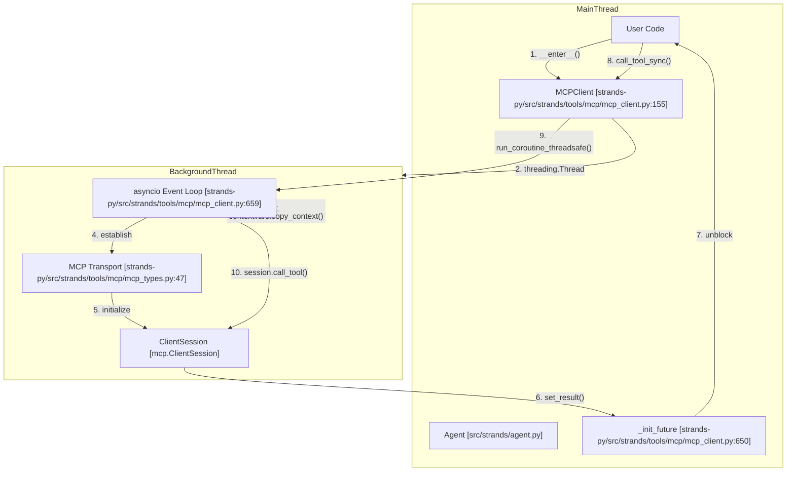
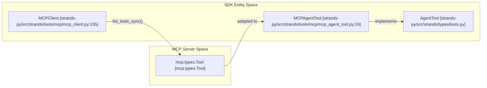

<!-- source: DeepWiki mcp.deepwiki.com · repo strands-agents/sdk-python · page 4.4 Model Context Protocol (MCP) Integration · fetched 2026-10-27 -->

# Model Context Protocol (MCP) Integration

<details>
<summary>Relevant source files</summary>

The following files were used as context for generating this wiki page:

- [site/src/content/docs/user-guide/concepts/tools/mcp-tools.mdx](site/src/content/docs/user-guide/concepts/tools/mcp-tools.mdx)
- [site/src/content/docs/user-guide/concepts/tools/mcp-tools.ts](site/src/content/docs/user-guide/concepts/tools/mcp-tools.ts)
- [strands-py/src/strands/tools/mcp/__init__.py](strands-py/src/strands/tools/mcp/__init__.py)
- [strands-py/src/strands/tools/mcp/mcp_agent_tool.py](strands-py/src/strands/tools/mcp/mcp_agent_tool.py)
- [strands-py/src/strands/tools/mcp/mcp_client.py](strands-py/src/strands/tools/mcp/mcp_client.py)
- [strands-py/src/strands/tools/mcp/mcp_instrumentation.py](strands-py/src/strands/tools/mcp/mcp_instrumentation.py)
- [strands-py/src/strands/types/tools.py](strands-py/src/strands/types/tools.py)
- [strands-py/tests/strands/tools/mcp/test_mcp_agent_tool.py](strands-py/tests/strands/tools/mcp/test_mcp_agent_tool.py)
- [strands-py/tests/strands/tools/mcp/test_mcp_client.py](strands-py/tests/strands/tools/mcp/test_mcp_client.py)
- [strands-py/tests/strands/tools/mcp/test_mcp_client_load_servers.py](strands-py/tests/strands/tools/mcp/test_mcp_client_load_servers.py)
- [strands-py/tests/strands/tools/mcp/test_mcp_client_tasks.py](strands-py/tests/strands/tools/mcp/test_mcp_client_tasks.py)
- [strands-py/tests/strands/tools/mcp/test_mcp_client_tool_provider.py](strands-py/tests/strands/tools/mcp/test_mcp_client_tool_provider.py)
- [strands-py/tests/strands/tools/mcp/test_mcp_instrumentation.py](strands-py/tests/strands/tools/mcp/test_mcp_instrumentation.py)
- [strands-ts/src/mcp/__tests__/client-annotations.test.ts](strands-ts/src/mcp/__tests__/client-annotations.test.ts)
- [strands-ts/src/mcp/__tests__/client.test.ts](strands-ts/src/mcp/__tests__/client.test.ts)
- [strands-ts/src/mcp/__tests__/config.test.node.ts](strands-ts/src/mcp/__tests__/config.test.node.ts)
- [strands-ts/src/mcp/client.ts](strands-ts/src/mcp/client.ts)
- [strands-ts/src/mcp/config.node.ts](strands-ts/src/mcp/config.node.ts)
- [strands-ts/src/mcp/config.ts](strands-ts/src/mcp/config.ts)
- [strands-ts/src/mcp/index.ts](strands-ts/src/mcp/index.ts)
- [strands-ts/src/tools/mcp-tool.ts](strands-ts/src/tools/mcp-tool.ts)
- [strands-ts/src/tools/types.ts](strands-ts/src/tools/types.ts)
- [strands-ts/test/integ/mcp/mcp.test.node.ts](strands-ts/test/integ/mcp/mcp.test.node.ts)

</details>


This document describes the Model Context Protocol (MCP) integration in the Strands Agents SDK. MCP is a standardized protocol for connecting AI applications to external data sources and tools. This integration enables agents to discover and execute tools, access prompts, and read resources provided by MCP servers.

## Overview

The MCP integration provides a bridge between Strands agents and MCP-compliant servers. The `MCPClient` class manages connections to MCP servers, discovers available tools/prompts/resources, and executes tool calls through the MCP protocol.

Key components:
- **`MCPClient`**: Main connection manager implementing the `ToolProvider` interface [strands-py/src/strands/tools/mcp/mcp_client.py:155]().
- **`MCPAgentTool`**: Adapter converting MCP tools to the SDK's `AgentTool` interface [strands-py/src/strands/tools/mcp/mcp_agent_tool.py:24]().
- **`MCPToolResult`**: Extended tool result supporting structured content and metadata [strands-py/src/strands/tools/mcp/mcp_types.py:50-74]().
- **Background Thread Architecture**: Non-blocking async communication pattern for synchronous SDK usage [strands-py/src/strands/tools/mcp/mcp_client.py:659-709]().

Sources: [strands-py/src/strands/tools/mcp/mcp_client.py:1-111](), [strands-py/src/strands/tools/mcp/mcp_types.py:1-74]()

## Architecture and Threading Model

### Background Thread Design

The `MCPClient` uses a background thread architecture to manage async MCP communication without blocking the main application thread. This allows synchronous agents to use MCP tools that require async I/O. Context variables are explicitly propagated from the main thread to the background thread to ensure consistent telemetry and state [strands-py/src/strands/tools/mcp/mcp_client.py:672-675](). Additionally, the `_background_task` clears any leaked running event loops (common when using OpenTelemetry `ThreadingInstrumentor`) to prevent `RuntimeError` during `run_until_complete()` [strands-py/src/strands/tools/mcp/mcp_client.py:663-668]().

**MCP Execution Flow**
Title: MCP Client Execution Flow


Sources: [strands-py/src/strands/tools/mcp/mcp_client.py:136-157](), [strands-py/src/strands/tools/mcp/mcp_client.py:659-709](), [strands-py/src/strands/tools/mcp/mcp_client.py:824-849](), [strands-py/tests/strands/tools/mcp/test_mcp_client.py:39-54]()

### Transport Abstraction

The `MCPTransport` type abstracts connection mechanisms including stdio, SSE, and HTTP.

| Transport Type | Factory Callable | Use Case |
|----------------|------------------|----------|
| `stdio_client` | `lambda: stdio_client(StdioServerParameters(...))` | Local subprocess servers [site/src/content/docs/user-guide/concepts/tools/mcp-tools.mdx:120-125]() |
| `sse_client` | `lambda: sse_client("http://...")` | Remote HTTP SSE endpoints [site/src/content/docs/user-guide/concepts/tools/mcp-tools.mdx:228-233]() |
| `streamablehttp_client` | `lambda: streamablehttp_client(url="...")` | Remote HTTP streaming [site/src/content/docs/user-guide/concepts/tools/mcp-tools.mdx:165-167]() |

Sources: [strands-py/src/strands/tools/mcp/mcp_types.py:15-47](), [strands-py/src/strands/tools/mcp/mcp_client.py:112-119]()

## Task-Augmented Execution (Experimental)

The SDK supports long-running MCP tools via Task-Augmented Execution. If a server supports the `tasks` capability and a tool is configured with `taskSupport` (required or optional), the `MCPClient` can initiate a task, poll for completion, and retrieve the final result [strands-py/src/strands/tools/mcp/mcp_client.py:851-910]().

**Task Execution Logic:**
- **Required**: Always uses task-augmented execution [strands-py/src/strands/tools/mcp/mcp_client.py:924-925]().
- **Optional**: Uses task-augmented execution if enabled in `TasksConfig` [strands-py/src/strands/tools/mcp/mcp_client.py:926-927]().
- **Forbidden/None**: Uses standard direct `call_tool` [strands-py/src/strands/tools/mcp/mcp_client.py:928-931]().

Sources: [strands-py/src/strands/tools/mcp/mcp_client.py:54](), [strands-py/src/strands/tools/mcp/mcp_tasks.py:1-50](), [strands-py/tests/strands/tools/mcp/test_mcp_client_tasks.py:20-46]()

## Tool Discovery and Registration

### Tool Discovery Flow

MCP tools are converted to the SDK's `AgentTool` format via `MCPAgentTool`.

Title: MCP Tool Transformation


Sources: [strands-py/src/strands/tools/mcp/mcp_client.py:362-411](), [strands-py/src/strands/tools/mcp/mcp_agent_tool.py:20-50]()

### Tool Filtering

The `ToolFilters` TypedDict allows controlling tool availability based on `allowed` and `rejected` patterns [strands-py/src/strands/tools/mcp/mcp_client.py:69-79]().

| Matcher Type | Logic |
|--------------|-------|
| `str` | Glob pattern matching [strands-py/src/strands/tools/mcp/mcp_client.py:387-388]() |
| `Pattern[str]` | Regex matching [strands-py/src/strands/tools/mcp/mcp_client.py:389-390]() |
| `Callable` | Custom logic callback `_ToolFilterCallback` [strands-py/src/strands/tools/mcp/mcp_client.py:391-392]() |

Sources: [strands-py/src/strands/tools/mcp/mcp_client.py:62-79](), [strands-py/src/strands/tools/mcp/mcp_client.py:363-411]()

## Tool Execution and Content Mapping

### Content Mapping

The `_map_mcp_content_to_tool_result_content` method handles conversion from MCP types to SDK `ToolResultContent` [strands-py/src/strands/tools/mcp/mcp_client.py:735-740]().

| MCP Type | SDK Type | Details |
|----------|----------|---------|
| `TextContent` | `text` | Direct string mapping [strands-py/src/strands/tools/mcp/mcp_client.py:743-744]() |
| `ImageContent` | `image` | Base64 decoded to bytes, format mapped via `MIME_TO_FORMAT` [strands-py/src/strands/tools/mcp/mcp_client.py:745-752]() |
| `EmbeddedResource` | `text`/`image` | Handles `TextResourceContents` and `BlobResourceContents` with MIME-based decoding [strands-py/src/strands/tools/mcp/mcp_client.py:753-815]() |

Sources: [strands-py/src/strands/tools/mcp/mcp_client.py:81-87](), [strands-py/src/strands/tools/mcp/mcp_client.py:735-815]()

### Structured Content and Metadata

`MCPToolResult` captures extra fields returned by modern MCP servers:
- **`structuredContent`**: JSON-serializable data from the tool [strands-py/src/strands/tools/mcp/mcp_types.py:71]().
- **`metadata`**: Non-content execution data (e.g., usage metrics) [strands-py/src/strands/tools/mcp/mcp_types.py:72]().
- **`isError`**: Application-level failure flag from the server [strands-py/src/strands/tools/mcp/mcp_types.py:73]().

Sources: [strands-py/src/strands/tools/mcp/mcp_types.py:50-74](), [strands-py/tests/strands/tools/mcp/test_mcp_client.py:149-165]()

## Prompts and Resources

### Prompts

`MCPClient` provides synchronous access to MCP prompts, which can be used to inject system instructions or message templates into an agent's context.

- `list_prompts_sync(pagination_token)`: Lists available prompt templates [strands-py/src/strands/tools/mcp/mcp_client.py:413-435]().
- `get_prompt_sync(prompt_id, args)`: Retrieves the actual messages for a specific prompt [strands-py/src/strands/tools/mcp/mcp_client.py:437-459]().

Sources: [strands-py/src/strands/tools/mcp/mcp_client.py:413-459](), [strands-py/tests/strands/tools/mcp/test_mcp_client.py:113-135]()

### Resources

Resources allow agents to read specific data URIs or use URI templates.

- `list_resources_sync()`: Lists static resources [strands-py/src/strands/tools/mcp/mcp_client.py:461-483]().
- `list_resource_templates_sync()`: Lists parameterized URI templates [strands-py/src/strands/tools/mcp/mcp_client.py:485-507]().
- `read_resource_sync(uri)`: Reads the content of a specific resource URI [strands-py/src/strands/tools/mcp/mcp_client.py:509-535]().

Sources: [strands-py/src/strands/tools/mcp/mcp_client.py:461-535](), [strands-py/tests/strands/tools/mcp/test_mcp_client.py:137-141]()

## Elicitation Support

The `MCPClient` supports the elicitation protocol, allowing MCP servers to request information or approvals from the user during tool execution via an `elicitation_callback` [strands-py/src/strands/tools/mcp/mcp_client.py:134]().

**Usage Example:**
```python
async def approval_callback(client, params):
    # params contains the message from the server
    return ElicitResult(action="accept", content={"message": "User approved"})

client = MCPClient(transport_callable, elicitation_callback=approval_callback)
```

Sources: [strands-py/src/strands/tools/mcp/mcp_client.py:134](), [strands-ts/src/mcp/__tests__/client.test.ts:124-141]()

## OpenTelemetry Instrumentation

The SDK includes `mcp_instrumentation` to enable distributed tracing across MCP boundaries. It injects/extracts OpenTelemetry context into the `_meta` field of JSON-RPC messages [strands-py/src/strands/tools/mcp/mcp_instrumentation.py:43-57]().

**Instrumented Hooks:**
- `BaseSession.send_request`: Injects context into outgoing tool calls [strands-py/src/strands/tools/mcp/mcp_instrumentation.py:168]().
- `TransportContextExtractingReader`: Extracts context from incoming transport messages [strands-py/src/strands/tools/mcp/mcp_instrumentation.py:202-243]().
- `SessionContextSavingWriter`: Preserves context for async processing in sessions [strands-py/src/strands/tools/mcp/mcp_instrumentation.py:311-329]().

Sources: [strands-py/src/strands/tools/mcp/mcp_instrumentation.py:1-168](), [strands-py/src/strands/tools/mcp/mcp_client.py:144]()

---

