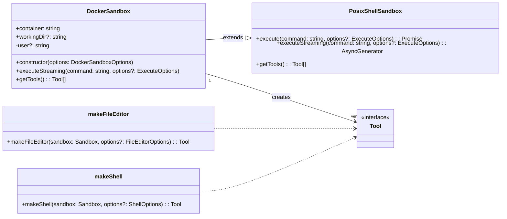
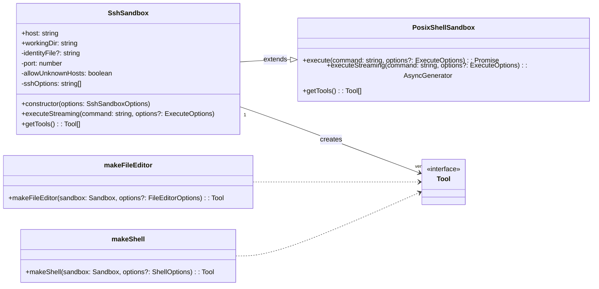

<!-- source: DeepWiki mcp.deepwiki.com · repo strands-agents/sdk-python · page 4.5 Vended Tools and Sandbox Environments · fetched 2026-10-27 -->

# Vended Tools and Sandbox Environments

<details>
<summary>Relevant source files</summary>

The following files were used as context for generating this wiki page:

- [site/src/content/docs/user-guide/concepts/sandbox/index.ts](site/src/content/docs/user-guide/concepts/sandbox/index.ts)
- [site/src/content/docs/user-guide/concepts/sandbox/index_imports.ts](site/src/content/docs/user-guide/concepts/sandbox/index_imports.ts)
- [site/src/content/docs/user-guide/concepts/tools/vended-tools-imports.ts](site/src/content/docs/user-guide/concepts/tools/vended-tools-imports.ts)
- [site/src/content/docs/user-guide/concepts/tools/vended-tools.mdx](site/src/content/docs/user-guide/concepts/tools/vended-tools.mdx)
- [site/src/content/docs/user-guide/concepts/tools/vended-tools.ts](site/src/content/docs/user-guide/concepts/tools/vended-tools.ts)
- [strands-py/src/strands/experimental/tools/__init__.py](strands-py/src/strands/experimental/tools/__init__.py)
- [strands-py/src/strands/experimental/tools/stop/__init__.py](strands-py/src/strands/experimental/tools/stop/__init__.py)
- [strands-py/src/strands/experimental/tools/stop/stop.py](strands-py/src/strands/experimental/tools/stop/stop.py)
- [strands-py/src/strands/sandbox/__init__.py](strands-py/src/strands/sandbox/__init__.py)
- [strands-py/src/strands/sandbox/docker.py](strands-py/src/strands/sandbox/docker.py)
- [strands-py/src/strands/sandbox/not_a_sandbox_local_environment.py](strands-py/src/strands/sandbox/not_a_sandbox_local_environment.py)
- [strands-py/src/strands/sandbox/ssh.py](strands-py/src/strands/sandbox/ssh.py)
- [strands-py/src/strands/sandbox/stream_process.py](strands-py/src/strands/sandbox/stream_process.py)
- [strands-py/src/strands/vended_tools/__init__.py](strands-py/src/strands/vended_tools/__init__.py)
- [strands-py/src/strands/vended_tools/http_request/README.md](strands-py/src/strands/vended_tools/http_request/README.md)
- [strands-py/src/strands/vended_tools/http_request/__init__.py](strands-py/src/strands/vended_tools/http_request/__init__.py)
- [strands-py/src/strands/vended_tools/http_request/http_request.py](strands-py/src/strands/vended_tools/http_request/http_request.py)
- [strands-py/src/strands/vended_tools/http_request/types.py](strands-py/src/strands/vended_tools/http_request/types.py)
- [strands-py/src/strands/vended_tools/shell/__init__.py](strands-py/src/strands/vended_tools/shell/__init__.py)
- [strands-py/src/strands/vended_tools/shell/shell.py](strands-py/src/strands/vended_tools/shell/shell.py)
- [strands-py/src/strands/vended_tools/shell/types.py](strands-py/src/strands/vended_tools/shell/types.py)
- [strands-py/tests/strands/agent/test_agent_sandbox.py](strands-py/tests/strands/agent/test_agent_sandbox.py)
- [strands-py/tests/strands/experimental/tools/test_stop.py](strands-py/tests/strands/experimental/tools/test_stop.py)
- [strands-py/tests/strands/sandbox/test_docker.py](strands-py/tests/strands/sandbox/test_docker.py)
- [strands-py/tests/strands/sandbox/test_ssh.py](strands-py/tests/strands/sandbox/test_ssh.py)
- [strands-py/tests/strands/sandbox/test_stream_process.py](strands-py/tests/strands/sandbox/test_stream_process.py)
- [strands-py/tests/strands/vended_tools/test_http_request.py](strands-py/tests/strands/vended_tools/test_http_request.py)
- [strands-py/tests/strands/vended_tools/test_shell.py](strands-py/tests/strands/vended_tools/test_shell.py)
- [strands-py/tests_integ/sandbox/test_docker.py](strands-py/tests_integ/sandbox/test_docker.py)
- [strands-ts/src/experimental/vended-tools/stop/README.md](strands-ts/src/experimental/vended-tools/stop/README.md)
- [strands-ts/src/experimental/vended-tools/stop/__tests__/stop.test.ts](strands-ts/src/experimental/vended-tools/stop/__tests__/stop.test.ts)
- [strands-ts/src/sandbox/__tests__/docker.test.node.ts](strands-ts/src/sandbox/__tests__/docker.test.node.ts)
- [strands-ts/src/sandbox/__tests__/ssh.test.node.ts](strands-ts/src/sandbox/__tests__/ssh.test.node.ts)
- [strands-ts/src/sandbox/docker.ts](strands-ts/src/sandbox/docker.ts)
- [strands-ts/src/sandbox/ssh.ts](strands-ts/src/sandbox/ssh.ts)
- [strands-ts/src/vended-tools/bash/README.md](strands-ts/src/vended-tools/bash/README.md)
- [strands-ts/src/vended-tools/bash/__tests__/bash.test.node.ts](strands-ts/src/vended-tools/bash/__tests__/bash.test.node.ts)
- [strands-ts/src/vended-tools/bash/index.ts](strands-ts/src/vended-tools/bash/index.ts)
- [strands-ts/src/vended-tools/bash/types.ts](strands-ts/src/vended-tools/bash/types.ts)
- [strands-ts/src/vended-tools/index.ts](strands-ts/src/vended-tools/index.ts)
- [strands-ts/test/integ/sandbox/docker.test.node.ts](strands-ts/test/integ/sandbox/docker.test.node.ts)

</details>


This page documents the built-in tools provided by the Strands SDK, known as "vended tools," and the sandbox abstraction that enables their execution in isolated environments. It covers the functionality of each vended tool, the different types of sandboxes available, and how tools interact with these environments. An experimental `stop` tool is also discussed.

## Vended Tools

Vended tools are pre-built functionalities included directly in the Strands SDK to handle common agent tasks. They are designed to be easily integrated into an agent's toolkit.

### Quick Start

To use vended tools, import them from their respective subpaths under `@strands-agents/sdk/vended-tools` (TypeScript) or `strands.vended_tools` (Python) and add them to your agent's `tools` list [site/src/content/docs/user-guide/concepts/tools/vended-tools.mdx:28-31]().

```typescript
import { Agent } from '@strands-agents/sdk'
import { bash } from '@strands-agents/sdk/vended-tools/bash'
import { fileEditor } from '@strands-agents/sdk/vended-tools/file-editor'
import { httpRequest } from '@strands-agents/sdk/vended-tools/http-request'
import { notebook } from '@strands-agents/sdk/vended-tools/notebook'

const agent = new Agent({
  tools: [bash, fileEditor, httpRequest, notebook],
})
```
Sources: [site/src/content/docs/user-guide/concepts/tools/vended-tools.mdx:28-31](), [site/src/content/docs/user-guide/concepts/tools/vended-tools.ts:2-6](), [site/src/content/docs/user-guide/concepts/tools/vended-tools.ts:14-17]()

### Available Vended Tools

The Strands SDK provides the following vended tools:

| Tool          | Description                                                              | Supported in                  |
| :------------ | :----------------------------------------------------------------------- | :---------------------------- |
| File Editor   | View, create, and edit files                                             | Python, TypeScript (Node.js)  |
| HTTP Request  | Make HTTP requests to external APIs                                      | Python, TypeScript (Node.js 20+, browsers) |
| Notebook      | Manage persistent text notebooks                                         | TypeScript (Node.js, browsers)|
| Bash / Shell  | Execute shell commands                                                   | Python, TypeScript (Node.js, Unix/Linux/macOS) |
| Sleep         | Pause execution for a bounded, cancellable duration                      | Python, TypeScript (Node.js, browsers) |
| Stop (Experimental) | Gracefully end the agent loop when the task is complete                  | Python, TypeScript (Node.js, browsers) |

Sources: [site/src/content/docs/user-guide/concepts/tools/vended-tools.mdx:36-44]()

#### File Editor

The `file_editor` tool allows agents to read, create, and modify files on disk [site/src/content/docs/user-guide/concepts/tools/vended-tools.mdx:46-48](). This is particularly useful for coding agents or configuration management tasks.

**Security Warning**: This tool operates with the full permissions of the process and can access arbitrary absolute paths. It is recommended to use it within a sandboxed environment for production [site/src/content/docs/user-guide/concepts/tools/vended-tools.mdx:49-52]().

The Python `file_editor` is available via `strands.vended_tools.file_editor` [strands-py/src/strands/vended_tools/__init__.py:28]().
The TypeScript `fileEditor` is available via `@strands-agents/sdk/vended-tools/file-editor` [strands-ts/src/vended-tools/index.ts:15]().

Sources: [site/src/content/docs/user-guide/concepts/tools/vended-tools.mdx:46-52](), [strands-py/src/strands/vended_tools/__init__.py:28](), [strands-ts/src/vended-tools/index.ts:15]()

#### HTTP Request

The `http_request` tool enables agents to make HTTP requests to external APIs and fetch web content. It supports all HTTP methods, custom headers, and request bodies, with a default timeout of 30 seconds [site/src/content/docs/user-guide/concepts/tools/vended-tools.mdx:83-85]().

In Python, the tool delegates networking to an `httpx.AsyncClient`. The `make_http_request` factory can be used to provide a pre-configured client for custom authentication, timeouts, or proxies [site/src/content/docs/user-guide/concepts/tools/vended-tools.mdx:90-93]().

The Python `http_request` is available via `strands.vended_tools.http_request` [strands-py/src/strands/vended_tools/__init__.py:28]().
The TypeScript `httpRequest` is available via `@strands-agents/sdk/vended-tools/http-request` [strands-ts/src/vended-tools/index.ts:17]().

Sources: [site/src/content/docs/user-guide/concepts/tools/vended-tools.mdx:83-85](), [site/src/content/docs/user-guide/concepts/tools/vended-tools.mdx:90-93](), [strands-py/src/strands/vended_tools/__init__.py:28](), [strands-ts/src/vended-tools/index.ts:17]()

#### Notebook

The `notebook` tool provides a persistent scratchpad for the agent to read and write across invocations. This is useful for planning tasks, tracking progress, and maintaining context. Notebook state is automatically persisted with session management [site/src/content/docs/user-guide/concepts/tools/vended-tools.mdx:141-144]().

The TypeScript `notebook` is available via `@strands-agents/sdk/vended-tools/notebook` [strands-ts/src/vended-tools/index.ts:18](). This tool is currently only supported in Node.js and browser environments [site/src/content/docs/user-guide/concepts/tools/vended-tools.mdx:145]().

Sources: [site/src/content/docs/user-guide/concepts/tools/vended-tools.mdx:141-145](), [strands-ts/src/vended-tools/index.ts:18]()

#### Bash / Shell

These tools allow agents to execute shell commands. There are key differences between the Python and TypeScript implementations:

*   **TypeScript `bash`**: Spawns a persistent `bash` process on the host, maintaining state (variables, working directory) across invocations. Sessions can be restarted to clear state [site/src/content/docs/user-guide/concepts/tools/vended-tools.mdx:170-172]().
    *   The TypeScript `bash` is available via `@strands-agents/sdk/vended-tools/bash` [strands-ts/src/vended-tools/index.ts:14]().
*   **Python `shell`**: Routes each command through the agent's sandbox and is stateless. Each call runs in a fresh shell, so state does not persist. The sandbox determines the interpreter (e.g., `sh` locally, login shell over SSH), requiring portable POSIX syntax [strands-py/src/strands/vended_tools/shell/shell.py:10-11](), [site/src/content/docs/user-guide/concepts/tools/vended-tools.mdx:173-176]().
    *   The Python `shell` is available via `strands.vended_tools.shell` [strands-py/src/strands/vended_tools/__init__.py:29](). The `make_shell` factory can be used to create a custom shell tool [strands-py/src/strands/vended_tools/shell/shell.py:29-34]().

**Security Warning**: These tools execute arbitrary shell commands. Without a sandbox, commands run with the full permissions of the process. It is crucial to use them with trusted input and consider sandboxed environments for production [site/src/content/docs/user-guide/concepts/tools/vended-tools.mdx:175-179]().

The `bash` tool in Python is deprecated and will be removed in v2.0.0; `shell` should be used instead [strands-py/src/strands/vended_tools/__init__.py:36-40]().

Sources: [site/src/content/docs/user-guide/concepts/tools/vended-tools.mdx:170-179](), [strands-py/src/strands/vended_tools/shell/shell.py:10-11](), [strands-py/src/strands/vended_tools/__init__.py:29](), [strands-py/src/strands/vended_tools/shell/shell.py:29-34](), [strands-ts/src/vended-tools/index.ts:14](), [strands-py/src/strands/vended_tools/__init__.py:36-40]()

#### Sleep

The `sleep` tool allows the agent to pause execution for a specified, cancellable duration [site/src/content/docs/user-guide/concepts/tools/vended-tools.mdx:200](). This can be useful for waiting on external processes or simulating delays.

The Python `sleep` is available via `strands.vended_tools.sleep` [strands-py/src/strands/vended_tools/__init__.py:30]().
The TypeScript `sleep` is available via `@strands-agents/sdk/vended-tools/sleep` [strands-ts/src/vended-tools/index.ts:19]().

Sources: [site/src/content/docs/user-guide/concepts/tools/vended-tools.mdx:200](), [strands-py/src/strands/vended_tools/__init__.py:30](), [strands-ts/src/vended-tools/index.ts:19]()

#### Stop (Experimental)

The `stop` tool is an experimental feature designed to allow an agent to gracefully end its loop when it determines its task is complete [site/src/content/docs/user-guide/concepts/tools/vended-tools.mdx:210]().

The Python `stop` tool is located at `strands.experimental.tools.stop` [strands-py/src/strands/experimental/tools/stop/stop.py]().
The TypeScript `stop` tool is located at `@strands-agents/sdk/experimental/vended-tools/stop` [site/src/content/docs/user-guide/concepts/tools/vended-tools.mdx:13]().

Sources: [site/src/content/docs/user-guide/concepts/tools/vended-tools.mdx:210](), [strands-py/src/strands/experimental/tools/stop/stop.py](), [site/src/content/docs/user-guide/concepts/tools/vended-tools.mdx:13]()

## Sandbox Environments

The Strands SDK provides an abstraction layer for executing commands in isolated environments, known as sandboxes. This enhances security and allows agents to interact with different execution contexts. The core sandbox interface is defined by `strands.sandbox.base.Sandbox` (Python) and `strands-ts/src/sandbox/base.ts` (TypeScript).

### Sandbox Types

The SDK offers several sandbox implementations:

#### `NotASandboxLocalEnvironment`

This is a local environment that executes commands directly on the host machine without any isolation. It's primarily used for testing and development where sandboxing is not required or desired [strands-py/src/strands/sandbox/not_a_sandbox_local_environment.py]().

Sources: [strands-py/src/strands/sandbox/not_a_sandbox_local_environment.py]()

#### `PosixShellSandbox`

This is a base class for sandboxes that execute commands in a POSIX-like shell environment. It provides common functionality for building shell commands and handling environment variables [strands-ts/src/sandbox/ssh.ts:6](), [strands-ts/src/sandbox/docker.ts:5]().

Sources: [strands-ts/src/sandbox/ssh.ts:6](), [strands-ts/src/sandbox/docker.ts:5]()

#### `DockerSandbox`

The `DockerSandbox` executes commands within a specified Docker container using `docker exec` [strands-ts/src/sandbox/docker.ts:2]().

*   **Configuration**: It can be configured with a `container` ID or name, an optional `workingDir`, and an optional `user` to run commands as [strands-ts/src/sandbox/docker.ts:16-32]().
*   **Execution**: Commands are executed using `docker exec` with appropriate flags for user, working directory, and environment variables [strands-ts/src/sandbox/docker.ts:52-75]().
*   **Tool Integration**: It automatically vends `sandbox_file_editor` and `sandbox_shell` tools, configured to operate within the specified Docker container [strands-ts/src/sandbox/docker.ts:86-95]().


**Diagram: Docker Sandbox Architecture**
Sources: [strands-ts/src/sandbox/docker.ts:2](), [strands-ts/src/sandbox/docker.ts:16-32](), [strands-ts/src/sandbox/docker.ts:52-75](), [strands-ts/src/sandbox/docker.ts:86-95]()

#### `SshSandbox`

The `SshSandbox` executes commands on a remote host via OpenSSH [strands-ts/src/sandbox/ssh.ts:2]().

*   **Configuration**: It requires a `host`, `workingDir`, and can optionally take an `identityFile`, `port`, and additional `sshOptions` [strands-ts/src/sandbox/ssh.ts:57-83]().
*   **Security**: It includes an allowlist for SSH options to prevent unsafe configurations like `ProxyCommand` unless `allowUnsafeSshOptions` is explicitly set to `true` [strands-ts/src/sandbox/ssh.ts:109-115](), [strands-ts/src/sandbox/ssh.ts:17-51]().
*   **Execution**: Each `executeStreaming` call spawns a fresh `ssh` process, making it stateless. It uses `BatchMode=yes` to disable interactive prompts, requiring key-based authentication [strands-ts/src/sandbox/ssh.ts:88-91]().
*   **Tool Integration**: Similar to `DockerSandbox`, it vends `sandbox_file_editor` and `sandbox_shell` tools, configured for the remote SSH host [strands-ts/src/sandbox/ssh.ts:158-167]().


**Diagram: SSH Sandbox Architecture**
Sources: [strands-ts/src/sandbox/ssh.ts:2](), [strands-ts/src/sandbox/ssh.ts:57-83](), [strands-ts/src/sandbox/ssh.ts:109-115](), [strands-ts/src/sandbox/ssh.ts:17-51](), [strands-ts/src/sandbox/ssh.ts:88-91](), [strands-ts/src/sandbox/ssh.ts:158-167]()

### Tool Execution in Sandboxes

Tools like `shell` and `file_editor` are designed to integrate seamlessly with sandboxes. When a sandbox is provided during the creation of these tools (e.g., using `make_shell(sandbox=...)` [strands-py/src/strands/vended_tools/shell/shell.py:31]()), the tool binds to that specific sandbox. If no sandbox is explicitly bound, the tool will attempt to read the sandbox from `tool_context.agent.sandbox` at call time [strands-py/src/strands/vended_tools/shell/shell.py:37-38]().

This mechanism allows agents to use the same tool interface (`shell`, `file_editor`) while executing commands in different isolated environments (local, Docker, SSH) based on the agent's configuration.

```mermaid
graph TD
    subgraph Agent System
        A[Agent] --> B{Tool Call}
    end

    subgraph Tool System
        B --> C[Vended Tool (e.g., shell)]
        C --> D{Sandbox Bound?}
        D -- Yes --> E[Bound Sandbox]
        D -- No --> F[Agent's Configured Sandbox]
    end

    subgraph Sandbox Abstraction
        E --> G[Sandbox.execute()]
        F --> G
        G --> H{Sandbox Type}
        H -- NotASandboxLocalEnvironment --> I[Local Host Execution]
        H -- DockerSandbox --> J[Docker Container Execution]
        H -- SshSandbox --> K[Remote SSH Host Execution]
    end

    I --> L[Tool Result]
    J --> L
    K --> L
    L --> C
    C --> B
```
**Diagram: Tool Execution Flow with Sandboxes**
Sources: [strands-py/src/strands/vended_tools/shell/shell.py:31](), [strands-py/src/strands/vended_tools/shell/shell.py:37-38]()

---

