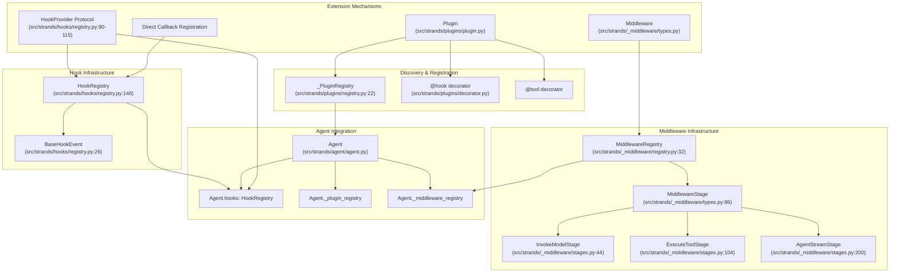
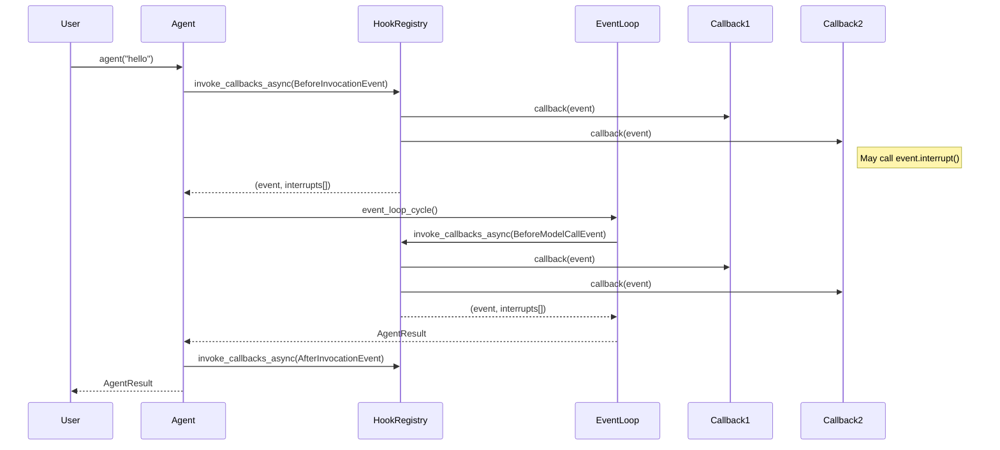
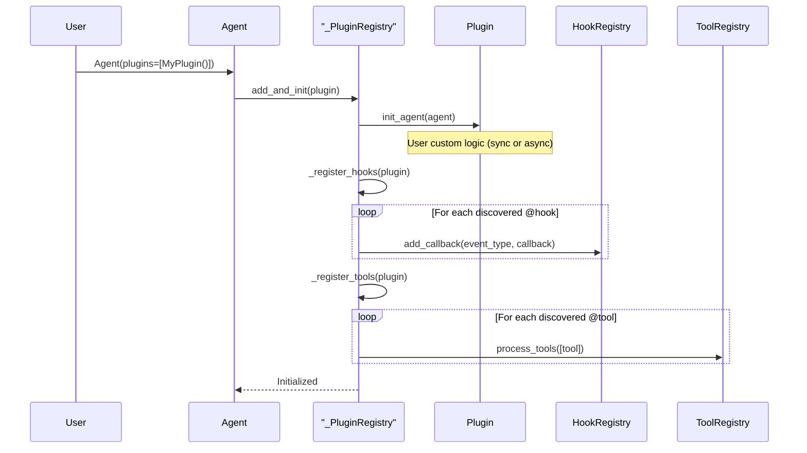

<!-- source: DeepWiki mcp.deepwiki.com · repo strands-agents/sdk-python · page 5 Extensibility System · fetched 2026-10-27 -->

# Extensibility System

<details>
<summary>Relevant source files</summary>

The following files were used as context for generating this wiki page:

- [strands-py/src/strands/_middleware/README.md](strands-py/src/strands/_middleware/README.md)
- [strands-py/src/strands/_middleware/__init__.py](strands-py/src/strands/_middleware/__init__.py)
- [strands-py/src/strands/_middleware/registry.py](strands-py/src/strands/_middleware/registry.py)
- [strands-py/src/strands/_middleware/stages.py](strands-py/src/strands/_middleware/stages.py)
- [strands-py/src/strands/_middleware/types.py](strands-py/src/strands/_middleware/types.py)
- [strands-py/src/strands/experimental/bidi/agent/agent.py](strands-py/src/strands/experimental/bidi/agent/agent.py)
- [strands-py/src/strands/interrupt.py](strands-py/src/strands/interrupt.py)
- [strands-py/src/strands/types/_events.py](strands-py/src/strands/types/_events.py)
- [strands-py/tests/strands/agent/test_agent_cancellation.py](strands-py/tests/strands/agent/test_agent_cancellation.py)
- [strands-py/tests/strands/middleware/test_agent_middleware.py](strands-py/tests/strands/middleware/test_agent_middleware.py)
- [strands-py/tests/strands/middleware/test_agent_stream_middleware.py](strands-py/tests/strands/middleware/test_agent_stream_middleware.py)
- [strands-py/tests/strands/middleware/test_execute_tool_middleware.py](strands-py/tests/strands/middleware/test_execute_tool_middleware.py)
- [strands-py/tests/strands/middleware/test_middleware_interrupts.py](strands-py/tests/strands/middleware/test_middleware_interrupts.py)
- [strands-py/tests/strands/middleware/test_registry.py](strands-py/tests/strands/middleware/test_registry.py)
- [strands-py/tests/strands/test_interrupt.py](strands-py/tests/strands/test_interrupt.py)
- [strands-ts/src/hooks/types.ts](strands-ts/src/hooks/types.ts)
- [strands-ts/src/interventions/__tests__/handler.test.ts](strands-ts/src/interventions/__tests__/handler.test.ts)
- [strands-ts/src/interventions/__tests__/registry.test.ts](strands-ts/src/interventions/__tests__/registry.test.ts)
- [strands-ts/src/interventions/actions.ts](strands-ts/src/interventions/actions.ts)
- [strands-ts/src/interventions/handler.ts](strands-ts/src/interventions/handler.ts)
- [strands-ts/src/interventions/index.ts](strands-ts/src/interventions/index.ts)
- [strands-ts/src/interventions/registry.ts](strands-ts/src/interventions/registry.ts)
- [strands-ts/src/types/lifecycle-observer.ts](strands-ts/src/types/lifecycle-observer.ts)
- [strands-ts/src/vended-interventions/steering/__tests__/handler.test.ts](strands-ts/src/vended-interventions/steering/__tests__/handler.test.ts)
- [strands-ts/src/vended-interventions/steering/__tests__/llm.test.ts](strands-ts/src/vended-interventions/steering/__tests__/llm.test.ts)
- [strands-ts/src/vended-interventions/steering/__tests__/tool-ledger.test.ts](strands-ts/src/vended-interventions/steering/__tests__/tool-ledger.test.ts)
- [strands-ts/src/vended-interventions/steering/handlers/handler.ts](strands-ts/src/vended-interventions/steering/handlers/handler.ts)

</details>


The Extensibility System provides the infrastructure for extending and customizing agent behavior without modifying core SDK code. It consists of three complementary mechanisms: the **Hook System** for event-driven callbacks, the **Plugin System** for composable feature bundles, and the **Middleware System** for wrapping core execution paths.

This page provides an overview of the extensibility architecture and how the components work together. For implementation details, see:
- [Plugin System](#5.1) — Document the `Plugin` base class, plugin lifecycle, automatic hook/tool discovery, and `init_agent` method.
- [Hook System and Events](#5.2) — Explain the hook system, event types, `HookRegistry`, callback registration, and event ordering.
- [Custom Hook Providers](#5.3) — Document how to create custom `HookProvider` implementations, integrate them with agents via `add_hook`/`addHook`, use middleware stages (`AgentStreamStage`, `InvokeModelStage`, `ExecuteToolStage`), and the `MiddlewareRegistry` for wrapping core execution paths.
- [Interrupt Handling and Human-in-the-Loop](#5.4) — Document interrupt mechanism, `InterruptException`, interrupt responses, and resume patterns.
- [Agent Skills Plugin](#5.5) — Document the `AgentSkills` plugin, `Skill` data model, `SKILL.md` format, filesystem loading, and system prompt injection.
- [Steering System](#5.6) — Document the `SteeringHandler`, `LLMSteeringHandler`, and context-driven just-in-time guidance.
- [Context Offloader Plugin](#5.7) — Document the `ContextOffloader` plugin for managing large tool outputs via external storage.
- [Memory System and Context Injection](#5.8) — Document the `MemoryManager`, `MemoryStore` interface, automatic extraction, and the `ContextInjector` plugin.
- [Goal Loop Plugin](#5.9) — Document the `GoalLoop` vended plugin and the `Judge` component.

---

## Extensibility Architecture

The extensibility system is built on layers that work together to provide flexible agent customization.

### Extension Architecture Overview


**Sources:** [src/strands/hooks/registry.py:26-155](), [src/strands/plugins/plugin.py:21-133](), [src/strands/plugins/registry.py:22-105](), [src/strands/_middleware/types.py:86-99](), [src/strands/_middleware/registry.py:32-34]()

The extension mechanisms provide different levels of abstraction:

| Mechanism | Use Case | Registration Method | Auto-Discovery |
|-----------|----------|---------------------|----------------|
| **Plugin** | Bundled hooks + tools | `Agent(plugins=[...])` | Yes - scans `@hook` and `@tool` [src/strands/plugins/plugin.py:85-86]() |
| **HookProvider** | Reusable hook sets | `Agent(hooks=[...])` | No - manual `register_hooks()` [src/strands/hooks/registry.py:108-114]() |
| **Direct Callback** | One-off hooks | `agent.add_hook(callback, event_type)` | No - explicit registration |
| **Middleware** | Wrap core execution paths | `agent._middleware_registry.add_middleware(stage, handler)` [src/strands/_middleware/registry.py:47-56]() | No - explicit registration |

---

## Hook System

The hook system enables event-driven customization through strongly-typed callbacks. All lifecycle events inherit from `BaseHookEvent` [src/strands/hooks/registry.py:26]() or `HookEvent` [src/strands/hooks/registry.py:72]() and flow through `HookRegistry` for dispatch.

### Event Lifecycle



**Sources:** [src/strands/hooks/registry.py:274-318](), [src/strands/hooks/__init__.py:32-47](), [tests/strands/hooks/test_registry.py:37-71]()

### HookRegistry and Type Inference

`HookRegistry` manages callback registration and invocation [src/strands/hooks/registry.py:146-160](). It can infer event types from callback signatures [src/strands/hooks/registry.py:168-173](), supporting:
- Single type hints: `event: BeforeModelCallEvent` [tests/strands/hooks/test_registry.py:103-112]()
- Union types: `event: BeforeModelCallEvent | AfterModelCallEvent` [tests/strands/hooks/test_registry.py:171-184]()

The registry supports both synchronous and asynchronous callbacks. Async callbacks must be invoked via `invoke_callbacks_async` [src/strands/hooks/registry.py:288-318]().

For details, see [Hook System and Events](#5.2).

---

## Middleware System

The Middleware System provides a powerful mechanism to wrap and intercept core agent execution paths, allowing for modification of context, events, and results. It operates on specific `MiddlewareStage` instances.

### Middleware Stages

The Python SDK defines three primary middleware stages [src/strands/_middleware/stages.py:44, 104, 200]():
- `InvokeModelStage`: Wraps the model invocation, allowing modification of messages, system prompts, tool specs, and the model itself. The context is `InvokeModelContext` [src/strands/_middleware/stages.py:24-41]().
- `ExecuteToolStage`: Wraps tool execution, enabling interventions before or after a tool call. The context is `ExecuteToolContext` [src/strands/_middleware/stages.py:104-128]().
- `AgentStreamStage`: The outermost stage, wrapping the entire agent invocation stream. The context is `AgentStreamContext` [src/strands/_middleware/stages.py:200-217]().

### Middleware Execution Flow

Middleware handlers are registered with the `MiddlewareRegistry` [src/strands/_middleware/registry.py:32]() for a specific stage. They can operate in three phases:
- **Wrap Phase**: The default, where the handler is an async generator that wraps the `next_fn` [src/strands/_middleware/types.py:66-71](). This allows for pre-processing context, yielding events, and post-processing results.
- **Input Phase**: Handlers transform the input context before it reaches the next middleware or the terminal function [src/strands/_middleware/types.py:56-63]().
- **Output Phase**: Handlers transform the final result event of the stage [src/strands/_middleware/types.py:76-83]().

```mermaid
graph TD
    A[Agent Invocation] --> B{MiddlewareRegistry.invoke(stage, context, terminal)}
    B --> C1(Middleware 1 - Wrap Phase)
    C1 --> C2(Middleware 2 - Wrap Phase)
    C2 --> C3(Middleware 3 - Input Phase)
    C3 --> D{Terminal Function<br/>(e.g., Model.stream(), ToolExecutor.execute())}
    D -- Yields Events --> C4(Middleware 3 - Output Phase)
    C4 -- Yields Events --> C5(Middleware 2 - Wrap Phase)
    C5 -- Yields Events --> C6(Middleware 1 - Wrap Phase)
    C6 --> E[Agent Result Stream]

    subgraph "InvokeModelStage"
        InvokeModelContext["InvokeModelContext<br/>(src/strands/_middleware/stages.py:24)"]
        ModelStream["Model.stream()"]
        InvokeModelContext --> ModelStream
    end

    subgraph "ExecuteToolStage"
        ExecuteToolContext["ExecuteToolContext<br/>(src/strands/_middleware/stages.py:104)"]
        ToolExecutor["ToolExecutor.execute()"]
        ExecuteToolContext --> ToolExecutor
    end

    subgraph "AgentStreamStage"
        AgentStreamContext["AgentStreamContext<br/>(src/strands/_middleware/stages.py:200)"]
        AgentEventLoop["Agent.event_loop_cycle()"]
        AgentStreamContext --> AgentEventLoop
    end

    C3 -- Transformed Context --> InvokeModelContext
    C3 -- Transformed Context --> ExecuteToolContext
    C3 -- Transformed Context --> AgentStreamContext
```

**Sources:** [src/strands/_middleware/registry.py:117-171](), [src/strands/_middleware/types.py:56-83](), [src/strands/_middleware/stages.py:24-217]()

Middleware can also initiate interrupts, pausing execution for human intervention [src/strands/_middleware/stages.py:129-159](). For details, see [Custom Hook Providers](#5.3).

---

## Plugin System

The `Plugin` base class provides automatic discovery and registration of methods decorated with `@hook` and `@tool` [src/strands/plugins/plugin.py:21-32]().

### Plugin Lifecycle



**Sources:** [src/strands/plugins/registry.py:70-105](), [src/strands/plugins/plugin.py:77-122](), [tests/strands/plugins/test_plugins.py:142-162]()

### Method Discovery

Plugin `__init__` scans the class hierarchy (MRO) for decorated methods [src/strands/plugins/plugin.py:97-112](). This ensures:
1. Parent class methods are registered before child class methods [src/strands/plugins/plugin.py:101]().
2. Child overrides replace parent methods (only child version registered) [src/strands/plugins/plugin.py:102-105]().

For details, see [Plugin System](#5.1).

---

## Specialized Subsystems

The extensibility system powers several advanced features:

### Interrupt Handling and Human-in-the-Loop
Hooks and middleware can trigger `Interrupt` objects by raising `InterruptException` [src/strands/interrupt.py:35-42](). This allows agents to pause and wait for human approval or additional data before proceeding with sensitive actions like tool calls. The `_InterruptState` manages the lifecycle of these interruptions, including resuming with human responses [src/strands/interrupt.py:44-191]().
For details, see [Interrupt Handling and Human-in-the-Loop](#5.4).

### Agent Skills
The `AgentSkills` plugin allows agents to load reusable capability bundles (skills) from the filesystem (using `SKILL.md` format) or external sources [tests_integ/test_skills_plugin.py:62-71]() (not shown in full). It injects skill metadata into the system prompt [tests_integ/test_skills_plugin.py:43-46]() (not shown in full). For details, see [Agent Skills Plugin](#5.5).

### Steering System
The Steering System provides just-in-time guidance to agents based on the current context. It has graduated from experimental to `strands.vended_plugins.steering`. It uses `LLMSteeringHandler` and `LedgerProvider` to influence agent behavior. For details, see [Steering System](#5.6).

### Context Offloading
The `ContextOffloader` vended plugin intercepts oversized tool results and persists them to external storage (S3, File, or Memory). It replaces large content blocks with references and provides a tool for the agent to retrieve them later. For details, see [Context Offloader Plugin](#5.7).

### Memory System and Context Injection
The Memory System, managed by `MemoryManager` and `MemoryStore` implementations, allows agents to store and retrieve information. The `ContextInjector` plugin then injects relevant memory into the agent's context, often using XML formatting for structured injection. For details, see [Memory System and Context Injection](#5.8).

### Goal Loop Plugin
The `GoalLoop` vended plugin enables iterative agent execution towards a defined goal. It incorporates a `Judge` component to evaluate goal completion, driving the agent through multiple turns until the criteria are met. For details, see [Goal Loop Plugin](#5.9).

---

## Summary

| Aspect | Hooks | Plugins | Middleware |
|--------|-------|---------|---------------|
| **Abstraction Level** | Low (individual callbacks) | High (bundled features) | Medium (execution path interception) |
| **Auto-Discovery** | Via type hints | Yes (@hook/@tool) | No (explicit registration) |
| **State** | Stateless callbacks | Stateful class instances | Stateful handlers (can maintain state across calls) |
| **Tools Support** | No | Yes (via @tool) | Yes (can intercept/modify tool calls) |
| **Use Case** | One-off modifications, event logging | Reusable feature packages, complex integrations | Modifying core agent logic (e.g., caching, rate-limiting, security, human-in-the-loop) |

**Sources:** [src/strands/hooks/registry.py:1-155](), [src/strands/plugins/plugin.py:1-133](), [src/strands/plugins/registry.py:1-105](), [src/strands/hooks/__init__.py:1-71](), [src/strands/_middleware/types.py:1-113](), [src/strands/_middleware/registry.py:1-171]()

---

