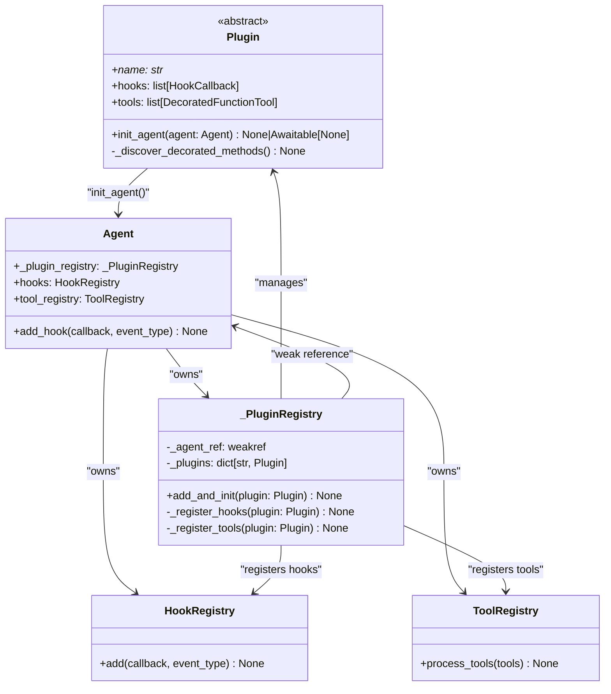
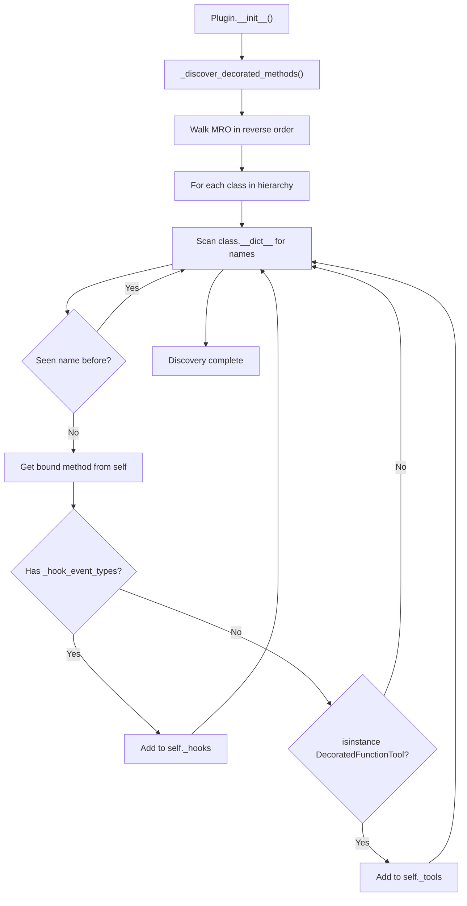
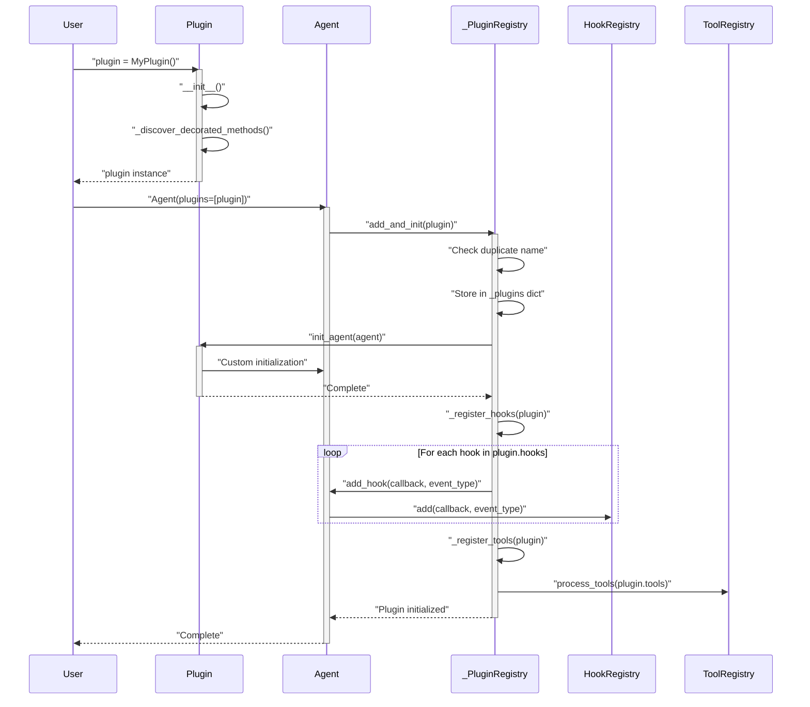
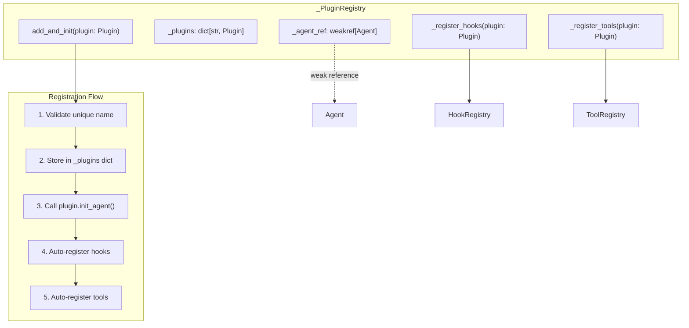
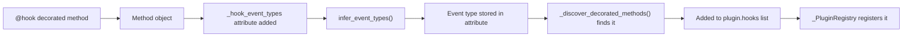
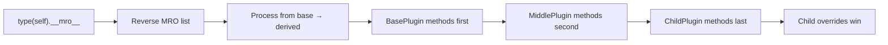

<!-- source: DeepWiki mcp.deepwiki.com · repo strands-agents/sdk-python · page 5.1 Plugin System · fetched 2026-10-27 -->

# Plugin System

<details>
<summary>Relevant source files</summary>

The following files were used as context for generating this wiki page:

- [strands-py/src/strands/agent/agent.py](strands-py/src/strands/agent/agent.py)
- [strands-py/src/strands/event_loop/event_loop.py](strands-py/src/strands/event_loop/event_loop.py)
- [strands-py/tests/strands/event_loop/test_event_loop.py](strands-py/tests/strands/event_loop/test_event_loop.py)
- [strands-py/tests/strands/event_loop/test_event_loop_metadata.py](strands-py/tests/strands/event_loop/test_event_loop_metadata.py)
- [strands-py/tests/strands/event_loop/test_event_loop_structured_output.py](strands-py/tests/strands/event_loop/test_event_loop_structured_output.py)
- [strands-ts/src/agent/__tests__/agent.hook.test.ts](strands-ts/src/agent/__tests__/agent.hook.test.ts)
- [strands-ts/src/agent/__tests__/agent.model-retry.test.ts](strands-ts/src/agent/__tests__/agent.model-retry.test.ts)
- [strands-ts/src/agent/__tests__/agent.test.ts](strands-ts/src/agent/__tests__/agent.test.ts)
- [strands-ts/src/agent/agent.ts](strands-ts/src/agent/agent.ts)
- [strands-ts/src/conversation-manager/__tests__/null-conversation-manager.test.ts](strands-ts/src/conversation-manager/__tests__/null-conversation-manager.test.ts)
- [strands-ts/src/hooks/__tests__/events.test.ts](strands-ts/src/hooks/__tests__/events.test.ts)
- [strands-ts/src/hooks/events.ts](strands-ts/src/hooks/events.ts)
- [strands-ts/src/index.ts](strands-ts/src/index.ts)
- [strands-ts/src/types/agent.ts](strands-ts/src/types/agent.ts)
- [strands-ts/src/types/messages.ts](strands-ts/src/types/messages.ts)

</details>


The plugin system provides a composable mechanism for extending agent functionality through automatic hook and tool registration. Plugins encapsulate related behavior modifications into reusable components that can be easily attached to any agent instance.

**Scope**: This page covers the `Plugin` base class, the `_PluginRegistry` for managing plugin lifecycle, auto-discovery of decorated methods, and the plugin-specific `@hook` decorator. For details about the hook event system and event types, see [Hook System and Events](). For information about creating tools, see [Creating Tools with @tool Decorator](). For information on specialized plugins like Agent Skills, see [Agent Skills Plugin]().

---

## Plugin Architecture

The plugin system consists of three primary components that work together to extend agent functionality:

### Plugin Class Structure

Digital entities and their relationships within the plugin ecosystem:



Sources: [strands-py/src/strands/plugins/plugin.py:21-133](), [strands-py/src/strands/plugins/registry.py:22-141]()

---

## Plugin Base Class

The `Plugin` abstract base class defines the interface that all plugins must implement. It provides automatic discovery of decorated methods and a lifecycle hook for custom initialization.

### Required Attributes

| Attribute | Type | Description |
|-----------|------|-------------|
| `name` | `str` | Stable string identifier for the plugin (abstract property) |
| `hooks` | `list[HookCallback]` | Auto-discovered `@hook` decorated methods |
| `tools` | `list[DecoratedFunctionTool]` | Auto-discovered `@tool` decorated methods |

### Required Methods

| Method | Signature | Description |
|--------|-----------|-------------|
| `init_agent` | `(agent: Agent) -> None \| Awaitable[None]` | Optional custom initialization logic |

The `name` property must be provided by subclasses as either a class attribute or a property. Attempting to instantiate a `Plugin` subclass without defining `name` raises a `TypeError` [strands-py/src/strands/plugins/plugin.py:72-75]().

### Initialization and Auto-Discovery

When a `Plugin` subclass is instantiated, the `__init__` method automatically scans the class hierarchy for methods decorated with `@hook` or `@tool`:



**Discovery Rules**:
- Parent class methods are processed before child class methods [strands-py/src/strands/plugins/plugin.py:100-101]().
- If a child overrides a decorated parent method, only the child's version is registered [strands-py/src/strands/plugins/plugin.py:103-105]().
- Methods are discovered in declaration order within each class [strands-py/src/strands/plugins/plugin.py:98-122]().
- Both hooks and tools are discovered in the same pass [strands-py/src/strands/plugins/plugin.py:114-122]().

Sources: [strands-py/src/strands/plugins/plugin.py:77-122]()

---

## Plugin Lifecycle

The plugin lifecycle progresses through four distinct phases when attached to an agent:

### Lifecycle Diagram

The following diagram maps the logical lifecycle to the internal method calls within `_PluginRegistry` and `Agent`:



### Lifecycle Phases

| Phase | Description | Code Location |
|-------|-------------|---------------|
| **1. Construction** | Plugin instantiated, decorated methods discovered | [strands-py/src/strands/plugins/plugin.py:77-86]() |
| **2. Registration** | Plugin added to registry, duplicate check performed | [strands-py/src/strands/plugins/registry.py:70-91]() |
| **3. Initialization** | `init_agent()` called for custom logic (sync or async) | [strands-py/src/strands/plugins/registry.py:94-98]() |
| **4. Auto-Registration** | Hooks and tools registered with agent registries | [strands-py/src/strands/plugins/registry.py:100-104]() |

Sources: [strands-py/src/strands/plugins/plugin.py:77-86](), [strands-py/src/strands/plugins/registry.py:70-141](), [strands-py/tests/strands/plugins/test_plugins.py:142-161]()

---

## Plugin Registry

The `_PluginRegistry` class manages the collection of plugins attached to an agent. It is an internal implementation detail created automatically by the `Agent` class.

### Registry Implementation



### Key Features

**Weak Reference to Agent**: The registry stores a `weakref.ref` to the agent to prevent circular references and allow proper garbage collection [strands-py/src/strands/plugins/registry.py:59](). Accessing `_PluginRegistry._agent` raises `ReferenceError` if the agent has been collected [strands-py/src/strands/plugins/registry.py:66-67]().

**Duplicate Prevention**: The registry maintains a name-keyed dictionary of plugins. Attempting to register a plugin with a duplicate name raises `ValueError: plugin already registered` [strands-py/src/strands/plugins/registry.py:87-88]().

**Async Support**: The `add_and_init()` method detects whether `init_agent()` is a coroutine function using `inspect.iscoroutinefunction()` [strands-py/src/strands/plugins/registry.py:94]() and handles it appropriately with `run_async()` [strands-py/src/strands/plugins/registry.py:96]().

Sources: [strands-py/src/strands/plugins/registry.py:22-141](), [strands-py/tests/strands/plugins/test_plugins.py:201-209]()

### Auto-Registration Process

The registry performs automatic registration in two steps after calling `init_agent()`:

#### Hook Registration

For each callback in `plugin.hooks`:
1. Extract event types from `_hook_event_types` attribute [strands-py/src/strands/plugins/registry.py:117]().
2. Call `agent.add_hook(hook_callback, event_type)` for each event type [strands-py/src/strands/plugins/registry.py:119]().
3. Log the registration with plugin name, hook name, and event type [strands-py/src/strands/plugins/registry.py:120-125]().

Sources: [strands-py/src/strands/plugins/registry.py:106-125]()

#### Tool Registration

If `plugin.tools` is non-empty:
1. Call `agent.tool_registry.process_tools(list(plugin.tools))` [strands-py/src/strands/plugins/registry.py:134]().
2. Log each tool registration with plugin name and tool name [strands-py/src/strands/plugins/registry.py:136-140]().

Sources: [strands-py/src/strands/plugins/registry.py:127-140]()

---

## The @hook Decorator

The plugin system provides a `@hook` decorator for marking methods that should be automatically registered as hook callbacks. This decorator uses type inference to determine which events a method should subscribe to.

### Decorator Mechanics



The `@hook` decorator:
1. Uses `infer_event_types` to determine event types from method annotations [strands-py/src/strands/plugins/decorator.py:59](), [strands-py/src/strands/hooks/_type_inference.py:14-78]().
2. Stores event types in a `_hook_event_types` attribute on the method [strands-py/src/strands/plugins/decorator.py:63]().
3. Supports union types (e.g., `BeforeModelCallEvent | AfterModelCallEvent`) for multiple events [strands-py/src/strands/hooks/_type_inference.py:62-70]().

Sources: [strands-py/src/strands/plugins/decorator.py](), [strands-py/src/strands/hooks/_type_inference.py](), [strands-py/src/strands/plugins/plugin.py:113-117]()

---

## Creating Custom Plugins

### Pattern 1: Decorator-Only Plugin

The simplest pattern uses only `@hook` and `@tool` decorators:

```python
from strands.plugins import Plugin, hook
from strands import tool
from strands.hooks import BeforeModelCallEvent

class SimplePlugin(Plugin):
    name = "simple-plugin"
    
    @hook
    def on_event(self, event: BeforeModelCallEvent):
        """Auto-discovered and registered."""
        pass
    
    @tool
    def helper_tool(self, param: str) -> str:
        """Auto-discovered and registered."""
        return f"Result: {param}"
```

Sources: [strands-py/src/strands/plugins/plugin.py:33-50]()

### Pattern 2: Plugin with Custom Initialization

For plugins requiring setup logic, override `init_agent()`:

```python
from strands.plugins import Plugin
from strands.hooks import BeforeModelCallEvent

class InitializingPlugin(Plugin):
    name = "initializing-plugin"
    
    def init_agent(self, agent: Agent) -> None:
        """Custom initialization - decorators still auto-register."""
        # No super() call needed
        agent.custom_attribute = "initialized"
```

**Important**: Do not call `super().init_agent()` - the base implementation is a no-op [strands-py/src/strands/plugins/plugin.py:132]() and the registry handles all auto-registration automatically [strands-py/src/strands/plugins/registry.py:100-104]().

Sources: [strands-py/src/strands/plugins/plugin.py:56-68]()

### Pattern 3: Async Initialization

Plugins can use async initialization for I/O operations:

```python
class AsyncPlugin(Plugin):
    name = "async-plugin"
    
    async def init_agent(self, agent: Agent) -> None:
        """Async initialization supported."""
        await some_async_setup()
        agent.ready = True
```

The registry detects the coroutine function and executes it using `run_async()` [strands-py/src/strands/plugins/registry.py:94-96]().

Sources: [strands-py/src/strands/plugins/registry.py:94-98]()

---

## Method Resolution Order (MRO) and Inheritance

The auto-discovery mechanism respects Python's Method Resolution Order to handle inheritance correctly:

### MRO Processing



**Behavior**:
- Parent class decorated methods are discovered before child class methods [strands-py/src/strands/plugins/plugin.py:101]().
- If a child overrides a parent's decorated method, only the child's version is registered [strands-py/src/strands/plugins/plugin.py:103-105]().
- The `seen` set tracks which method names have been processed to prevent duplicates [strands-py/src/strands/plugins/plugin.py:99-105]().

Sources: [strands-py/src/strands/plugins/plugin.py:97-122]()

---

