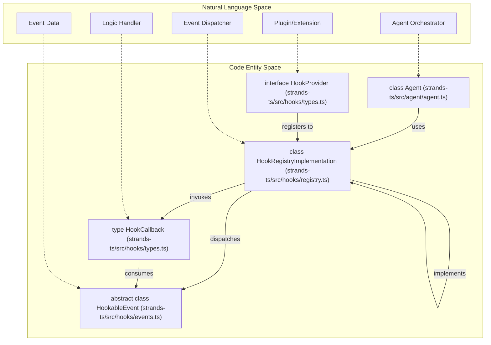
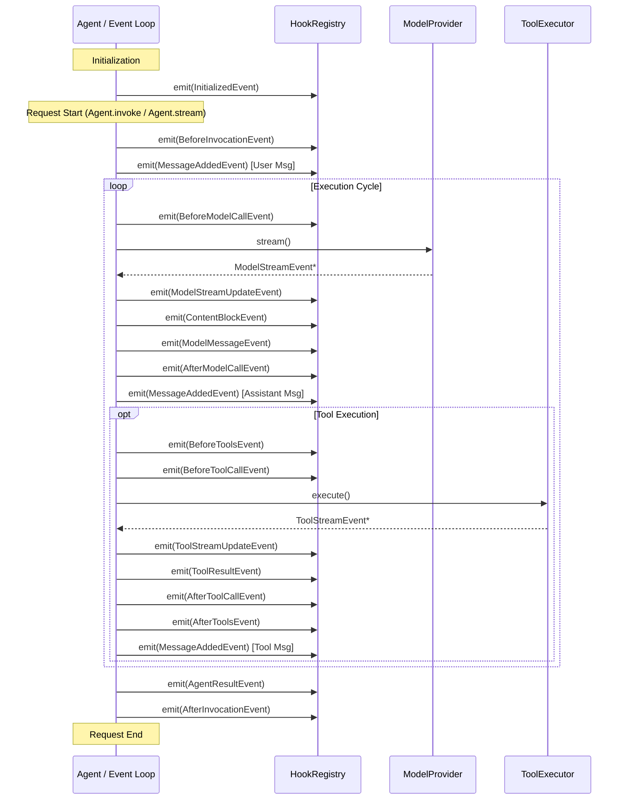
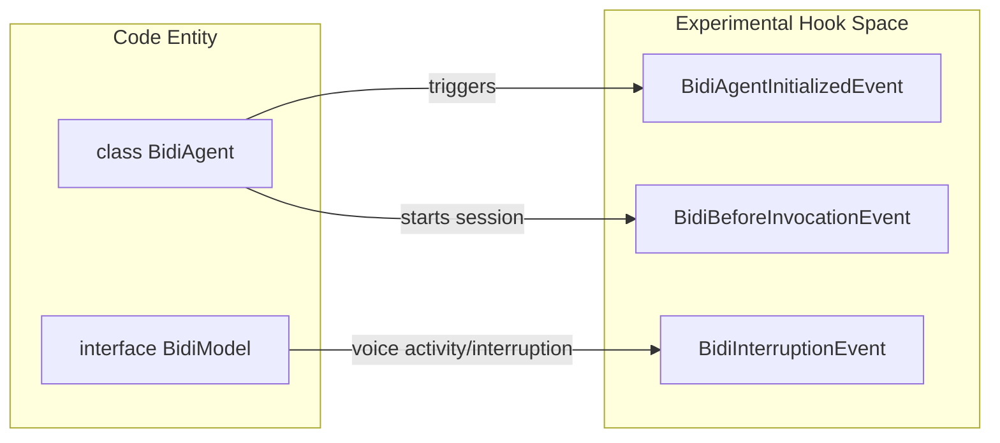

<!-- source: DeepWiki mcp.deepwiki.com · repo strands-agents/sdk-python · page 5.2 Hook System and Events · fetched 2026-10-27 -->

# Hook System and Events

Relevant source files

The following files were used as context for generating this wiki page:

- [site/src/content/docs/user-guide/concepts/agents/hooks.mdx](site/src/content/docs/user-guide/concepts/agents/hooks.mdx)
- [site/src/content/docs/user-guide/concepts/agents/hooks.ts](site/src/content/docs/user-guide/concepts/agents/hooks.ts)
- [site/src/content/docs/user-guide/concepts/interrupts.mdx](site/src/content/docs/user-guide/concepts/interrupts.mdx)
- [site/src/content/docs/user-guide/concepts/tools/custom-tools.mdx](site/src/content/docs/user-guide/concepts/tools/custom-tools.mdx)
- [site/src/content/docs/user-guide/concepts/tools/executors.mdx](site/src/content/docs/user-guide/concepts/tools/executors.mdx)
- [site/src/content/docs/user-guide/concepts/tools/tools.ts](site/src/content/docs/user-guide/concepts/tools/tools.ts)
- [strands-py/docs/HOOKS.md](strands-py/docs/HOOKS.md)
- [strands-py/src/strands/hooks/__init__.py](strands-py/src/strands/hooks/__init__.py)
- [strands-py/src/strands/hooks/events.py](strands-py/src/strands/hooks/events.py)
- [strands-py/tests/fixtures/mock_hook_provider.py](strands-py/tests/fixtures/mock_hook_provider.py)
- [strands-py/tests/strands/agent/hooks/test_events.py](strands-py/tests/strands/agent/hooks/test_events.py)
- [strands-py/tests/strands/agent/test_agent_hooks.py](strands-py/tests/strands/agent/test_agent_hooks.py)
- [strands-ts/src/__fixtures__/tool-helpers.ts](strands-ts/src/__fixtures__/tool-helpers.ts)
- [strands-ts/src/__tests__/interrupt.test.ts](strands-ts/src/__tests__/interrupt.test.ts)
- [strands-ts/src/agent/__tests__/agent.hook.test.ts](strands-ts/src/agent/__tests__/agent.hook.test.ts)
- [strands-ts/src/agent/__tests__/agent.model-retry.test.ts](strands-ts/src/agent/__tests__/agent.model-retry.test.ts)
- [strands-ts/src/agent/__tests__/agent.test.ts](strands-ts/src/agent/__tests__/agent.test.ts)
- [strands-ts/src/agent/agent.ts](strands-ts/src/agent/agent.ts)
- [strands-ts/src/conversation-manager/__tests__/null-conversation-manager.test.ts](strands-ts/src/conversation-manager/__tests__/null-conversation-manager.test.ts)
- [strands-ts/src/hooks/__tests__/events.test.ts](strands-ts/src/hooks/__tests__/events.test.ts)
- [strands-ts/src/hooks/__tests__/registry.test.ts](strands-ts/src/hooks/__tests__/registry.test.ts)
- [strands-ts/src/hooks/events.ts](strands-ts/src/hooks/events.ts)
- [strands-ts/src/hooks/index.ts](strands-ts/src/hooks/index.ts)
- [strands-ts/src/hooks/registry.ts](strands-ts/src/hooks/registry.ts)
- [strands-ts/src/index.ts](strands-ts/src/index.ts)
- [strands-ts/src/multiagent/__tests__/graph.tracer.test.ts](strands-ts/src/multiagent/__tests__/graph.tracer.test.ts)
- [strands-ts/src/multiagent/__tests__/state.test.ts](strands-ts/src/multiagent/__tests__/state.test.ts)
- [strands-ts/src/tools/__tests__/tool.test.ts](strands-ts/src/tools/__tests__/tool.test.ts)
- [strands-ts/src/tools/function-tool.ts](strands-ts/src/tools/function-tool.ts)
- [strands-ts/src/tools/tool.ts](strands-ts/src/tools/tool.ts)
- [strands-ts/src/types/agent.ts](strands-ts/src/types/agent.ts)
- [strands-ts/src/types/messages.ts](strands-ts/src/types/messages.ts)

The Hook System provides a strongly-typed, composable mechanism for extending agent functionality by intercepting and modifying behavior throughout the execution lifecycle. This system replaces legacy callback handlers with a multi-subscriber model, allowing both built-in SDK components and user code to react to or modify agent execution.

## Hook System Architecture

The architecture is based on a central `HookRegistry` that manages the mapping between event types and their associated callback functions. The system supports both individual callback registration and bulk registration via `HookProvider` objects.

### Core Components and Entities

Sources: [strands-ts/src/agent/agent.ts:52](), [strands-ts/src/hooks/registry.ts:1-10](), [strands-ts/src/hooks/types.ts:1-10](), [strands-ts/src/hooks/events.ts:89-98]()

### Data Flow and Registration

1.  **Registration**: A `HookProvider` implements `registerHooks(registry)` to subscribe to specific `HookableEvent` subclasses [strands-ts/src/hooks/registry.ts:10-17]().
2.  **Inference**: The `HookRegistry` can automatically infer the event type from the type hints of a callback function using `inferEventTypes`. This supports single types, lists, and Union types (e.g., `A | B`) [strands-ts/src/hooks/registry.ts:100-115]().
3.  **Invocation**: When an event occurs, the `Agent` calls `registry.invokeCallbacks(event)`. The registry identifies all subscribers for that event type and executes them in order, unless reverse ordering is specified for the event [strands-ts/src/hooks/registry.ts:120-144](), [strands-ts/src/agent/agent.ts:1021-1023]().

## Event Lifecycle and Types

The SDK distinguishes between standard Agent events, Multi-Agent events, and specialized Bidirectional (Bidi) events.

### Execution Event Flow

Sources: [strands-ts/src/agent/__tests__/agent.hook.test.ts:38-156](), [strands-ts/src/agent/__tests__/agent.test.ts:141-173](), [strands-ts/src/hooks/events.ts:1-98]()

### Key Event Categories

| Category | Event Class | Timing |
| :--- | :--- | :--- |
| **Lifecycle** | `InitializedEvent` | After agent construction [strands-ts/src/hooks/events.ts:117-133]() |
| **Invocations** | `BeforeInvocationEvent` | Before `invoke`, `stream`, or `structuredOutput` [strands-ts/src/hooks/events.ts:137-164]() |
| | `AfterInvocationEvent` | After request completion (supports `resume`) [strands-ts/src/hooks/events.ts:171-197]() |
| **Model** | `BeforeModelCallEvent` | Immediately before model inference [strands-ts/src/hooks/events.ts:259-275]() |
| | `AfterModelCallEvent` | After model response or exception [strands-ts/src/hooks/events.ts:280-310]() |
| | `ModelStreamUpdateEvent` | During model streaming, wraps raw `ModelStreamEvent` [strands-ts/src/hooks/events.ts:315-329]() |
| | `ContentBlockEvent` | When a content block is fully received from the model [strands-ts/src/hooks/events.ts:334-348]() |
| | `ModelMessageEvent` | When a full message is received from the model [strands-ts/src/hooks/events.ts:353-367]() |
| **Tools** | `BeforeToolsEvent` | Before executing a batch of tools [strands-ts/src/hooks/events.ts:202-216]() |
| | `AfterToolsEvent` | After all tools in a batch complete execution [strands-ts/src/hooks/events.ts:221-235]() |
| | `BeforeToolCallEvent` | Before individual tool execution (supports `cancel`) [strands-ts/src/hooks/events.ts:372-397]() |
| | `AfterToolCallEvent` | After individual tool execution (supports `retry`) [strands-ts/src/hooks/events.ts:402-427]() |
| | `ToolStreamUpdateEvent` | During tool streaming, wraps raw `ToolStreamEvent` [strands-ts/src/hooks/events.ts:432-446]() |
| | `ToolResultEvent` | When a tool result is fully received [strands-ts/src/hooks/events.ts:451-465]() |
| **Messaging** | `MessageAddedEvent` | Whenever a message is added to history [strands-ts/src/hooks/events.ts:240-254]() |
| **Results** | `AgentResultEvent` | When the final `AgentResult` is available [strands-ts/src/hooks/events.ts:470-484]() |
| **Interrupts** | `InterruptEvent` | When an agent invocation is interrupted [strands-ts/src/hooks/events.ts:489-503]() |

## Event Modification and Steering

Events are not just passive notifications; many allow "steering" the agent by modifying specific writable properties. Events enforce immutability for most fields but allow modification of specific attributes via `_can_write()` (Python) or direct property assignment (TypeScript).

### Writable Properties and Controls

*   **Invocation Cancellation**: Setting `cancel` in `BeforeInvocationEvent` (to `true` or a string message) prevents the invocation from proceeding [strands-ts/src/hooks/events.ts:149-151]().
*   **Tool Redirection**: In `BeforeToolCallEvent`, hooks can modify `toolUse` to change the tool's input or name before it executes [strands-ts/src/hooks/events.ts:385-387]().
*   **Execution Cancellation**: Setting `cancel` in `BeforeToolCallEvent` (to `true` or a string message) prevents the tool from running and returns a cancellation message to the model [strands-ts/src/hooks/events.ts:388-390]().
*   **Autonomous Looping**: In `AfterInvocationEvent`, setting the `resume` property to a new `InvokeArgs` causes the agent to automatically re-invoke itself [strands-ts/src/hooks/events.ts:189-191]().
*   **Tool Retries**: In `AfterToolCallEvent`, setting `retry = true` causes the `ToolExecutor` to discard the result and immediately re-run the tool [strands-ts/src/hooks/events.ts:418-420]().

### Callback Ordering

The system supports standard and reverse ordering based on the `_shouldReverseCallbacks()` method of the event [strands-ts/src/hooks/events.ts:95-97]().
*   **Standard Order**: Callbacks are executed in the order they were registered.
*   **Reverse Order**: For "cleanup" style events, callbacks are executed in reverse registration order (Last-In, First-Out). This applies to `AfterInvocationEvent`, `AfterToolsEvent`, and `AfterToolCallEvent` [strands-ts/src/hooks/events.ts:193-195](), [strands-ts/src/hooks/events.ts:231-233](), [strands-ts/src/hooks/events.ts:423-425]().

## Interrupt Handling

The hook system integrates with the SDK's interrupt mechanism. Events that implement `Interruptible` (like `BeforeToolsEvent`) allow hooks to trigger a `Human-in-the-loop` pause [strands-ts/src/hooks/events.ts:202]().

When a callback calls `event.interrupt(params)`, the registry collects these interrupts. If interrupts are present, the execution loop is halted, and the state is persisted for later resumption [strands-ts/src/hooks/registry.ts:135-144](), [strands-ts/src/__tests__/interrupt.test.ts:10-30]().

## Experimental and Bidi Hooks

For the Bidirectional Streaming Agent (`BidiAgent`), a parallel set of hooks exists in `strands.experimental.hooks` (Python) and `strands-ts/src/experimental/hooks` (TypeScript). These handle real-time concerns like audio interruptions and connection restarts.

Sources: [strands-py/src/strands/experimental/hooks/events.py:44-52](), [strands-py/src/strands/experimental/hooks/events.py:186-193]()

*   **BidiInterruptionEvent**: Triggered when a user speaks over the agent or an error causes interruption [strands-py/src/strands/experimental/hooks/events.py:186-193]().
*   **BidiConnectionRestartEvent**: Triggered when the underlying websocket or stream connection is dropped and re-established [strands-py/src/strands/experimental/hooks/__init__.py:6-15]().

Note: Several experimental aliases (e.g., `BeforeToolInvocationEvent`, `AfterToolInvocationEvent`) have been moved to production as `BeforeToolCallEvent` and `AfterToolCallEvent`. Using the old names will trigger a `DeprecationWarning` [strands-py/src/strands/experimental/hooks/events.py:19-37](), [tests/strands/experimental/hooks/test_hook_aliases.py:33-44]().

Sources: [strands-ts/src/agent/agent.ts:52-89](), [strands-ts/src/types/agent.ts:12-31](), [strands-ts/src/hooks/events.ts:1-503](), [strands-ts/src/hooks/registry.ts:1-144](), [strands-ts/src/hooks/types.ts:1-10](), [strands-ts/src/index.ts:205-235](), [strands-ts/src/agent/__tests__/agent.hook.test.ts:1-28](), [strands-ts/src/agent/__tests__/agent.test.ts:24-31](), [strands-ts/src/hooks/__tests__/events.test.ts:1-490](), [strands-ts/src/hooks/__tests__/registry.test.ts:1-100](), [site/src/content/docs/user-guide/concepts/agents/hooks.mdx:1-213](), [strands-py/src/strands/hooks/events.py:1-280](), [strands-py/src/strands/hooks/registry.py:1-250](), [strands-py/src/strands/experimental/hooks/events.py:40-195](), [strands-py/tests/strands/agent/test_agent_hooks.py:1-225](), [strands-py/tests/strands/hooks/test_registry.py:1-200]()

---

